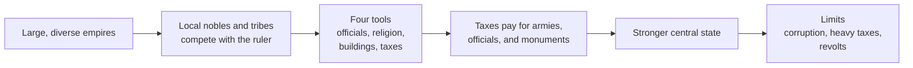

# AP World History: Modern — Topic 3.2 Summary: Empires: Administration (c. 1450–1750)

> Source: Summary of AP_WH_3.2_Notes_EN.md

**Unit 3: Land-Based Empires (c. 1450–1750)**

---

## In One Sentence

Rulers of land-based empires made their rule seem rightful and pulled power to the center with four tools: **loyal officials and soldiers**, **religious ideas**, **monumental buildings**, and **new tax systems**.

## The Big Picture

Growing empires had to rule large, diverse populations spread over huge distances. Local nobles and tribes often competed with the ruler for power. So rulers worked to **legitimize** their rule (make it seem rightful) and to **consolidate** it (pull power to the center). Taxes paid for the armies, officials, and buildings that made the central state stronger. But these tools had limits: they cost a lot and could lead to corruption and revolts.

## Key Points

### 1. Loyal Officials and Soldiers (LO-B)

- Rulers built **bureaucratic elites** (trained officials) and **military professionals** (full-time soldiers) whose loyalty belonged to the ruler, not to local nobles or families.
- **Ottoman devshirme:** Christian boys from the Balkans were taken, converted to Islam, and trained. The best became officials; others became **Janissaries**, elite infantry with guns. With no family power base, they were loyal only to the sultan.
- **Qing civil service exam:** kept from the Ming, it tested the **Confucian classics**, so officials were chosen by merit. Manchu and Han officials were often paired in the same post.
- **Mughal mansabdars** (under Akbar): officials were ranked and given land revenue rights in return for **supplying troops**. The rank was **not hereditary**.
- **Safavid ghulams** were Christian slave soldiers from the Caucasus. **Russia's Table of Ranks** (1722) based promotion on **state service**, not noble birth.

### 2. Religious Ideas (LO-B)

- **Divine right of kings:** European monarchs such as **Louis XIV** said they ruled by God's will. This justified **absolute monarchy** (a king with no limits on his power).
- After taking Egypt in 1517, Ottoman sultans claimed the title **caliph** and protected Mecca and Medina, as leaders of the **Sunni** world.
- The Safavids made **Shi'a Islam** the state religion, which united Persia and set it apart from the Ottomans.
- The Qing used the **Mandate of Heaven** and Confucian rituals, and supported Tibetan Buddhism.
- The **Mexica (Aztecs)** offered war captives in **human sacrifice** to the sun and war god. The **Sapa Inca** (Inca ruler) was seen as a descendant of the sun god Inti.

### 3. Art and Monumental Architecture (LO-B)

- Huge buildings showed a ruler's **wealth, power, and divine favor**.
- **Versailles** (France): Louis XIV moved his court there in 1682 to keep nobles close and **under watch**.
- **Taj Mahal** (Mughal): Shah Jahan built it as a tomb for his wife, a display of Mughal splendor.
- **Isfahan** (Safavid capital from 1598) and the **Süleymaniye Mosque** (Ottoman) showed Persian culture and Islamic leadership.
- **St. Petersburg** (Russia, 1703) was Peter the Great's "window to the West."

### 4. Tax Collection Systems (LO-B)

- **Zamindars** (Mughal): local landholders collected taxes from peasants for the state and **kept a share**.
- **Tax farming** (Ottoman): the state **sold the right** to collect taxes. The buyer paid the state up front, then collected from the people.
- **Tribute** (Mexica): conquered city-states paid goods such as cotton, cacao, and feathers, recorded in **tribute lists**.
- **Mit'a** (Inca): a **labor tax**. People worked on roads, temples, farms, and mines.
- The Qing collected land and head taxes. In 1712 **Kangxi froze the head tax** to win peasant support.

### 5. Absolute Monarchs and the Limits of Power (LO-B)

- **Louis XIV**, the "Sun King," combined divine right, Versailles, and a large standing army.
- **Peter the Great** (r. 1682–1725) pushed **westernization**: he built a navy, founded St. Petersburg, and made nobles wear Western dress and shave their beards.
- Limits: zamindars and tax farmers could keep too much revenue, which led to **corruption**.
- Elite soldiers could turn on the ruler, as in later **Janissary revolts**. Costly wars and monuments meant heavy taxes, and heavy taxes led to **revolts**.

## Must-Know Terms & People

| Term | What it is | Why it matters |
|---|---|---|
| Devshirme | Ottoman system of taking and training Christian boys | Made officials and soldiers loyal only to the sultan |
| Janissaries | Elite Ottoman infantry with guns | Example of military professionals |
| Civil service exam | Qing test on the Confucian classics | Chose officials by merit |
| Mansabdar | Ranked Mughal official who supplied troops | Tied nobles' income to service, not birth |
| Table of Ranks | Peter the Great's 1722 promotion system | Made Russian nobles serve the tsar |
| Divine right of kings | Belief that monarchs rule by God's will | Justified absolute monarchy in Europe |
| Caliph | Title claimed by Ottoman sultans after 1517 | Made the sultan leader of the Sunni world |
| Versailles | Louis XIV's palace | Kept French nobles close and watched |
| Zamindar | Mughal landholder who collected taxes | Mughal revenue came through local elites |
| Tax farming | Selling the right to collect taxes | Ottoman way to raise money up front |
| Tribute | Goods paid by conquered city-states | Funded the Mexica state |
| Mit'a | Inca labor tax | Shows a tax paid in work, not money |

## Key Dates

| Year | Event |
|---|---|
| 1517 | Ottomans take Egypt; the sultan claims the title of caliph |
| 1556 | Akbar's reign begins (mansabdar system) |
| 1598 | Shah Abbas I makes Isfahan the Safavid capital |
| 1632–1653 | Shah Jahan builds the Taj Mahal |
| 1682 | Louis XIV moves his court to Versailles |
| 1703 | Peter the Great founds St. Petersburg |
| 1712 | Kangxi freezes the head tax |
| 1722 | Peter's Table of Ranks |

## How the Exam Asks About It

- **Legitimacy & consolidation:** Rulers legitimized power with religion (divine right, caliph, Mandate of Heaven) and great buildings, and consolidated it with loyal officials, professional soldiers, and new tax systems.
- **Continuity, innovation, diversity:** Continuity: the Qing kept the Ming civil service exam. Innovation: Russia's Table of Ranks based promotion on service, not birth. Diversity: some empires taxed money or goods (zamindars, tax farming, tribute), while the Inca taxed labor (mit'a).
- **Likely comparison:** Ottoman devshirme vs. Qing civil service exam. Both produced officials loyal to the ruler. But the devshirme took outsiders (Christian boys) and converted them, while the exam picked officials by merit on the Confucian classics.
- **Common trap:** Students think **tax farming** is a tax on farms. The fix: the state **sold the right to collect taxes** to individuals, who paid up front and then collected from the people.

## Check Yourself

1. What was the devshirme, and why were its recruits loyal to the sultan?

▶ Answer
Christian boys from the Balkans were taken, converted to Islam, and trained as officials or Janissaries. They had no family power base, so they were loyal only to the sultan.

2. Give two examples of rulers using religion to legitimize their rule.

▶ Answer
Louis XIV claimed divine right, saying he ruled by God's will. Ottoman sultans claimed the title caliph after taking Egypt in 1517.

3. How was the Inca mit'a different from Mexica tribute?

▶ Answer
The mit'a was a labor tax: people worked on roads, temples, farms, and mines. Mexica tribute was paid in goods, such as cotton, cacao, and feathers.

