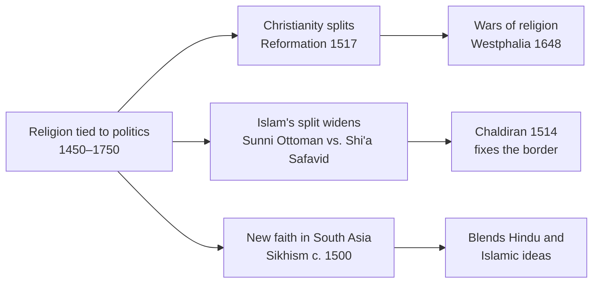

# AP World History: Modern — Topic 3.3 Summary: Empires and Belief Systems (c. 1450–1750)

> Source: Summary of AP_WH_3.3_Notes_EN.md

**Unit 3: Land-Based Empires (c. 1450–1750)**

---

## In One Sentence

Christianity split into Catholic and Protestant churches, Islam's Sunni–Shi'a divide grew deeper because of the Ottoman–Safavid rivalry, and Sikhism grew out of Hindu–Islamic contact, and in each case rulers used religion to build their power.

## The Big Picture

Two big religions split further in this period, and a new faith appeared. In Europe, Martin Luther's protest in 1517 started the **Protestant Reformation**, and the Catholic Church answered with its own reforms. In the Islamic world, the **Sunni** Ottomans and the **Shi'a** Safavids turned a religious split into a political rivalry. In South Asia, **Sikhism** mixed Hindu and Islamic ideas. Religion and politics were tightly linked: rulers used religious divisions to strengthen their own power.

## Key Points

### 1. The Protestant Reformation (LO-C)

- Causes: **Church corruption**, such as selling **indulgences** (payments said to reduce punishment for sins); the **printing press**, which spread new ideas and Bibles fast; and rulers who wanted the Church's land and wealth.
- **Martin Luther** (1517) attacked indulgences in his **95 Theses**. He taught salvation by **faith alone** and that the **Bible alone** is the authority.
- **John Calvin** (Geneva) taught **predestination**: God has already chosen who is saved.
- **Henry VIII** broke with the Pope to end his marriage. In 1534 he made the king head of the **Church of England**.

### 2. Catholic Reformation and Wars of Religion (LO-C)

- The **Council of Trent** (1545–1563) restated Catholic teachings and fixed some abuses.
- The **Jesuits** (1540) spread Catholicism through schools and **missions in Asia and the Americas**, so Christianity grew.
- Religious wars ended in deals: the **Peace of Augsburg** (1555) let each prince in the Holy Roman Empire choose Lutheran or Catholic, and the **Edict of Nantes** (1598) gave French Protestants limited tolerance.
- The **Peace of Westphalia** (1648) ended the Thirty Years' War. Rulers decided religion in their states, and the Catholic–Protestant split became **permanent**.

### 3. Islam: Sunni Ottomans vs. Shi'a Safavids (LO-C)

- The **Ottomans were Sunni**; the **Safavids were Shi'a**. The Ottoman sultan claimed to be **caliph** (leader of the Muslim world).
- In 1501 **Ismail** made **Shi'a Islam** the state religion of Persia, often forcing it on a mostly Sunni population.
- At the **Battle of Chaldiran** (1514) the Ottomans won, which fixed the border between Sunni and Shi'a lands.
- The religious split became a **political rivalry**: wars, silk trade embargoes, and competing claims to lead the Muslim world.

### 4. South Asia: Sikhism and Mughal Policy (LO-C)

- **Guru Nanak** founded **Sikhism** in **Punjab**, northern India, around 1500. It is **syncretic**: it mixes parts of **Hinduism and Islam**.
- Sikhs believe in **one God**, **reject the caste system**, and keep the Hindu ideas of karma and reincarnation.
- The Mughal emperor **Akbar** (r. 1556–1605) was **tolerant**. He abolished the **jizya** (a tax on non-Muslims) in 1564 and held debates among faiths. Hindus supported him.
- **Aurangzeb** (r. 1658–1707) followed **strict Sunni** rule. He restored the jizya in 1679 and executed the Sikh guru Tegh Bahadur.
- Hindus and Sikhs revolted. The Sikhs armed themselves as the **Khalsa** (1699), and the empire grew weaker.

## Must-Know Terms & People

| Term | What it is | Why it matters |
|---|---|---|
| Protestant Reformation | Break from the Catholic Church that began with Luther in 1517 | Split Western Christianity for good |
| Indulgences | Payments said to reduce punishment for sins | Their sale sparked Luther's protest |
| Predestination | Calvin's idea that God already chose who is saved | A key Protestant belief |
| Jesuits | Catholic order approved in 1540 | Spread Catholicism through missions worldwide |
| Peace of Westphalia | 1648 treaty that ended the Thirty Years' War | Rulers chose their states' religion; split became permanent |
| Sunni / Shi'a | The two main branches of Islam | Ottomans were Sunni, Safavids were Shi'a |
| Battle of Chaldiran | 1514 Ottoman victory over the Safavids | Fixed the Sunni–Shi'a border |
| Sikhism | One-God faith founded by Guru Nanak in Punjab | Example of syncretism from Hindu–Islamic contact |

## Key Dates

| Year | Event |
|---|---|
| c. 1500 | Guru Nanak begins teaching Sikhism in Punjab |
| 1501 | Safavids make Shi'a Islam the state religion |
| 1514 | Battle of Chaldiran: Sunni Ottomans defeat Shi'a Safavids |
| 1517 | Martin Luther posts the 95 Theses |
| 1564 | Akbar abolishes the jizya |
| 1648 | Peace of Westphalia ends the Thirty Years' War |
| 1679 | Aurangzeb restores the jizya |

## How the Exam Asks About It

- **Legitimacy & consolidation:** Rulers used religion to hold power: the Ottoman sultan claimed to be caliph, Ismail made Shi'a Islam the state religion, Henry VIII made the king head of the Church of England, and after Westphalia rulers chose their states' religion.
- **Continuity, innovation, diversity:** Continuity: rulers still used religion to justify rule and taxed religious minorities (jizya). Innovation: Protestant ideas like "faith alone," spread by the printing press. Diversity: Sikhism blended Hindu and Islamic ideas.
- **Likely comparison:** Akbar vs. Aurangzeb. Both were Mughal emperors whose religious policy shaped their rule. But Akbar was tolerant and ended the jizya, which won Hindu support, while Aurangzeb was strictly Sunni and restored it, which led to revolts.
- **Common trap:** Students say the Reformation only weakened Christianity. The fix: it broke with old traditions, but both the Protestant and Catholic reformations helped Christianity **grow**, for example through Jesuit missions.

## Check Yourself

1. What did Martin Luther attack in his 95 Theses, and what were his two main ideas?

▶ Answer
He attacked the sale of indulgences. He taught that people are saved by faith alone and that the Bible alone is the authority.

2. How did the Ottoman–Safavid rivalry deepen the Sunni–Shi'a split?

▶ Answer
The Safavids made Shi'a Islam their state religion in 1501, while the Ottomans were Sunni. They fought wars, such as Chaldiran in 1514, and competed to lead the Muslim world, so the religious split became a political one.

3. Why is Sikhism called a syncretic faith?

▶ Answer
It mixes Hinduism and Islam. It believes in one God and rejects the caste system, but keeps the Hindu ideas of karma and reincarnation.

