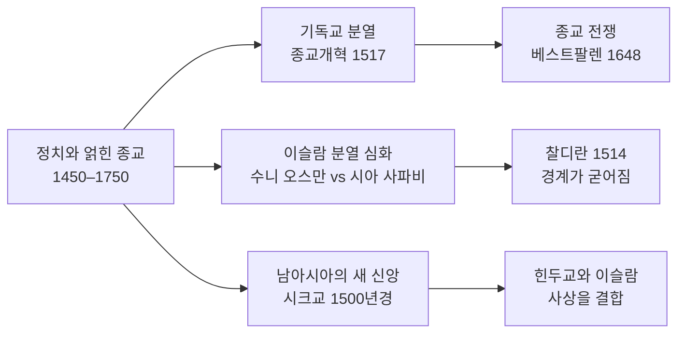

# AP 세계사: 모던 — 토픽 3.3 요약: 제국과 신앙 체계 (Empires: Belief Systems)

> 출처: AP_WH_3.3_Notes_KR.md 요약

**Unit 3: 육상 제국 (Land-Based Empires, c. 1450–1750)**

---

## 한 문장 요약

기독교는 가톨릭과 개신교로 갈라졌고, 이슬람의 수니·시아 분열은 오스만·사파비의 경쟁 때문에 깊어졌으며, 시크교는 힌두교와 이슬람의 만남 속에서 생겨났고, 어느 경우든 통치자들은 종교를 이용해 권력을 키웠다.

## 큰 그림

이 시기에 큰 종교 두 개가 더 갈라졌고, 새로운 신앙이 나타났다. 유럽에서는 1517년 마르틴 루터 (Martin Luther)의 항의가 **종교개혁** (Protestant Reformation)을 일으켰고, 가톨릭 교회는 스스로 개혁하며 맞섰다. 이슬람 세계에서는 **수니파 (Sunni)** 오스만과 **시아파 (Shi'a)** 사파비가 종교 분열을 정치적 경쟁으로 바꾸었다. 남아시아에서는 **시크교** (Sikhism)가 힌두교와 이슬람의 사상을 섞었다. 종교와 정치는 밀접하게 얽혀 있었고, 통치자들은 종교 분열을 이용해 자기 권력을 키웠다.

## 핵심 정리

### 1. 종교개혁 (Protestant Reformation) (LO-C)

- 원인은 **면벌부 (Indulgences)**(죄에 대한 벌을 줄여 준다며 받은 돈) 판매 같은 **교회의 부패**, 새 사상과 성경을 빠르게 퍼뜨린 **인쇄술 (Printing press)**, 교회의 토지와 재산을 원한 군주들이었다.
- **마르틴 루터** (Martin Luther)는 1517년 **95개조 반박문** (95 Theses)으로 면벌부를 비판했다. 그는 **오직 믿음**으로 구원받고 **오직 성경**만이 권위라고 가르쳤다.
- **장 칼뱅** (John Calvin)은 제네바 (Geneva)에서 **예정설** (Predestination)을 가르쳤다. 신이 구원받을 사람을 이미 정해 두었다는 생각이다.
- **헨리 8세** (Henry VIII)는 혼인을 끝내려고 교황과 결별했다. 1534년 그는 왕을 **영국 국교회** (Church of England)의 수장으로 삼았다.

### 2. 가톨릭 개혁과 종교 전쟁 (LO-C)

- **트리엔트 공의회** (Council of Trent, 1545–1563)는 가톨릭 교리를 재확인하고 일부 폐단을 고쳤다.
- **예수회** (Jesuits, 1540)는 교육과 **아시아·아메리카 선교**로 가톨릭을 퍼뜨렸고, 그 결과 기독교가 성장했다.
- 종교 전쟁은 합의로 끝났다. **아우크스부르크 화의** (Peace of Augsburg, 1555)는 신성로마제국 (Holy Roman Empire)의 각 제후가 루터파나 가톨릭을 고르게 했고, **낭트 칙령** (Edict of Nantes, 1598)은 프랑스 개신교도에게 제한적 관용을 주었다.
- **베스트팔렌 조약** (Peace of Westphalia, 1648)은 30년 전쟁 (Thirty Years' War)을 끝냈다. 통치자가 자국의 종교를 정했고, 가톨릭·개신교 분열은 **영구적**으로 굳어졌다.

### 3. 이슬람: 수니파 오스만 vs 시아파 사파비 (LO-C)

- **오스만은 수니파**, **사파비는 시아파**였다. 오스만 술탄은 **칼리프 (Caliph)**(이슬람 세계의 지도자)를 자처했다.
- 1501년 **이스마일** (Ismail)은 **시아파 이슬람**을 페르시아의 국교로 삼았고, 수니파가 많던 주민에게 강제로 따르게 하는 경우가 많았다.
- **찰디란 전투** (Battle of Chaldiran, 1514)에서 오스만이 이겨 수니 지역과 시아 지역의 경계가 굳어졌다.
- 종교 분열은 **정치적 경쟁**이 되었다. 전쟁, 비단 교역 금수 조치, 이슬람 세계 지도권 다툼이 이어졌다.

### 4. 남아시아: 시크교와 무굴의 종교 정책 (LO-C)

- **구루 나나크** (Guru Nanak)는 1500년경 북인도 **펀자브** (Punjab)에서 **시크교**를 창시했다. 시크교는 **혼합주의 (Syncretism)** 신앙으로, **힌두교와 이슬람**의 요소를 섞었다.
- 시크교도는 **유일신**을 믿고 **카스트 제도를 거부**하며, 힌두교의 업 (Karma)과 윤회 개념은 유지한다.
- 무굴 황제 **악바르** (Akbar, r. 1556–1605)는 **관용**적이었다. 1564년 **지즈야 (Jizya)**(비무슬림에게 걷는 세금)를 폐지하고 여러 종교 간 토론을 열었다. 힌두교도가 그를 지지했다.
- **아우랑제브** (Aurangzeb, r. 1658–1707)는 **엄격한 수니** 통치를 했다. 1679년 지즈야를 부활시키고 시크교 구루 테그 바하두르 (Tegh Bahadur)를 처형했다.
- 힌두교도와 시크교도가 반란을 일으켰다. 시크교도는 **칼사** (Khalsa, 1699)로 무장했고, 제국은 약해졌다.

## 꼭 알아야 할 용어·인물

| 용어 | 무엇인가 | 왜 중요한가 |
|---|---|---|
| 종교개혁 (Protestant Reformation) | 1517년 루터에서 시작된 가톨릭 교회와의 결별 | 서방 기독교를 완전히 갈라놓음 |
| 면벌부 (Indulgences) | 죄에 대한 벌을 줄여 준다며 받은 돈 | 그 판매가 루터의 항의를 불러옴 |
| 예정설 (Predestination) | 신이 구원받을 사람을 이미 정했다는 칼뱅의 생각 | 개신교의 핵심 믿음 |
| 예수회 (Jesuits) | 1540년 승인된 가톨릭 수도회 | 선교로 가톨릭을 전 세계에 퍼뜨림 |
| 베스트팔렌 조약 (Peace of Westphalia) | 30년 전쟁을 끝낸 1648년 조약 | 통치자가 자국 종교를 정함. 분열이 영구화됨 |
| 수니파 / 시아파 (Sunni / Shi'a) | 이슬람의 두 주요 갈래 | 오스만은 수니파, 사파비는 시아파 |
| 찰디란 전투 (Battle of Chaldiran) | 1514년 오스만이 사파비에 거둔 승리 | 수니·시아 경계를 굳힘 |
| 시크교 (Sikhism) | 구루 나나크가 펀자브에서 창시한 유일신 신앙 | 힌두교·이슬람 교류에서 나온 혼합주의의 예 |

## 주요 연도

| 연도 | 사건 |
|---|---|
| 1500년경 | 구루 나나크, 펀자브에서 시크교 가르침 시작 |
| 1501 | 사파비, 시아파 이슬람을 국교로 삼음 |
| 1514 | 찰디란 전투: 수니 오스만이 시아 사파비에 승리 |
| 1517 | 마르틴 루터, 95개조 반박문 게시 |
| 1564 | 악바르, 지즈야 폐지 |
| 1648 | 베스트팔렌 조약, 30년 전쟁 종결 |
| 1679 | 아우랑제브, 지즈야 부활 |

## 시험에서는 이렇게 묻는다

- **정당화와 공고화:** 통치자들은 종교로 권력을 지켰다. 오스만 술탄은 칼리프를 자처했고, 이스마일은 시아파 이슬람을 국교로 삼았으며, 헨리 8세는 왕을 영국 국교회의 수장으로 만들었고, 베스트팔렌 이후에는 통치자가 자국의 종교를 정했다.
- **연속성·혁신·다양성:** 연속성은 통치자가 여전히 종교로 통치를 정당화하고 종교적 소수에게 세금(지즈야)을 걷은 것이다. 혁신은 인쇄술로 퍼진 "오직 믿음" 같은 개신교 사상이다. 다양성은 힌두교와 이슬람 사상을 섞은 시크교이다.
- **자주 나오는 비교:** 악바르와 아우랑제브. 두 사람 모두 종교 정책이 통치를 좌우한 무굴 황제였다. 그러나 악바르는 관용적이어서 지즈야를 없애 힌두교도의 지지를 얻었고, 아우랑제브는 엄격한 수니파여서 지즈야를 되살려 반란을 불렀다.
- **자주 하는 실수:** 종교개혁이 기독교를 약하게만 만들었다고 쓰는 것이다. 바로잡기: 종교개혁은 옛 전통과 단절했지만, 개신교 종교개혁과 가톨릭 개혁은 모두 예수회 선교 등을 통해 기독교의 **성장**에 기여했다.

## 스스로 확인하기

1. 마르틴 루터는 95개조 반박문에서 무엇을 비판했고, 그의 두 가지 핵심 사상은 무엇인가?

▶ 정답
그는 면벌부 판매를 비판했다. 사람은 오직 믿음으로 구원받고, 오직 성경만이 권위라고 가르쳤다.

2. 오스만·사파비의 경쟁은 수니·시아 분열을 어떻게 깊게 했는가?

▶ 정답
사파비는 1501년 시아파 이슬람을 국교로 삼았고, 오스만은 수니파였다. 두 나라는 1514년 찰디란 전투 같은 전쟁을 벌이고 이슬람 세계의 지도권을 다투었으므로, 종교 분열이 정치 분열이 되었다.

3. 시크교를 왜 혼합주의 신앙이라고 하는가?

▶ 정답
힌두교와 이슬람을 섞었기 때문이다. 유일신을 믿고 카스트 제도를 거부하지만, 힌두교의 업과 윤회 개념은 유지한다.

