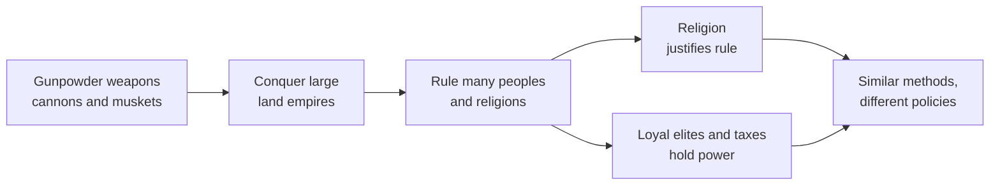

# AP World History: Modern — Topic 3.4 Summary: Comparing Land-Based Empires (c. 1450–1750)

> Source: Summary of AP_WH_3.4_Notes_EN.md

**Unit 3: Land-Based Empires (c. 1450–1750)**

---

## In One Sentence

The Ottoman, Safavid, Mughal, Qing, and Russian empires all used gunpowder, religion, loyal elites, taxes, and grand buildings to gain and keep power, but they differed in how they treated the many peoples and religions they ruled.

## The Big Picture

This topic brings Topics 3.1–3.3 together. Land-based empires (empires whose power came from armies and control of land) grew large with **gunpowder weapons**. Then they had to rule many peoples and religions. They used similar tools: **religion** to justify rule, **loyal elites** to weaken rival nobles, and **taxes** to pay for armies. On the exam you must **compare**: name a similarity or difference, then **explain why**.

## Key Points

### 1. Similarity: Gunpowder and Expansion (LO-D)

- All these empires used **gunpowder weapons** to conquer and defend land.
- The Ottomans used **cannons at Constantinople** (1453). **Babur** used guns at **Panipat** (1526) to found the Mughal Empire.
- The Safavids adopted gunpowder after the Battle of **Chaldiran** (1514). Russia used firearms to expand into **Siberia**, and the Qing used them in frontier wars.

### 2. Similarity: Religion and Monuments (LO-D)

- Every empire used **religion to legitimize** (justify) its rule.
- Ottoman sultans were **Sunni** and claimed to be **caliph**; the Safavids made **Shi'a Islam** the state religion; the Qing used the **Mandate of Heaven** and Confucianism; Russian tsars claimed **divine right** through Orthodox Christianity.
- **Monumental architecture** showed wealth and power: the **Süleymaniye Mosque** (Ottoman), **Isfahan** (Safavid), the **Taj Mahal** (Mughal), and **St. Petersburg** (Russia).

### 3. Similarity: Loyal Elites and Taxes (LO-D)

- Rulers built **loyal elites** to weaken rival nobles: the Ottoman **devshirme** and **Janissaries**, Safavid **ghulams**, Mughal **mansabdars**, the Qing **civil service exam** and **Manchu banners**, and Russia's **Table of Ranks**.
- **Taxes** paid for armies and officials: Ottoman **tax farming**, Mughal **zamindars**, Qing land and head taxes, and Russian taxes on serfs.
- Later, **heavy taxes** caused revolts.

### 4. Difference: Religious Policy Toward Subjects (LO-D)

- **Ottoman millet system:** Christian and Jewish communities ran their own religious and legal affairs and paid the **jizya** (a tax on non-Muslims).
- **Safavid:** pushed **Shi'a conversion** across Persia, a stricter policy.
- **Mughal:** policy changed with each ruler. **Akbar** was tolerant, while **Aurangzeb** was strict and restored the jizya.

### 5. Difference: Outsider Rulers and the Majority (LO-D)

- **Qing:** the **Manchus** ruled a **Han Chinese majority**. They kept their identity (the **queue** hairstyle was required of Han men) but **adopted Chinese government and Confucianism**.
- **Mughal:** a **Muslim minority** ruled a **Hindu majority**. Akbar married **Rajput** princesses and gave Hindus high posts.
- **Ottoman:** used Christian-born officials (devshirme) and the millet system to rule Christian subjects.

### 6. Other Differences: The West and the Sea (LO-D)

- **Russia** **westernized** (copied Western ways) under **Peter the Great** and grew stronger.
- **Land-based empires** got power from armies, land taxes, and control of territory. **Maritime empires** (Unit 4: Portugal, Spain, Britain) got power from navies and overseas trade.

## Must-Know Terms & People

| Term | What it is | Why it matters |
|---|---|---|
| Land-based empire | Empire whose power came from armies, land taxes, and territory | The type of empire this unit compares |
| Maritime empire | Empire whose power came from navies and overseas trade | Contrast with land-based empires in Unit 4 |
| Devshirme / Janissaries | Ottoman system of taking Christian boys to serve as soldiers and officials | Loyal elite with no family ties |
| Civil service exam | Test to choose officials by merit | Qing won over the Han elite |
| Table of Ranks | Russian system for ranking officials | Built Russia's loyal elite |
| Millet system | Ottoman self-rule for religious communities | Example of religious tolerance |
| Queue | Manchu hairstyle required of Han men | Qing kept a separate Manchu identity |
| Westernization | Copying Western ways, as under Peter the Great | Made Russia stronger |

## Key Dates

| Year | Event |
|---|---|
| 1453 | Ottoman cannons take Constantinople |
| 1501 | Safavid Empire begins |
| 1514 | Battle of Chaldiran; Safavids then adopt gunpowder |
| 1526 | Babur's guns win at Panipat; Mughal Empire begins |
| 1547 | Rule of the tsars begins in Russia |
| 1644 | Qing Dynasty replaces the Ming |

## How the Exam Asks About It

- **Legitimacy & consolidation:** Rulers justified power with religion (caliph, Shi'a state religion, Mandate of Heaven, divine right) and monuments, and kept it with loyal elites and taxes.
- **Continuity, innovation, diversity:** Continuity: the Qing kept Chinese government and Confucianism. Innovation: gunpowder weapons, such as Babur's guns at Panipat. Diversity: the Ottoman millet system let Christian and Jewish communities run their own affairs.
- **Likely comparison:** Ottoman devshirme vs. Qing civil service exam. Both built officials loyal to the ruler and weakened powerful nobles. But the Ottomans relied on outsiders (Christian boys with no family ties), while the Qing won over the local Han elite.
- **Common trap:** Students list a similarity but don't explain it. The fix: use **Claim → Evidence → Reasoning**. Make a claim, give a specific term and date, then say "because…" to explain why it worked.

## Check Yourself

1. Name two methods that most land-based empires shared, with one example of each.

▶ Answer
They used religion to justify rule, such as the Qing Mandate of Heaven. They also built loyal elites, such as the Ottoman devshirme or Russia's Table of Ranks.

2. How did the Manchu Qing rule a Han Chinese majority?

▶ Answer
The Manchus kept their own identity, for example by making Han men wear the queue and keeping Manchu banners. But they adopted Chinese government and Confucianism and chose officials through the civil service exam.

3. How did Ottoman and Safavid religious policy toward subjects differ?

▶ Answer
The Ottoman millet system let Christian and Jewish communities run their own religious and legal affairs if they paid the jizya. The Safavids instead pushed Shi'a conversion across Persia.

