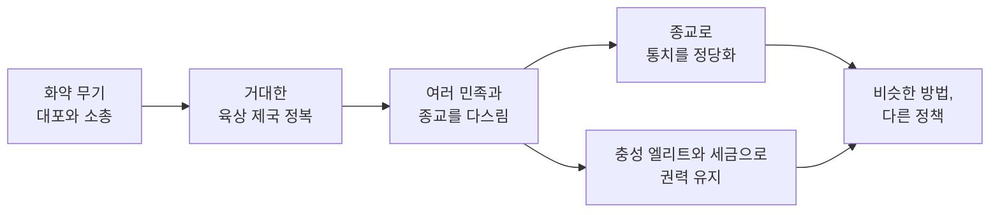

# AP 세계사: 모던 — 토픽 3.4 요약: 육상 제국 비교 (Comparison in Land-Based Empires)

> 출처: AP_WH_3.4_Notes_KR.md 요약

**Unit 3: 육상 제국 (Land-Based Empires, c. 1450–1750)**

---

## 한 문장 요약

오스만, 사파비, 무굴, 청, 러시아 제국은 모두 화약, 종교, 충성스러운 엘리트, 세금, 웅장한 건축으로 권력을 얻고 지켰지만, 자신이 다스린 여러 민족과 종교를 대하는 방식은 서로 달랐다.

## 큰 그림

이 토픽은 토픽 3.1–3.3을 하나로 묶는다. 육상 제국 (Land-based empires)은 군대와 영토 장악에서 힘을 얻은 제국으로, **화약 무기** (Gunpowder weapons)로 크게 팽창했다. 그다음에는 여러 민족과 종교를 다스려야 했다. 제국들은 비슷한 도구를 썼다. **종교**로 통치를 정당화했고, **충성스러운 엘리트**로 경쟁 귀족을 약화시켰으며, **세금**으로 군대를 유지했다. 시험에서는 **비교**해야 한다. 공통점이나 차이점을 말한 뒤 **왜 그런지 설명**해야 한다.

## 핵심 정리

### 1. 공통점: 화약과 팽창 (LO-D)

- 이 제국들은 모두 **화약 무기**로 영토를 정복하고 지켰다.
- 오스만은 **콘스탄티노플** (Constantinople)에서 **대포**를 썼다(1453). **바부르** (Babur)는 **파니파트** (Panipat)에서 총포를 써서(1526) 무굴 제국 (Mughal Empire)을 세웠다.
- 사파비는 **찰디란 (Chaldiran)** 전투(1514) 이후 화약 무기를 도입했다. 러시아는 화기로 **시베리아** (Siberia)로 팽창했고, 청은 변경 전쟁에서 화기를 썼다.

### 2. 공통점: 종교와 기념비 건축 (LO-D)

- 모든 제국이 **종교로 통치를 정당화** (Legitimize)했다.
- 오스만 술탄은 **수니파** (Sunni)로서 **칼리프** (Caliph)를 자처했다. 사파비는 **시아파 이슬람** (Shi'a Islam)을 국교로 삼았다. 청은 **천명** (Mandate of Heaven)과 유교를 내세웠다. 러시아 차르는 동방정교를 바탕으로 **왕권신수설** (Divine right)을 주장했다.
- **기념비적 건축** (Monumental architecture)은 부와 권력을 보여 주었다. **쉴레이마니예 모스크 (Süleymaniye Mosque)**(오스만), **이스파한 (Isfahan)**(사파비), **타지마할 (Taj Mahal)**(무굴), **상트페테르부르크 (St. Petersburg)**(러시아)가 그 예이다.

### 3. 공통점: 충성 엘리트와 세금 (LO-D)

- 통치자들은 **충성스러운 엘리트**를 길러 경쟁 귀족을 약화시켰다. 오스만의 **데브시르메** (Devshirme)와 **예니체리 (Janissaries)**, 사파비의 **굴람 (Ghulams)**, 무굴의 **만사브다르 (Mansabdars)**, 청의 **과거제** (Civil service exam)와 **만주 팔기 (Manchu banners)**, 러시아의 **관등표** (Table of Ranks)가 그 예이다.
- **세금**으로 군대와 관료를 유지했다. 오스만의 **징세 청부 (Tax farming)**, 무굴의 **자민다르 (Zamindars)**, 청의 토지세와 인두세, 러시아의 농노에게 걷는 세금이 있었다.
- 나중에는 **무거운 세금**이 반란을 불렀다.

### 4. 차이점: 백성에 대한 종교 정책 (LO-D)

- **오스만 밀레트 제도 (Millet system):** 기독교·유대교 공동체가 **지즈야 (Jizya)**(비무슬림에게 걷는 세금)를 내고 종교·법률 문제를 스스로 처리했다.
- **사파비:** 페르시아 전역에 **시아파 개종**을 밀어붙였다. 더 엄격한 정책이었다.
- **무굴:** 통치자마다 정책이 달라졌다. **악바르** (Akbar)는 관용적이었고, **아우랑제브** (Aurangzeb)는 엄격해서 지즈야를 부활시켰다.

### 5. 차이점: 소수 출신 지배층과 다수 주민 (LO-D)

- **청:** **만주족** (Manchus)이 **한족 (Han) 다수**를 다스렸다. 만주족은 고유 정체성을 지켰지만(한족 남성에게 **변발** (Queue)을 강요함), **중국식 정부와 유교를 받아들였다**.
- **무굴:** **무슬림 소수**가 **힌두교도 다수**를 다스렸다. 악바르는 **라지푸트 (Rajput)** 공주와 혼인하고 힌두교도를 고위직에 임명했다.
- **오스만:** 기독교도 출신 관료(데브시르메)와 밀레트 제도로 기독교도 백성을 다스렸다.

### 6. 그 밖의 차이점: 서양과 바다 (LO-D)

- **러시아**는 **표트르 대제 (Peter the Great)** 때 **서구화 (Westernization)**(서양의 방식을 본뜸)를 추진해 강해졌다.
- **육상 제국**은 군대, 토지세, 영토 장악으로 권력을 얻었다. **해양 제국 (Maritime empires)**(Unit 4: 포르투갈, 스페인, 영국)은 해군과 해외 교역으로 권력을 얻었다.

## 꼭 알아야 할 용어·인물

| 용어 | 무엇인가 | 왜 중요한가 |
|---|---|---|
| 육상 제국 (Land-based empire) | 군대, 토지세, 영토에서 힘을 얻은 제국 | 이 단원에서 비교하는 제국의 유형 |
| 해양 제국 (Maritime empire) | 해군과 해외 교역에서 힘을 얻은 제국 | Unit 4에서 육상 제국과 대비됨 |
| 데브시르메 / 예니체리 (Devshirme / Janissaries) | 기독교도 소년을 데려와 군인과 관료로 쓴 오스만의 제도 | 가족 기반이 없는 충성 엘리트 |
| 과거제 (Civil service exam) | 능력으로 관리를 뽑는 시험 | 청이 한족 엘리트를 끌어들임 |
| 관등표 (Table of Ranks) | 관리의 등급을 정한 러시아의 제도 | 러시아의 충성 엘리트를 만듦 |
| 밀레트 제도 (Millet system) | 종교 공동체의 자치를 허용한 오스만의 제도 | 종교적 관용의 예 |
| 변발 (Queue) | 한족 남성에게 강요된 만주족의 머리 모양 | 청이 만주족의 정체성을 따로 지킴 |
| 서구화 (Westernization) | 표트르 대제 때처럼 서양의 방식을 본뜨는 것 | 러시아를 강하게 만듦 |

## 주요 연도

| 연도 | 사건 |
|---|---|
| 1453 | 오스만의 대포가 콘스탄티노플을 점령함 |
| 1501 | 사파비 제국 시작 |
| 1514 | 찰디란 전투. 이후 사파비가 화약 무기를 도입함 |
| 1526 | 바부르의 총포가 파니파트에서 승리함. 무굴 제국 시작 |
| 1547 | 러시아에서 차르의 통치 시작 |
| 1644 | 청나라가 명나라를 대신함 |

## 시험에서는 이렇게 묻는다

- **정당화와 공고화:** 통치자들은 종교(칼리프, 시아파 국교, 천명, 왕권신수설)와 기념비 건축으로 권력을 정당화했고, 충성 엘리트와 세금으로 권력을 지켰다.
- **연속성·혁신·다양성:** 연속성은 청이 중국식 정부와 유교를 이어 간 것이다. 혁신은 파니파트에서 쓰인 바부르의 총포 같은 화약 무기이다. 다양성은 기독교·유대교 공동체가 스스로 일을 처리하게 한 오스만 밀레트 제도이다.
- **자주 나오는 비교:** 오스만의 데브시르메와 청의 과거제. 두 제도 모두 통치자에게 충성하는 관리를 길러 강한 귀족을 약화시켰다. 그러나 오스만은 외부인(가족 기반이 없는 기독교도 소년)에게 의존했고, 청은 현지 한족 엘리트를 끌어들였다.
- **자주 하는 실수:** 공통점을 나열만 하고 설명하지 않는 것이다. 바로잡기: **주장 → 근거 → 설명** (Claim → Evidence → Reasoning)을 쓴다. 주장을 하고, 구체적인 용어와 연도를 근거로 들고, "왜냐하면…"으로 효과가 있었던 이유를 설명한다.

## 스스로 확인하기

1. 대부분의 육상 제국이 공유한 방법 두 가지를 예와 함께 쓰라.

▶ 정답
종교로 통치를 정당화했다. 청의 천명이 그 예이다. 또 충성 엘리트를 길렀다. 오스만의 데브시르메나 러시아의 관등표가 그 예이다.

2. 만주족의 청은 한족 다수를 어떻게 다스렸는가?

▶ 정답
만주족은 한족 남성에게 변발을 강요하고 만주 팔기를 유지하는 등 고유 정체성을 지켰다. 그러나 중국식 정부와 유교를 받아들이고 과거제로 관리를 뽑았다.

3. 오스만과 사파비의 백성에 대한 종교 정책은 어떻게 달랐는가?

▶ 정답
오스만 밀레트 제도는 기독교·유대교 공동체가 지즈야를 내면 종교·법률 문제를 스스로 처리하게 했다. 반면 사파비는 페르시아 전역에 시아파 개종을 밀어붙였다.

