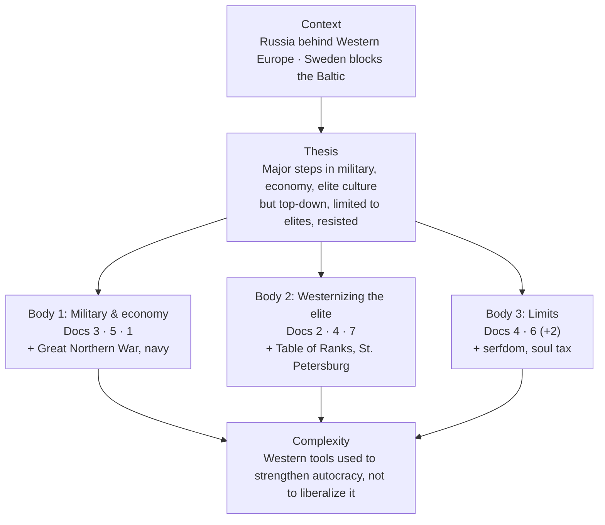

# Unit 3 DBQ 2: Peter the Great — Question & Model Essay
> **How to use:** Read the question and documents first, write your own essay (15 min planning + 45 min writing), then compare it with the answer guide below.

---

## 📝 Question (Textbook p.185–188, another printing)
**Directions:** Question 1 is based on the accompanying documents, which have been edited for this exercise. Suggested time: 15 minutes planning and 45 minutes writing.

> **1. Using the documents and your knowledge of world history, evaluate the extent to which Peter the Great took steps during his reign (1682–1725) to modernize Russia and transform it into a major European power.**

### Requirements (self-check)
- [ ] **Thesis:** a historically defensible claim that sets up a line of reasoning
- [ ] **Context:** describe a broader historical context relevant to the prompt
- [ ] **Documents:** use at least **6** documents to support your argument
- [ ] **Outside evidence:** at least **1** specific piece of evidence not found in the documents
- [ ] **Sourcing:** for at least **3** documents, explain how point of view, purpose, historical situation, or audience matters to your argument
- [ ] **Complexity:** use evidence to corroborate, qualify, or modify an argument that addresses the prompt

### Documents
> Summaries with short key quotes. The full text is in the textbook.

**Document 1** · Bishop Burnet of England, describing Peter the Great, 1698
- Peter wanted to understand English church doctrine but "did not seem disposed to mend matters" in Russia
- He was "resolved to encourage learning" by sending Russians to travel abroad and drawing "strangers to come and live among them"
- He was still worried about "his sister's intrigues"; his temper mixed passion and severity
- He is resolute "but understands little of war"

**Document 2** · Peter I, Decree on Compulsory Education of the Russian Nobility
- Teachers from mathematical schools are sent to every region to teach mathematics and geometry to noble children (children of freeholders and government clerks excepted)
- Penalty: no one may marry until he has learned these subjects

**Document 3** · Peter I, Decree on the Invitation of Foreigners, 1702
- Peter says he has ruled so that his subjects become "more and more prosperous": keeping order, defending the state, and extending trade
- Administrative changes help subjects become "more skillful in their commercial relations"
- He wants an army of "well-drilled men, maintained in perfect order and discipline"
- He invites foreigners, including "artisans profitable to the State," to come in numbers

**Document 4** · Peter I, Decree on Western Dress, 1701
- Boyars, court members, gentry, officials, merchants, streltsy, guild members, and townspeople must wear Western dress, "excepting the clergy and peasant tillers of the soil"
- Upper garments in French or Saxon style, lower garments and saddles in German style; women and children of these groups, including priests' wives, must also dress in Western style
- Russian dress is forbidden, and craftsmen may not make or sell it

**Document 5** · Statute for the College of Manufactures, 1723
- Russia should have factories like those "found in other states," especially ones using materials found within the empire
- Anyone, "without distinction of rank or condition," may open a factory
- Owners must hire experienced foreign master craftsmen to train Russians so they "may themselves become masters"

**Document 6** · Jean Rousset de Missy, *Life of Peter the Great*, c. 1730
- Peter taxed beards: 100 rubles a year for gentlemen and merchants, one kopek for commoners at the town gates; priests and peasants exempt
- Russians saw it as "an enormous sin" that tended to "the abolition of their religion"; priests called him "a tyrant and a pagan"
- Old Russians kept their shaved beards to be buried with them; young men accepted the custom more readily

**Document 7** · Portrait of Peter the Great, Library of Congress
- Peter in European-style armor with a sash across his chest, holding a sword, with one hand resting near what looks like a globe
- *Note:* the textbook gives no artist or date. The image resembles Paul Delaroche's 1838 portrait, which was painted more than a century after Peter's death. Check this before using the date in a sourcing argument.

---

## 📘 Answer Guide
> Everything below is the model answer. Labels like **[Thesis]** and **[Sourcing]** show which rubric point each part earns. Remove them when you practice writing it yourself.

---

## 🗺️ Essay Plan

## 📄 Document Analysis (HIPP)
| Doc | Source | What it shows | Sourcing angle used |
|---|---|---|---|
| 1 | Bishop Burnet of England, 1698 | Peter sends Russians abroad and invites foreigners; "understands little of war" | **Historical situation:** written during Peter's 1698 visit to England, before his victories over Sweden |
| 2 | Peter I, Decree on Compulsory Education of the Nobility | Nobles' children must learn math and geometry or be barred from marrying | Used for content |
| 3 | Peter I, Decree on the Invitation of Foreigners, 1702 | Foreign officers and artisans invited to improve trade, administration, and the army | **Purpose / audience:** a public manifesto meant to attract foreigners |
| 4 | Peter I, Decree on Western Dress, 1701 | Elites must wear Western clothes; clergy and peasants exempt | **Purpose:** makes loyalty to reform visible among the elite only |
| 5 | Statute for the College of Manufactures, 1723 | State promotes factories; foreign masters train Russians | Used for content |
| 6 | Rousset de Missy, *Life of Peter the Great*, c. 1730 | Beard tax; priests call Peter a tyrant; young men accept the change | **Point of view:** a French Protestant writer with little sympathy for Orthodox clergy |
| 7 | Portrait of Peter the Great, Library of Congress | Peter in European-style armor and sash, holding a sword, beside what looks like a globe | **Purpose:** presents Peter as a Western-style military monarch |

> 📌 This DBQ comes from a different printing of the textbook than Unit 3 DBQ 1. The LEQs on p.184 are the same, but here the directions say to write LEQ 1, LEQ 2, **and either** LEQ 3 or LEQ 4.

---

## ✍️ Model Essay

**[Contextualization]** By the late 1600s, Western European states such as France, England, and the Dutch Republic were pulling ahead of the rest of Eurasia. Their gunpowder armies were drilled and professional, their navies sailed the world, and their governments used trained officials and growing manufacturing to pay for war. Russia, by contrast, had expanded across Siberia to the Pacific, but it was still a largely agrarian society of serfs, with no warm-water port and no navy. Sweden controlled the Baltic coast, and the Ottomans controlled the Black Sea. Inside Russia, the old boyar nobility, the streltsy musketeers, and the Orthodox Church all held power that could limit the tsar, and Peter's half-sister Sophia had ruled as regent during his youth.

**[Thesis]** Peter the Great took sweeping steps to modernize Russia's military, economy, and elite culture, and these steps did transform Russia into a major European power. However, his modernization was imposed from the top down, aimed mostly at the elite, and enforced by coercion, so it strengthened the tsar's autocratic power more than it changed Russian society as a whole.

**[Body 1: Military and economy]** Peter's most successful reforms targeted military strength and the economy that paid for it. In his 1702 decree, Peter invited foreigners, including officers and "artisans profitable to the State," so that his troops would "consist of well-drilled men, maintained in perfect order and discipline" (Doc 3). **[Sourcing: purpose and audience]** This decree was a manifesto meant to be read by foreigners, so Peter stressed his "care for the general good" and the prosperity of his subjects to make Russia look like an attractive and orderly place to work. Even so, its goals of better trade and a stronger army match what Peter actually did. The 1723 Statute for the College of Manufactures shows the same plan in the economy: the state promoted factories like those "found in other states" and required factory owners to hire foreign master craftsmen who would train Russians until they "become masters" themselves (Doc 5). Peter was not just borrowing foreign experts; he wanted Russia to become self-sufficient in producing the goods, especially iron and weapons, that a great power needed. Bishop Burnet saw the beginnings of this policy when he wrote that Peter was "resolved to encourage learning" by sending Russians to travel abroad and drawing "strangers to come and live among them" (Doc 1). **[Sourcing: historical situation]** Burnet met Peter in 1698 during the Grand Embassy, when the young tsar was touring Western Europe to study shipbuilding and recruit experts. His remark that Peter "understands little of war" was written before Russia's great victories, so it reflects Peter's early inexperience rather than his later achievements. **[Outside evidence]** Those achievements came in the Great Northern War (1700–1721). After rebuilding his army and creating a Baltic navy, Peter defeated Sweden at the Battle of Poltava in 1709, and the Treaty of Nystad (1721) gave Russia the Baltic coast. Russia replaced Sweden as the leading power of northern Europe.

**[Body 2: Westernizing the elite]** Peter also tried to make the Russian elite think, dress, and serve like Western Europeans. His education decree sent teachers from mathematical schools to every region and ordered that no noble could marry until he had learned mathematics and geometry (Doc 2). Tying such a personal right to schooling shows how far Peter would go to produce nobles who could serve as engineers, navigators, and officers. His 1701 dress decree required boyars, officials, merchants, the streltsy, and their wives and children to wear French, Saxon, and German clothing, and it forbade craftsmen to make or sell traditional Russian dress (Doc 4). **[Sourcing: purpose]** The decree exempted the clergy and "peasant tillers of the soil." This shows that its purpose was not to change the daily life of all Russians, but to make the people who served the state visibly European, so that loyalty to the tsar's reforms could be seen at a glance. Peter presented himself the same way. In his portrait, he appears in European-style armor and a sash, holding a sword beside what looks like a globe (Doc 7). **[Sourcing: purpose]** Portraits like this were made to show Peter as a Western-style warrior king with worldwide ambitions, the kind of ruler who belonged among the monarchs of Europe. **[Outside evidence]** Peter backed this image with institutions. In 1703 he founded St. Petersburg on the Baltic as a "window to the West" and later made it the capital, and the Table of Ranks (1722) made nobles' status depend on service to the state rather than on birth.

**[Body 3: Limits of modernization]** These reforms had clear limits, because they were forced on Russians rather than accepted by them. Rousset de Missy described how Peter made nobles and merchants pay one hundred rubles a year to keep their beards and stationed officials at town gates to collect a kopek from commoners (Doc 6). Priests called the tsar "a tyrant and a pagan," and old Russians saved their shaved beards so that they could be buried with them and still enter heaven. Only "the young men" adopted the new style readily. **[Sourcing: point of view]** As a French Protestant writing for European readers around 1730, Rousset de Missy had little sympathy for Orthodox priests and may have presented Russian resistance as superstition. Still, his account shows that Peter's cultural reforms divided Russian society by age and class. Documents 2 and 4 also reveal that the reforms reached only a thin layer of Russians: nobles, officials, and town merchants. **[Outside evidence]** For the peasant majority, life became harder. Peter tightened serfdom, drafted peasants into the army for life, forced thousands of laborers to build St. Petersburg, and introduced a soul tax (collected from 1724) on every male peasant to pay for his wars. He also abolished the office of patriarch and placed the Church under a state body, the Holy Synod (1721), which silenced one of the main sources of opposition.

**[Complexity]** Peter the Great therefore went very far in modernizing the parts of Russia that mattered for military power and state control, and by 1725 Russia was a major European power. But his modernization was selective. He borrowed Western technology, schooling, and fashions, but not Western ideas about limited monarchy or the rights of subjects. The same decrees that brought foreign craftsmen and math teachers to Russia also tied nobles more tightly to state service and peasants more tightly to the land. In this sense, Peter used Western tools to make Russian autocracy stronger, which helps explain why Russia, unlike the Ottoman, Safavid, and Mughal empires, grew more powerful in the 1700s while still remaining a society built on serfdom.

---

## ✅ Rubric Check (7 points)
| Rubric point | Where it is earned | Points |
|---|---|---|
| A. Thesis | Second paragraph: a claim of "sweeping steps, but top-down and limited," with a line of reasoning | 1 |
| B. Contextualization | First paragraph: Western European military and economic lead, Russia's lack of ports, internal rivals | 1 |
| C. Evidence: documents | All 7 documents used to support the argument (6 or more needed) | 2 |
| C. Evidence: outside | Grand Embassy, Great Northern War, Poltava (1709), Treaty of Nystad (1721), St. Petersburg, Table of Ranks, soul tax, Holy Synod | 1 |
| D. Sourcing | Docs 1, 3, 4, 6, 7 (3 or more needed) | 1 |
| D. Complexity | Final paragraph: Western tools used to strengthen autocracy; comparison with the Islamic empires | 1 |
| | **Total** | **7** |
