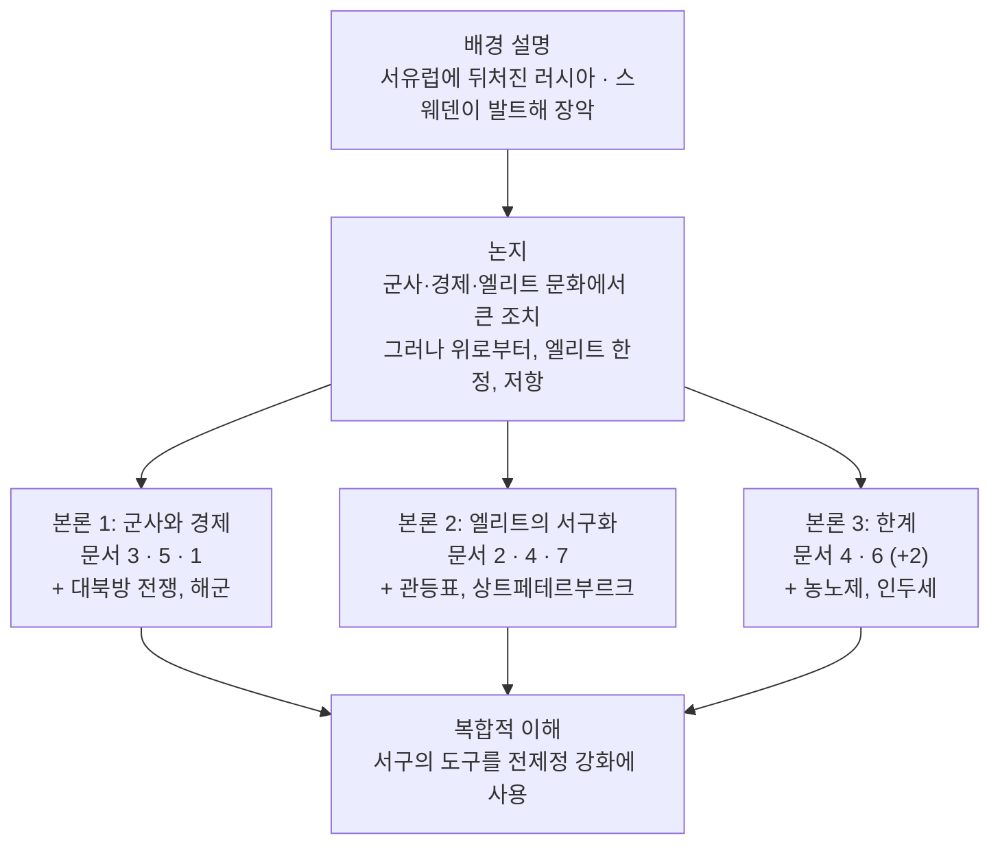

# Unit 3 DBQ 2: 표트르 대제 — 문제 & 모범 에세이 (한국어 해설판)
> **사용법:** 먼저 문제와 문서를 읽고 직접 써 보세요(계획 15분 + 쓰기 45분). 그다음 아래 해설과 비교하세요.
>
> AP 시험 답안은 **영어로** 써야 합니다. 이 파일은 영어판(`AP_WH_Unit3_DBQ2_PeterTheGreat_EN.md`)을 이해하기 위한 번역·해설판입니다. 에세이에 인용할 수 있도록 문서의 핵심 표현은 영어로 함께 적었습니다.

---

## 📝 문제 (교재 p.185–188, 다른 인쇄본)
**지시문:** 1번 문제는 함께 실린 문서를 바탕으로 합니다. 문서는 연습용으로 편집되었습니다. 권장 시간은 계획 15분, 쓰기 45분입니다.

> **1. Using the documents and your knowledge of world history, evaluate the extent to which Peter the Great took steps during his reign (1682–1725) to modernize Russia and transform it into a major European power.**
>
> **번역:** 문서와 세계사 지식을 활용하여, 표트르 대제가 재위 기간(1682–1725) 동안 러시아를 근대화하고 유럽의 주요 강대국으로 바꾸기 위해 어느 정도 조치를 취했는지 평가하라.

### 요구 사항 (스스로 점검)
- [ ] **논지:** 역사적으로 타당하고 논리 흐름을 세우는 주장
- [ ] **배경 설명:** 문제와 관련된 더 넓은 역사적 배경
- [ ] **문서 활용:** 문서 **6개 이상**으로 논증 뒷받침
- [ ] **외부 근거:** 문서에 없는 구체적 근거 **1개 이상**
- [ ] **출처 분석:** 문서 **3개 이상**에 대해 관점·목적·역사적 상황·독자가 논증과 어떻게 관련되는지 설명
- [ ] **복합적 이해:** 근거로 논증을 뒷받침하거나, 조건을 달거나, 수정하기

### 문서
> 교재 문서를 요약하고 핵심 표현을 짧게 인용했습니다. 전문은 교재를 보세요.

**문서 1** · 영국의 버넷 주교, 표트르 대제에 대한 묘사, 1698
- 표트르는 영국 교회의 교리를 이해하고 싶어 했지만, 러시아의 상황을 "did not seem disposed to mend matters" (고칠 생각은 없어 보였음)
- 러시아인을 해외로 보내고 "strangers to come and live among them" (외국인이 와서 함께 살게) 하여 "resolved to encourage learning" (학문을 장려하기로 결심함)
- 여전히 "his sister's intrigues" (누나의 음모)를 걱정했고, 성격은 열정과 엄격함이 섞여 있음
- 단호하지만 "understands little of war" (전쟁은 잘 모름)

**문서 2** · 표트르 1세, 러시아 귀족 의무 교육령
- 수학 학교의 교사를 모든 지역에 보내 귀족 자녀에게 수학과 기하학을 가르침 (자영농과 관청 서기의 자녀는 예외)
- 벌칙: 이 과목을 배우기 전에는 결혼할 수 없음

**문서 3** · 표트르 1세, 외국인 초청령, 1702
- 즉위 이후 백성이 "more and more prosperous" (점점 더 번영하도록) 다스려 왔다고 말함: 질서 유지, 국가 방어, 교역 확대
- 행정 개혁으로 백성이 "more skillful in their commercial relations" (상업 관계에 더 능숙해짐)
- "well-drilled men, maintained in perfect order and discipline" (완벽한 질서와 규율 속의 잘 훈련된 병사들)로 이루어진 군대를 원함
- "artisans profitable to the State" (국가에 이로운 장인)를 비롯한 외국인을 많이 초청함

**문서 4** · 표트르 1세, 서양 복장령, 1701
- 보야르, 궁정 사람, 젠트리, 관리, 상인, 스트렐치, 길드 회원, 도시민은 서양식 옷을 입어야 함. 단 "excepting the clergy and peasant tillers of the soil" (성직자와 땅을 가는 농민은 예외)
- 윗옷은 프랑스·작센식, 아래옷과 안장은 독일식. 이 집단의 여성과 자녀(사제의 아내 포함)도 서양식 옷을 입어야 함
- 러시아 옷 착용 금지, 장인은 만들거나 팔 수 없음

**문서 5** · 공업청 규정, 1723
- 러시아에도 "found in other states" (다른 나라에 있는 것과 같은) 공장이 있어야 함. 특히 제국 안의 원료를 쓰는 공장
- 누구든 "without distinction of rank or condition" (신분이나 처지와 관계없이) 공장을 열 수 있음
- 공장주는 경험 많은 외국인 장인을 고용해, 러시아인이 "may themselves become masters" (스스로 장인이 될 수 있게) 훈련시켜야 함

**문서 6** · 장 루세 드 미시, 『표트르 대제의 생애』, 1730년경
- 수염세: 신사·상인은 1년에 100루블, 평민은 성문에서 1코페이카. 사제와 농민은 예외
- 러시아인은 이를 "an enormous sin" (엄청난 죄)이자 "the abolition of their religion" (신앙을 없애려는 것)으로 여김. 사제들은 그를 "a tyrant and a pagan" (폭군이자 이교도)이라 부름
- 나이 든 러시아인은 잘린 수염을 간직했다가 함께 묻히려 했고, 젊은이들은 새 관습을 더 쉽게 받아들임

**문서 7** · 표트르 대제 초상화, 미국 의회도서관
- 유럽식 갑옷에 띠를 두르고 칼을 든 표트르. 한 손은 지구의로 보이는 물체 근처에 있음
- *참고:* 교재에는 화가와 연도가 없습니다. 표트르가 죽고 100년 넘게 지난 1838년에 그려진 폴 들라로슈의 초상화와 비슷해 보입니다. 출처 분석에 연도를 쓰기 전에 확인하세요.

---

## 📘 해설

---

## 🗺️ 에세이 구성

## 📄 문서 분석 (HIPP)
| 문서 | 출처 | 보여주는 것 | 활용한 출처 분석 |
|---|---|---|---|
| 1 | 영국의 버넷 주교, 1698 | 러시아인을 해외로 보내고 외국인을 초청함. "전쟁은 잘 모른다" | **역사적 상황:** 1698년 표트르의 영국 방문 중, 스웨덴에 승리하기 전에 쓴 글 |
| 2 | 표트르 1세, 귀족 의무 교육령 | 귀족 자녀는 수학·기하학을 배워야 하고, 배우지 않으면 결혼 금지 | 내용 근거로 사용 |
| 3 | 표트르 1세, 외국인 초청령, 1702 | 교역·행정·군대를 개선하려고 외국인 장교·장인을 초청 | **목적·독자:** 외국인을 끌어들이려는 공개 선언문 |
| 4 | 표트르 1세, 서양 복장령, 1701 | 엘리트는 서양식 옷을 입어야 함. 성직자·농민은 예외 | **목적:** 개혁에 대한 충성을 엘리트에게만 눈에 보이게 함 |
| 5 | 공업청(College of Manufactures) 규정, 1723 | 국가가 공장을 장려하고, 외국 장인이 러시아인을 훈련 | 내용 근거로 사용 |
| 6 | 루세 드 미시, 『표트르 대제의 생애』, 1730년경 | 수염세. 사제들은 표트르를 폭군이라 부르고, 젊은이들은 받아들임 | **관점:** 정교회 사제에게 호의적이지 않은 프랑스 개신교 작가 |
| 7 | 표트르 대제 초상화, 미국 의회도서관 | 유럽식 갑옷과 띠를 두르고 칼을 든 모습. 옆에 지구의로 보이는 물체 | **목적:** 서양식 군주이자 군사 지도자로 표현 |

> 📌 이 DBQ는 Unit 3 DBQ 1과 다른 인쇄본에 실린 문제입니다. p.184의 LEQ는 같지만, 이 판에서는 LEQ 1, LEQ 2, 그리고 **LEQ 3 또는 4 중 하나**를 쓰라고 되어 있습니다.

---

## ✍️ 모범 에세이 (번역)

**[배경 설명]** 1600년대 후반, 프랑스·영국·네덜란드 같은 서유럽 국가들은 유라시아의 다른 지역보다 앞서 나가고 있었다. 이들의 화약 군대는 훈련된 직업 군대였고, 해군은 전 세계를 항해했으며, 정부는 훈련받은 관리와 성장하는 제조업으로 전쟁 비용을 댔다. 반면 러시아는 시베리아를 가로질러 태평양까지 팽창했지만, 여전히 농노가 대부분인 농업 사회였고 부동항도 해군도 없었다. 발트해 연안은 스웨덴이, 흑해는 오스만이 장악하고 있었다. 러시아 안에서는 옛 보야르 귀족, 스트렐치 총병대, 정교회가 모두 차르를 제약할 수 있는 힘을 갖고 있었고, 표트르가 어릴 때는 이복누나 소피아가 섭정으로 나라를 다스렸다.

**[논지]** 표트르 대제는 러시아의 군사·경제·엘리트 문화를 근대화하기 위해 폭넓은 조치를 취했고, 이 조치들은 실제로 러시아를 유럽의 주요 강대국으로 바꾸었다. 그러나 그의 근대화는 위에서 아래로 강요되었고, 주로 엘리트를 대상으로 했으며, 강압으로 시행되었다. 그래서 러시아 사회 전체를 바꾸기보다 차르의 전제 권력을 더 강하게 만들었다.

**[본론 1: 군사와 경제]** 표트르의 가장 성공적인 개혁은 군사력과 그 비용을 대는 경제를 겨냥했다. 1702년 법령에서 표트르는 장교와 "국가에 이로운 장인"을 비롯한 외국인을 초청해, 군대가 "완벽한 질서와 규율 속에 유지되는 잘 훈련된 병사들"로 이루어지게 하려 했다(문서 3). **[출처 분석: 목적·독자]** 이 법령은 외국인에게 읽히려고 만든 선언문이었다. 그래서 표트르는 러시아가 일하기 좋은 질서 있는 나라로 보이도록 "공공의 이익에 대한 배려"와 백성의 번영을 강조했다. 그렇지만 더 나은 교역과 더 강한 군대라는 목표는 표트르가 실제로 한 일과 일치한다. 1723년 공업청 규정은 경제에서도 같은 계획을 보여준다. 국가는 "다른 나라에 있는 것과 같은" 공장을 장려했고, 공장주에게 외국인 장인을 고용해 러시아인이 스스로 "장인이 될" 때까지 훈련시키도록 했다(문서 5). 표트르는 외국 전문가를 빌려 쓰는 데 그치지 않고, 강대국에 필요한 물자, 특히 철과 무기를 러시아가 스스로 만들 수 있기를 원했다. 버넷 주교는 표트르가 러시아인을 해외로 보내고 "외국인을 불러들여 함께 살게" 함으로써 "학문을 장려하기로 결심했다"고 썼는데, 이 정책의 시작을 본 것이다(문서 1). **[출처 분석: 역사적 상황]** 버넷은 1698년 대사절단 때 표트르를 만났다. 당시 젊은 차르는 조선술을 배우고 전문가를 모으려고 서유럽을 순방하고 있었다. 표트르가 "전쟁은 잘 모른다"는 말은 러시아가 큰 승리를 거두기 전에 쓴 것이므로, 훗날의 업적이 아니라 초기의 미숙함을 보여준다. **[외부 근거]** 그 업적은 대북방 전쟁(1700–1721)에서 나왔다. 표트르는 군대를 재건하고 발트해 함대를 만든 뒤 1709년 폴타바 전투에서 스웨덴을 꺾었고, 뉘스타드 조약(1721)으로 발트해 연안을 얻었다. 러시아는 스웨덴을 대신해 북유럽의 최강국이 되었다.

**[본론 2: 엘리트의 서구화]** 표트르는 러시아 엘리트가 서유럽인처럼 생각하고, 옷을 입고, 국가를 섬기게 하려 했다. 교육령은 수학 학교의 교사를 모든 지역에 보내고, 수학과 기하학을 배우기 전에는 귀족이 결혼할 수 없게 했다(문서 2). 결혼처럼 사적인 권리를 학교 교육에 묶은 것은, 기술자·항해사·장교로 일할 귀족을 길러내려고 표트르가 얼마나 멀리 나아갔는지 보여준다. 1701년 복장령은 보야르, 관리, 상인, 스트렐치와 그 아내·자녀에게 프랑스·작센·독일식 옷을 입게 하고, 장인이 전통 러시아 옷을 만들거나 파는 것을 금지했다(문서 4). **[출처 분석: 목적]** 이 법령은 성직자와 "땅을 가는 농민"을 예외로 두었다. 이는 법령의 목적이 모든 러시아인의 일상을 바꾸는 것이 아니라, 국가를 섬기는 사람들을 눈에 띄게 유럽식으로 만들어 차르의 개혁에 대한 충성을 한눈에 확인하는 데 있었음을 보여준다. 표트르는 자신도 같은 방식으로 표현했다. 초상화에서 그는 유럽식 갑옷과 띠를 두르고, 지구의로 보이는 물체 옆에서 칼을 들고 있다(문서 7). **[출처 분석: 목적]** 이런 초상화는 표트르를 세계적 야망을 품은 서양식 전사 왕, 곧 유럽의 군주들과 나란히 설 만한 통치자로 보여주려고 만들어졌다. **[외부 근거]** 표트르는 이 이미지를 제도로 뒷받침했다. 1703년 발트해 연안에 "서방으로 난 창" 상트페테르부르크를 세워 나중에 수도로 삼았고, 관등표(1722)는 귀족의 지위가 출신이 아니라 국가에 대한 복무에 달리게 만들었다.

**[본론 3: 근대화의 한계]** 이 개혁들에는 뚜렷한 한계가 있었다. 러시아인이 받아들인 것이 아니라 강요된 것이었기 때문이다. 루세 드 미시는 표트르가 귀족과 상인에게 수염을 기르려면 해마다 100루블을 내게 하고, 성문에 관리를 세워 평민에게서 1코페이카를 걷었다고 묘사했다(문서 6). 사제들은 차르를 "폭군이자 이교도"라 불렀고, 나이 든 러시아인들은 잘린 수염을 간직했다가 함께 묻혀야 천국에 갈 수 있다고 믿었다. 새 방식을 기꺼이 받아들인 것은 "젊은이들"뿐이었다. **[출처 분석: 관점]** 루세 드 미시는 1730년경 유럽 독자를 위해 글을 쓴 프랑스 개신교도였으므로, 정교회 사제에게 호의적이지 않았고 러시아인의 저항을 미신처럼 그렸을 수 있다. 그래도 그의 기록은 표트르의 문화 개혁이 러시아 사회를 나이와 계층에 따라 갈라놓았음을 보여준다. 문서 2와 4 역시 개혁이 귀족·관리·도시 상인이라는 얇은 층에만 닿았음을 드러낸다. **[외부 근거]** 다수인 농민의 삶은 오히려 더 힘들어졌다. 표트르는 농노제를 강화하고, 농민을 평생 군대에 징집하고, 수많은 노동자를 상트페테르부르크 건설에 동원했으며, 전쟁 비용을 대려고 모든 남성 농민에게 인두세(1724년부터 징수)를 매겼다. 또 총대주교직을 없애고 교회를 국가 기관인 신성종무원(1721) 아래 두어, 주요 반대 세력 하나를 잠재웠다.

**[복합적 이해]** 따라서 표트르 대제는 군사력과 국가 통제에 중요한 분야에서 러시아를 매우 크게 근대화했고, 1725년의 러시아는 유럽의 주요 강대국이었다. 하지만 그의 근대화는 선택적이었다. 그는 서구의 기술·교육·복식은 빌려 왔지만, 군주권 제한이나 백성의 권리 같은 서구의 사상은 받아들이지 않았다. 외국 장인과 수학 교사를 러시아로 데려온 바로 그 법령들이 귀족을 국가 복무에, 농민을 땅에 더 단단히 묶었다. 이런 의미에서 표트르는 서구의 도구로 러시아의 전제정을 더 강하게 만들었다. 이것은 오스만·사파비·무굴 제국과 달리 러시아가 1700년대에 더 강해지면서도 여전히 농노제에 기반한 사회로 남은 이유를 설명해 준다.

---

## ✅ 채점 기준 확인 (7점)
| 채점 항목 | 점수를 받는 부분 | 점수 |
|---|---|---|
| A. 논지 | 두 번째 문단: "폭넓은 조치였지만 위로부터, 제한적"이라는 주장과 논리 흐름 | 1 |
| B. 배경 설명 | 첫 문단: 서유럽의 군사·경제적 우위, 러시아에 항구가 없음, 내부 경쟁 세력 | 1 |
| C. 근거: 문서 | 문서 7개 모두 논증에 활용 (6개 이상 필요) | 2 |
| C. 근거: 외부 | 대사절단, 대북방 전쟁, 폴타바(1709), 뉘스타드 조약(1721), 상트페테르부르크, 관등표, 인두세, 신성종무원 | 1 |
| D. 출처 분석 | 문서 1, 3, 4, 6, 7 (3개 이상 필요) | 1 |
| D. 복합적 이해 | 마지막 문단: 서구의 도구로 전제정 강화, 이슬람 제국들과의 비교 | 1 |
| | **합계** | **7** |

---

## 📝 영어로 쓸 때 유용한 표현
| 쓰임 | 표현 |
|---|---|
| "정도"를 묻는 문제의 논지 | took sweeping steps…, but… / went very far in…, but… |
| 근대화의 성격 | imposed from the top down / aimed mostly at the elite / enforced by coercion |
| 출처 분석: 독자 | This decree was a manifesto meant to be read by foreigners, so… |
| 출처 분석: 시기 | …was written before…, so it reflects… rather than… |
| 출처 분석: 예외 조항 | The decree exempted…, which shows that its purpose was… |
| 복합적 이해 | Peter borrowed Western…, but not Western ideas about… |
