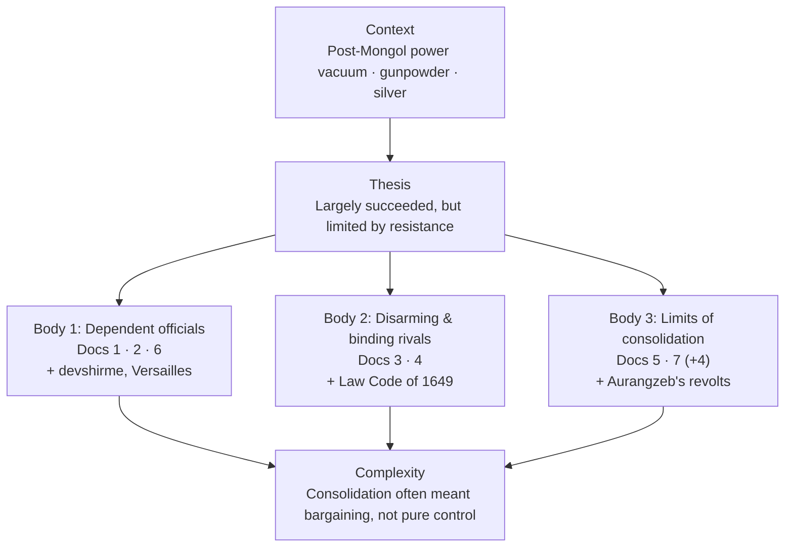

# Unit 3 DBQ — Question & Model Essay
> **How to use:** Read the question and documents first, write your own essay (15 min planning + 45 min writing), then compare it with the answer guide below.

---

## 📝 Question (Textbook p.185–188)
**Directions:** Question 1 is based on the accompanying documents, which have been edited for this exercise. Suggested time: 15 minutes planning and 45 minutes writing.

> **1. Evaluate the extent to which rulers in Eurasia succeeded in consolidating power within their states, during the period c. 1450 to c. 1750.**

### Requirements (self-check)
- [ ] **Thesis:** a historically defensible claim that sets up a line of reasoning
- [ ] **Context:** describe a broader historical context relevant to the prompt
- [ ] **Documents:** use at least **4** documents to support your argument
- [ ] **Outside evidence:** at least **1** specific piece of evidence not found in the documents
- [ ] **Sourcing:** for at least **2** documents, explain how point of view, purpose, historical situation, or audience matters to your argument
- [ ] **Complexity:** show a complex understanding through sophisticated argument and/or effective use of evidence

### Documents
> Summaries with short key quotes. The full text is in the textbook.

**Document 1** · Tun Bu village gazetteer (a village record updated over time), southern China, c. 1450
- The early Ming chose one **tax captain** per township, responsible for all grain and silver taxes in the area
- Village leaders "did not dare sit" in front of tax captains
- Tax captains had an official table and chair and tools of punishment, could order arrests with warrants "written in red ink," set deadlines, and force village leaders to pay

**Document 2** · Niccolò Machiavelli, *The Prince*, excerpt on the Ottoman sultan, 1513
- The Ottoman monarchy "is governed by one ruler, the Sultan, the others are his servants"
- The sultan divides his kingdom into sanjaks (subprovinces), sends administrators there, and moves them "as he chooses"
- The King of France, by contrast, sits among an ancient nobility with its own subjects and privileges
- The Turkish state is hard to conquer but easy to hold, because its officials, "being all slaves and bondmen," are hard to corrupt
- ⚠️ *Textbook note:* the source line links the excerpt to Suleiman the Magnificent, but Suleiman did not become sultan until 1520. In 1513 the sultan was Selim I. Refer to "the Ottoman sultan" in your essay.

**Document 3** · Toyotomi Hideyoshi, Sword Hunt edict ("Collection of Swords"), 1588
- Farmers are forbidden to own swords, spears, firearms, or other weapons
- Weapons make "the collection of annual rent" harder and lead to "uprisings"
- The collected swords will become nails and bolts for a Great Image of Buddha, so farmers benefit "in the lives to come"
- Farmers who only farm will prosper; this concern is "the foundation for the peace and security of the country"
- ⚠️ *Textbook note:* the source line calls Hideyoshi a "Tokugawa Shogun." He was never shogun (see the note below the HIPP table).

**Document 4** · Ernest Lissner, painting *Salt Riot in Moscow*, 1938
- Shows the 1648 riot by artisans and serfs against Tsar Alexei I's **universal salt tax**
- Caption: the government changed policy in response, but the changes "unintentionally institutionalized serfdom for centuries"

**Document 5** · François Bernier, French traveler and employee of the Mughal emperor, 1668
- The king, as owner of all land in India, grants land to soldiers and governors in place of salary, if they pay him a yearly sum from the surplus
- Grantees hold "an authority almost absolute over the peasantry"; Bernier calls it cruel and oppressive
- Peasants ask why they should work for "a tyrant who may come tomorrow" and take everything; grantees see no reason to improve land they may lose

**Document 6** · Saint-Simon, duke at the court of Louis XIV, *Memoirs 1691–1709*, published 1829
- "Louis XIV wished to reign by himself"
- He chose ministers "not for their knowledge, but for their ignorance" and liked to teach them, and took credit for instructing his generals
- His "love of admiration was his ruin"; flattery was "the sole means" of approaching him

**Document 7** · Jean Rousset de Missy, *Life of Peter the Great*, 1730
- Peter taxed beards: 100 rubles a year for gentlemen and merchants, one kopek for commoners at the town gates; priests and peasants exempt
- Priests called him "a tyrant and a pagan"; old Russians kept their shaved beards to be buried with them
- Young men accepted the new custom more readily

---

## 📘 Answer Guide
> Everything below is the model answer. Labels like **[Thesis]** and **[Sourcing]** show which rubric point each part earns. Remove them when you practice writing it yourself.

---

## 🗺️ Essay Plan

## 📄 Document Analysis (HIPP)
| Doc | Source | What it shows | Sourcing angle used |
|---|---|---|---|
| 1 | Ming village gazetteer, c. 1450 | State-appointed tax captains with power to arrest and punish | **Purpose / audience:** a local record, not imperial propaganda |
| 2 | Machiavelli, *The Prince*, 1513 | Sultan rules alone; officials are rotated "servants" | **Purpose:** advising Italian princes, so he holds up the sultan as a model |
| 3 | Hideyoshi, Sword Hunt edict, 1588 | Peasants disarmed to prevent revolt and ease tax collection | **Purpose:** frames confiscation as compassion and a religious offering |
| 4 | Lissner painting, 1938, of 1648 Salt Riot | Revolt against a salt tax; serfdom became fixed | **Historical situation:** painted in the Soviet era, which celebrated popular revolt against tsars |
| 5 | Bernier, French traveler, 1668 | Mughal land grantees oppress peasants; land is neglected | **Point of view:** European outsider who valued private property |
| 6 | Saint-Simon, *Memoirs*, on Louis XIV | King chose weak ministers and ruled alone | **Point of view:** a duke who lost power under absolutism |
| 7 | Rousset de Missy, 1730, on Peter the Great | Beard tax enforced, but priests and old Russians resisted | Used for content |

> ⚠️ **Textbook note:** Document 3's source line calls Hideyoshi a "Tokugawa Shogun (king)." This is wrong: Toyotomi Hideyoshi was never shogun. He ruled as *kampaku* (imperial regent), and the Tokugawa shogunate began in 1603, after his death. Use "Hideyoshi, the unifier of Japan" in your essay.

---

## ✍️ Model Essay

**[Contextualization]** Between 1450 and 1750, the breakup of the Mongol khanates left a power vacuum across Eurasia that new and revived states rushed to fill. The Ming had driven out the Yuan in 1368. The Ottomans, Safavids, and Mughals rose on the strength of gunpowder weapons, and Muscovy threw off Mongol rule to become the Russian tsardom. Gunpowder made armies more expensive and more decisive, so rulers needed steady tax revenue and reliable officials more than ever. The growing flow of silver from the Americas even let states like Ming China demand taxes in silver. Yet every one of these rulers faced rivals inside their own borders: hereditary nobles, regional warlords, armed peasants, and religious authorities.

**[Thesis]** Rulers in Eurasia largely succeeded in consolidating power by creating officials who depended entirely on the ruler and by stripping potential rivals of weapons and independent authority. However, this success was limited, because the heavy taxes and forced reforms that consolidation required often provoked resistance and, in some cases, weakened the very states they were meant to strengthen.

**[Body 1: Dependent officials]** The most successful rulers built bureaucracies whose members owed everything to the ruler. In Ming China, the dynasty chose one tax captain for each township and gave him an official table and chair, tools of punishment, and the right to order arrests with warrants in red ink (Doc 1). **[Sourcing: purpose and audience]** Because this account comes from a village gazetteer, a record kept by the community for its own use rather than imperial propaganda, its description of village leaders who "did not dare sit" in front of the tax captains is strong evidence that central authority really was felt at the lowest level of society. The Ottomans went further. Machiavelli observed that the sultan's administrators were his "servants" whom he moved from one sanjak to another "as he chooses," so that they were "slaves and bondmen" who could hardly be turned against him (Doc 2). **[Sourcing: purpose]** Machiavelli wrote *The Prince* to advise Italian rulers on how to win and keep power in a divided Italy, which explains why he praises Ottoman centralization and contrasts it with France, where old noble families had their own loyal subjects. **[Outside evidence]** This loyalty came from the devshirme, which took Christian boys from the Balkans, converted them, and trained them as Janissaries and officials with no family power base of their own. Louis XIV of France pursued the same goal. According to Saint-Simon, Louis "wished to reign by himself" and chose ministers "not for their knowledge, but for their ignorance" (Doc 6). **[Sourcing: point of view]** As a duke from the old nobility that lost influence under absolutism, Saint-Simon had reason to portray Louis as vain, but his complaint itself confirms that the king had pushed great nobles out of real government. Louis's move of the court to Versailles in 1682 completed this by turning nobles into courtiers who competed for royal favor instead of governing provinces.

**[Body 2: Disarming and binding rivals]** Rulers also consolidated power by removing the means of resistance. In Japan, Hideyoshi's 1588 Sword Hunt ordered farmers to surrender all swords, spears, and firearms, explaining that weapons made "the collection of annual rent" difficult and encouraged "uprisings" (Doc 3). **[Sourcing: purpose]** The edict presents confiscation as "compassionate concern" and promises that the melted swords will build a Great Buddha so that farmers benefit "in the lives to come." This religious framing shows that Hideyoshi, who had risen from humble origins to reunify Japan after a century of civil war, needed to make a coercive policy look like a blessing. By separating armed samurai from unarmed farmers, the edict laid the base for the stable Tokugawa order that followed. In Russia, consolidation came through a bargain rather than pure force. The 1648 Salt Riot against Tsar Alexei I's universal salt tax forced the government to change course, yet those changes "institutionalized serfdom for centuries" (Doc 4). **[Outside evidence]** The Law Code of 1649 bound peasants permanently to the land, which won the loyalty of the gentry who served the tsar, at the cost of the peasants' freedom.

**[Body 3: Limits of consolidation]** Even so, consolidation often had sharp limits. Document 4 itself shows that a single new tax could bring artisans and serfs into the streets of Moscow. **[Sourcing: historical situation]** The painting was made in 1938 in the Soviet Union, where the state celebrated popular revolts against the tsars, so it emphasizes the violence of the uprising, but the riot's real result was the tightening of tsarist control over peasants. In Mughal India, the emperor granted land revenue to soldiers and governors in place of salary, and François Bernier reported that these grantees held "an authority almost absolute over the peasantry" (Doc 5). Because grants could be taken away, neither peasants nor grantees had reason to improve the land, which "create[d] uneasiness" and left it "neglected." **[Sourcing: point of view]** As a French physician who believed in private property, Bernier may have exaggerated Mughal oppression for European readers, yet his account helps explain why the empire weakened. **[Outside evidence]** Under Aurangzeb, costly wars in the south and the restored jizya tax on non-Muslims led to revolts by Hindus and Sikhs, and the empire broke apart after his death in 1707. Peter the Great's reforms in Russia show a similar limit on cultural authority. He taxed beards and stationed officials at town gates to collect the tax, but priests called him "a tyrant and a pagan," and older Russians saved their shaved beards so they could be buried with them (Doc 7). The tsar could enforce a law, but he could not force his subjects to accept it.

**[Complexity]** In the end, Eurasian rulers succeeded in consolidating power to a large extent, but rarely through central control alone. The Russian tsars kept power by trading peasant freedom for noble loyalty, and the Mughals ruled through land grantees they could not fully control. Even the most centralized system, the Ottoman slave bureaucracy that Machiavelli admired, later turned against the sultans when the Janissaries resisted reform. Success depended on whether a ruler could bind elites to the throne without crushing the peasants whose taxes paid for the state. Rulers who struck that balance, like the Qing emperor Kangxi when he froze the head tax in 1712, kept their states stable. Rulers who did not, like Aurangzeb, saw consolidation turn into decline.

---

## ✅ Rubric Check (7 points)
| Rubric point | Where it is earned | Points |
|---|---|---|
| A. Thesis | Second paragraph: a claim of "largely succeeded, but limited," with a line of reasoning | 1 |
| B. Contextualization | First paragraph: post-Mongol vacuum, gunpowder, silver, internal rivals | 1 |
| C. Evidence: documents | All 7 documents used to support the argument (4 or more needed) | 2 |
| C. Evidence: outside | Devshirme, Versailles (1682), Law Code of 1649, Aurangzeb and the jizya, Kangxi (1712) | 1 |
| D. Sourcing | Docs 1, 2, 3, 4, 5, 6 (2 or more needed) | 1 |
| D. Complexity | Final paragraph: consolidation as bargaining, short-term vs. long-term results | 1 |
| | **Total** | **7** |
