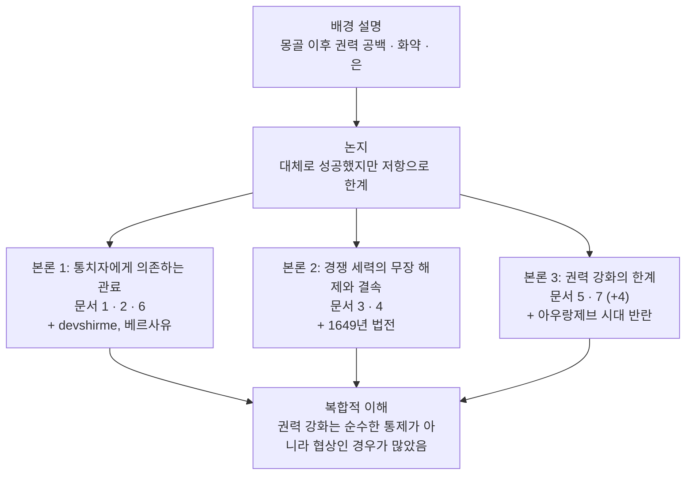

# Unit 3 DBQ — 문제 & 모범 에세이 (한국어 해설판)
> **사용법:** 먼저 문제와 문서를 읽고 직접 써 보세요(계획 15분 + 쓰기 45분). 그다음 아래 해설과 비교하세요.
>
> AP 시험 답안은 **영어로** 써야 합니다. 이 파일은 영어판(`AP_WH_Unit3_DBQ_EN.md`)을 이해하기 위한 번역·해설판입니다. 에세이에 인용할 수 있도록 문서의 핵심 표현은 영어로 함께 적었습니다.

---

## 📝 문제 (교재 p.185–188)
**지시문:** 1번 문제는 함께 실린 문서를 바탕으로 합니다. 문서는 연습용으로 편집되었습니다. 권장 시간은 계획 15분, 쓰기 45분입니다.

> **1. Evaluate the extent to which rulers in Eurasia succeeded in consolidating power within their states, during the period c. 1450 to c. 1750.**
>
> **번역:** 1450년경–1750년경, 유라시아의 통치자들이 자국 내에서 권력을 강화하는 데 어느 정도 성공했는지 평가하라.

### 요구 사항 (스스로 점검)
- [ ] **논지:** 역사적으로 타당하고 논리 흐름을 세우는 주장
- [ ] **배경 설명:** 문제와 관련된 더 넓은 역사적 배경
- [ ] **문서 활용:** 문서 **4개 이상**으로 논증 뒷받침
- [ ] **외부 근거:** 문서에 없는 구체적 근거 **1개 이상**
- [ ] **출처 분석:** 문서 **2개 이상**에 대해 관점·목적·역사적 상황·독자가 논증과 어떻게 관련되는지 설명
- [ ] **복합적 이해:** 정교한 논증이나 효과적인 근거 활용으로 복합적 이해를 보여주기

### 문서
> 교재 문서를 요약하고 핵심 표현을 짧게 인용했습니다. 전문은 교재를 보세요.

**문서 1** · 둔부(Tun Bu) 마을 지방지(계속 갱신된 마을 기록), 중국 남부, 1450년경
- 명 초기에는 향마다 **세량장(tax captain)** 한 명을 뽑아 그 지역의 곡물세와 은세를 모두 맡김
- 마을 지도자들은 세량장 앞에서 "did not dare sit" (감히 앉지 못함)
- 세량장은 관청용 탁자·의자와 처벌 도구를 갖추고, 붉은 먹으로 쓴 영장("written in red ink")으로 체포를 명하고, 납부 기한을 정하고, 마을 지도자에게 강제로 내게 함

**문서 2** · 니콜로 마키아벨리, 『군주론』 중 오스만 술탄에 관한 부분, 1513
- 오스만 왕국은 "governed by one ruler, the Sultan, the others are his servants" (한 명의 통치자인 술탄이 다스리고, 나머지는 그의 하인)
- 술탄은 나라를 산작(하위 지방)으로 나누어 관리를 보내고 "as he chooses" (원하는 대로) 교체함
- 반면 프랑스 왕은 자기 백성과 특권을 가진 오래된 귀족들 사이에 있음
- 오스만은 정복하기는 어렵지만 정복한 뒤에는 지키기 쉬움. 관리들이 "slaves and bondmen" (노예이자 종)이라 매수하기 어렵기 때문
- ⚠️ *교재 오류:* 출처에는 쉴레이만 대제에 관한 글로 되어 있지만, 쉴레이만은 1520년에야 즉위했습니다. 1513년의 술탄은 셀림 1세입니다. 에세이에서는 "the Ottoman sultan"이라고 쓰세요.

**문서 3** · 도요토미 히데요시, 칼 사냥령(도수령), 1588
- 농민의 칼·창·총 등 무기 소유 금지
- 무기가 있으면 "the collection of annual rent" (연공 징수)가 어려워지고 "uprisings" (봉기)가 일어남
- 몰수한 칼은 대불상의 못과 볼트로 쓰여, 농민이 "in the lives to come" (내세에서도) 복을 받음
- 농사만 짓는 농민은 번영하며, 이런 배려가 "the foundation for the peace and security of the country" (나라의 평화와 안녕의 기초)
- ⚠️ *교재 오류:* 출처에 "Tokugawa Shogun"이라고 되어 있지만, 히데요시는 쇼군이 된 적이 없습니다 (문서 분석표 아래 설명 참고).

**문서 4** · 에른스트 리스너, 그림 「모스크바의 소금 폭동」, 1938
- 차르 알렉세이 1세의 **전국 소금세**에 맞선 1648년 장인·농노 폭동을 그림
- 설명: 정부가 요구에 따라 정책을 바꾸었지만, 그 변화가 "unintentionally institutionalized serfdom for centuries" (의도치 않게 수세기 동안 농노제를 제도로 굳힘)

**문서 5** · 프랑수아 베르니에, 프랑스 여행가이자 무굴 황제에게 고용된 인물, 1668
- 인도의 모든 땅의 주인인 왕이 군인과 총독에게 봉급 대신 땅을 줌. 대신 잉여 수입에서 해마다 일정액을 바치게 함
- 수여자들은 "an authority almost absolute over the peasantry" (농민에 대한 거의 절대적인 권한)를 가짐. 베르니에는 이를 잔인하고 억압적이라고 봄
- 농민은 언제든 와서 모든 것을 빼앗을 "a tyrant" (폭군)를 위해 왜 일해야 하는지 묻고, 수여자는 잃을지 모르는 땅을 가꿀 이유를 찾지 못함

**문서 6** · 생시몽 공작(루이 14세의 궁정인), 『회고록 1691–1709』, 1829년 출간
- "Louis XIV wished to reign by himself" (루이 14세는 혼자 다스리고 싶어 했다)
- 장관을 "not for their knowledge, but for their ignorance" (지식이 아니라 무지 때문에) 골랐고, 가르치기를 좋아했으며, 장군들을 지도한 공도 자기 것으로 돌림
- 그의 "love of admiration was his ruin" (찬사를 좋아한 것이 파멸의 원인), 아첨이 그에게 다가가는 "the sole means" (유일한 방법)

**문서 7** · 장 루세 드 미시, 『표트르 대제의 생애』, 1730
- 표트르가 수염에 세금을 매김: 신사·상인은 1년에 100루블, 평민은 성문에서 1코페이카. 사제와 농민은 예외
- 사제들은 그를 "a tyrant and a pagan" (폭군이자 이교도)이라 부르고, 나이 든 러시아인은 잘린 수염을 간직했다가 함께 묻히려 함
- 젊은이들은 새 관습을 더 쉽게 받아들임

---

## 📘 해설

---

## 🗺️ 에세이 구성

## 📄 문서 분석 (HIPP)
| 문서 | 출처 | 보여주는 것 | 활용한 출처 분석 |
|---|---|---|---|
| 1 | 명나라 마을 기록(지방지), 1450년경 | 국가가 임명한 세량장이 체포·처벌 권한을 가짐 | **목적·독자:** 황실 선전물이 아닌 지역 기록 |
| 2 | 마키아벨리, 『군주론』, 1513 | 술탄 혼자 다스리고, 관리는 자리를 옮겨 다니는 "하인" | **목적:** 이탈리아 군주들에게 조언하려고 술탄을 본보기로 제시 |
| 3 | 히데요시, 칼 사냥령(도수령), 1588 | 반란을 막고 세금을 쉽게 걷으려고 농민의 무기를 몰수 | **목적:** 몰수를 자비와 불교적 공덕으로 포장 |
| 4 | 리스너의 그림(1938), 1648년 소금 폭동 | 소금세에 대한 반란. 결국 농노제가 굳어짐 | **역사적 상황:** 차르에 맞선 민중 봉기를 기리던 소련 시대에 그려짐 |
| 5 | 베르니에(프랑스 여행가), 1668 | 무굴의 토지 수여자가 농민을 억압하고 땅이 버려짐 | **관점:** 사유재산을 중시한 유럽 외부인 |
| 6 | 생시몽, 『회고록』, 루이 14세에 대해 | 왕이 무능한 장관을 골라 혼자 다스림 | **관점:** 절대왕정 아래 권력을 잃은 공작 |
| 7 | 루세 드 미시, 1730, 표트르 대제에 대해 | 수염세를 강제했지만 사제와 노인들이 저항 | 내용 근거로 사용 |

> ⚠️ **교재 오류:** 문서 3의 출처에 히데요시가 "Tokugawa Shogun (king)"이라고 적혀 있지만 틀린 표기입니다. 도요토미 히데요시는 쇼군이 된 적이 없고 간파쿠(관백, 천황의 섭정)로 다스렸습니다. 도쿠가와 막부는 그가 죽은 뒤인 1603년에 시작됐습니다. 에세이에서는 "일본을 통일한 히데요시"라고 쓰세요.

---

## ✍️ 모범 에세이 (번역)

**[배경 설명]** 1450–1750년, 몽골 칸국들이 무너지면서 유라시아 곳곳에 권력 공백이 생겼고, 새로 일어나거나 다시 일어선 국가들이 그 자리를 차지하려 했다. 명은 1368년에 원을 몰아냈다. 오스만·사파비·무굴은 화약 무기의 힘으로 성장했고, 모스크바 대공국은 몽골 지배에서 벗어나 러시아 차르국이 되었다. 화약 때문에 군대는 더 비싸지고 전쟁의 승패를 더 크게 좌우하게 되었다. 그래서 통치자들에게는 안정적인 세수와 믿을 만한 관리가 그 어느 때보다 필요했다. 아메리카에서 흘러든 은 덕분에 명나라 같은 국가는 세금을 은으로 걷기도 했다. 그러나 모든 통치자는 나라 안에 경쟁자를 두고 있었다. 세습 귀족, 지방 군벌, 무장한 농민, 종교 권위가 그들이었다.

**[논지]** 유라시아의 통치자들은 자신에게만 의존하는 관리를 만들고, 잠재적 경쟁 세력에게서 무기와 독자적 권한을 빼앗음으로써 권력 강화에 대체로 성공했다. 그러나 이 성공에는 한계가 있었다. 권력 강화에 필요했던 무거운 세금과 강제 개혁이 자주 저항을 불렀고, 어떤 경우에는 강하게 만들려던 국가를 오히려 약화시켰기 때문이다.

**[본론 1: 통치자에게 의존하는 관료]** 가장 성공한 통치자들은 모든 것을 통치자에게 빚진 관료 조직을 만들었다. 명나라는 향마다 세량장 한 명을 뽑아 관청용 탁자와 의자, 처벌 도구, 붉은 먹으로 쓴 영장으로 체포를 명할 권한을 주었다(문서 1). **[출처 분석: 목적·독자]** 이 기록은 황실 선전물이 아니라 마을이 스스로 쓰려고 남긴 지방지다. 그래서 마을 지도자들이 세량장 앞에서 "감히 앉지 못했다"는 묘사는, 중앙 권력이 사회 맨 아래까지 실제로 미쳤다는 강한 증거가 된다. 오스만은 한 걸음 더 나아갔다. 마키아벨리는 술탄의 관리들이 그의 "하인"이며 술탄이 "원하는 대로" 이 산작에서 저 산작으로 옮긴다고 보았다. 그래서 이들은 술탄에게 등을 돌리게 만들기 어려운 "노예이자 종"이었다(문서 2). **[출처 분석: 목적]** 마키아벨리는 분열된 이탈리아의 군주들에게 권력을 얻고 지키는 법을 조언하려고 『군주론』을 썼다. 그래서 오스만의 중앙집권을 칭찬하고, 오래된 귀족 가문이 저마다 충성하는 백성을 거느린 프랑스와 대비했다. **[외부 근거]** 이런 충성은 devshirme에서 나왔다. 발칸의 기독교도 소년을 데려와 개종시키고 예니체리와 관리로 키운 제도로, 이들에게는 자기 가문의 권력 기반이 없었다. 프랑스의 루이 14세도 같은 목표를 추구했다. 생시몽에 따르면 루이는 "혼자 다스리고 싶어 했고", 장관을 "지식이 아니라 무지 때문에" 골랐다(문서 6). **[출처 분석: 관점]** 생시몽은 절대왕정 아래 영향력을 잃은 옛 귀족 출신 공작이었으므로 루이를 허영심 많은 인물로 그릴 이유가 있었다. 하지만 그의 불평 자체가 왕이 대귀족을 실제 정치에서 밀어냈다는 사실을 확인해 준다. 1682년 루이가 궁정을 베르사유로 옮기면서, 귀족은 지방을 다스리는 대신 왕의 총애를 다투는 궁정인이 되었다.

**[본론 2: 경쟁 세력의 무장 해제와 결속]** 통치자들은 저항할 수단을 없애는 방식으로도 권력을 강화했다. 일본에서 히데요시는 1588년 칼 사냥령으로 농민에게 칼·창·총을 모두 내놓게 했다. 무기가 있으면 "연공 징수"가 어려워지고 "봉기"가 일어난다는 이유였다(문서 3). **[출처 분석: 목적]** 이 법령은 몰수를 "자비로운 배려"로 표현하고, 녹인 칼로 대불상을 지어 농민이 "내세에서도" 복을 받게 된다고 약속한다. 이런 종교적 포장은, 한 세기에 걸친 내전 끝에 미천한 출신에서 일어나 일본을 다시 통일한 히데요시가 강압적인 정책을 축복처럼 보이게 해야 했다는 점을 보여준다. 무장한 사무라이와 무기 없는 농민을 나눈 이 법령은 뒤이은 안정된 도쿠가와 체제의 바탕이 되었다. 러시아에서는 순수한 무력보다 협상을 통해 권력이 강화되었다. 차르 알렉세이 1세의 소금세에 맞선 1648년 소금 폭동으로 정부는 정책을 바꾸어야 했지만, 그 변화는 "수세기 동안 농노제를 제도로 굳혔다"(문서 4). **[외부 근거]** 1649년 법전은 농민을 땅에 영구히 묶었다. 이로써 차르를 섬기는 젠트리의 충성을 얻었지만, 대가는 농민의 자유였다.

**[본론 3: 권력 강화의 한계]** 그럼에도 권력 강화에는 뚜렷한 한계가 있었다. 문서 4 자체가 새 세금 하나로 모스크바 거리에 장인과 농노가 쏟아져 나올 수 있었음을 보여준다. **[출처 분석: 역사적 상황]** 이 그림은 1938년 소련에서 그려졌다. 소련은 차르에 맞선 민중 봉기를 기렸기 때문에 그림은 봉기의 격렬함을 강조한다. 하지만 폭동의 실제 결과는 농민에 대한 차르의 통제가 더 강해진 것이었다. 무굴 인도에서 황제는 군인과 총독에게 봉급 대신 토지 세수를 주었고, 베르니에는 이 수여자들이 "농민에 대해 거의 절대적인 권한"을 가졌다고 보고했다(문서 5). 수여받은 땅은 언제든 빼앗길 수 있었기 때문에 농민도 수여자도 땅을 가꿀 이유가 없었고, 그 결과 "불안"이 생기고 땅은 "버려졌다". **[출처 분석: 관점]** 베르니에는 사유재산을 중시한 프랑스 의사였으므로 유럽 독자를 위해 무굴의 억압을 과장했을 수 있다. 그래도 그의 기록은 제국이 왜 약해졌는지 설명하는 데 도움이 된다. **[외부 근거]** 아우랑제브 시대에는 남쪽에서 벌인 비싼 전쟁과 비무슬림에게 다시 부과한 지즈야 때문에 힌두교도와 시크교도가 반란을 일으켰고, 1707년 그가 죽은 뒤 제국은 분열했다. 러시아 표트르 대제의 개혁은 문화적 권위에도 한계가 있었음을 보여준다. 그는 수염에 세금을 매기고 성문에 관리를 세워 세금을 걷었지만, 사제들은 그를 "폭군이자 이교도"라 불렀고 나이 든 러시아인들은 잘린 수염을 간직했다가 함께 묻히려 했다(문서 7). 차르는 법을 강제할 수는 있었지만, 백성이 그 법을 받아들이게 만들 수는 없었다.

**[복합적 이해]** 결국 유라시아의 통치자들은 권력 강화에 상당 부분 성공했지만, 중앙 통제만으로 이룬 경우는 드물었다. 러시아의 차르는 농민의 자유를 귀족의 충성과 맞바꾸어 권력을 지켰고, 무굴은 완전히 통제할 수 없는 토지 수여자를 통해 다스렸다. 마키아벨리가 감탄한 가장 중앙집권적인 체제, 곧 오스만의 노예 관료제조차 훗날 예니체리가 개혁에 저항하면서 술탄에게 등을 돌렸다. 성공은 통치자가 국가 재정을 대는 농민을 짓밟지 않으면서 엘리트를 왕좌에 묶어 둘 수 있는지에 달려 있었다. 1712년 인두세를 고정한 청의 강희제처럼 이 균형을 맞춘 통치자는 나라를 안정시켰다. 아우랑제브처럼 그러지 못한 통치자는 권력 강화가 쇠퇴로 바뀌는 것을 지켜봐야 했다.

---

## ✅ 채점 기준 확인 (7점)
| 채점 항목 | 점수를 받는 부분 | 점수 |
|---|---|---|
| A. 논지 | 두 번째 문단: "대체로 성공했지만 한계가 있었다"는 주장과 논리 흐름 | 1 |
| B. 배경 설명 | 첫 문단: 몽골 이후 권력 공백, 화약, 은, 내부 경쟁자 | 1 |
| C. 근거: 문서 | 문서 7개 모두 논증에 활용 (4개 이상 필요) | 2 |
| C. 근거: 외부 | devshirme, 베르사유(1682), 1649년 법전, 아우랑제브와 지즈야, 강희제(1712) | 1 |
| D. 출처 분석 | 문서 1, 2, 3, 4, 5, 6 (2개 이상 필요) | 1 |
| D. 복합적 이해 | 마지막 문단: 협상으로서의 권력 강화, 단기·장기 결과 비교 | 1 |
| | **합계** | **7** |

---

## 📝 영어로 쓸 때 유용한 표현
| 쓰임 | 표현 |
|---|---|
| 논지의 정도 표현 | largely succeeded, but… / to a great extent / only partially |
| 문서 인용 | According to Saint-Simon… / Machiavelli observed that… (Doc 2) |
| 출처 분석 시작 | Because this account comes from… / As a duke who lost power… / Written to advise… |
| 근거 연결 | This loyalty came from… / X pursued the same goal. |
| 한계 제시 | Even so, … had sharp limits. / could enforce…, but could not… |
| 복합적 이해 | In the end, … rarely through … alone. / Success depended on whether… |
