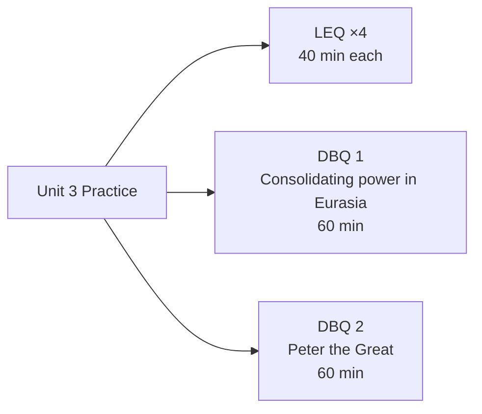

# Unit 3 Practice Questions (Questions Only)
> Land-Based Empires, 1450–1750 · Textbook p.184–188
>
> This file has **no answers**, so you can practice under exam conditions. Answer guides are listed at the bottom.

---

## Part 1. Long Essay Questions (p.184)

**Directions:** Suggested writing time for each essay is 40 minutes.
> ⚠️ The two printings of the textbook give different directions:
> - **Printing 1:** Write an essay in response to **one** of the prompts below.
> - **Printing 2:** Write essay responses to **1, 2, and EITHER 3 or 4**.

**In your response you should do the following:**
- [ ] Respond to the prompt with a historically defensible thesis or claim that establishes a line of reasoning
- [ ] Describe a broader historical context relevant to the prompt
- [ ] Support an argument in response to the prompt using specific and relevant examples of evidence (Printing 1: at least two pieces)
- [ ] Use historical reasoning (e.g., comparison, causation, continuity or change) to frame or structure an argument that addresses the prompt
- [ ] Demonstrate a complex understanding: use evidence to corroborate, qualify, or modify an argument

---

**LEQ 1.** In Africa and Eurasia from 1450 to 1750, various forms of Islam and Christianity were key factors in the expansion of empires.

Develop an argument that evaluates the extent to which the various belief systems showed continuity or change over time during the period from 1450 to 1750.

> *Skill: continuity and change · Related notes: 3.3*

---

**LEQ 2.** Rulers of empires in Africa and Eurasia from 1450 to 1750 developed new methods of governing to solidify their authority over their citizens.

Develop an argument that evaluates the extent to which changes in government caused the consolidation of power in empires in the period 1450 to 1750.

> *Skill: causation · Related notes: 3.2*

---

**LEQ 3.** New technology, including gunpowder weapons, shaped empires throughout southern and southwestern Asia from 1450 to 1750.

Develop an argument that evaluates the extent to which various land-based empires in southern and southwestern Asia developed in similar ways from 1450 to 1750.

> *Skill: comparison · Related notes: 3.1, 3.4*

---

**LEQ 4.** New technology, including gunpowder weapons, shaped empires in Russia and China from 1450 to 1750.

Develop an argument that evaluates the extent to which various land-based empires in Russia and China developed in similar ways from 1450 to 1750.

> *Skill: comparison · Related notes: 3.1, 3.4*

---

## Part 2. DBQ 1: Consolidating Power in Eurasia (Printing 1, p.185–188)

**Directions:** Question 1 is based on the accompanying documents, which have been edited for this exercise. You are advised to spend 15 minutes planning and 45 minutes writing your answer.

> **1. Evaluate the extent to which rulers in Eurasia succeeded in consolidating power within their states, during the period c. 1450 to c. 1750.**

**In your response you should do the following:**
- [ ] Thesis that establishes a line of reasoning
- [ ] Broader historical context
- [ ] Use at least **four** documents
- [ ] At least **one** additional piece of specific evidence beyond the documents
- [ ] For at least **two** documents, explain how point of view, purpose, historical situation, and/or audience is relevant
- [ ] Complex understanding through sophisticated argument and/or effective use of evidence

**Documents** (summaries with key quotes; full text in the textbook)

| Doc | Source | Content |
|---|---|---|
| 1 | Tun Bu village gazetteer, southern China, c. 1450 | The early Ming chose one **tax captain** per township for all grain and silver taxes. Village leaders "did not dare sit" before them. Tax captains had tools of punishment and could order arrests with warrants "written in red ink." |
| 2 | Machiavelli, *The Prince*, on the Ottoman sultan, 1513 | The Ottoman state "is governed by one ruler, the Sultan, the others are his servants," moved between sanjaks "as he chooses." Unlike France, where nobles have their own subjects. Officials are "slaves and bondmen," hard to corrupt. |
| 3 | Toyotomi Hideyoshi, Sword Hunt edict, 1588 | Farmers must give up all weapons, which make "the collection of annual rent" harder and cause "uprisings." The swords will be used for a Great Buddha so farmers benefit "in the lives to come." |
| 4 | Ernest Lissner, painting *Salt Riot in Moscow*, 1938 | The 1648 riot of artisans and serfs against Tsar Alexei I's universal salt tax. The response "unintentionally institutionalized serfdom for centuries." |
| 5 | François Bernier, French traveler employed by the Mughal emperor, 1668 | The king grants land to soldiers and governors instead of pay. Grantees have "an authority almost absolute over the peasantry." Neither peasants nor grantees improve the land. |
| 6 | Saint-Simon, duke at Louis XIV's court, *Memoirs 1691–1709*, publ. 1829 | "Louis XIV wished to reign by himself." He chose ministers "not for their knowledge, but for their ignorance." Flattery was "the sole means" of approaching him. |
| 7 | Jean Rousset de Missy, *Life of Peter the Great*, 1730 | Peter's beard tax (100 rubles for nobles and merchants, one kopek for commoners). Priests called him "a tyrant and a pagan." Old Russians kept their beards for burial; young men accepted the change. |

> ⚠️ *Textbook source errors:* Doc 2 names Suleiman the Magnificent, but in 1513 the sultan was Selim I (Suleiman became sultan in 1520). Doc 3 calls Hideyoshi a "Tokugawa Shogun," but he was never shogun.

---

## Part 3. DBQ 2: Peter the Great (Printing 2, p.185–188)

**Directions:** Question 1 is based on the accompanying documents, which have been edited for this exercise. You are advised to spend 15 minutes planning and 45 minutes writing your answer.

> **1. Using the documents and your knowledge of world history, evaluate the extent to which Peter the Great took steps during his reign (1682–1725) to modernize Russia and transform it into a major European power.**

**In your response you should do the following:**
- [ ] Thesis that establishes a line of reasoning
- [ ] Broader historical context
- [ ] Use at least **six** documents
- [ ] At least **one** additional piece of specific evidence beyond the documents
- [ ] For at least **three** documents, explain how point of view, purpose, historical situation, and/or audience is relevant
- [ ] Use evidence to corroborate, qualify, or modify an argument

**Documents** (summaries with key quotes; full text in the textbook)

| Doc | Source | Content |
|---|---|---|
| 1 | Bishop Burnet of England, 1698 | Peter was "resolved to encourage learning," sending Russians abroad and drawing "strangers to come and live among them." He feared "his sister's intrigues" and "understands little of war." |
| 2 | Peter I, Decree on Compulsory Education of the Nobility | Teachers sent to every region to teach noble children math and geometry. Penalty: no one may marry until he learns them. |
| 3 | Peter I, Decree on the Invitation of Foreigners, 1702 | Goal: prosperous subjects, more trade, and an army of "well-drilled men." Foreigners, including "artisans profitable to the State," are invited to come. |
| 4 | Peter I, Decree on Western Dress, 1701 | Boyars, officials, merchants, streltsy, townspeople, and their families must wear Western dress, "excepting the clergy and peasant tillers of the soil." Russian dress may not be made or sold. |
| 5 | Statute for the College of Manufactures, 1723 | Russia should have factories like those "found in other states." Anyone may open one. Foreign masters must train Russians to "become masters." |
| 6 | Jean Rousset de Missy, *Life of Peter the Great*, c. 1730 | Beard tax; Russians saw it as "an enormous sin." Priests called Peter "a tyrant and a pagan." Young men accepted the change. |
| 7 | Portrait of Peter the Great, Library of Congress | Peter in European-style armor with a sash and sword, near what looks like a globe. (No artist or date given in the textbook.) |

---

## 📘 Answer Guides
| Question | File |
|---|---|
| LEQ 1–4 | Thesis ideas and evidence: end of the 3.1, 3.2, and 3.3 notes |
| DBQ 1 | `AP_WH_Unit3_DBQ_EN.md` |
| DBQ 2 | `AP_WH_Unit3_DBQ2_PeterTheGreat_EN.md` |
