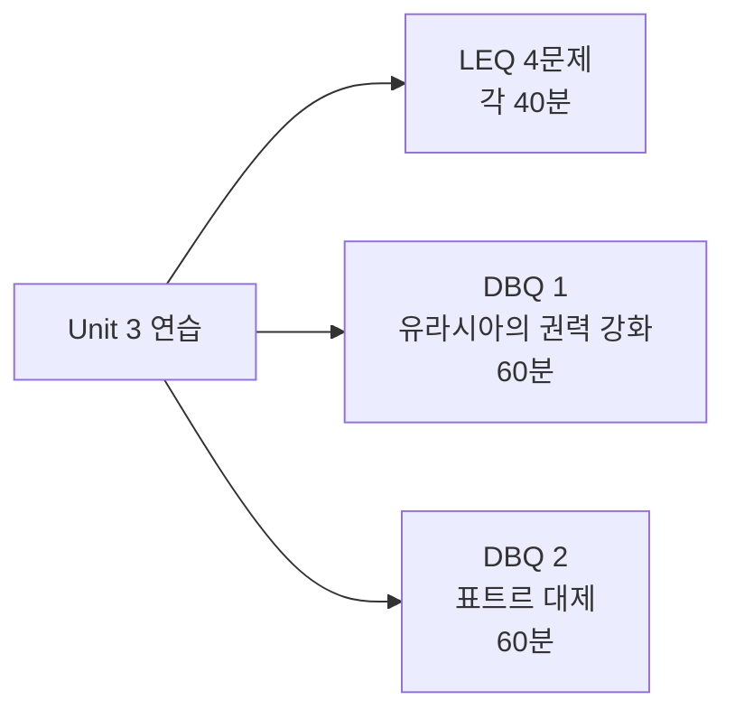

# Unit 3 연습 문제지 (문제만)
> 육상 제국, 1450–1750 · 교재 p.184–188
>
> 시험처럼 연습할 수 있도록 **답은 넣지 않았습니다.** 답안 해설 파일은 맨 아래에 있습니다.
> 답안은 영어로 써야 하므로 문제는 원문 그대로 두고 번역을 함께 적었습니다.

---

## 1부. 서술형 문제 LEQ (p.184)

**지시문:** 에세이 하나당 권장 시간은 40분입니다.
> ⚠️ 교재 인쇄본에 따라 지시문이 다릅니다.
> - **인쇄본 1:** 아래 문제 중 **하나**를 골라 쓰기
> - **인쇄본 2:** **1번, 2번, 그리고 3번 또는 4번** 중 하나를 쓰기

**답안에 들어가야 할 것:**
- [ ] 역사적으로 타당하고 논리 흐름을 세우는 논지
- [ ] 문제와 관련된 더 넓은 역사적 배경
- [ ] 구체적이고 관련 있는 근거로 논증 뒷받침 (인쇄본 1: 최소 2개)
- [ ] 역사적 사고(비교, 인과관계, 지속과 변화)로 논증 구성
- [ ] 복합적 이해: 근거로 논증을 뒷받침하거나, 조건을 달거나, 수정하기

---

**LEQ 1.** In Africa and Eurasia from 1450 to 1750, various forms of Islam and Christianity were key factors in the expansion of empires.

Develop an argument that evaluates the extent to which the various belief systems showed continuity or change over time during the period from 1450 to 1750.

> **번역:** 1450–1750년 아프리카와 유라시아에서 여러 갈래의 이슬람과 기독교는 제국 팽창의 핵심 요인이었다. 이 시기 여러 신앙 체계가 어느 정도 지속되거나 변화했는지 평가하는 논증을 전개하라.
>
> *사고 기술: 지속과 변화 · 관련 노트: 3.3*

---

**LEQ 2.** Rulers of empires in Africa and Eurasia from 1450 to 1750 developed new methods of governing to solidify their authority over their citizens.

Develop an argument that evaluates the extent to which changes in government caused the consolidation of power in empires in the period 1450 to 1750.

> **번역:** 1450–1750년, 아프리카와 유라시아 제국의 통치자들은 백성에 대한 권위를 굳히려고 새로운 통치 방식을 만들었다. 정부의 변화가 제국의 권력 강화를 어느 정도 일으켰는지 평가하는 논증을 전개하라.
>
> *사고 기술: 인과관계 · 관련 노트: 3.2*

---

**LEQ 3.** New technology, including gunpowder weapons, shaped empires throughout southern and southwestern Asia from 1450 to 1750.

Develop an argument that evaluates the extent to which various land-based empires in southern and southwestern Asia developed in similar ways from 1450 to 1750.

> **번역:** 1450–1750년, 화약 무기를 비롯한 새로운 기술이 남아시아와 서남아시아 제국들을 형성했다. 이 지역의 여러 육상 제국이 어느 정도 비슷한 방식으로 발전했는지 평가하는 논증을 전개하라.
>
> *사고 기술: 비교 · 관련 노트: 3.1, 3.4*

---

**LEQ 4.** New technology, including gunpowder weapons, shaped empires in Russia and China from 1450 to 1750.

Develop an argument that evaluates the extent to which various land-based empires in Russia and China developed in similar ways from 1450 to 1750.

> **번역:** 1450–1750년, 화약 무기를 비롯한 새로운 기술이 러시아와 중국의 제국들을 형성했다. 두 지역의 육상 제국이 어느 정도 비슷한 방식으로 발전했는지 평가하는 논증을 전개하라.
>
> *사고 기술: 비교 · 관련 노트: 3.1, 3.4*

---

## 2부. DBQ 1: 유라시아의 권력 강화 (인쇄본 1, p.185–188)

**지시문:** 1번 문제는 함께 실린 문서를 바탕으로 합니다. 문서는 연습용으로 편집되었습니다. 권장 시간은 계획 15분, 쓰기 45분입니다.

> **1. Evaluate the extent to which rulers in Eurasia succeeded in consolidating power within their states, during the period c. 1450 to c. 1750.**
>
> **번역:** 1450년경–1750년경, 유라시아의 통치자들이 자국 내에서 권력을 강화하는 데 어느 정도 성공했는지 평가하라.

**답안에 들어가야 할 것:**
- [ ] 논리 흐름을 세우는 논지
- [ ] 더 넓은 역사적 배경
- [ ] 문서 **4개 이상** 활용
- [ ] 문서에 없는 구체적 근거 **1개 이상**
- [ ] 문서 **2개 이상**에 대해 관점·목적·역사적 상황·독자가 논증과 어떻게 관련되는지 설명
- [ ] 정교한 논증이나 효과적인 근거 활용으로 복합적 이해 보여주기

**문서** (요약과 핵심 인용. 전문은 교재를 보세요)

| 문서 | 출처 | 내용 |
|---|---|---|
| 1 | 둔부 마을 지방지, 중국 남부, 1450년경 | 명 초기에 향마다 **세량장** 한 명이 곡물세·은세를 모두 맡음. 마을 지도자들은 그 앞에서 "did not dare sit". 세량장은 처벌 도구를 갖추고 "written in red ink" 영장으로 체포를 명할 수 있었음 |
| 2 | 마키아벨리, 『군주론』, 오스만 술탄에 대해, 1513 | 오스만은 "governed by one ruler, the Sultan, the others are his servants". 관리들은 산작 사이를 "as he chooses" 옮겨 다님. 귀족이 자기 백성을 가진 프랑스와 다름. 관리들은 "slaves and bondmen"이라 매수하기 어려움 |
| 3 | 도요토미 히데요시, 칼 사냥령, 1588 | 농민은 무기를 모두 내놓아야 함. 무기가 있으면 "the collection of annual rent"가 어렵고 "uprisings"가 일어남. 칼은 대불상에 쓰여 농민이 "in the lives to come" 복을 받음 |
| 4 | 에른스트 리스너, 그림 「모스크바의 소금 폭동」, 1938 | 차르 알렉세이 1세의 전국 소금세에 맞선 1648년 장인·농노 폭동. 정부의 대응이 "unintentionally institutionalized serfdom for centuries" |
| 5 | 프랑수아 베르니에, 무굴 황제에게 고용된 프랑스 여행가, 1668 | 왕이 군인·총독에게 봉급 대신 땅을 줌. 수여자들은 "an authority almost absolute over the peasantry"를 가짐. 농민도 수여자도 땅을 가꾸지 않음 |
| 6 | 생시몽 공작(루이 14세의 궁정인), 『회고록 1691–1709』, 1829년 출간 | "Louis XIV wished to reign by himself". 장관을 "not for their knowledge, but for their ignorance" 골랐음. 아첨이 그에게 다가가는 "the sole means" |
| 7 | 장 루세 드 미시, 『표트르 대제의 생애』, 1730 | 표트르의 수염세(귀족·상인 100루블, 평민 1코페이카). 사제들은 그를 "a tyrant and a pagan"이라 부름. 노인들은 수염을 간직해 함께 묻히려 했고, 젊은이들은 받아들임 |

> ⚠️ *교재 출처 오류:* 문서 2는 쉴레이만 대제로 되어 있지만 1513년의 술탄은 셀림 1세입니다(쉴레이만은 1520년 즉위). 문서 3은 히데요시를 "Tokugawa Shogun"이라고 했지만, 히데요시는 쇼군이 된 적이 없습니다.

---

## 3부. DBQ 2: 표트르 대제 (인쇄본 2, p.185–188)

**지시문:** 1번 문제는 함께 실린 문서를 바탕으로 합니다. 문서는 연습용으로 편집되었습니다. 권장 시간은 계획 15분, 쓰기 45분입니다.

> **1. Using the documents and your knowledge of world history, evaluate the extent to which Peter the Great took steps during his reign (1682–1725) to modernize Russia and transform it into a major European power.**
>
> **번역:** 문서와 세계사 지식을 활용하여, 표트르 대제가 재위 기간(1682–1725) 동안 러시아를 근대화하고 유럽의 주요 강대국으로 바꾸기 위해 어느 정도 조치를 취했는지 평가하라.

**답안에 들어가야 할 것:**
- [ ] 논리 흐름을 세우는 논지
- [ ] 더 넓은 역사적 배경
- [ ] 문서 **6개 이상** 활용
- [ ] 문서에 없는 구체적 근거 **1개 이상**
- [ ] 문서 **3개 이상**에 대해 관점·목적·역사적 상황·독자가 논증과 어떻게 관련되는지 설명
- [ ] 근거로 논증을 뒷받침하거나, 조건을 달거나, 수정하기

**문서** (요약과 핵심 인용. 전문은 교재를 보세요)

| 문서 | 출처 | 내용 |
|---|---|---|
| 1 | 영국의 버넷 주교, 1698 | 표트르는 러시아인을 해외로 보내고 "strangers to come and live among them" 하여 "resolved to encourage learning". "his sister's intrigues"를 걱정했고 "understands little of war" |
| 2 | 표트르 1세, 귀족 의무 교육령 | 모든 지역에 교사를 보내 귀족 자녀에게 수학·기하학을 가르침. 벌칙: 배우기 전에는 결혼 금지 |
| 3 | 표트르 1세, 외국인 초청령, 1702 | 목표: 백성의 번영, 교역 확대, "well-drilled men"으로 이루어진 군대. "artisans profitable to the State"를 비롯한 외국인 초청 |
| 4 | 표트르 1세, 서양 복장령, 1701 | 보야르·관리·상인·스트렐치·도시민과 그 가족은 서양식 옷을 입어야 함. "excepting the clergy and peasant tillers of the soil". 러시아 옷은 만들거나 팔 수 없음 |
| 5 | 공업청 규정, 1723 | 러시아에도 "found in other states" 같은 공장이 있어야 함. 누구나 공장을 열 수 있음. 외국 장인이 러시아인을 "become masters" 하도록 훈련 |
| 6 | 장 루세 드 미시, 『표트르 대제의 생애』, 1730년경 | 수염세. 러시아인은 이를 "an enormous sin"으로 여김. 사제들은 표트르를 "a tyrant and a pagan"이라 부름. 젊은이들은 받아들임 |
| 7 | 표트르 대제 초상화, 미국 의회도서관 | 유럽식 갑옷과 띠, 칼, 지구의로 보이는 물체 옆의 표트르 (교재에 화가·연도 표기 없음) |

---

## 📘 답안 해설 파일
| 문제 | 파일 |
|---|---|
| LEQ 1–4 | 논지 예시와 근거: 3.1, 3.2, 3.3 노트 끝 |
| DBQ 1 | `AP_WH_Unit3_DBQ_KR.md` |
| DBQ 2 | `AP_WH_Unit3_DBQ2_PeterTheGreat_KR.md` |
