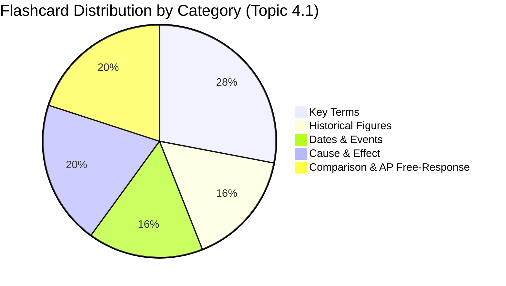

# Topic 4.1: Technological Innovations — Flashcards

---

### Category 1: Key Terms

- [ ] **What was the magnetic compass, and where did it originate?**
  

▶ Answer

  A navigational instrument that points toward magnetic north, originally developed in China (Han/Song dynasties) for divination before being adapted for maritime navigation in China and Europe by the 12th century.
  

- [ ] **What is an astrolabe, and who improved it for maritime use?**
  

▶ Answer

  An instrument originating in the Hellenistic Mediterranean that measures the angle of celestial bodies above the horizon to determine latitude. It was significantly improved and popularized by Muslim navigators in the 12th century.
  

- [ ] **What is a lateen sail, and what navigational advantage did it provide?**
  

▶ Answer

  A triangular sail developed in the Indian Ocean and Arab maritime world. Unlike traditional square sails, it allowed vessels to tack—sail diagonally into the wind—enabling exploration across open ocean waters regardless of prevailing wind direction.
  

- [ ] **What was the caravel?**
  

▶ Answer

  A small, fast, highly maneuverable three-masted ship developed by the Portuguese in the 15th century. It utilized a combination of lateen and square sails and had a shallow draft, making it ideal for coastal reconnaissance and transoceanic exploration.
  

- [ ] **What was the fluyt, and what economic role did it play?**
  

▶ Answer

  A 16th/17th-century Dutch cargo vessel designed exclusively for seaborne commerce with a large cargo hold, pear-shaped hull, and uncomplicated rigging. It required a very small crew, drastically reducing shipping costs and establishing Dutch maritime commercial dominance.
  

- [ ] **What is cartography, and how did it change during the 15th–17th centuries?**
  

▶ Answer

  The science and art of mapmaking. During this period, it evolved from imprecise medieval charts to accurate oceanic maps integrating astronomical grids, compass bearings, and mapped wind/current patterns.
  

- [ ] **What were primogeniture laws?**
  

▶ Answer

  European inheritance laws where all land and titles passed exclusively to the eldest son. This left younger noble sons landless, motivating them to seek fortune, land, and adventure in transoceanic expeditions.
  

---

### Category 2: Historical Figures

- [ ] **Who was Prince Henry the Navigator, and what was his contribution to exploration?**
  

▶ Answer

  A Portuguese royal prince (1394–1460) who centralized navigational research, sponsored the school/court of navigation at Sagres, and funded systematic expeditions along the West African coast to access gold and an eastern sea route.
  

- [ ] **Who was Alexander Neckham?**
  

▶ Answer

  An English scholar (1157–1217) who provided one of the earliest European written descriptions of the magnetic needle compass being used by sailors to navigate in cloudy weather and night darkness.
  

- [ ] **How did Isaac Newton's scientific work assist maritime navigation?**
  

▶ Answer

  His discovery and mathematical formulation of the law of universal gravitation explained ocean tides, allowing navigators to predict tidal cycles and safely avoid shallow coastal reefs and sandbars.
  

- [ ] **Who were the Muslim scholars of Al-Andalus in the context of technological diffusion?**
  

▶ Answer

  Islamic scholars based in medieval Spain who translated, preserved, and refined Greek, Indian, and Arab scientific texts on astronomy, mathematics, and navigation, transmitting this knowledge into Christian Western Europe.
  

---

### Category 3: Dates & Events

- [ ] **What was the significance of the 12th century for navigation in Europe?**
  

▶ Answer

  The magnetic compass and improved astrolabe diffused widely into European maritime circles from China and the Islamic world, laying the empirical foundations for ocean navigation.
  

- [ ] **What occurred in 1415 that catalyzed Portuguese expansion?**
  

▶ Answer

  Portugal conquered the North African commercial hub of Ceuta, inspiring Prince Henry to sponsor further naval explorations southward along the West African coast.
  

- [ ] **Why did the fall of Constantinople in 1453 impact European maritime efforts?**
  

▶ Answer

  The Ottoman capture of Constantinople closed direct Christian access to Black Sea trade and enabled Ottoman/Venetian domination over Mediterranean luxury routes, forcing Western Europeans to seek an oceanic route to Asia.
  

- [ ] **How did the invention of the telescope around 1609 affect navigation?**
  

▶ Answer

  It allowed astronomers to produce precise astronomical charts and celestial grids, enabling navigators to calculate nighttime positions far more accurately.
  

---

### Category 4: Cause & Effect

- [ ] **What caused the Omani-European rivalry in the Indian Ocean?**
  

▶ Answer

  **Cause**: Portugal built fortified outposts (e.g., Muscat, Hormuz) in the Indian Ocean to monopolize trade routes.  
  **Effect**: The Sultanate of Oman repeatedly attacked and expelled Portuguese garrisons, challenging European dominance in regional trade.
  

- [ ] **How did demographic pressure in Europe lead to oceanic exploration?**
  

▶ Answer

  **Cause**: Population recovery after the Black Death created labor surpluses and land shortages.  
  **Effect**: Commoners and landless younger sons sought economic livelihood, social mobility, and landholdings across newly discovered maritime frontiers.
  

- [ ] **How did the diffusion of the sternpost rudder change ship capabilities?**
  

▶ Answer

  **Cause**: The Chinese sternpost rudder replaced steering oars on large European vessels.  
  **Effect**: Ships achieved superior steering control and stability, allowing them to withstand turbulent oceanic storms.
  

- [ ] **How did understanding ocean gyres and wind currents facilitate transoceanic voyages?**
  

▶ Answer

  **Cause**: Mariners documented circular wind patterns (such as the Atlantic trade winds and westerlies).  
  **Effect**: European captains learned the *volta do mar*—sailing away from direct paths to catch favorable winds—ensuring reliable round-trip voyages across oceans.
  

- [ ] **What caused the development of armed merchant vessels like the carrack?**
  

▶ Answer

  **Cause**: Long-distance trade routes faced piracy and naval confrontations with rival states.  
  **Effect**: Europeans mounted heavy cannons onto sturdy, multi-decked carracks, merging commercial cargo hauling with military naval superiority.
  

---

### Category 5: Comparison & AP Free-Response

- [ ] **Compare the functional advantages of the Caravel versus the Fluyt.**
  

▶ Answer

  - **Caravel**: Designed for exploratory reconnaissance; equipped with lateen sails for maneuvering into wind and a shallow draft for coastal/river surveying.  
  - **Fluyt**: Designed for commercial freight; maximized cargo capacity without deck-mounted cannons, operating with minimal crew to minimize operational costs.
  

- [ ] **Compare traditional square sails with triangular lateen sails.**
  

▶ Answer

  - **Square Sails**: Highly efficient when sailing directly before the wind (downwind), but entirely ineffective when facing headwinds.  
  - **Lateen Sails**: Could pivot on an angle to catch crosswinds and headwinds, allowing zigzagging (tacking) across vast open ocean waters.
  

- [ ] **[AP Short Answer / SAQ Practice] Explain ONE technological innovation from 1450 to 1750 that facilitated transoceanic travel.**
  

▶ Answer

  - **Claim**: The European adoption and refinement of the astrolabe from Muslim scholars directly enabled safe transoceanic travel.  
  - **Evidence**: Sailors used the astrolabe to measure the altitude of celestial bodies relative to the horizon to determine their latitude north or south of the equator.  
  - **Reasoning**: This accurate latitude measurement allowed mariners to navigate out of sight of land for months across the Atlantic and Indian Oceans without losing their geographic orientation.
  

- [ ] **[AP Long Essay / LEQ Practice] Evaluate the extent to which cross-cultural interactions influenced European maritime expansion between 1450 and 1750.**
  

▶ Answer

  - **Claim**: Cross-cultural interactions were foundational to European maritime expansion, as European navigation relied almost entirely on the synthesis of Asian and Islamic technologies.  
  - **Evidence**: Europeans adopted the magnetic compass and sternpost rudder from China, lateen sails and astrolabes from the Islamic world, and combined them with Greek celestial geometry.  
  - **Reasoning**: Without synthesizing these imported tools, European explorers would have lacked both the directional capability and vessel maneuverability required to cross open oceans.
  

- [ ] **[AP Document-Based Practice] Analyze how state sponsorship interacted with technological innovation to alter global trade networks.**
  

▶ Answer

  - **Claim**: State sponsorship was essential because it provided the massive capital required to turn theoretical technological innovations into expansive maritime fleets.  
  - **Evidence**: Portuguese royal funding under Prince Henry the Navigator established naval research facilities and financed successive voyages that tested the caravel and astronomical mapping.  
  - **Reasoning**: Because individual merchants could not absorb the extreme financial risks and initial construction costs of oceanic expeditions, centralized royal patronage institutionalized technological breakthroughs, directly yielding national trading post empires.
  
