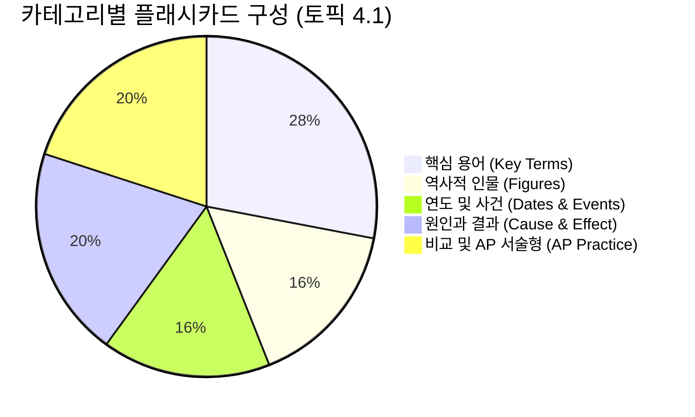

# 토픽 4.1: 기술 혁신 (Technological Innovations) — 플래시카드

---

### 카테고리 1: 핵심 용어 (Key Terms)

- [ ] **나침반(Magnetic Compass)의 기원과 항해에서의 역할은 무엇인가?**
  

▶ 정답

  중국(한·송대)에서 점술용으로 발명된 후 12세기경 유럽과 중동으로 전파된 항법 장비입니다. 자침이 지구 자기장의 북쪽을 가리키므로, 안개나 야간 등 육지가 보이지 않는 대양에서도 선박이 일정한 방향을 유지하며 항해할 수 있게 했습니다.
  

- [ ] **아스트롤라베(Astrolabe)란 무엇이며, 어떤 집단에 의해 발전되었는가?**
  

▶ 정답

  헬레니즘 지중해 세계에서 기원하여 12세기 이슬람 항해사 및 천문학자들에 의해 정밀하게 개량된 천문 관측 기구입니다. 지평선 위 천체(태양과 별)의 고도를 측정하여 적도로부터의 북위/남위(위도)를 정확히 계산하는 데 사용되었습니다.
  

- [ ] **라틴 세일(Lateen Sail)의 형태와 기술적 장점은 무엇인가?**
  

▶ 정답

  아랍 및 인도양 해역에서 개발된 삼각형 형태의 돛입니다. 바람을 등지고만 갈 수 있었던 전통 사각돛과 달리, 돛의 각도를 조절하여 맞바람을 지그재그(Tacking)로 헤치며 전진할 수 있어 대양 횡단 항로 개척에 결정적 기여를 했습니다.
  

- [ ] **카라벨선(Caravel)의 구조적 특징과 장점은 무엇인가?**
  

▶ 정답

  15세기 포르투갈이 개발한 소형 3마스트 범선입니다. 삼각돛(라틴 세일)과 사각돛을 혼용하여 역풍 항해가 가능했고, 흘수선(배 밑바닥 깊이)이 얕아 암초가 많은 미지의 연안 탐사와 강어귀 진입, 원양 탐험에 최적화되었습니다.
  

- [ ] **플루이트선(Fluyt)의 개발 목적과 경제적 의의는 무엇인가?**
  

▶ 정답

  16~17세기 네덜란드가 순수 상업용 화물 운송을 위해 개발한 선박입니다. 군용 대포를 배제하고 배불뚝이 형태의 넓은 화물창과 간소화된 돛장치를 갖추어, 최소한의 승무원으로 최대의 화물을 운송함으로써 해운 운임비를 획기적으로 낮추었습니다.
  

- [ ] **지도 제작술(Cartography)은 15~17세기에 어떻게 진화했는가?**
  

▶ 정답

  단순한 상징적 중세 지도에서 벗어나 천문학적 격자 좌표계, 나침반 방위선, 실제 측정된 해류와 풍향 정보를 체계적으로 반영한 실용적 원양 항해도(포르톨라노 해도 등)로 발전했습니다.
  

- [ ] **장자 상속제(Primogeniture laws)란 무엇이며 탐험에 어떤 영향을 미쳤는가?**
  

▶ 정답

  영지와 작위 등 모든 가문 재산을 맏아들에게만 상속하도록 규정한 유럽의 법제입니다. 재산을 받지 못한 차남 이하 귀족 자제들이 토지와 부, 신분 상승을 추구하며 해외 탐험과 식민 정복 원정에 대거 자원하게 만들었습니다.
  

---

### 카테고리 2: 역사적 인물 (Historical Figures)

- [ ] **항해왕자 엔히크(Prince Henry the Navigator)의 역사적 업적은 무엇인가?**
  

▶ 정답

  포르투갈의 왕족(1394–1460)으로, 사그레스에 항해 연구소를 설립하고 항해사, 지도 제작자, 조선공을 모아 체계적인 해양 탐사를 후원했습니다. 서아프리카 연안 탐사를 지속적으로 재정 지원하여 포르투갈 해양 제국의 초석을 닦았습니다.
  

- [ ] **알렉산더 네컴(Alexander Neckham)은 나침반과 관련하여 어떤 기록을 남겼는가?**
  

▶ 정답

  12세기 영국의 학자(1157–1217)로, 유럽 문헌 중 최초로 선원들이 흐린 날이나 칠흑 같은 밤에 자침(나침반)을 회전시켜 북쪽 방향을 확인하며 항해한다는 사실을 상세히 기록했습니다.
  

- [ ] **아이작 뉴턴(Isaac Newton)의 과학적 발견이 항해에 미친 영향은 무엇인가?**
  

▶ 정답

  만유인력 법칙을 수립하여 달과 태양의 인력에 의한 조수간만의 차(밀물과 썰물)를 과학적으로 설명했습니다. 이를 통해 선원들은 연안 수심 변화를 예측하여 좌초 위험을 예방할 수 있었습니다.
  

- [ ] **알안달루스(Al-Andalus)의 학자들은 지식 확산에 어떤 기여를 했는가?**
  

▶ 정답

  이슬람 지배하의 스페인 지역에서 고대 그리스의 기하학·천문학 문헌과 이슬람 세계의 항법 지식을 아랍어에서 라틴어로 번역·보존하여 서유럽 르네상스와 과학적 항법 발전에 결정적인 지적 가교 역할을 했습니다.
  

---

### 카테고리 3: 연도 및 사건 (Dates & Events)

- [ ] **12세기가 해양 항해사에서 중요한 전환점이 된 이유는 무엇인가?**
  

▶ 정답

  중국의 자침 나침반과 이슬람 학자들의 정밀 아스트롤라베가 유럽 항해계에 널리 수용되어, 연안 항해에서 대양 항해로 전환할 수 있는 기술적 토대가 마련되었습니다.
  

- [ ] **1415년 세우타(Ceuta) 정복이 포르투갈 탐험사에 갖는 의미는 무엇인가?**
  

▶ 정답

  포르투갈이 북아프리카의 전략적 무역 도시 세우타를 점령하면서 사하라 종단 금 무역의 실체를 알게 되었고, 엔히크 왕자가 아프리카 서안을 따라 남하하는 대규모 해상 탐사를 시작하는 직접적 계기가 되었습니다.
  

- [ ] **1453년 콘스탄티노플 함락이 유럽의 원양 항해를 가속화한 이유는 무엇인가?**
  

▶ 정답

  오스만 제국이 콘스탄티노플을 장악하고 지중해 무역로를 통제하며 관세를 대폭 인상하자, 이탈리아 상인을 거치지 않고 아시아 향신료 산지로 직접 갈 수 있는 해상 항로 개척이 서유럽 국가들에게 국가적 급선무가 되었습니다.
  

- [ ] **1609년 망원경 발명이 항해술에 미친 영향은 무엇인가?**
  

▶ 정답

  별자리와 행성의 움직임을 정밀 관측할 수 있게 되어 고정밀 천문도(Astronomical Charts)가 제작되었고, 밤하늘의 천체를 기준 삼아 자신의 위치를 계산하는 천문 항법의 오차가 대폭 줄어들었습니다.
  

---

### 카테고리 4: 원인과 결과 (Cause & Effect)

- [ ] **오만-유럽 경쟁(Omani-European Rivalry)의 원인과 결과는 무엇인가?**
  

▶ 정답

  - **원인**: 포르투갈이 인도양 무역을 독점하기 위해 무스카트, 호르무즈 등 주요 길목에 요새를 건설하고 무역 통행증(Cartaz)을 강제함.  
  - **결과**: 오만 술탄국이 이에 저항하여 해상 요새를 공격·탈환하고 독자적 해양 세력을 형성하며 유럽의 일방적 패권 장악을 저지함.
  

- [ ] **유럽의 인구 증가가 대양 탐험으로 이어진 인과관계는 무엇인가?**
  

▶ 정답

  - **원인**: 흑사병 이후 15~16세기 유럽 인구가 급증하면서 경작지와 식량, 일자리가 부족해짐.  
  - **결과**: 토지를 상속받지 못한 평민과 차남 귀족들이 생계와 경제적 신분 상승을 도모하기 위해 해외 원정과 식민지 정착으로 대거 유출됨.
  

- [ ] **선미 방향타(Sternpost Rudder)의 도입이 가져온 선박 운항의 변화는 무엇인가?**
  

▶ 정답

  - **원인**: 중국에서 유래된 선미 중앙 장착형 조타 장치가 유럽의 기존 측면 노(Steering oar)를 대체함.  
  - **결과**: 거친 파도가 치는 외해에서도 선박의 방향 제어력과 안정성이 획기적으로 향상되어 대형 선박의 원양 항해가 가능해짐.
  

- [ ] **환류(Gyres) 및 풍향 체계에 대한 이해가 원양 왕복 항해를 가능하게 한 방식은 무엇인가?**
  

▶ 정답

  - **원인**: 대서양의 무역풍과 편서풍 등 일정한 순환 바람 체계(Volta do mar)를 관측하고 기록함.  
  - **결과**: 목적지로 갈 때와 귀환할 때 서로 다른 항로를 선택하여 순풍을 타고 안전하게 왕복 항해할 수 있게 됨.
  

- [ ] **캐럭선(Carrack)과 같은 무장 대형 범선이 등장하게 된 원인은 무엇인가?**
  

▶ 정답

  - **원인**: 장거리 무역로에서 해적의 습격과 적대적 경쟁 국가의 해군 위협이 상존함.  
  - **결과**: 대량의 상품을 싣는 동시에 측면에 다수의 함포를 장착할 수 있는 복합 구조의 대형 선박을 건조하여 상업과 군사력을 결합함.
  

---

### 카테고리 5: 비교 및 AP 서술형 (AP Practice)

- [ ] **카라벨선(Caravel)과 플루이트선(Fluyt)의 설계 철학 및 기능을 비교하시오.**
  

▶ 정답

  - **카라벨선**: 탐험과 연안 정찰용. 얕은 흘수선과 삼각돛 중심 구성으로 역풍 돌파력과 기동성을 중시함.  
  - **플루이트선**: 상업적 화물 수송 전용. 무장을 최소화하고 화물창 용적을 극대화하여 적은 인원으로 운용비용을 극도로 낮춤.
  

- [ ] **전통 사각돛과 라틴 세일(삼각돛)의 기능적 차이를 비교하시오.**
  

▶ 정답

  - **사각돛**: 순풍(뒤에서 부는 바람)을 받을 때 추진력이 매우 강력하지만, 역풍 상황에서는 항해가 불가능함.  
  - **라틴 세일**: 바람을 비스듬히 안고 양력을 발생시켜 맞바람 속에서도 지그재그로 전진할 수 있어 풍향 제약을 극복함.
  

- [ ] **[단답형 서술 / SAQ] 1450~1750년 사이 대양 항해를 촉진한 기술 혁신 1가지를 제시하고 그 작동 원리와 영향을 설명하시오.**
  

▶ 정답

  - **주장 (Claim)**: 이슬람 항해사들이 개량한 아스트롤라베(Astrolabe)의 도입은 유럽인들의 안전한 대양 횡단을 직접 가능하게 했습니다.  
  - **근거 (Evidence)**: 선원들은 아스트롤라베로 수평선 대비 태양이나 북극성의 고도를 측정하여 적도 기준 남북 위치인 위도를 정확히 파악했습니다.  
  - **설명 (Reasoning)**: 육안으로 지형지물을 볼 수 없는 수천 킬로미터의 대서양 한가운데서도 선박이 정해진 항로를 이탈하지 않고 유지할 수 있게 됨으로써 전 지구적 무역망 연결이 현실화되었습니다.
  

- [ ] **[장문형 서술 / LEQ] 1450~1750년 유럽의 해양 팽창에서 문화 간 상호작용이 미친 영향의 정도를 평가하시오.**
  

▶ 정답

  - **주장 (Claim)**: 문화 간 상호작용은 유럽 해양 팽창의 성패를 가른 결정적 요인이었으며, 유럽의 항해 기술은 아시아와 이슬람권 기술의 융합 없이는 성립할 수 없었습니다.  
  - **근거 (Evidence)**: 중국의 나침반과 선미 방향타, 이슬람권의 아스트롤라베와 라틴 세일, 헬레니즘 천문학 지식이 스페인과 포르투갈의 항해 학교에서 융합되었습니다.  
  - **설명 (Reasoning)**: 유럽의 자체적 조선 능력만으로는 거친 대양 횡단이 불가능했으나, 여러 문명권의 방향 측정, 역풍 항해, 정밀 조타 기술이 복합적으로 통합됨으로써 비로소 전 지구적 해양 제국 건설이 가능해졌습니다.
  

- [ ] **[자료 기반 서술 / DBQ] 국가 권력의 후원(State Sponsorship)과 항해 기술 혁신 간의 상호작용을 분석하시오.**
  

▶ 정답

  - **주장 (Claim)**: 국가의 재정적·제도적 후원은 막대한 위험과 비용이 수반되는 기술 혁신을 실질적 해양 제국 건설로 전환시킨 필수 동력이었습니다.  
  - **근거 (Evidence)**: 포르투갈의 엔히크 왕자는 사그레스에 천문학자, 수학자, 조선 기술자를 조직화하고 지속적인 탐험 자금을 지원하여 카라벨선 제작과 대서양 바람 지도를 완성했습니다.  
  - **설명 (Reasoning)**: 개별 상인이나 길드는 실패 위험이 극도로 높은 초기 원양 탐험 비용을 감당할 수 없었기 때문에, 국가 주도의 중앙집권적 지원이 기술적 돌파구를 실제 식민지 개척과 무역 독점이라는 국가 전략으로 결실 맺게 했습니다.
  
