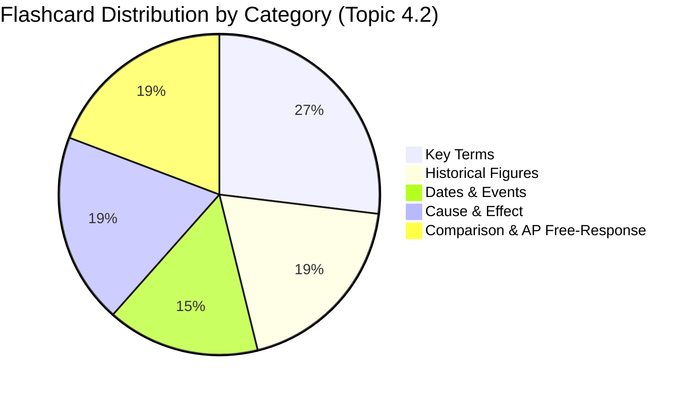

# Topic 4.2: Exploration: Causes and Events — Flashcards

---

### Category 1: Key Terms

- [ ] **What is mercantilism?**
  

▶ Answer

  An economic policy predominant in 16th–18th-century Europe postulating that a nation's power depends on accumulating precious metals (bullion). It required heavy state regulation, export maximization, import tariffs, and colonial exploitation.
  

- [ ] **What is a "trading post empire"?**
  

▶ Answer

  An imperial system pioneered by the Portuguese that focused on capturing and fortifying strategic maritime choke points and coastal ports rather than occupying inland territories, aiming to monopolize and tax maritime commerce.
  

- [ ] **What was the cartaz system?**
  

▶ Answer

  A naval trade pass issued by the Portuguese crown requiring all non-Portuguese merchant vessels in the Indian Ocean to pay customs duties and conform to Portuguese trade regulations under threat of confiscation.
  

- [ ] **What were the Manila Galleons?**
  

▶ Answer

  Heavily armed Spanish trading vessels that made annual trans-Pacific voyages between Acapulco (Mexico) and Manila (Philippines), exchanging New World silver for Chinese silk, porcelain, and luxury goods.
  

- [ ] **What was the Northwest Passage?**
  

▶ Answer

  A hypothetical direct water route connecting the Atlantic and Pacific oceans through northern North America, actively sought by English, French, and Dutch explorers to reach Asia.
  

- [ ] **What is bullionism?**
  

▶ Answer

  A core component of mercantilist theory holding that the economic health and sovereignty of a state are measured directly by the amount of physical gold and silver locked in royal treasuries.
  

- [ ] **What was Quebec's role in the French empire?**
  

▶ Answer

  Founded in 1608 by Samuel de Champlain, it served as the fortified administrative and trading center of New France, focusing on the beaver fur trade through alliances with indigenous peoples.
  

---

### Category 2: Historical Figures

- [ ] **Who was Prince Henry the Navigator?**
  

▶ Answer

  A Portuguese royal (1394–1460) who mobilized state revenue to establish navigation research centers and sponsor continuous exploratory voyages south along the West African coast.
  

- [ ] **Who was Bartholomew Diaz?**
  

▶ Answer

  A Portuguese captain who in 1488 became the first European to sail around the southernmost tip of Africa (Cape of Good Hope), opening the sea gateway to the Indian Ocean.
  

- [ ] **Who was Vasco da Gama?**
  

▶ Answer

  A Portuguese explorer who sailed across the Indian Ocean to land at Calicut, India in 1498, securing Portugal's initial commercial entry into Asian maritime trade.
  

- [ ] **Who was Afonso de Albuquerque?**
  

▶ Answer

  Governor of Portuguese India (1509–1515) who forcefully secured strategic bases at Goa, Malacca, and Hormuz, establishing Portugal's spice monopoly through naval artillery.
  

- [ ] **Who was Ferdinand Magellan?**
  

▶ Answer

  A Portuguese navigator sailing under the Spanish flag whose expedition (1519–1522) accomplished the first circumnavigation of the globe, claiming the Philippines for Spain.
  

---

### Category 3: Dates & Events

- [ ] **What occurred in 1488 regarding European exploration?**
  

▶ Answer

  Bartholomew Diaz rounded the Cape of Good Hope, demonstrating that ships could pass from the Atlantic to the Indian Ocean.
  

- [ ] **What was the historical significance of 1492?**
  

▶ Answer

  Christopher Columbus, backed by Ferdinand and Isabella of Spain, made landfall in the Americas, initiating sustained transatlantic ecological and imperial interactions.
  

- [ ] **What took place at the Battle of Diu in 1509?**
  

▶ Answer

  The Portuguese fleet decisively routed a joint Egyptian Mamluk, Ottoman, and Venetian fleet off the coast of India, cementing European naval hegemony in the Arabian Sea.
  

- [ ] **What was established in Manila in 1571?**
  

▶ Answer

  The Spanish established Manila as their colonial capital and commercial entrepôt in the Philippines, anchoring the Pacific silver-silk trade between America and Asia.
  

---

### Category 4: Cause & Effect

- [ ] **Why did European states centrally sponsor oceanic exploration instead of leaving it to private merchants?**
  

▶ Answer

  **Cause**: Oceanic exploration required astronomical financial outlays for ship fleets, armaments, and long provisions, with vast risk of total shipwreck.  
  **Effect**: Only centralizing monarchies possessed the tax revenues and sovereignty to underwrite these risks in return for trade monopolies.
  

- [ ] **How did Italian city-states inadvertently stimulate western European exploration?**
  

▶ Answer

  **Cause**: Venice and Genoa maintained exclusive distribution monopolies over Asian luxury commodities entering the Mediterranean.  
  **Effect**: Iberian nations (Portugal and Spain) sought all-water sea routes to bypass Italian middlemen and lower commodity acquisition costs.
  

- [ ] **What caused the rapid decline of the Portuguese maritime trading post empire?**
  

▶ Answer

  **Cause**: Portugal possessed a very small domestic population and lacked the military and bureaucratic manpower to police far-flung outposts against rivals and corruption.  
  **Effect**: The Dutch (VOC) and English East India Companies systematically captured Portuguese outposts (such as Malacca and Sri Lanka) in the 17th century.
  

- [ ] **What was the effect of Spanish silver mining on Pacific trade via Manila?**
  

▶ Answer

  **Cause**: The Ming Dynasty shifted its imperial taxation system strictly to silver, drastically raising Chinese domestic demand for bullion.  
  **Effect**: Spanish galleons shipped thousands of tons of American silver from Acapulco to Manila, where Chinese merchants eagerly exchanged silks and porcelain.
  

- [ ] **Why did French colonization in North America take a different trajectory than Spanish colonization?**
  

▶ Answer

  **Cause**: France found little mineral bullion in Canada and focused on the lucrative beaver fur trade, which required mobility and native partnerships.  
  **Effect**: France established sparse trading posts rather than massive agricultural settlements, leading to cooperative military alliances with indigenous tribes.
  

---

### Category 5: Comparison & AP Free-Response

- [ ] **Compare the imperial strategies of the Portuguese and Spanish maritime empires in the 16th century.**
  

▶ Answer

  - **Portuguese Empire**: Built a trading post empire centered on maritime choke points (Hormuz, Goa, Malacca) and customs passes without extensive inland territorial conquest.  
  - **Spanish Empire**: Undertook extensive land conquests (Aztec and Inca empires), colonizing large populations, managing vast agricultural estates, and extracting subterranean mineral wealth.
  

- [ ] **Compare French colonial settlement patterns with English colonial settlements in North America.**
  

▶ Answer

  - **French**: Focused on river-based fur trade networks with low European settler populations, relying on symbiotic trade alliances and Jesuit missionary engagement with native nations.  
  - **English**: Focused on family-based permanent agrarian colonization (e.g., Virginia, New England), rapidly clearing land and displacing native populations through territorial conflict.
  

- [ ] **[AP Short Answer / SAQ Practice] Explain ONE economic motivation that drove state sponsorship of maritime voyages between 1450 and 1750.**
  

▶ Answer

  - **Claim**: The mercantilist drive to hoard gold and silver bullion motivated monarchies to directly finance maritime exploration.  
  - **Evidence**: Spain financed Columbus and subsequent conquistador expeditions to secure direct access to gold deposits and mineral wealth abroad.  
  - **Reasoning**: Under mercantilist theory, national power was zero-sum and tied to bullion; thus, spending treasury funds to discover direct overseas mineral deposits gave states a military and geopolitical advantage over European rivals.
  

- [ ] **[AP Long Essay / LEQ Practice] Evaluate the extent to which European maritime exploration altered economic interactions between Europe and Asia from 1450 to 1750.**
  

▶ Answer

  - **Claim**: European maritime exploration substantially reorganized luxury trade routes by introducing direct ocean transport, but largely adapted to rather than dismantled preexisting Asian merchant networks.  
  - **Evidence**: Portugal captured key nodes like Malacca and Goa, forcing ships to buy cartaz passes, while Manila galleons funneled American silver into China in exchange for silk.  
  - **Reasoning**: While Europeans redirected oceanic carrying routes and inserted themselves as middlemen using armed naval force, Asian domestic production (silk, tea, spices) and intra-Asian merchant networks remained vast, resilient, and economically dominant throughout this era.
  

- [ ] **[AP Document-Based Practice] Analyze how religious motives intersected with commercial motives in Iberian maritime expansion.**
  

▶ Answer

  - **Claim**: In Iberian exploration, commercial expansion and Catholic evangelism were viewed as mutually reinforcing aspects of imperial statecraft.  
  - **Evidence**: Papal bulls and royal charters authorized Portuguese and Spanish explorers to claim new trade monopolies while mandating the conversion of indigenous peoples, as seen in the dispatch of Jesuit and Franciscan friars on voyages.  
  - **Reasoning**: European monarchs legitimized their armed commercial expansion and territorial seizures to their subjects and church authorities by framing economic enrichment as necessary to finance and spread global Christendom.
  
