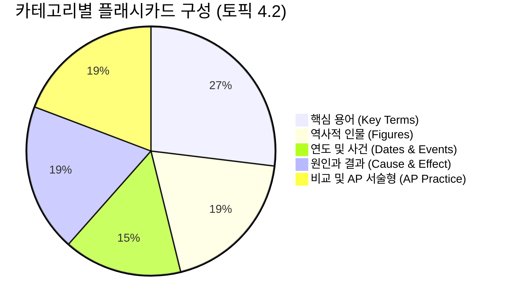

# 토픽 4.2: 해양 탐험: 원인과 전개 (Exploration: Causes and Events) — 플래시카드

---

### 카테고리 1: 핵심 용어 (Key Terms)

- [ ] **중상주의(Mercantilism)란 무엇인가?**
  

▶ 정답

  16~18세기 유럽을 지배한 경제 사상으로, 국가의 번영과 권력이 금·은 등 귀금속(Bullion)의 보유량에 직결된다고 보았습니다. 이에 따라 강력한 국가 통제하에 수출을 장려하고 수입 관세를 부과하며 식민지를 원자재 공급처이자 상품 시장으로 착취했습니다.
  

- [ ] **무역 거점 제국(Trading Post Empire)이란 무엇인가?**
  

▶ 정답

  포르투갈이 인도양과 아시아 연안에서 개척한 제국 형태로, 넓은 내륙 영토를 무력 점령하는 대신 해상 교통의 전략적 병목 지점(호르무즈, 고아, 말라카 등)에 요새와 항구를 설치하여 해상 교역을 통제하고 관세를 징수하는 방식입니다.
  

- [ ] **카르타스(Cartaz) 제도란 무엇인가?**
  

▶ 정답

  포르투갈 왕실이 인도양을 오가는 아시아 및 중동 상선들에게 강제로 구매하도록 한 해상 통행증입니다. 이를 소지하지 않은 선박은 해적으로 간주하여 나포하거나 격침했습니다.
  

- [ ] **마닐라 갈레온(Manila Galleons)의 역할은 무엇인가?**
  

▶ 정답

  멕시코 아카풀코와 필리핀 마닐라 사이를 연례 운항하던 스페인의 대형 무장 상선입니다. 아메리카산 은을 마닐라로 수송하여 중국 상인들의 비단, 도자기 등 고급 사치품과 교환하는 태평양 은 무역의 핵심 축이었습니다.
  

- [ ] **북서항로(Northwest Passage)란 무엇인가?**
  

▶ 정답

  북아메리카 대륙의 북극해를 통과해 대서양에서 태평양 및 아시아로 직접 건너가기 위해 영국, 프랑스, 네덜란드 탐험가들이 찾아 헤맨 전설적인 해상 항로입니다.
  

- [ ] **귀금속주의(Bullionism)란 무엇인가?**
  

▶ 정답

  중상주의의 핵심 신념으로, 한 국가의 실질적 부와 군사력은 오직 국고에 보관된 금과 은의 물리적 수량에 의해 결정된다는 경제 이론입니다.
  

- [ ] **프랑스 식민지 퀘벡(Quebec)의 역사적 의의는 무엇인가?**
  

▶ 정답

  1608년 사뮈엘 드 샹플랭에 의해 건설된 누벨프랑스의 요새화된 중심지로, 원주민들과 우호적 동맹을 맺고 세인트로렌스강 유역의 비버 모피 무역을 장악하는 전초기지 역할을 했습니다.
  

---

### 카테고리 2: 역사적 인물 (Historical Figures)

- [ ] **항해왕자 엔히크(Prince Henry the Navigator)의 역사적 공헌은 무엇인가?**
  

▶ 정답

  포르투갈 왕실의 재정을 지원하여 항해 연구소(사그레스)를 세우고 선박 기술자와 지도 제작자를 육성했으며, 서아프리카 연안 탐사를 지속적으로 조직하여 대항해 시대를 개막한 인물입니다.
  

- [ ] **바르톨로뮤 디아스(Bartholomew Diaz)의 업적은 무엇인가?**
  

▶ 정답

  1488년 유럽인 최초로 아프리카 최남단 희망봉(Cape of Good Hope)을 항해하여 돌아섬으로써 대서양에서 인도양으로 진입하는 해상 통로의 존재를 증명했습니다.
  

- [ ] **바스코 다 가마(Vasco Da Gama)의 역사적 성과는 무엇인가?**
  

▶ 정답

  1498년 희망봉을 돌아 인도 캘리컷(Calicut)에 도착함으로써 유럽에서 아시아로 가는 직항 해상 무역로를 개척하여 포르투갈의 막대한 향신료 수입 기반을 닦았습니다.
  

- [ ] **아폰수 드 알부케르크(Afonso de Albuquerque)의 군사적 역할은 무엇인가?**
  

▶ 정답

  포르투갈령 인도의 총독(1509–1515)으로서 호르무즈, 고아, 말라카를 무력으로 정복하여 무슬림 상인들의 무역망을 차단하고 포르투갈의 인도양 향신료 독점권을 수립했습니다.
  

- [ ] **페르디난드 마젤란(Ferdinand Magellan)의 탐험이 갖는 의미는 무엇인가?**
  

▶ 정답

  스페인 왕실의 후원으로 1519~1522년 사상 최초의 세계 일주 항해를 이끌어(본인은 필리핀에서 전사), 지구 전체가 하나의 거대한 해양으로 연결되어 있음을 인류 역사상 최초로 입증했습니다.
  

---

### 카테고리 3: 연도 및 사건 (Dates & Events)

- [ ] **1488년 바르톨로뮤 디아스의 항해가 지닌 역사적 분기점은 무엇인가?**
  

▶ 정답

  아프리카 대륙의 끝인 희망봉을 발견·통과함으로써 아프리카 남쪽을 돌아 인도양으로 진입할 수 있다는 해양 지리적 확신을 유럽에 제공했습니다.
  

- [ ] **1492년 콜럼버스의 항해가 세계사에 미친 결정적 영향은 무엇인가?**
  

▶ 정답

  스페인의 후원으로 대서양을 건너 카리브해에 도달함으로써, 수천 년간 격리되어 있던 동반구와 서반구 문명이 지속적으로 접촉하고 융합하는 콜럼버스 교환(Columbian Exchange)의 서막을 열었습니다.
  

- [ ] **1509년 디우 해전(Battle of Diu)의 승패가 가져온 결과는 무엇인가?**
  

▶ 정답

  포르투갈 함대가 이집트 맘루크, 오스만 제국, 베네치아의 연합 함대를 괴멸시키고 아라비아해와 인도양 북부의 해상 통제권을 확고히 장악했습니다.
  

- [ ] **1571년 스페인의 마닐라(Manila) 건설이 갖는 세계 경제적 의의는 무엇인가?**
  

▶ 정답

  스페인이 필리핀에 마닐라를 설립함으로써 멕시코산 은과 중국산 비단·도자기를 직접 교환하는 최초의 전 지구적 태평양 환류 무역망이 완성되었습니다.
  

---

### 카테고리 4: 원인과 결과 (Cause & Effect)

- [ ] **개별 상인이 아닌 국가(군주)가 해양 탐험을 주도적으로 후원한 이유는 무엇인가?**
  

▶ 정답

  - **원인**: 대양 탐험은 함대 건조, 대포 무장, 장기 보급 등 천문학적 초기 자본과 선박 침몰 등의 극단적 위험이 수반됨.  
  - **결과**: 막대한 조세 징수권과 주권을 가진 중앙집권적 군주정만이 이러한 위험을 감당할 수 있었고, 탐험 성공 시 독점 무역 이익을 국고로 환수함.
  

- [ ] **이탈리아 도시 국가들의 지중해 독점이 서유럽 탐험을 촉진한 메커니즘은 무엇인가?**
  

▶ 정답

  - **원인**: 베네치아와 제노바가 오스만 제국과 결탁하여 지중해를 통한 동방 향신료 및 비단 유통을 독점하고 막대한 마진을 붙임.  
  - **결과**: 이베리아 국가들(포르투갈, 스페인)이 이탈리아 중개 상인을 배제하고 직접 원산지로 갈 수 있는 대서양 및 대양 우회 항로 개척에 사활을 걸게 됨.
  

- [ ] **포르투갈 무역 거점 제국이 17세기에 급격히 쇠퇴한 원인은 무엇인가?**
  

▶ 정답

  - **원인**: 포르투갈의 본국 인구 규모가 너무 작아 넓은 인도양 연안 요새들을 방어하고 상선들을 감독할 인력이 태부족했으며, 관료 부패가 만연함.  
  - **결과**: 자본력과 군사력이 우세한 네덜란드(VOC)와 영국의 합동 주식회사 세력에게 말라카, 실론 등 핵심 무역 기지를 차례로 빼앗김.
  

- [ ] **스페인의 아메리카 은 채굴이 아시아-태평양 무역에 미친 영향은 무엇인가?**
  

▶ 정답

  - **원인**: 명나라가 은 본위 세제(조용조 대신 일조편법)를 채택하면서 중국 내 은 수요가 폭증함.  
  - **결과**: 스페인이 볼리비아 포토시 등에서 채굴한 은이 마닐라를 통해 대량으로 중국으로 유입되고, 그 대가로 막대한 중국산 사치품이 세계 시장으로 수출됨.
  

- [ ] **프랑스의 북미 식민화 방식이 스페인과 근본적으로 달라진 원인은 무엇인가?**
  

▶ 정답

  - **원인**: 북미 캐나다 지역에는 스페인의 아메리카처럼 금·은 광산이나 대규모 농경 문명이 없었고 비버 등 모피 자원이 풍부했음.  
  - **결과**: 대규모 정착 농업이나 군사 정복 대신 내륙 수로를 따라 교역소를 세우고 원주민 부족들과 군사적·상업적 동맹 관계를 맺음.
  

---

### 카테고리 5: 비교 및 AP 서술형 (AP Practice)

- [ ] **16세기 포르투갈과 스페인의 제국 팽창 모델을 비교하시오.**
  

▶ 정답

  - **포르투갈**: 아프리카와 인도양 연안의 해상 요충지를 장악하는 **무역 거점 제국(Trading Post Empire)**으로, 내륙 영토 정복보다는 해상 교역 독점과 통행세 징수에 치중함.  
  - **스페인**: 아스테카와 잉카를 멸망시키고 내륙 깊숙이 진출한 **영토 제국(Territorial Empire)**으로, 원주민 노동력을 동원한 광산 채굴 및 플랜테이션 농업을 운영함.
  

- [ ] **북미 대륙에서 프랑스와 영국의 식민지 정착 패턴을 비교하시오.**
  

▶ 정답

  - **프랑스**: 소수의 상인, 사냥꾼, 예수회 선교사 중심의 네트워크로, 모피 무역을 위해 원주민과 공생적 동맹 및 혼인 관계를 형성함.  
  - **영국**: 종교적 자유와 토지 획득을 목적으로 온 가족 단위의 대규모 이주 정착민 중심이었으며, 농경지 확장을 위해 원주민을 무력으로 축출함.
  

- [ ] **[단답형 서술 / SAQ] 1450~1750년 사이 유럽 국가가 해양 탐험을 후원하게 된 경제적 동기 1가지를 제시하고 그 영향을 설명하시오.**
  

▶ 정답

  - **주장 (Claim)**: 국력의 척도를 금·은 귀금속 보유량으로 보는 중상주의(Mercantilism) 신념이 국가 주도 탐험을 이끌었습니다.  
  - **근거 (Evidence)**: 스페인 왕실은 콜럼버스와 코르테스 등의 원정을 후원하여 아메리카의 금은 채굴지를 확보하려 했습니다.  
  - **설명 (Reasoning)**: 중상주의적 관점에서 국부 창출은 제로섬 게임이었으므로, 타국에 화폐가 유출되는 것을 막고 자국 국고에 직접 귀금속을 쌓기 위한 국가 차원의 탐험 투자가 필연적으로 발생했습니다.
  

- [ ] **[장문형 서술 / LEQ] 1450~1750년 유럽의 해양 탐험이 유럽과 아시아 간 경제적 상호작용을 변화시킨 정도를 평가하시오.**
  

▶ 정답

  - **주장 (Claim)**: 유럽 해양 탐험은 아시아 물품의 직항 수송로를 열고 막대한 아메리카산 은을 결제 수단으로 유입시켰으나, 아시아 역내 전통 무역망 자체를 완전히 파괴하지는 못했습니다.  
  - **근거 (Evidence)**: 포르투갈의 고아·말라카 장악과 스페인의 마닐라 갈레온 무역으로 은과 향신료 유통로가 재편되었으나, 명·청 제국과 무굴 제국의 경제 규모는 여전히 세계 생산을 주도했습니다.  
  - **설명 (Reasoning)**: 유럽 세력은 무장 상선으로 해상 중계 무역을 장악했으나 아시아 내륙의 광대한 생산과 지역 상인들의 자생적 네트워크를 완전히 대체할 군사적·인구학적 역량을 갖추지 못했기 때문입니다.
  

- [ ] **[자료 기반 서술 / DBQ] 이베리아 국가들의 해양 팽창에서 종교적 동기와 상업적 동기가 어떻게 상호 작용했는지 분석하시오.**
  

▶ 정답

  - **주장 (Claim)**: 이베리아(스페인·포르투갈) 국가들에서 상업적 이익 추구와 가톨릭 선교 열망은 국가 팽창을 정당화하고 추진하는 불가분의 상호보완적 동기였습니다.  
  - **근거 (Evidence)**: 교황 자오선과 왕실 특허장은 군주에게 무역 독점권을 부여하는 조건으로 원주민 개종 의무를 부과했고, 예수회 선교사들은 상인 함선에 동승하여 아시아와 아메리카로 파견되었습니다.  
  - **설명 (Reasoning)**: 경제적 정복 활동은 '야만인의 영혼 구원'이라는 종교적 명분으로 윤리적 정당성을 획득했고, 반대로 선교 활동에 필요한 막대한 자금과 군사적 방호는 무역 이익과 식민지 수탈을 통해 조달되었습니다.
  
