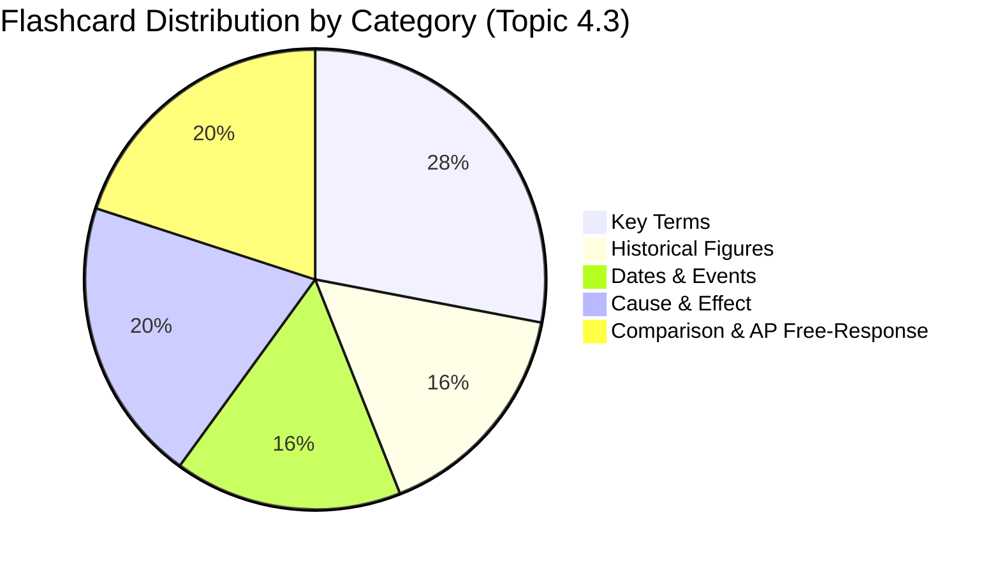

# Topic 4.3: The Columbian Exchange — Flashcards

---

### Category 1: Key Terms

- [ ] **What is the Columbian Exchange?**
  

▶ Answer

  The colossal, unprecedented global transmission of plants, animals, human populations, communicable diseases, cultures, and ideas between the Eastern Hemisphere (Afro-Eurasia) and Western Hemisphere (Americas) following 1492.
  

- [ ] **What was the Great Dying?**
  

▶ Answer

  The devastating demographic collapse of indigenous American societies caused by epidemic diseases (smallpox, measles, typhus) introduced by Europeans, resulting in the death of 50% to 90% of the native population.
  

- [ ] **What were engenhos?**
  

▶ Answer

  Portuguese colonial Brazilian sugar plantations and industrial processing mills (meaning "engines") notorious for lethal working conditions, high mortality, and absolute dependence on enslaved African labor.
  

- [ ] **What is the African Diaspora?**
  

▶ Answer

  The forced dispersal and exile of millions of enslaved Africans across the Americas and Atlantic world, leading to profound demographic shifts and dynamic cultural syncretism.
  

- [ ] **What are creole languages?**
  

▶ Answer

  New hybrid linguistic systems developed in the Americas that fused the grammatical syntax of West African languages with the vocabularies of European colonizers (English, French, Spanish, Portuguese).
  

- [ ] **What is Gullah (or Geechee)?**
  

▶ Answer

  An English-based creole language and distinct African-American culture preserved by descendants of enslaved Africans living in the coastal Sea Islands and lowcountry of South Carolina and Georgia.
  

- [ ] **What is cash crop agriculture?**
  

▶ Answer

  The large-scale agricultural production of specific crops (sugarcane, tobacco, cotton, indigo) cultivated exclusively for sale and commercial profit on global markets rather than for local subsistence.
  

---

### Category 2: Historical Figures

- [ ] **Who was Christopher Columbus in the context of the Columbian Exchange?**
  

▶ Answer

  The Genoese explorer sponsored by Spain whose 1492 Atlantic crossing initiated the permanent biological and economic reconnection between the Old and New Worlds.
  

- [ ] **Who was Hernán Cortés in relation to epidemic diseases?**
  

▶ Answer

  The Spanish conquistador whose invasion of Mesoamerica coincided with the catastrophic smallpox outbreak that decimated Aztec defenders in Tenochtitlán, ensuring Spanish conquest.
  

- [ ] **Who was Francisco Pizarro in the context of disease transfer?**
  

▶ Answer

  The Spanish conquistador who conquered the Inca Empire after smallpox had already preceded his troops, killing Emperor Huayna Capac and triggering a civil war that fractured Inca resistance.
  

- [ ] **Who was Alfred Crosby?**
  

▶ Answer

  The pioneering environmental historian who coined the term "Columbian Exchange" in his 1972 book, establishing the biological and ecological framework for understanding post-1492 world history.
  

---

### Category 3: Dates & Events

- [ ] **What happened in 1492 to trigger the Columbian Exchange?**
  

▶ Answer

  Columbus's fleet reached the Caribbean islands, initiating continuous transoceanic biological exchanges between ecosystems that had evolved in separation for over 10,000 years.
  

- [ ] **What occurred in Hispaniola in 1518?**
  

▶ Answer

  The first documented pandemic of smallpox broke out among indigenous Taíno populations, rapidly spreading through the Caribbean basin and mainland Americas.
  

- [ ] **When did American caloric staple crops become established in European agriculture?**
  

▶ Answer

  During the mid-to-late 16th and 17th centuries, crops like potatoes, maize, and tomatoes transformed European agrarian diets and prevented recurring famines.
  

- [ ] **What was the demographic milestone regarding African forced migration by the mid-1800s?**
  

▶ Answer

  Until the mid-19th century, more African men and women had arrived in the Americas via the coercive slave trade than free European migrants combined.
  

---

### Category 4: Cause & Effect

- [ ] **Why did Eurasian diseases cause such extraordinary mortality among indigenous Americans?**
  

▶ Answer

  **Cause**: Indigenous Americans had lived in complete isolation from Old World domesticated animals (cattle, pigs) and the viral zoonotic pathogens that developed from them.  
  **Effect**: Lacking acquired genetic antibodies, native immune systems were overwhelmed, causing 50% to 90% mortality.
  

- [ ] **How did the introduction of the potato impact European society?**
  

▶ Answer

  **Cause**: The potato yielded substantially more calories per acre than wheat or rye and grew well in moist, marginal soils.  
  **Effect**: European peasant malnutrition fell sharply, spurring a prolonged demographic boom that fueled urbanization and early factory labor.
  

- [ ] **Why did the cultivation of sugarcane in Brazil generate the Transatlantic Slave Trade?**
  

▶ Answer

  **Cause**: Sugar was extraordinarily profitable in Europe, but its labor-intensive harvest in tropical heat decimated native laborers through disease and exhaustion.  
  **Effect**: Portuguese planters turned to purchasing millions of enslaved West Africans to sustain production in engenhos.
  

- [ ] **How did the introduction of American crops affect African demographics?**
  

▶ Answer

  **Cause**: Crops like manioc (cassava), maize, and peanuts were introduced into Africa from Brazil.  
  **Effect**: These hardy, nutrient-dense crops flourished in African soils, expanding agricultural yields and sustaining net population growth despite heavy slave-trade losses.
  

- [ ] **What environmental effect did European domesticated livestock have on the American landscape?**
  

▶ Answer

  **Cause**: Grazing animals (cattle, sheep, goats) with hard hooves multiplied rapidly without natural predators.  
  **Effect**: They overgrazed native vegetation, causing widespread soil erosion, topsoil degradation, and deforestation.
  

---

### Category 5: Comparison & AP Free-Response

- [ ] **Compare the demographic impact of the Columbian Exchange on the Americas versus Afro-Eurasia.**
  

▶ Answer

  - **The Americas**: Suffered a catastrophic population collapse (Great Dying) due to unvetted Old World pathogens, losing up to 90% of native populations.  
  - **Afro-Eurasia**: Experienced explosive and sustained demographic growth due to high-calorie American food staples (potatoes, maize, sweet potatoes).
  

- [ ] **Compare the historical development of the horse in North American indigenous culture with the pig.**
  

▶ Answer

  - **Horse**: Adopted voluntarily by Great Plains tribes, fundamentally reshaping nomadic lifestyle, buffalo hunting efficiency, and status based on equestrian warfare.  
  - **Pig**: Multiplied exponentially in wild herds, ravaging native agricultural plots and wild tubers, functioning as a disruptive invasive species.
  

- [ ] **[AP Short Answer / SAQ Practice] Explain ONE way in which the Columbian Exchange altered social structures in the Americas.**
  

▶ Answer

  - **Claim**: The Columbian Exchange created racially stratified social hierarchies in the Americas centered on European dominance.  
  - **Evidence**: The influx of European settlers, enslaved Africans, and surviving indigenous peoples produced mixed offspring, prompting the creation of the Casta system (peninsulares, criollos, mestizos, mulattoes).  
  - **Reasoning**: Racial ancestry and skin color became institutionalized determinants of legal privilege, land ownership, and tax obligations throughout Iberian American colonies.
  

- [ ] **[AP Long Essay / LEQ Practice] Evaluate the extent to which the Columbian Exchange transformed global economic systems between 1450 and 1750.**
  

▶ Answer

  - **Claim**: The Columbian Exchange fundamentally transformed global economics by establishing integrated transatlantic trade networks driven by plantation cash crops and coerced labor.  
  - **Evidence**: Sugarcane and tobacco monocultures in the Caribbean and Brazil generated massive European wealth, directly fueling the transatlantic trade in enslaved Africans and mercantilist profits.  
  - **Reasoning**: Pre-1492 regional trade networks became subordinated to a singular Atlantic commercial system, where American land, African coerced labor, and European capital were coordinated to produce commodities for global markets.
  

- [ ] **[AP Document-Based Practice] Analyze the cultural consequences of the African Diaspora in the Atlantic world.**
  

▶ Answer

  - **Claim**: Despite brutal dehumanization under chattel slavery, enslaved Africans forged resilient, syncretic cultural traditions that permanently redefined American culture.  
  - **Evidence**: Enslaved communities created creole languages such as Gullah, blended West African culinary traditions (gumbo, okra) into southern diets, and created musical genres like Negro spirituals featuring polyrhythmic percussion.  
  - **Reasoning**: Cultural syncretism served as both a covert mechanism of psychological resistance against enslavement and a means of preserving ancestral identity within hostile colonial societies.
  
