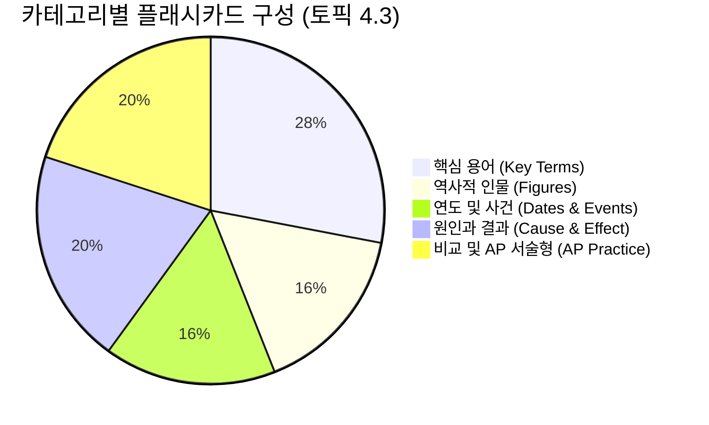

# 토픽 4.3: 콜럼버스 교환 (The Columbian Exchange) — 플래시카드

---

### 카테고리 1: 핵심 용어 (Key Terms)

- [ ] **콜럼버스 교환(Columbian Exchange)의 정의는 무엇인가?**
  

▶ 정답

  1492년 콜럼버스의 대서양 횡단 이후 동반구(아프로-유라시아)와 서반구(아메리카) 사이에서 일어난 식물, 동물, 전염병, 인간 집단, 문화, 사상의 대규모 전 지구적 상호 이동 현상입니다.
  

- [ ] **인구 대참사(The Great Dying)란 무엇인가?**
  

▶ 정답

  유럽인이 가져온 구대륙 전염병(천연두, 홍역 등)에 면역력이 전혀 없던 아메리카 원주민 인구의 50%에서 최대 90%가 감염되어 사망한 인류 역사상 유례없는 인구학적 파멸 사건입니다.
  

- [ ] **엔젠호(Engenhos)란 무엇인가?**
  

▶ 정답

  포르투갈어로 '엔진'을 의미하며, 브라질에서 사탕수수 재배부터 설탕 분쇄·정제까지 수행한 복합 플랜테이션입니다. 극도로 가혹한 노동 환경으로 매년 노예의 5~10%가 사망했습니다.
  

- [ ] **아프리카 디아스포라(African Diaspora)란 무엇인가?**
  

▶ 정답

  대서양 노예 무역에 의해 수백만 명의 아프리카인이 본향을 떠나 아메리카 대륙 전역으로 강제 분산·이주된 역사적 이산(離散) 현상입니다.
  

- [ ] **크리올어(Creole languages)는 어떻게 형성되었는가?**
  

▶ 정답

  다양한 언어권 출신의 아프리카 노예들이 소통하기 위해 서아프리카 고유의 문법 구조에 유럽 지배자들의 언어(영어, 프랑스어, 스페인어, 포르투갈어) 어휘를 융합하여 창조한 새로운 혼합 언어입니다.
  

- [ ] **굴라/기치(Gullah / Geechee) 문화의 특징은 무엇인가?**
  

▶ 정답

  미국 사우스캐롤라이나와 조지아 연안 제도에 격리되어 살던 아프리카계 미국인 후손들이 보존한 독자적인 영어 기반 크리올어 및 아프리카 전통 문화 공동체입니다.
  

- [ ] **환금 작물(Cash Crops)이란 무엇인가?**
  

▶ 정답

  생존을 위한 자급자족용이 아니라, 국내외 시장에서 고수익을 올리기 위해 대규모 플랜테이션에서 환금을 목적으로 집약 재배한 상업용 작물(사탕수수, 담배, 면화, 카카오 등)입니다.
  

---

### 카테고리 2: 역사적 인물 (Historical Figures)

- [ ] **크리스토퍼 콜럼버스(Christopher Columbus)가 생태사에 미친 영향은 무엇인가?**
  

▶ 정답

  1492년 대서양을 횡단하여 1만 년 이상 분리되어 독자적으로 진화해 온 동·서반구의 생태계를 영구적으로 재결합시킴으로써 '콜럼버스 교환'을 촉발했습니다.
  

- [ ] **에르난 코르테스(Hernán Cortés)의 정복과 전염병의 관계는 어떠했는가?**
  

▶ 정답

  스페인 정복자로 아스테카 제국을 침략했을 당시, 스페인군이 전파한 천연두가 수도 테노치티틀란에 창궐하여 원주민 군사력과 사회 구조를 궤멸시킴으로써 정복을 결정지었습니다.
  

- [ ] **프란시스코 피사로(Francisco Pizarro)의 잉카 정복에 천연두가 미친 영향은 무엇인가?**
  

▶ 정답

  피사로의 침공 직전 천연두가 이미 안데스산맥으로 퍼져 잉카 황제 우아이나 카팍과 후계자를 죽음에 이르게 했고, 이로 인해 발생한 극심한 내전 틈을 타 피사로가 잉카를 멸망시켰습니다.
  

- [ ] **앨프리드 크로스비(Alfred Crosby)의 학문적 공헌은 무엇인가?**
  

▶ 정답

  1972년 저서 《콜럼버스의 교환(The Columbian Exchange)》을 통해 역사학에 생물학적·생태학적 분석 틀을 도입하여 1492년 이후의 인류사를 질병과 생태 교환의 관점에서 재해석했습니다.
  

---

### 카테고리 3: 연도 및 사건 (Dates & Events)

- [ ] **1492년이 생태학적으로 갖는 분기점으로서의 의의는 무엇인가?**
  

▶ 정답

  콜럼버스의 신대륙 도달로 구대륙과 신대륙 간의 생물학적 단절이 끝나고 전 지구적인 작물, 가축, 전염병의 이동이 개시되었습니다.
  

- [ ] **1518년 히스파니올라섬에서 발생한 역사적 사건은 무엇인가?**
  

▶ 정답

  신대륙에서 공식 기록된 최초의 대규모 천연두 팬데믹이 발생하여 카리브해 원주민 타이노족을 궤멸 상태에 빠뜨렸습니다.
  

- [ ] **16세기 중후반 아메리카 작물이 유라시아에 가져온 농업 혁신은 무엇인가?**
  

▶ 정답

  감자, 옥수수, 고구마가 유럽과 아시아 농경지에 정착하여 척박한 토양의 생산성을 비약적으로 높이고 주기적 기근을 퇴치했습니다.
  

- [ ] **19세기 중반까지 아메리카 대륙 이주민의 인구학적 특징은 무엇이었는가?**
  

▶ 정답

  19세기 중반까지 아메리카 대륙으로 건너온 전체 인구 중 자유 의지로 이주한 백인 유럽인보다 강제로 끌려온 흑인 노예의 수가 훨씬 더 많았습니다.
  

---

### 카테고리 4: 원인과 결과 (Cause & Effect)

- [ ] **유라시아 전염병이 아메리카 원주민에게 파멸적인 치사율을 보인 원인은 무엇인가?**
  

▶ 정답

  - **원인**: 원주민들은 가축과 밀접하게 생활하며 수천 년간 병원균에 노출되어 면역 항체를 획득한 유라시아인과 달리 전염병에 완전히 무방비 상태였음.  
  - **결과**: 면역 항체가 전혀 없어 천연두, 홍역 감염 시 50~90%에 달하는 전례 없는 사망률이 발생함.
  

- [ ] **감자(Potato) 도입이 유럽 사회에 미친 인과관계는 무엇인가?**
  

▶ 정답

  - **원인**: 감자는 밀보다 단위 면적당 칼로리 생산량이 3~4배 높고 습하고 척박한 토양에서도 잘 자람.  
  - **결과**: 유럽 농민들의 영양 결핍과 만성 기근이 해소되어 인구가 급증하였고, 도시 공장으로 유입될 노동력 풀이 형성됨.
  

- [ ] **브라질의 사탕수수 재배가 대서양 노예 무역의 폭발적 증가를 부른 원인은 무엇인가?**
  

▶ 정답

  - **원인**: 유럽에서 설탕 수요가 폭증했으나, 토착 원주민 노동력은 질병으로 괴멸되거나 정글로 도망쳐 노동력 부족이 심화됨.  
  - **결과**: 포르투갈 농장주들이 열대 기후에 강하고 탈출이 어려운 서아프리카 흑인 노예들을 대규모로 수입하기 시작함.
  

- [ ] **아메리카 작물이 아프리카 대륙 인구에 미친 역설적 효과는 무엇인가?**
  

▶ 정답

  - **원인**: 브라질에서 전래된 마니옥(카사바), 옥수수, 땅콩 등이 가뭄에 강하고 아프리카 토양에 잘 적응함.  
  - **결과**: 식량 공급이 획기적으로 개선되어, 대규모 노예 무역으로 인한 인구 유출에도 불구하고 아프리카 전반의 인구가 증가세를 유지함.
  

- [ ] **구대륙 가축(소, 양, 돼지)의 방목이 신대륙 자연환경에 미친 영향은 무엇인가?**
  

▶ 정답

  - **원인**: 천적이 없는 아메리카 대륙에 번식력이 강한 발굽 가축들이 통제 없이 방목됨.  
  - **결과**: 토종 식생이 과도한 방목(Overgrazing)으로 파괴되고 단단한 발굽으로 인해 토양이 침식되어 사막화와 환경 훼손이 진행됨.
  

---

### 카테고리 5: 비교 및 AP 서술형 (AP Practice)

- [ ] **콜럼버스 교환이 동반구와 서반구의 인구 변동에 미친 영향을 비교하시오.**
  

▶ 정답

  - **서반구 (신대륙)**: 구대륙 전염병의 유입으로 원주민 인구의 최대 90%가 사망하는 전례 없는 인구학적 붕괴(The Great Dying)를 겪음.  
  - **동반구 (구대륙)**: 옥수수, 감자, 고구마 등 고열량 아메리카 작물의 도입으로 기근이 감소하고 유럽, 중국, 아프리카 인구가 급증함.
  

- [ ] **말(Horse)이 북미 원주민 사회에 가져온 긍정적·부정적 변화를 비교하시오.**
  

▶ 정답

  - **긍정적 변화**: 버팔로 사냥 효율성이 극대화되어 식량 잉여가 발생하고, 이동성이 향상되어 대평원 유목 문화가 화려하게 꽃핌.  
  - **부정적 변화**: 말의 소유권에 따라 빈부 격차와 사회적 계층화가 심화되었으며, 말을 차지하기 위한 부족 간 무력 분쟁이 격화됨.
  

- [ ] **[단답형 서술 / SAQ] 콜럼버스 교환이 아메리카 대륙의 사회 구조를 변화시킨 구체적 방식 1가지를 설명하시오.**
  

▶ 정답

  - **주장 (Claim)**: 콜럼버스 교환은 아메리카 대륙에 인종과 혈통에 기반한 엄격한 사회 계급 체제를 확립했습니다.  
  - **근거 (Evidence)**: 유럽 정복자, 아프리카 흑인 노예, 생존 원주민 간의 혼혈이 발생하자 스페인은 페닌술라르, 크리오요, 메스티소, 물라토 등을 구분하는 카스타 제도(Casta system)를 제도화했습니다.  
  - **설명 (Reasoning)**: 피부색과 혈통의 순수성이 법적 권리, 토지 소유권, 납세 의무를 결정하는 핵심 지표로 작동하여 백인 지배층이 사회적 부와 권력을 독점하는 구조를 낳았습니다.
  

- [ ] **[장문형 서술 / LEQ] 1450~1750년 사이 콜럼버스 교환이 세계 경제 체제를 재편한 정도를 평가하시오.**
  

▶ 정답

  - **주장 (Claim)**: 콜럼버스 교환은 환금 작물 플랜테이션과 강제 노동 체제를 결합하여 단일한 대서양 무역 경제망을 창출함으로써 세계 경제를 근본적으로 재편했습니다.  
  - **근거 (Evidence)**: 설탕과 담배를 생산하기 위해 아프리카 흑인을 아메리카로 강제 이송하는 대서양 삼각무역이 형성되었고, 신대륙의 은은 아시아 사치품 무역의 결제 수단으로 전 세계에 유통되었습니다.  
  - **설명 (Reasoning)**: 과거 대륙별로 파편화되어 있던 자급자족적 농업 및 지역 상업망이 유럽의 자본, 아프리카의 노동력, 아메리카의 토지와 자원이 결합된 전 지구적 상업 자본주의 체제로 통합되었기 때문입니다.
  

- [ ] **[자료 기반 서술 / DBQ] 대서양 세계에서 아프리카 디아스포라가 남긴 문화적 유산과 생존 전략을 분석하시오.**
  

▶ 정답

  - **주장 (Claim)**: 아프리카 노예들은 동산 노예제의 가혹한 억압 속에서도 고유의 전통을 유럽 문화와 융합(Syncretism)하여 독창적인 언어와 예술을 창조하며 저항했습니다.  
  - **근거 (Evidence)**: 서아프리카 문법과 유럽 어휘를 합친 크리올어(굴라어 등)를 발전시켰고, 밴조를 제작하며 싱코페이션 리듬의 흑인 영가를 불러 탈출을 모의하고 연대감을 다졌습니다.  
  - **설명 (Reasoning)**: 이러한 문화적 혼합은 비인간적인 노동 착취 속에서 인간성을 지키고 집단적 정체성을 유지하기 위한 심리적·물리적 생존 투쟁의 발현이었습니다.
  
