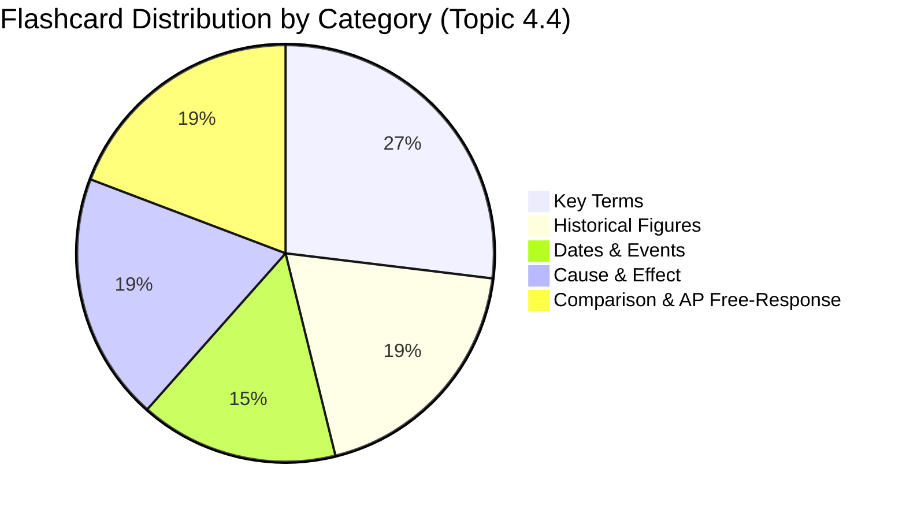

# Topic 4.4: Maritime Empires Link Regions — Flashcards

---

### Category 1: Key Terms

- [ ] **What is chattel slavery?**
  

▶ Answer

  A severe labor system where human beings are classified by law as personal property (chattel) that can be bought, sold, and inherited across generations, with zero legal rights.
  

- [ ] **What is indentured servitude?**
  

▶ Answer

  A contractual labor agreement where a person agreed to work without wages for a specified period (typically 4–7 years) in exchange for transatlantic passage, room, board, and eventual freedom.
  

- [ ] **What was the encomienda system?**
  

▶ Answer

  A Spanish labor grant authorizing conquistadores to compel tribute and physical labor from specified indigenous populations, supposedly in exchange for food, protection, and Catholic instruction.
  

- [ ] **What was the hacienda system?**
  

▶ Answer

  Vast rural agricultural estates in Spanish America where landowners utilized debt peonage to keep indigenous tenant laborers permanently bound to the estate.
  

- [ ] **What was the colonial mita system?**
  

▶ Answer

  The Spanish adaptation of the traditional Incan public labor draft, transforming it into a mandatory, coercive system forcing indigenous Andean males into the lethal silver mines of Potosí.
  

- [ ] **What was the Treaty of Tordesillas (1494)?**
  

▶ Answer

  A papal-brokered treaty dividing newly discovered non-Christian lands between Spain (west of the 370-league meridian) and Portugal (east of the line, granting them Brazil and African/Asian routes).
  

- [ ] **Who were the sepoys?**
  

▶ Answer

  Indian soldiers trained and equipped with modern European firearms and drills, employed by the British East India Company to secure regional dominance across the subcontinent.
  

---

### Category 2: Historical Figures

- [ ] **Who was Hernán Cortés?**
  

▶ Answer

  The Spanish conquistador who overthrew the Aztec Empire between 1519 and 1521 through military alliances with subject indigenous tribes and the biological impact of smallpox.
  

- [ ] **Who was Francisco Pizarro?**
  

▶ Answer

  The Spanish conquistador who captured and executed Inca Emperor Atahualpa in 1532–1533 and conquered the Inca Empire, establishing Spanish rule over Peru.
  

- [ ] **Who was Atahualpa?**
  

▶ Answer

  The last sovereign Incan emperor who won a civil war against his brother Huáscar just before being captured at Cajamarca by Pizarro and subsequently garroted.
  

- [ ] **Who was Pedro Menéndez de Avilés?**
  

▶ Answer

  The Spanish explorer and naval commander who founded St. Augustine, Florida, in 1565, establishing the oldest continuous European settlement in North America.
  

- [ ] **Who was Toyotomi Hideyoshi in relation to foreign trade and religion?**
  

▶ Answer

  The Japanese unifier who issued the 1587 edict expelling Christian missionaries and prohibiting worship after viewing Christian converts and European influence as threats to Japanese sovereignty.
  

---

### Category 3: Dates & Events

- [ ] **What occurred in 1494 regarding imperial rivalry?**
  

▶ Answer

  The signing of the Treaty of Tordesillas, establishing a legal demarcation line dividing the Americas and Atlantic trade zones between Spain and Portugal.
  

- [ ] **What was the historical outcome of 1521 in Mesoamerica?**
  

▶ Answer

  The fall of the Aztec capital of Tenochtitlán to Spanish forces and indigenous allies, leading to the creation of the Viceroyalty of New Spain.
  

- [ ] **What took place in Japan during the 1630s?**
  

▶ Answer

  The Tokugawa Shogunate enacted the Sakoku (closed country) decrees, expelling foreigners, prohibiting Japanese overseas travel, and restricting European contact to the Dutch at Deshima.
  

- [ ] **What was the outcome of the Seven Years' War (1756–1763) for maritime empires?**
  

▶ Answer

  Great Britain defeated France globally, seizing New France (Canada) and eliminating French political and military power from India.
  

---

### Category 4: Cause & Effect

- [ ] **How did the acquisition of European firearms alter West African state building?**
  

▶ Answer

  **Cause**: Coastal kingdoms (Dahomey, Asante) traded enslaved war captives for European guns and gunpowder.  
  **Effect**: Armed with firearms, these militarized states outgunned neighboring interior tribes, capturing more prisoners and fueling an expanding slave-for-guns cycle.
  

- [ ] **Why did the Tokugawa Shogunate implement the Sakoku policy?**
  

▶ Answer

  **Cause**: Thousands of Japanese converted to Roman Catholicism, and some converted daimyos destroyed Buddhist shrines and challenged shogunal supremacy.  
  **Effect**: The Shogunate banned Christianity, executed recalcitrant converts, and closed the country to preserve social order and central authority.
  

- [ ] **Why did the Spanish transition from the encomienda to the hacienda system?**
  

▶ Answer

  **Cause**: Catastrophic indigenous population decline from epidemics and clerical protests (Las Casas) led the Spanish crown to curtail encomienda labor rights.  
  **Effect**: Colonists accumulated private landholdings (haciendas), using debt peonage to legally tether surviving indigenous laborers.
  

- [ ] **What caused the economic decline of the Swahili city-states after 1498?**
  

▶ Answer

  **Cause**: Vasco da Gama and Portuguese fleets invaded the East African coast, sacking Kilwa and Mombasa and diverting maritime customs revenues to fortified naval garrisons.  
  **Effect**: The autonomous commercial prosperity that had linked East Africa to the Indian Ocean for centuries collapsed into severe regional decline.
  

- [ ] **How did British forces gradually subjugate the Indian subcontinent?**
  

▶ Answer

  **Cause**: The Mughal Empire fractured along regional and religious lines, weakening central military defense.  
  **Effect**: The British East India Company allied with local elites, hired native sepoys, and intervened militarily to transform commercial nodes into territorial rule.
  

---

### Category 5: Comparison & AP Free-Response

- [ ] **Compare the social and economic conditions of chattel slavery with indentured servitude.**
  

▶ Answer

  - **Chattel Slavery**: Permanent, hereditary, racially based bondage where laborers were legal property without rights or path to freedom.  
  - **Indentured Servitude**: Temporary, non-hereditary contractual labor (4–7 years) primarily of European origin, concluding with freedom dues and legal emancipation.
  

- [ ] **Compare European interactions with local rulers in West Africa versus Mesoamerica.**
  

▶ Answer

  - **West Africa**: Europeans remained confined to coastal trading posts (*feitorias*) and negotiated commercial treaties as trading partners with powerful local kings.  
  - **Mesoamerica**: Europeans launched direct military invasions, dismantled imperial dynastic hierarchies, and claimed total territorial sovereignty.
  

- [ ] **[AP Short Answer / SAQ Practice] Explain ONE continuity in the economic systems of the Indian Ocean network between 1450 and 1750.**
  

▶ Answer

  - **Claim**: Despite European naval incursions, traditional merchant networks and customary port taxation persisted as core continuities in the Indian Ocean.  
  - **Evidence**: Asian merchants (Gujaratis, Javanese, Arabs) continued exchanging bulk goods, textiles, and spices, operating alongside European companies.  
  - **Reasoning**: The Portuguese and Dutch lacked the administrative personnel and naval numbers to eradicate existing Asian trade networks, forcing them to function largely within the preexisting port-tax frameworks.
  

- [ ] **[AP Long Essay / LEQ Practice] Evaluate the extent to which coerced labor systems expanded between 1450 and 1750.**
  

▶ Answer

  - **Claim**: Coerced labor systems expanded to an unprecedented global scale between 1450 and 1750, driven by the labor demands of transoceanic cash crop plantations and silver extraction.  
  - **Evidence**: Transatlantic chattel slavery transported over 10 million Africans to American plantations, while the Spanish coerced indigenous populations through the Potosí mita and encomiendas.  
  - **Reasoning**: Unlike pre-modern regional servitude, early modern coercive labor was tied to a globalized capitalist commodity market requiring relentless, intensive physical labor to maximize colonial export profits.
  

- [ ] **[AP Document-Based Practice] Analyze how Asian states resisted European encroachment from 1450 to 1750.**
  

▶ Answer

  - **Claim**: Asian states effectively utilized centralized political authority and legal prohibitions to limit and control European territorial and cultural penetration.  
  - **Evidence**: Tokugawa Japan expelled foreigners and banned Christianity under the Sakoku decrees, while Ming and Qing China restricted European merchants to designated ports under strict imperial surveillance.  
  - **Reasoning**: Because land-based East Asian empires maintained formidable armies, bureaucratic institutions, and economic self-sufficiency, they could enforce isolationist policies that European maritime powers were powerless to overturn militarily.
  
