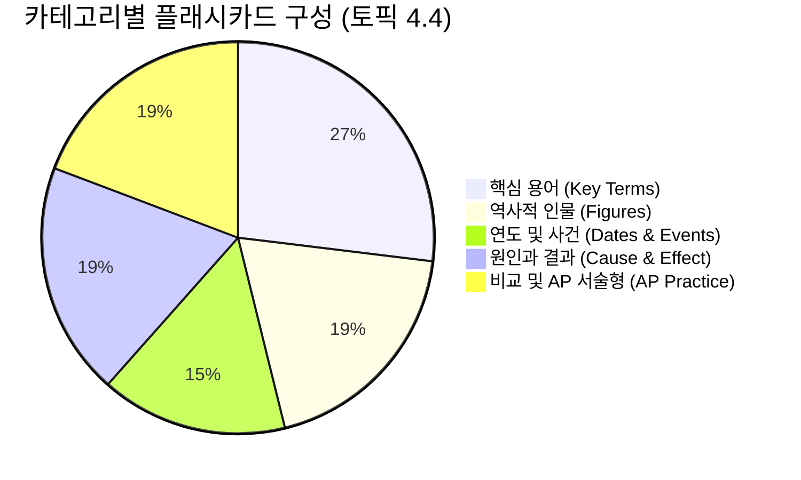

# 토픽 4.4: 해양 제국의 지역 간 연결 (Maritime Empires Link Regions) — 플래시카드

---

### 카테고리 1: 핵심 용어 (Key Terms)

- [ ] **동산 노예제(Chattel Slavery)란 무엇인가?**
  

▶ 정답

  인간을 법적으로 완전히 매매·상속·양도가 가능한 개인 사유물(동산)로 규정한 노예제입니다. 노예는 어떠한 법적 인권도 갖지 못하며 그 신분은 자녀에게 영구히 세습되었습니다.
  

- [ ] **계약 하인제(Indentured Servitude)란 무엇인가?**
  

▶ 정답

  신대륙으로 건너가는 대서양 선박 운임과 현지 숙식을 제공받는 대가로 통상 4~7년 동안 보수 없이 지정된 고용주 밑에서 농업 노동을 제공하기로 맺은 계약 노동 체제입니다.
  

- [ ] **엔코미엔다(Encomienda) 제도란 무엇인가?**
  

▶ 정답

  스페인 국왕이 정복자들에게 일정 구역 원주민의 노동력과 공물을 강제 징발할 권리를 승인하고, 그 대가로 원주민을 보호하고 가톨릭으로 개종시킬 종교적 의무를 부여한 식민 수탈 제도입니다.
  

- [ ] **하시엔다(Hacienda) 제도란 무엇인가?**
  

▶ 정답

  스페인령 아메리카에서 엔코미엔다 쇠퇴 후 등장한 대토지 농축산 농장입니다. 지주들은 부채 노예제(Debt peonage)를 통해 원주민 농민들에게 빚을 지워 토지에 영구적으로 결박시켰습니다.
  

- [ ] **식민지 미타(Colonial Mita) 제도란 무엇인가?**
  

▶ 정답

  스페인이 안데스 잉카의 전통 공공 윤번 부역제를 변질시켜, 볼리비아 포토시(Potosí) 은광의 치명적인 지하 채굴 작업에 원주민 성인 남성들을 의무적으로 강제 차출한 죽음의 노동 체제입니다.
  

- [ ] **토르데시야스 조약(Treaty of Tordesillas, 1494)의 내용은 무엇인가?**
  

▶ 정답

  교황의 중재로 카보베르데 서쪽 370리그 자오선을 경계로 하여, 그 서쪽(아메리카 대륙 대부분)은 스페인이, 동쪽(브라질 및 아프리카·인도양 항로)은 포르투갈이 독점하기로 분할한 조약입니다.
  

- [ ] **세포이(Sepoys)란 누구인가?**
  

▶ 정답

  영국 동인도회사(EIC)가 인도 현지인을 모병하여 유럽식 군사 훈련과 총포로 무장시킨 용병 군대로, 영국이 인도 내 경쟁 열강을 몰아내고 내륙을 장악하는 주력 군사력이 되었습니다.
  

---

### 카테고리 2: 역사적 인물 (Historical Figures)

- [ ] **에르난 코르테스(Hernán Cortés)의 업적은 무엇인가?**
  

▶ 정답

  스페인 정복자로서 아스테카의 압제에 분노하던 원주민 부족들과 동맹을 맺고, 천연두 유행의 결정적 도움을 받아 1521년 수도 테노치티틀란을 함락하여 아스테카 제국을 멸망시켰습니다.
  

- [ ] **프란시스코 피사로(Francisco Pizarro)의 잉카 정복 과정은 어떠했는가?**
  

▶ 정답

  1532년 카하마르카에서 잉카 황제 아타우알파를 생포한 후 거액의 황금 몸값을 받고도 1533년 살해하였으며, 1572년까지 잔존 저항을 완전히 진압하고 페루 부왕령을 세웠습니다.
  

- [ ] **아타우알파(Atahualpa)는 누구인가?**
  

▶ 정답

  잉카 제국의 마지막 실질적 황제로, 이복형제 우아스카르와의 내전에서 승리했으나 피사로의 기습 공격에 사로잡혀 스페인인들에 의해 처형당했습니다.
  

- [ ] **페드로 메넨데스 데 아빌레스(Pedro Menéndez de Avilés)의 공헌은 무엇인가?**
  

▶ 정답

  1565년 미국 플로리다 동해안에 세인트오거스틴(St. Augustine) 요새를 건설하여 북미 대륙에서 가장 오래 지속된 유럽인 정착촌을 세운 스페인 제독입니다.
  

- [ ] **도요토미 히데요시(Toyotomi Hideyoshi)의 기독교 정책은 무엇이었는가?**
  

▶ 정답

  1587년 기독교 개종자들의 불교 사원 파괴와 서구 침략 야욕을 경계하여 선교사 추방령을 선포하고 기독교 신앙을 불법화한 일본의 통일 권력자입니다.
  

---

### 카테고리 3: 연도 및 사건 (Dates & Events)

- [ ] **1494년 토르데시야스 조약 체결이 남긴 영토적 결과는 무엇인가?**
  

▶ 정답

  분할선이 남아메리카 동부를 관통하게 되어, 남아메리카 대륙 중 유일하게 브라질만이 포르투갈의 식민지가 되고 나머지는 스페인 영토로 귀속되었습니다.
  

- [ ] **1521년 아스테카 멸망 후 건설된 식민 정부는 무엇인가?**
  

▶ 정답

  코르테스가 파괴된 테노치티틀란 폐허 위에 멕시코시티를 건설하고 스페인 국왕 직속의 누에바에스파냐(New Spain) 부왕령을 수립했습니다.
  

- [ ] **1630년대 일본 도쿠가와 막부의 쇄국령(Sakoku) 조치는 무엇인가?**
  

▶ 정답

  모든 외국인의 입국을 금지하고 일본인의 해외 출국 및 귀국을 사형으로 다스렸으며, 오직 네덜란드 상인에게만 나가사키 데지마에서 제한적 교역을 허용했습니다.
  

- [ ] **7년 전쟁(1756–1763)이 세계 식민지 질서에 미친 결과는 무엇인가?**
  

▶ 정답

  영국이 프랑스를 격파하고 1763년 파리 조약을 통해 프랑스 세력을 인도와 캐나다에서 몰아냄으로써 세계 최대 해양 제국으로 부상했습니다.
  

---

### 카테고리 4: 원인과 결과 (Cause & Effect)

- [ ] **유럽산 화약 무기 유입이 서아프리카 국가들에 미친 원인과 결과는 무엇인가?**
  

▶ 정답

  - **원인**: 연안 왕국(다호메이, 아샨티)이 유럽인들에게 흑인 전쟁 포로를 넘겨주고 최신 화승총과 대포를 수입함.  
  - **결과**: 화력을 앞세워 총기가 없는 내륙 이웃 부족들을 약탈하여 더 많은 노예를 확보하는 '총-노예 악순환'이 발생하여 지역이 극도로 군사화됨.
  

- [ ] **도쿠가와 막부가 쇄국 정책(Sakoku)을 전격 단행한 원인은 무엇인가?**
  

▶ 정답

  - **원인**: 수만 명의 일본인이 가톨릭으로 개종하고 개종 다이묘들이 막부의 통제를 벗어나 외세와 결탁할 위험이 가시화됨.  
  - **결과**: 외세의 침략과 기독교의 전파를 체제 붕괴 위협으로 간주하고, 외국인 추방 및 해외 교류를 철저히 차단함.
  

- [ ] **스페인이 엔코미엔다에서 하시엔다 제도로 전환하게 된 원인은 무엇인가?**
  

▶ 정답

  - **원인**: 전염병으로 원주민 인구가 급감하고 라스카사스 신부 등 가톨릭 사제들의 가혹한 수탈 고발로 국왕이 엔코미엔다 권한을 축소함.  
  - **결과**: 식민지 지주들이 사유지(대농장)를 매입하고 부채 노예제를 통해 원주민 농민을 종속시키는 하시엔다 형태로 이행함.
  

- [ ] **1498년 이후 스와힐리 도시 국가들이 급격히 몰락한 이유는 무엇인가?**
  

▶ 정답

  - **원인**: 바스코 다 가마와 포르투갈 해군 함대가 킬와와 몸바사를 함포로 포격하고 요새를 세워 해상 교역세를 갈취함.  
  - **결과**: 수 세기 동안 인도양과 아프리카 내륙을 잇던 번영하던 자치 상업 네트워크가 파괴되어 지역 전체가 빈곤과 쇠퇴에 빠짐.
  

- [ ] **영국 동인도회사(EIC)가 인도 내륙을 효과적으로 잠식할 수 있었던 원인은 무엇인가?**
  

▶ 정답

  - **원인**: 무굴 제국의 중앙 권력이 약화되고 힌두교도와 무슬림 영주 간의 분열과 내분이 심화됨.  
  - **결과**: EIC가 지역 토후들과 개별 조약을 맺고 인도인 용병(세포이)을 동원해 경쟁 세력과 프랑스를 차례로 격파하며 식민지배를 확장함.
  

---

### 카테고리 5: 비교 및 AP 서술형 (AP Practice)

- [ ] **동산 노예제(Chattel Slavery)와 계약 하인제(Indentured Servitude)의 법적·경제적 지위를 비교하시오.**
  

▶ 정답

  - **동산 노예제**: 인간을 사유재산으로 간주하여 인권이 전무하며, 인종에 기반하고 신분이 자손 대대로 세습되는 영구적 강제 노동.  
  - **계약 하인제**: 대서양 도항 비용을 갚기 위해 4~7년 동안 일하는 자발적 기한부 계약 노동으로, 만료 후 토지나 자금을 받고 자유인이 됨.
  

- [ ] **서아프리카와 아메리카 대륙에서 전개된 유럽 제국의 식민화 방식을 비교하시오.**
  

▶ 정답

  - **서아프리카**: 강력한 토착 왕국들이 존재하여 내륙 침략이 불가능했으므로, 연안 상관(Feitorias)을 중심으로 현지 왕들과 대등한 무역 협상을 벌임.  
  - **아메리카**: 전염병과 화력을 앞세워 원주민 제국을 군사적으로 멸망시키고 내륙 영토 전역을 직접 지배하는 영토 식민지(부왕령)를 건설함.
  

- [ ] **[단답형 서술 / SAQ] 1450~1750년 사이 인도양 무역망에서 유지된 경제적 지속성(Continuity) 1가지를 제시하고 설명하시오.**
  

▶ 정답

  - **주장 (Claim)**: 유럽 해양 세력의 침투에도 불구하고 아시아 현지 상인들의 전통적 역내 교역망과 상업 관행은 지속되었습니다.  
  - **근거 (Evidence)**: 인도 구자라트, 아랍, 자바 상인들은 쌀, 직물, 일상 소비재를 운송하며 기존 항구의 관세를 납부하고 교역을 지속했습니다.  
  - **설명 (Reasoning)**: 포르투갈과 네덜란드 세력은 해상 길목을 차단했을 뿐 광대한 아시아 내륙 생산과 복잡한 역내 연안 무역 전체를 통제할 인력과 자본이 턱없이 부족했기 때문입니다.
  

- [ ] **[장문형 서술 / LEQ] 1450~1750년 전 지구적 규모에서 강제 노동 체제가 확산된 정도를 평가하시오.**
  

▶ 정답

  - **주장 (Claim)**: 대서양 환금 작물 플랜테이션과 신대륙 광산 개발 수요로 인해, 강제 노동 체제는 인류 역사상 유례없는 전 지구적 규모와 가혹한 상품화 수준으로 팽창했습니다.  
  - **근거 (Evidence)**: 1천만 명 이상의 아프리카인을 수송한 대서양 동산 노예제와 포토시 은광의 잔혹한 식민지 미타 부역제가 대표적 사례입니다.  
  - **설명 (Reasoning)**: 이전 시대의 노예제나 부역이 가내 노동이나 국지적 공공사업에 그쳤던 것과 달리, 근대 초기의 강제 노동은 유럽 자본주의 시장의 이윤 극대화와 결합되어 노동자를 소모품으로 착취하는 대규모 산업적 양상을 띠었습니다.
  

- [ ] **[자료 기반 서술 / DBQ] 1450~1750년 동아시아 국가들이 유럽의 팽창에 대응하여 취한 저항 전략을 분석하시오.**
  

▶ 정답

  - **주장 (Claim)**: 동아시아 제국들은 강력한 중앙집권 관료제와 군사력을 바탕으로 엄격한 통제 및 쇄국 정책을 시행하여 서구의 식민 지배 시도를 성공적으로 차단했습니다.  
  - **근거 (Evidence)**: 도쿠가와 일본은 쇄국령(Sakoku)을 통해 기독교도를 탄압하고 네덜란드 상관을 데지마로 격리했으며, 명·청 제국은 조공 질서와 광둥 무역 체제를 통해 서구 상인을 통제했습니다.  
  - **설명 (Reasoning)**: 아메리카 원주민들과 달리 동아시아 국가들은 구대륙 병원균에 면역력이 있었고 강력한 화약 무기와 자급자족적 거대 경제를 유지했기 때문에 서구 해양 열강의 군사적 굴복 요구를 단호히 거부할 수 있었습니다.
  
