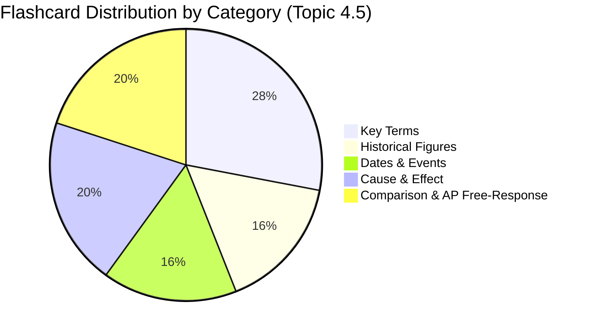

# Topic 4.5: Maritime Empires Develop — Flashcards

---

### Category 1: Key Terms

- [ ] **What was the Commercial Revolution?**
  

▶ Answer

  The profound economic transformation in Europe between the late 15th and early 18th centuries marked by the rise of a trade-based economy, the circulation of American gold and silver, the growth of joint-stock companies, and early commercial capitalism.
  

- [ ] **What was the Price Revolution?**
  

▶ Answer

  A prolonged inflationary period across Western Europe during the 16th and early 17th centuries caused by steady population recovery combined with the massive influx of silver bullion from Spanish American mines.
  

- [ ] **What is a joint-stock company?**
  

▶ Answer

  A corporate commercial enterprise owned by shareholders who pool financial capital to fund oceanic trade ventures, sharing both proportional profits and commercial liabilities.
  

- [ ] **What is limited liability?**
  

▶ Answer

  A revolutionary commercial legal principle stipulating that an investor's financial responsibility for a company's debts is legally restricted to the amount of money they personally invested.
  

- [ ] **What was the Triangular Trade?**
  

▶ Answer

  A complex, three-legged Atlantic commercial network exchanging European manufactured goods (guns, textiles) for African enslaved laborers, transporting them to the Americas, and carrying plantation cash crops (sugar, tobacco) back to Europe.
  

- [ ] **What was the Middle Passage?**
  

▶ Answer

  The second leg of the Triangular Trade across the Atlantic, where millions of captured Africans were transported under unsanitary, cramped, and lethal conditions to American slave markets.
  

- [ ] **What were viceroys and audiencias?**
  

▶ Answer

  - **Viceroys**: Royal governors appointed by the Spanish monarch to administer territories like New Spain and Peru.  
  - **Audiencias**: Royal courts of appeal established to supervise and legally check the administrative decisions of viceroys.
  

---

### Category 2: Historical Figures

- [ ] **Who was Diego de Landa?**
  

▶ Answer

  A Spanish Franciscan bishop in the Yucatán peninsula who in 1562 ordered the mass public burning of priceless Maya hieroglyphic codices, viewing them as demonic superstitions.
  

- [ ] **Who were the Dutch merchants as "middlemen of Europe"?**
  

▶ Answer

  Dutch commercial traders who, utilizing highly efficient fluyt ships and cheap maritime shipping rates, transported goods across the Baltic, Mediterranean, Atlantic, and Indian Oceans.
  

- [ ] **Who was the Sultan of Morocco during the invasion of Songhai (1590)?**
  

▶ Answer

  Ahmad al-Mansur, who dispatched an expeditionary force equipped with European firearms across the Sahara to seize control of Songhai's trans-Saharan gold mines and trade routes.
  

- [ ] **Who were the leaders of Dahomey and Oyo in the context of the Atlantic slave trade?**
  

▶ Answer

  West African kings who centralized state power and built militarized states by trading war captives to European slavers in exchange for muskets and ammunition.
  

---

### Category 3: Dates & Events

- [ ] **What landmark financial institution was founded in 1602?**
  

▶ Answer

  The Dutch East India Company (VOC) was chartered, accompanied by the creation of the world's first formal stock exchange in Amsterdam.
  

- [ ] **What happened in 1609 regarding Dutch banking?**
  

▶ Answer

  The Bank of Amsterdam was founded, establishing a standardized public system of deposit banking, bill of exchange clearing, and international currency trading.
  

- [ ] **What was the historical significance of the Battle of Tondibi in 1591?**
  

▶ Answer

  A Moroccan expeditionary force armed with gunpowder and muskets decisively routed the much larger, traditionally armed Songhai army near Gao, collapsing the Songhai Empire.
  

- [ ] **What occurred during the early 18th century with the South Sea and Mississippi Bubbles?**
  

▶ Answer

  Rampant stock market speculation in Britain (South Sea Company) and France (Mississippi Company) caused devastating financial crashes when asset bubbles burst, bankrupting thousands of investors.
  

---

### Category 4: Cause & Effect

- [ ] **How did the massive influx of American silver cause inflation (Price Revolution) in Europe?**
  

▶ Answer

  **Cause**: Millions of pounds of silver poured into Spain and Europe from Potosí and Zacatecas, drastically multiplying money supply while food and commodity production rose slowly.  
  **Effect**: Prices of grain, livestock, and manufactured goods increased dramatically across Europe for over a century.
  

- [ ] **Why did the Transatlantic Slave Trade cause a rise in polygyny in West Africa?**
  

▶ Answer

  **Cause**: European slave traders heavily preferred young male laborers for plantation agriculture, taking more than two-thirds of male captives.  
  **Effect**: The resulting heavy surplus of women in coastal West African societies led directly to the social expansion of polygyny (men taking multiple wives).
  

- [ ] **How did the introduction of American crops affect the African population during the slave trade era?**
  

▶ Answer

  **Cause**: American root crops like manioc (cassava) and maize were introduced via Portuguese ships from Brazil into Africa.  
  **Effect**: These caloric, drought-resistant crops increased food security, stimulating birth rates and population growth that partially countered slave trade depopulation.
  

- [ ] **Why did China become the ultimate "sink" for American silver?**
  

▶ Answer

  **Cause**: The Ming dynasty implemented the Single Whip Tax Law, mandating that all imperial land taxes be paid strictly in silver coin.  
  **Effect**: Global silver flowed inexorably to China from Europe and Manila, where Europeans traded silver for tea, silk, and porcelain.
  

- [ ] **What caused the collapse of the Songhai Empire in 1591?**
  

▶ Answer

  **Cause**: The Moroccan Sultanate sought trans-Saharan gold trade revenues and invaded with musketeers and cannons.  
  **Effect**: Moroccan firearms decimated Songhai infantry, fracturing the empire into fragmented local warlord states.
  

---

### Category 5: Comparison & AP Free-Response

- [ ] **Compare the corporate structure of the Dutch VOC with Spanish colonial commerce.**
  

▶ Answer

  - **Dutch VOC**: A privately funded, joint-stock corporation owned by public shareholders operating under limited liability, prioritizing commercial profit.  
  - **Spanish Commerce**: A direct royal state monopoly controlled by the Crown (Casa de Contratación), funded through imperial borrowing, prioritizing bullion hoarding and religious orthodoxy.
  

- [ ] **Compare the demographic impact of the slave trade on West Africa versus its labor impact on the Americas.**
  

▶ Answer

  - **West Africa**: Severe population loss in targeted coastal areas, severe gender imbalances (deficit of men), and continuous internal militarized warfare.  
  - **The Americas**: Establishment of a permanent, coerced chattel labor force that fueled rapid export-oriented plantation agricultural output (sugar, tobacco).
  

- [ ] **[AP Short Answer / SAQ Practice] Explain ONE commercial innovation from 1450 to 1750 that facilitated the growth of maritime empires.**
  

▶ Answer

  - **Claim**: The invention of the joint-stock company with limited liability was a crucial commercial innovation that facilitated maritime imperial expansion.  
  - **Evidence**: The Dutch East India Company (VOC) issued publicly traded shares on the Amsterdam stock exchange to pool vast amounts of capital from middle-class investors.  
  - **Reasoning**: By spreading the extreme financial risk of long-distance oceanic trade among thousands of shareholders and capping individual liability, companies raised capital volumes exceeding those of most royal treasuries, enabling continuous naval fleet construction.
  

- [ ] **[AP Long Essay / LEQ Practice] Evaluate the extent to which the Commercial Revolution altered European economic systems between 1450 and 1750.**
  

▶ Answer

  - **Claim**: The Commercial Revolution fundamentally reorganized European economies from agrarian, localized feudalism into an integrated commercial capitalist system anchored by global trade.  
  - **Evidence**: The establishment of public bourses (Amsterdam Stock Exchange), national chartered monopolies (EIC, VOC), and transnational currency banking replaced barter and local guild regulations.  
  - **Reasoning**: While rural peasant agriculture remained common, national wealth increasingly centered on mercantilist capital accumulation, overseas corporate investment, and consumer commodity markets (sugar, tobacco, tea).
  

- [ ] **[AP Document-Based Practice] Analyze how the influx of American silver affected early modern global empires.**
  

▶ Answer

  - **Claim**: American silver served as the primary lubricant for the first truly global trading system, though it produced destabilizing economic consequences for extracting and importing states.  
  - **Evidence**: Potosí silver was transported to Spain (Atlantic) and Manila (Pacific) to purchase Chinese silks; however, the abundance of bullion caused the Price Revolution in Europe and severe inflation in Ming China.  
  - **Reasoning**: While silver allowed European monarchs to finance armies and integrate into wealthy Asian markets, their inability to regulate currency supply triggered hyperinflation and fiscal insolvency.
  
