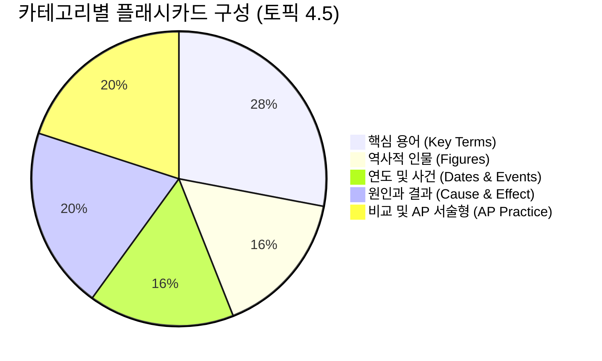

# 토픽 4.5: 해양 제국의 발전 (Maritime Empires Develop) — 플래시카드

---

### 카테고리 1: 핵심 용어 (Key Terms)

- [ ] **상업 혁명(Commercial Revolution)이란 무엇인가?**
  

▶ 정답

  15세기 말부터 18세기 초까지 유럽에서 전개된 경제적 대전환으로, 아메리카 금·은 유입, 대양 무역로 개척, 합자회사 및 은행 등 근대적 금융 제도의 출현으로 상업 자본주의가 확립된 과정입니다.
  

- [ ] **가격 혁명(Price Revolution)의 원인과 현상은 무엇인가?**
  

▶ 정답

  16~17세기 초 서유럽 전역에서 곡물과 공산품 물가가 수 세기 동안 급등한 인플레이션 현상으로, 유럽의 인구 회복에 따른 수요 증가와 신대륙 은의 막대한 유입이 결합되어 발생했습니다.
  

- [ ] **합자회사(Joint-Stock Company)의 작동 원리는 무엇인가?**
  

▶ 정답

  수많은 투자자가 주식을 매입하여 공동으로 대규모 자본을 형성한 후, 원양 무역 및 식민지 개척에 투자하여 지분에 비례해 이익과 손실을 배분받는 근대 주식회사의 효시입니다.
  

- [ ] **유한책임(Limited Liability) 원칙의 혁신성은 무엇인가?**
  

▶ 정답

  회사가 파산하더라도 투자자는 자신이 매입한 주식 출자금 한도 내에서만 손실 책임을 지고 개인 사유재산은 압류당하지 않도록 보장하여, 중산층의 적극적 투자 참여를 이끌어낸 제도입니다.
  

- [ ] **삼각무역(Triangular Trade)의 3단계 구조는 무엇인가?**
  

▶ 정답

  유럽(총기·공산품 수출) → 서아프리카(흑인 노예 선적) → 아메리카(플랜테이션 환금 작물 설탕·담배 적재) → 유럽으로 순환하는 대서양 3자 교역 시스템입니다.
  

- [ ] **중간 항로(Middle Passage)의 역사적 실상은 어떠했는가?**
  

▶ 정답

  아프리카 흑인 노예들을 아메리카 플랜테이션으로 수송하던 대서양 횡단 항로로, 쇠사슬 결박, 극단적 과밀, 오물과 전염병으로 인해 수많은 노예가 항해 중 사망한 비인도적 항로였습니다.
  

- [ ] **부왕(Viceroys)과 아우디엔시아(Audiencias)의 상호 견제 관계는 무엇인가?**
  

▶ 정답

  부왕은 스페인 국왕의 대리인으로서 식민지 행정과 군사를 총괄했고, 아우디엔시아는 왕립 사법 법원으로서 부왕의 정책을 심사하고 국왕 법령 준수 여부를 감시하며 권력 독점을 견제했습니다.
  

---

### 카테고리 2: 역사적 인물 (Historical Figures)

- [ ] **디에고 데 란다(Diego de Landa) 주교의 역사적 행적은 무엇인가?**
  

▶ 정답

  1562년 유카탄반도에서 마야 원주민들의 고유 종교를 악마의 숭배로 규정하고, 수많은 마야 그림문자 서적(코덱스)을 공개 소각하여 귀중한 고대 문명 기록을 파괴한 스페인 프란치스코회 주교입니다.
  

- [ ] **네덜란드 상인들이 "유럽의 중개자"로 불린 이유는 무엇인가?**
  

▶ 정답

  운송비가 극도로 저렴한 플루이트선을 대량 운용하며 발트해의 곡물과 목재, 지중해의 포도주, 아시아의 향신료, 아메리카의 설탕을 전 유럽에 유통시키는 상업 네트워크를 장악했기 때문입니다.
  

- [ ] **1590년 송가이 침공을 명령한 모로코 술탄 아흐마드 알만수르의 의도는 무엇인가?**
  

▶ 정답

  포르투갈과의 전쟁으로 바닥난 국고를 채우기 위해, 사하라 종단 금광 지대와 무역로를 장악하고자 최신 유럽산 화승총과 대포로 무장한 원정대를 파병했습니다.
  

- [ ] **다호메이(Dahomey)와 오요(Oyo)의 지도자들은 노예 무역에 어떻게 편승했는가?**
  

▶ 정답

  유럽 상인들에게 포로들을 노예로 매각하는 대가로 총기를 공급받아 상비군을 무장시키고, 이 군사력을 바탕으로 내륙 부족들을 공격하여 노예를 조달하며 집권 권력을 강화했습니다.
  

---

### 카테고리 3: 연도 및 사건 (Dates & Events)

- [ ] **1602년 네덜란드 동인도회사(VOC)와 암스테르담 증권거래소 설립의 의의는 무엇인가?**
  

▶ 정답

  세계 최초로 대중에게 주식을 발행하고 자유롭게 거래할 수 있는 공식 주식회사가 출범하여 근대 상업 자본주의의 제도적 틀을 완성했습니다.
  

- [ ] **1609년 암스테르담 은행(Bank of Amsterdam)의 설립이 가져온 금융 혁신은 무엇인가?**
  

▶ 정답

  각국의 다양한 주화를 표준화된 공공 예금 통화로 환전하고 어음 결제를 지원함으로써 국제 상업 거래의 결제 안정성과 신용 체제를 혁명적으로 개선했습니다.
  

- [ ] **1591년 톤디비 전투(Battle of Tondibi)의 결정적 결과는 무엇인가?**
  

▶ 정답

  화승총으로 무장한 모로코 원정군이 수적으로 훨씬 우세했던 송가이 제국 군대를 대파하고 수도 가오와 팀북투를 점령함으로써 서아프리카 최대 이슬람 제국 송가이를 멸망시켰습니다.
  

- [ ] **18세기 초 남해 거품 사건과 미시시피 거품 사건의 교훈은 무엇인가?**
  

▶ 정답

  식민지 무역 독점권에 대한 맹목적 투기 열풍으로 주가가 폭등했다가 폭락하면서, 금융 시장에 대한 국가적 규제와 투명한 기업 회계 제도의 필요성을 절감하게 되었습니다.
  

---

### 카테고리 4: 원인과 결과 (Cause & Effect)

- [ ] **아메리카 은 유입이 유럽의 가격 혁명(Price Revolution)을 촉발한 메커니즘은 무엇인가?**
  

▶ 정답

  - **원인**: 포토시 등에서 채굴된 막대한 양의 은이 유럽에 쏟아져 유통 화폐량이 폭증했으나 농산물과 상품 생산량 증가는 이에 미치지 못함.  
  - **결과**: 화폐 가치가 급락하고 전 유럽의 식량과 생필품 물가가 수 세기 동안 지속적으로 폭등함.
  

- [ ] **대서양 노예 무역이 서아프리카에 일부다처제(Polygyny)를 확산시킨 인과관계는 무엇인가?**
  

▶ 정답

  - **원인**: 유럽 노예 상인들이 플랜테이션 중노동에 적합한 젊은 남성 노예를 집중적으로 끌고 가 전체의 3분의 2 이상이 남성이었음.  
  - **결과**: 서아프리카 연안 사회에 극심한 남성 부족과 여성 잉여가 발생하여 한 남성이 여러 아내를 맞이하는 일부다처제가 사회적으로 보편화됨.
  

- [ ] **아메리카 작물이 아프리카 인구에 미친 역설적 원인과 결과는 무엇인가?**
  

▶ 정답

  - **원인**: 포르투갈 상선에 의해 브라질에서 마니옥(카사바), 옥수수 등 척박한 토양에 강한 작물이 아프리카로 전래됨.  
  - **결과**: 식량 공급이 획기적으로 개선되어, 대규모 노예 유출에도 불구하고 아프리카 전반의 인구가 증가세를 유지하는 역설적 완충 작용을 함.
  

- [ ] **중국이 전 세계 은의 궁극적 종착지(Silver Sink)가 된 배경은 무엇인가?**
  

▶ 정답

  - **원인**: 명나라가 모든 조세를 은으로 일원화하여 납부하도록 규정한 일조편법을 시행하여 은 수요가 절대적이 됨.  
  - **결과**: 스페인과 유럽 상인들이 아메리카에서 채굴한 은의 상당 부분이 중국산 비단, 도자기, 차를 구매하는 결제 대금으로 중국 국고로 흘러 들어감.
  

- [ ] **1591년 송가이 제국이 모로코 군대에 의해 붕괴된 원인과 결과는 무엇인가?**
  

▶ 정답

  - **원인**: 모로코 군대는 최신 오스만식 화승총과 대포로 무장한 반면, 송가이 군대는 수적으로 우세했으나 전통 창검과 화살에 의존함.  
  - **결과**: 톤디비 전투에서 송가이가 괴멸되고 사하라 종단 교역로의 중심 제국이 사라져 지역 사회가 분열됨.
  

---

### 카테고리 5: 비교 및 AP 서술형 (AP Practice)

- [ ] **네덜란드 동인도회사(VOC)와 스페인의 식민지 무역 체제를 비교하시오.**
  

▶ 정답

  - **네덜란드 VOC**: 민간 주주들이 출자한 합자회사로 유한책임 하에 운영되었으며, 종교적 개종보다는 순수한 상업적 이윤 극대화를 최우선 목표로 삼음.  
  - **스페인 무역 체제**: 국왕 직속 식민지 무역원(카사 데 콘트라타시온)이 엄격히 통제한 왕실 독점 체제로, 은 귀금속 확보와 가톨릭 선교가 주된 목적이었음.
  

- [ ] **노예 무역이 서아프리카 사회에 미친 인구학적 파급 효과와 아메리카 대륙에 미친 노동 경제적 파급 효과를 비교하시오.**
  

▶ 정답

  - **서아프리카**: 수백만 명의 청장년층 남성 유출로 극심한 성비 불균형, 가족 해체, 지속적인 노예 획득 약탈 전쟁 발발.  
  - **아메리카**: 플랜테이션 농업에 투입된 영구적 강제 노동 인력이 확립되어 설탕·담배 등 환금 작물 대량 수출과 자본 축적이 가능해짐.
  

- [ ] **[단답형 서술 / SAQ] 1450~1750년 사이 유럽의 상업 팽창을 촉진한 금융 혁신 1가지를 제시하고 그 작동 방식을 설명하시오.**
  

▶ 정답

  - **주장 (Claim)**: 유한책임(Limited Liability)을 갖춘 합자회사(Joint-Stock Company)의 등장은 해양 제국 팽창을 가속화한 핵심 금융 혁신이었습니다.  
  - **근거 (Evidence)**: 네덜란드 VOC는 암스테르담 증권거래소를 통해 수많은 일반 시민과 상인에게 주식을 판매하여 대규모 원양 무역 자본을 조달했습니다.  
  - **설명 (Reasoning)**: 투자자가 자신이 투자한 금액 이상의 회사 채무에 책임을 지지 않도록 보호함으로써, 개인의 파산 위험을 차단하고 광범위한 자본을 효율적으로 동원하여 국가 주도 탐험보다 훨씬 막대한 선단을 지속적으로 파견할 수 있게 되었습니다.
  

- [ ] **[장문형 서술 / LEQ] 1450~1750년 상업 혁명이 유럽 경제 구조를 변화시킨 정도를 평가하시오.**
  

▶ 정답

  - **주장 (Claim)**: 상업 혁명은 유럽 경제를 자급자족적 봉건 장원 경제에서 전 지구적 시장과 연결된 근대적 상업 자본주의 체제로 근본적으로 재편했습니다.  
  - **근거 (Evidence)**: 암스테르담 은행과 증권거래소의 설립, 대서양 삼각무역을 통한 플랜테이션 상품 유통, 아메리카산 은 유입으로 인한 가격 혁명이 이를 증명합니다.  
  - **설명 (Reasoning)**: 토지 소유권에만 의존하던 전통 귀족 계급의 상대적 지위가 인플레이션으로 약화된 반면, 상선과 금융 투자를 장악한 부르주아 상인 계층이 부를 축적하며 산업혁명을 견인할 자본 축적의 기틀을 마련했기 때문입니다.
  

- [ ] **[자료 기반 서술 / DBQ] 아메리카 대륙의 은(Silver) 유입이 전 지구적 교역망과 각국 경제에 미친 복합적 영향을 분석하시오.**
  

▶ 정답

  - **주장 (Claim)**: 아메리카산 은은 진정한 의미의 최초의 글로벌 화폐로 기능하여 세계 교역을 통합시켰으나, 은을 다량 흡수한 국가들에게는 인플레이션과 경제 왜곡이라는 치명적 부작용을 낳았습니다.  
  - **근거 (Evidence)**: 스페인은 포토시의 은으로 전비와 사치품을 결제했으나 국내 물가 폭등(가격 혁명)과 재정 파산을 겪었고, 명나라는 일조편법으로 은을 흡수했으나 은 가치 변동으로 농민 봉기와 왕조 멸망을 촉진했습니다.  
  - **설명 (Reasoning)**: 은은 대서양과 태평양을 횡단하는 무역의 결제 수단으로 세계 상권을 하나로 묶었지만, 실물 제조업 생산력의 뒷받침 없이 화폐량만 급증한 국가들의 거시 경제적 안정성을 근본적으로 파괴하는 양날의 검으로 작용했습니다.
  
