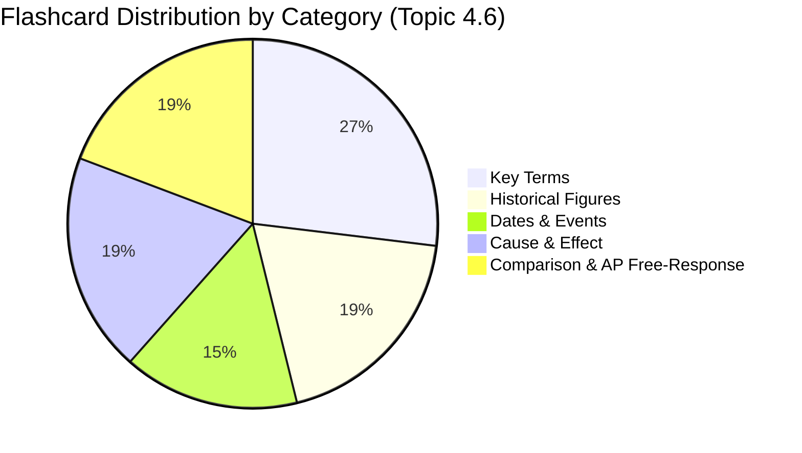

# Topic 4.6: Internal and External Challenges to State Power — Flashcards

---

### Category 1: Key Terms

- [ ] **Who were the Cossacks, and what was their relationship to the Russian state?**
  

▶ Answer

  Fierce, autonomous horsemen and runaway serfs living on the southern steppes. While hired as mercenary cavalry to expand Russian borders into Siberia, they frequently rebelled against tsarist central autocracy.
  

- [ ] **What were mirs in Tsarist Russia?**
  

▶ Answer

  Traditional village peasant communes that collectively owned land, allocated farm plots to individual serf households, and collected communal tax quotas for landlords and the state.
  

- [ ] **What was the Maratha Empire?**
  

▶ Answer

  A powerful Hindu confederacy/empire in central India (1674–1818) formed by warrior leader Shivaji that waged sustained guerrilla warfare against Mughal rule, effectively breaking Mughal hegemony.
  

- [ ] **What was the Pueblo Revolt (1680)?**
  

▶ Answer

  A major indigenous uprising in present-day New Mexico where allied Pueblo and Apache tribes rose up against Spanish Franciscan friars and authorities, expelling the colonizers for 12 years.
  

- [ ] **Who were Maroons in the Americas?**
  

▶ Answer

  Autonomous communities founded by self-liberated (escaped) enslaved Africans in remote geographical areas (such as the Jamaican mountains and Brazilian hinterlands/quilombos).
  

- [ ] **What was the Gloucester County Rebellion (1663)?**
  

▶ Answer

  An early colonial conspiracy in Virginia where enslaved Africans and white European indentured servants united to demand freedom from the royal governor, prefiguring later fears of multiracial solidarity.
  

- [ ] **What was the Fronde in France?**
  

▶ Answer

  A series of civil revolts between 1648 and 1653 led by French nobles and parliamentarians attempting to curb the rising centralizing absolutism of the French monarchy (Cardinal Mazarin and young Louis XIV).
  

---

### Category 2: Historical Figures

- [ ] **Who was Queen Ana Nzinga?**
  

▶ Answer

  Ruler of Ndongo and Matamba (south-central Africa) who allied with the Dutch, offered sanctuary to runaway slaves, and resisted Portuguese slave raids and colonial encroachment for decades.
  

- [ ] **Who was Yemelyan Pugachev?**
  

▶ Answer

  A Cossack chieftain who launched the massive 1774 peasant rebellion against Catherine the Great, pretending to be her murdered husband, Peter III, before his capture and execution.
  

- [ ] **Who was Popé?**
  

▶ Answer

  A Pueblo religious leader from Ohkay Owingeh who coordinated the successful Pueblo Revolt of 1680, organizing coordinated attacks against Spanish churches and outposts.
  

- [ ] **Who was Queen Nanny?**
  

▶ Answer

  An escaped African woman who united the Windward Maroons of Jamaica in the early 18th century and led successful guerrilla warfare against British colonial forces, securing formal autonomy.
  

- [ ] **Who was Metacom (King Philip)?**
  

▶ Answer

  The chief of the Wampanoag people who led a confederacy of Native American tribes in Metacom’s War (1675–1678) against English colonial expansion in New England.
  

---

### Category 3: Dates & Events

- [ ] **What took place in 1624 regarding African anti-colonial resistance?**
  

▶ Answer

  Ana Nzinga became ruler of Ndongo, inaugurating a multi-decade campaign of diplomatic maneuvering, conversion, and armed resistance against Portuguese colonization.
  

- [ ] **What was the milestone outcome of 1680 in Spanish New Mexico?**
  

▶ Answer

  The Pueblo Revolt erupted, killing 400 Spaniards and expelling colonial authorities from Santa Fe for over a decade.
  

- [ ] **What occurred in 1688–1689 during England's Glorious Revolution?**
  

▶ Answer

  Parliament deposed the Catholic monarch James II, inviting William of Orange and Mary II to rule and passing the English Bill of Rights, which established a constitutional monarchy.
  

- [ ] **What erupted in Russia in 1774?**
  

▶ Answer

  The Pugachev Rebellion, the largest peasant revolt in Russian imperial history, destabilizing Catherine the Great's regime between the Volga River and the Ural Mountains.
  

---

### Category 4: Cause & Effect

- [ ] **Why did the Portuguese alliance with Queen Ana Nzinga collapse?**
  

▶ Answer

  **Cause**: Portugal refused to honor territorial treaties, continuing unauthorized slave raids inside Ndongo.  
  **Effect**: Nzinga seized Matamba, established an alliance with the Dutch, and launched a protracted military resistance campaign against Portugal.
  

- [ ] **How did the Pugachev Rebellion paradoxically worsen the status of Russian serfs?**
  

▶ Answer

  **Cause**: Pugachev's uprising terrified Empress Catherine the Great and the noble landowning class.  
  **Effect**: To ensure noble loyalty to the tsarist state, Catherine granted landowners absolute, unchecked punitive authority over their serfs.
  

- [ ] **What caused the Pueblo Revolt of 1680?**
  

▶ Answer

  **Cause**: Spanish authorities and Franciscan priests banned traditional kiva ceremonies, tortured native holy men, and coerced tribute labor under the encomienda.  
  **Effect**: The Pueblo tribes united, attacked Spanish settlements, burned Catholic churches, and drove the Spanish colonizers out of New Mexico.
  

- [ ] **How did Mughal Emperor Aurangzeb's religious policies cause the rise of the Maratha Empire?**
  

▶ Answer

  **Cause**: Aurangzeb repealed policies of religious tolerance, reimposing the discriminatory *jizya* tax on non-Muslims and demolishing Hindu temples.  
  **Effect**: Militant Hindu resistance coalesced behind the Marathas, who fought decades of guerrilla warfare that shattered Mughal territorial control.
  

- [ ] **What caused the outbreak of Metacom's War in 1675?**
  

▶ Answer

  **Cause**: Continuous English Puritan encroachment on indigenous Wampanoag ancestral lands and colonial court interference in tribal sovereignty.  
  **Effect**: A bloody multi-year war destroyed 12 English settlements, decimated native populations, and ended autonomous indigenous independence in southern New England.
  

---

### Category 5: Comparison & AP Free-Response

- [ ] **Compare the causes and methods of resistance used by Queen Ana Nzinga versus Queen Nanny of Jamaica.**
  

▶ Answer

  - **Ana Nzinga**: Ruled an established sovereign African state (Ndongo/Matamba); combined interstate diplomacy (baptized Christian, allied with the Dutch) with regular armies to resist Portuguese slave raiding.  
  - **Queen Nanny**: Led an escaped maroon community in the rugged Jamaican mountains; utilized covert guerrilla ambushes and mountain warfare against British forces to secure treaty-based self-governance.
  

- [ ] **Compare the Glorious Revolution with the Fronde.**
  

▶ Answer

  - **The Fronde (France)**: An armed noble insurrection that failed to halt royal centralization, ultimately prompting Louis XIV to build absolute monarchy at Versailles.  
  - **The Glorious Revolution (England)**: A bloodless coup engineered by Parliament that succeeded in permanently limiting royal power, establishing parliamentary supremacy and constitutional rule.
  

- [ ] **[AP Short Answer / SAQ Practice] Explain ONE internal challenge to imperial authority in the period 1450 to 1750.**
  

▶ Answer

  - **Claim**: The Maratha warrior uprising represented a major internal challenge to Mughal imperial authority in South Asia.  
  - **Evidence**: Led by Shivaji, the Hindu Marathas utilized mobile guerrilla warfare against Mughal imperial armies between 1680 and 1707.  
  - **Reasoning**: By exploiting religious grievances stemming from Aurangzeb's reimposition of the jizya tax, the Marathas fractured Mughal central authority and founded an independent Hindu empire, leaving the Mughals severely weakened.
  

- [ ] **[AP Long Essay / LEQ Practice] Evaluate the extent to which indigenous populations resisted European imperial expansion between 1450 and 1750.**
  

▶ Answer

  - **Claim**: Indigenous populations resisted European expansion extensively through both coordinated armed conflict and strategic military alliances, although epidemic diseases and technological disparities often limited long-term autonomy.  
  - **Evidence**: The Pueblo Revolt of 1680 successfully expelled the Spanish from New Mexico for 12 years, and Metacom's War in 1675 destroyed 12 Puritan towns before being suppressed.  
  - **Reasoning**: While indigenous groups lacked immunity to European diseases and could rarely sustain multi-front wars against reinforced colonial powers, their fierce military resistance forced European empires to negotiate concessions, reform labor demands, and adapt colonial administrative policies.
  

- [ ] **[AP Document-Based Practice] Analyze how marginalized social groups organized resistance against early modern coercive labor systems.**
  

▶ Answer

  - **Claim**: Marginalized and coerced populations organized resistance by establishing autonomous geographical communities, forming cross-ethnic coalitions, and launching armed rebellions against colonial authorities.  
  - **Evidence**: Enslaved Africans in Jamaica fled to establish independent Maroon communities under Queen Nanny, Virginia indentured servants and slaves united in the 1663 Gloucester conspiracy, and Russian serfs joined the 1774 Pugachev revolt.  
  - **Reasoning**: Because institutionalized legal channels were closed to coerced workers, marginalized laborers utilized territorial withdrawal into inaccessible terrains or violent collective uprisings to contest exploitation and demand human autonomy.
  
