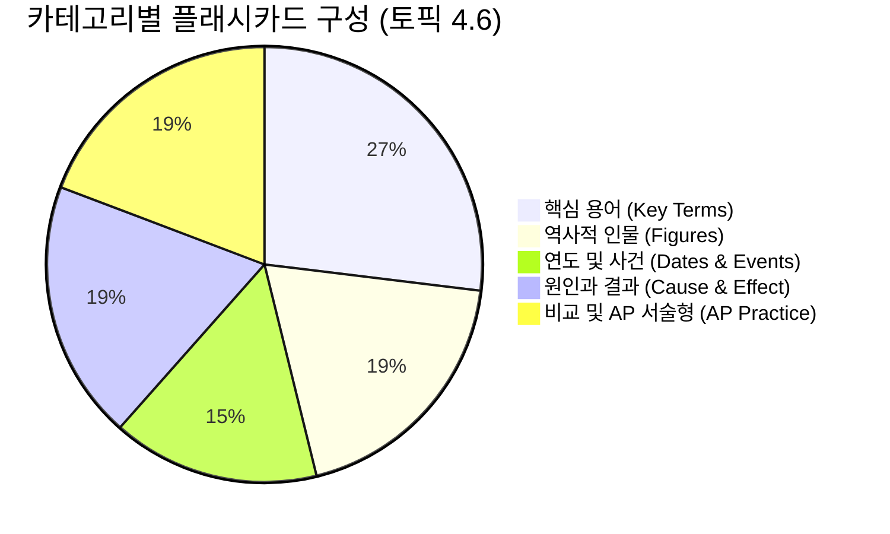

# 토픽 4.6: 국가 권력에 대한 내외의 도전 (Internal & External Challenges) — 플래시카드

---

### 카테고리 1: 핵심 용어 (Key Terms)

- [ ] **카자크(Cossacks)란 누구이며, 러시아 제정과의 관계는 어떠했는가?**
  

▶ 정답

  흑해 인근 남부 초원에서 거주하던 용맹한 기마 전사 집단으로 상당수가 도망친 농노 출신이었습니다. 차르의 시베리아 영토 확장에 용병으로 활약했으나, 차르의 중앙집권적 전제 권력에 맞서 자주 대규모 반란을 일으켰습니다.
  

- [ ] **러시아의 미르(Mirs)란 무엇인가?**
  

▶ 정답

  러시아 농촌의 전통적 촌락 공동체로, 농토를 주기적으로 분배하고 농노들의 세금 납부와 부역 의무를 영주와 국가를 대신하여 연대 책임으로 통제하던 자치 기구입니다.
  

- [ ] **마라타 제국(Maratha Empire)이란 무엇인가?**
  

▶ 정답

  17세기 후반 시바지가 이끄는 힌두 전사 집단이 무굴 제국의 이슬람 전제 통치와 종교 탄압에 맞서 수립한 힌두 연맹 제국(1674–1818)으로, 무굴의 패권을 종식시켰습니다.
  

- [ ] **푸에블로 반란(Pueblo Revolt, 1680)의 성격은 무엇인가?**
  

▶ 정답

  스페인령 뉴멕시코에서 가톨릭 강제 개종과 엔코미엔다 강제 노동에 맞서 푸에블로족과 아파치족이 연합하여 스페인 식민 정복자들을 12년 동안 완전히 몰아낸 대규모 원주민 항쟁입니다.
  

- [ ] **마룬(Maroons) 공동체란 무엇인가?**
  

▶ 정답

  카리브해와 아메리카 대륙의 사탕수수 플랜테이션에서 탈출한 아프리카 흑인 노예들이 험준한 산악 지대나 정글에 세운 요새화된 자치 무장 공동체입니다.
  

- [ ] **글로스터 카운티 반란 모의(Gloucester County Rebellion, 1663)의 의의는 무엇인가?**
  

▶ 정답

  미국 버지니아에서 흑인 노예와 백인 계약 하인이 인종을 넘어 자유를 쟁취하기 위해 총독에 맞서 무장 봉기를 결탁했던 사건으로, 식민 지배층에게 계급 연대의 공포를 심어주었습니다.
  

- [ ] **프랑스의 프롱드의 난(The Fronde, 1648–1653)이란 무엇인가?**
  

▶ 정답

  마자랭 추기경과 어린 루이 14세의 절대주의 왕권 강화 및 과도한 과세에 반발하여 파리 고등법원과 전통 대귀족들이 일으킨 내란입니다.
  

---

### 카테고리 2: 역사적 인물 (Historical Figures)

- [ ] **아나 은징가(Queen Ana Nzinga) 여왕의 역사적 업적은 무엇인가?**
  

▶ 정답

  은동고와 마탐바의 통치자로서 기독교 개종 외교, 네덜란드와의 군사 동맹, 도망 노예 수용 정책을 복합적으로 구사하며 포르투갈의 식민 노예 약탈에 수십 년간 맞선 여왕입니다.
  

- [ ] **예멜리얀 푸가초프(Yemelyan Pugachev)는 누구인가?**
  

▶ 정답

  자신이 암살된 황제 표트르 3세라고 사칭하며 1774년 농노와 소수 민족을 규합해 예카테리나 대제에 맞서 러시아 역사상 최대의 농민 반란을 일으킨 카자크 지도자입니다.
  

- [ ] **포페(Popé)의 역사적 지도력은 무엇인가?**
  

▶ 정답

  스페인 사제들의 가혹한 종교 탄압에 맞서 1680년 뉴멕시코 여러 푸에블로 부족들의 봉기 시점을 매듭지은 끈으로 비밀리에 조율하여 반란을 대성공으로 이끈 종교 지도자입니다.
  

- [ ] **내니 여왕(Queen Nanny)의 역사적 공헌은 무엇인가?**
  

▶ 정답

  자메이카 윈드워드 마룬 부족을 통솔하여 험준한 블루마운틴에서 영국 정규군을 상대로 탁월한 게릴라전을 펼쳐, 1730년대 영국으로부터 공식적인 자치 조약을 이끌어낸 영웅입니다.
  

- [ ] **메타콤(Metacom / King Philip)의 최후 저항은 무엇이었는가?**
  

▶ 정답

  왐파노아그족 추장으로서 청교도 정착민들의 끊임없는 영토 침탈에 맞서 1675~1678년 뉴잉글랜드 전역에서 혈전을 벌인(메타콤 전쟁) 북미 원주민 지도자입니다.
  

---

### 카테고리 3: 연도 및 사건 (Dates & Events)

- [ ] **1624년 아프리카 은동고에서 일어난 역사적 분기점은 무엇인가?**
  

▶ 정답

  아나 은징가가 은동고의 왕위에 올라, 포르투갈의 불법적인 노예 사냥을 차단하고 주권을 지키기 위한 대포르투갈 항쟁 체제를 가동했습니다.
  

- [ ] **1680년 스페인 제국에 충격을 준 뉴멕시코의 사건은 무엇인가?**
  

▶ 정답

  푸에블로 반란이 발발하여 스페인 식민 당국자 400여 명이 처단되고, 스페인 군대가 산타페에서 남쪽 엘파소로 완전히 쫓겨났습니다.
  

- [ ] **1688~1689년 영국의 명예혁명이 남긴 헌정사적 성과는 무엇인가?**
  

▶ 정답

  가톨릭 절대군주 제임스 2세가 축출되고 윌리엄과 메리가 공동 즉위하며 의회 권리장전을 승인함으로써, 의회 중심의 입헌군주제가 확립되었습니다.
  

- [ ] **1774년 러시아 제국을 뒤흔든 사건은 무엇인가?**
  

▶ 정답

  푸가초프의 난이 발발하여 우랄과 볼가강 일대를 장악하고 농노 해방을 선언했으나, 결국 정부군에 진압되어 처형되었습니다.
  

---

### 카테고리 4: 원인과 결과 (Cause & Effect)

- [ ] **포르투갈과 아나 은징가 간의 초기 동맹이 파탄 난 원인과 결과는 무엇인가?**
  

▶ 정답

  - **원인**: 포르투갈이 협정을 무시하고 은동고 영내에서 노예 약탈을 지속하고 영토 침탈을 멈추지 않음.  
  - **결과**: 은징가가 마탐바로 거점을 옮겨 네덜란드와 동맹을 맺고 도망 노예를 군대로 양성하여 포르투갈군을 격퇴함.
  

- [ ] **푸가초프 반란이 러시아 농노들의 처지를 역설적으로 악화시킨 원인은 무엇인가?**
  

▶ 정답

  - **원인**: 반란의 폭력성과 규모에 충격을 받은 예카테리나 대제는 전제정 유지를 위해 귀족들의 절대적 협조가 절실해짐.  
  - **결과**: 귀족들의 환심을 사기 위해 영주들에게 농노 처벌권과 토지 매매권을 전폭적으로 부여하여 농노제가 더욱 가혹해짐.
  

- [ ] **1680년 푸에블로 반란의 원인과 결과는 무엇인가?**
  

▶ 정답

  - **원인**: 스페인 수도사들의 원주민 종교 의식 금지, 키바(성소) 파괴, 주술 혐의 고문 및 가혹한 엔코미엔다 부역 착취.  
  - **결과**: 원주민 연합이 스페인인을 몰아내고 12년간 자치를 누렸으며, 재정복 후 스페인 당국은 종교 탄압을 완화하고 유화 정책으로 선회함.
  

- [ ] **아우랑제브 황제의 종교 정책이 무굴 제국의 몰락을 초래한 메커니즘은 무엇인가?**
  

▶ 정답

  - **원인**: 악바르 대제의 힌두-이슬람 화합 정책을 폐기하고 힌두교도에게 지즈야세를 재부과하며 사원을 파괴함.  
  - **결과**: 힌두 마라타족이 시바지를 중심으로 무장 봉기하여 마라타 제국을 세우고 무굴 제국의 내륙 통치력을 완전히 붕괴시킴.
  

- [ ] **1675년 메타콤 전쟁이 촉발된 원인과 결과는 무엇인가?**
  

▶ 정답

  - **원인**: 영국 청교도 식민 정착민들의 끝없는 토지 잠식과 원주민 부족 주권 침해.  
  - **결과**: 뉴잉글랜드 정착촌 12곳이 파괴되는 막대한 피해가 발생했으나, 메타콤 전사 후 남부 뉴잉글랜드 원주민 토지가 완전히 영국인들에게 강탈당함.
  

---

### 카테고리 5: 비교 및 AP 서술형 (AP Practice)

- [ ] **아프리카 아나 은징가 여왕과 자메이카 내니 여왕의 저항 전략을 비교하시오.**
  

▶ 정답

  - **아나 은징가**: 주권 국가(은동고·마탐바)의 군주로서 기독교 개종, 네덜란드와의 국가 간 외교 동맹 및 정규군 전투를 결합함.  
  - **내니 여왕**: 사탕수수 농장을 탈출한 마룬 공동체의 지도자로서 험준한 산악 지형을 이용한 게릴라 기습전으로 영국군을 지치게 하여 자치 조약을 체결함.
  

- [ ] **프랑스의 프롱드의 난과 영국의 명예혁명을 국가 권력의 변화 관점에서 비교하시오.**
  

▶ 정답

  - **프롱드의 난**: 귀족들의 반란이 실패로 끝나 루이 14세의 베르사유 궁전을 정점으로 하는 절대왕정이 완성되는 계기가 됨.  
  - **명예혁명**: 의회가 주도한 정변이 성공하여 권리장전을 제정하고 국왕의 권력을 법 아래에 두는 입헌군주제가 수립됨.
  

- [ ] **[단답형 서술 / SAQ] 1450~1750년 사이 국가의 중앙집권적 권력 강화에 저항한 국내적 사건 1가지를 제시하고 그 영향을 설명하시오.**
  

▶ 정답

  - **주장 (Claim)**: 무굴 제국 내 힌두 마라타 전사들의 저항은 제국의 중앙집권 권력을 해체시킨 결정적 사건이었습니다.  
  - **근거 (Evidence)**: 아우랑제브 황제의 지즈야세 재부과와 힌두 탄압에 맞서 시바지가 이끄는 마라타 군대가 데칸고원에서 장기 게릴라전을 벌였습니다.  
  - **설명 (Reasoning)**: 이 저항은 무굴 제국의 군사 재정을 고갈시키고 중부 인도의 통제권을 박탈하여, 무굴 제국을 명목상의 지방 정권으로 전락시키고 마라타 제국이 부상하게 만들었습니다.
  

- [ ] **[장문형 서술 / LEQ] 1450~1750년 유럽 식민 팽창에 맞선 원주민 사회의 저항의 성격과 한계를 평가하시오.**
  

▶ 정답

  - **주장 (Claim)**: 원주민 사회는 종교 탄압과 토지 수탈에 맞서 강력한 군사 연대 봉기로 식민 제국에 타격을 입혔으나, 구대륙 전염병과 자원 고갈로 인해 장기적 자치를 유지하는 데는 한계가 있었습니다.  
  - **근거 (Evidence)**: 1680년 푸에블로 반란은 스페인을 12년간 축출했고, 1675년 메타콤 전쟁은 12개 영국 정착촌을 파괴했습니다.  
  - **설명 (Reasoning)**: 비록 초기 기습과 연합 전술로 승리를 거두었으나, 인구 손실과 화약 무기 보급의 절대적 열세로 인해 결국 유럽의 증원군과 군사적 재침략에 굴복할 수밖에 없었습니다.
  

- [ ] **[자료 기반 서술 / DBQ] 근대 초 가혹한 강제 노동 체제에 저항하여 피압박 민중들이 구사한 저항 양식을 분석하시오.**
  

▶ 정답

  - **주장 (Claim)**: 억압받던 노예와 농민들은 도망을 통한 독립 공동체 건설, 다인종 연대 모의, 무장 반란 등 다양한 방식으로 노동 착취에 맞섰습니다.  
  - **근거 (Evidence)**: 자메이카의 탈출 노예들은 내니 여왕 아래 마룬 자치령을 세웠고, 버지니아에서는 흑인 노예와 백인 계약 하인이 결탁(1663)했으며, 러시아 농노들은 푸가초프의 난(1774)에 대거 가담했습니다.  
  - **설명 (Reasoning)**: 법적 제도권 내에서 권리를 구제받을 길이 전무했던 피지배층은 지리적 도피를 통해 국가 권력의 손길이 닿지 않는 자치를 일구거나, 전면적인 무력 봉기로 체제의 근간을 위협했습니다.
  
