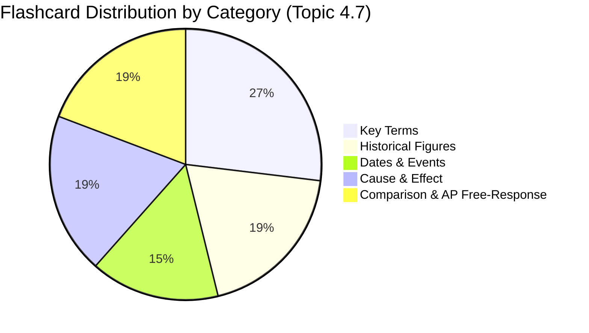

# Topic 4.7: Changing Social Hierarchies — Flashcards

---

### Category 1: Key Terms

- [ ] **What was the Casta system in colonial Latin America?**
  

▶ Answer

  A rigid, institutionalized social and legal hierarchy determined by racial purity (*limpieza de sangre*), ancestry, and skin color, dictating taxation, legal privileges, and access to offices.
  

- [ ] **Who were Peninsulares?**
  

▶ Answer

  Spaniards and Portuguese born on the Iberian Peninsula who resided in the Americas; they stood at the absolute apex of the colonial pyramid, monopolizing top viceregal, military, and ecclesiastical posts.
  

- [ ] **Who were Criollos (Creoles)?**
  

▶ Answer

  Individuals of pure European descent born in the Americas. They constituted the wealthy landowning and mercantile elite, but were barred from the highest administrative offices reserved for peninsulares.
  

- [ ] **What was the difference between Mestizos, Mulattoes, and Zambos?**
  

▶ Answer

  - **Mestizos**: Mixed European and Indigenous American parentage.  
  - **Mulattoes**: Mixed European and African parentage.  
  - **Zambos**: Mixed African and Indigenous American parentage.
  

- [ ] **What was the Queue hairstyle in Qing China?**
  

▶ Answer

  The traditional Manchu hairstyle—front of the head shaved with hair gathered into a long braid at the back—imposed on all Han Chinese men under penalty of death as a symbol of submission.
  

- [ ] **What was "Harem Politics" in the Ottoman Empire?**
  

▶ Answer

  The significant informal political power exercised by wives, concubines, and queen mothers (Valide Sultan) of the Ottoman imperial harem in influencing diplomatic, administrative, and succession decisions.
  

- [ ] **What was the Ottoman timar system?**
  

▶ Answer

  A feudal grant system where the sultan allocated agricultural revenues of conquered lands to military cavalry officers (sipahis) to secure elite military loyalty and provincial administration.
  

---

### Category 2: Historical Figures

- [ ] **Who was Roxelana (Hurrem Sultan)?**
  

▶ Answer

  An enslaved Ukrainian captive who entered Sultan Suleiman the Magnificent's harem, became his legal wife, wielded extraordinary political influence, and secured the succession of her son.
  

- [ ] **Who was Akbar the Great in the context of religious toleration?**
  

▶ Answer

  Mughal emperor (1556–1605) who instituted broad religious tolerance, abolishing the *jizya* tax on non-Muslims, marrying Hindu princesses, and hosting interfaith dialogues to integrate his Hindu subjects.
  

- [ ] **Who was Mehmed II in relation to religious minorities?**
  

▶ Answer

  The Ottoman sultan who, after conquering Constantinople, formally invited Spanish Jews exiled in 1492 to settle in Istanbul, utilizing their administrative, medical, and printing talents.
  

- [ ] **Who was Ivan IV ("Ivan the Terrible") regarding the Russian social order?**
  

▶ Answer

  Russian tsar who violently suppressed the noble boyar class, confiscating their hereditary estates and establishing the *Oprichnina* to enforce absolute autocracy.
  

- [ ] **Who were Li Chengdong and Liu Liangzuo?**
  

▶ Answer

  Han Chinese generals who defected to the Qing dynasty and ruthlessly executed massacres against Han civilians (such as in Jaiding and Jiangyin) who resisted adopting the Manchu queue.
  

---

### Category 3: Dates & Events

- [ ] **What landmark expulsions occurred in Spain in 1492?**
  

▶ Answer

  Following the completion of the *Reconquista*, Ferdinand and Isabella issued the Edict of Expulsion, forcing all practicing Jews (and later Muslims) to convert to Catholicism or leave Spain.
  

- [ ] **What transition occurred in China in 1644?**
  

▶ Answer

  The Manchu forces breached the Great Wall, overthrew the remnants of the Ming Dynasty, and established the Qing Dynasty (1644–1912), subordinating the Han Chinese majority.
  

- [ ] **What was the Law of 1649 in Tsarist Russia?**
  

▶ Answer

  An imperial law code that permanently tied Russian peasants to the land, eliminating escape provisions and legalizing hereditary serfdom to placate the boyar aristocracy.
  

- [ ] **What took place in France under Louis XIV regarding aristocratic power?**
  

▶ Answer

  During his personal rule (1661–1715), Louis XIV neutralized noble military uprisings by requiring aristocrats to reside at the Palace of Versailles, reducing them to courtiers dependent on royal favor.
  

---

### Category 4: Cause & Effect

- [ ] **Why did the Ottoman Empire welcome Sephardic Jewish refugees in 1492?**
  

▶ Answer

  **Cause**: Catholic monarchs expelled Jews from Spain, stripping them of property.  
  **Effect**: Sultan Mehmed II recognized their valuable commercial connections, linguistic skills, banking acumen, and knowledge of firearm/printing technology, integrating them into the empire.
  

- [ ] **Why did the Qing Dynasty mandate the queue hairstyle for Han Chinese men?**
  

▶ Answer

  **Cause**: The ruling Manchus were an ethnic minority seeking to cement their political authority over hundreds of millions of Han Chinese.  
  **Effect**: The queue served as an unmistakable visual marker of submission; refusal exposed anti-Qing rebels and was punished by decapitation.
  

- [ ] **How did the development of gunpowder weaponry alter the balance between European monarchs and nobles?**
  

▶ Answer

  **Cause**: Expensive siege cannons and standing armies could only be financed by royal state treasuries, not individual feudal lords.  
  **Effect**: Monarchs easily demolished noble stone fortifications, subordinating the feudal nobility to royal absolutism.
  

- [ ] **What caused the establishment of the Casta system in Spanish America?**
  

▶ Answer

  **Cause**: European settlers, enslaved Africans, and indigenous Americans intermarried and produced mixed-race offspring.  
  **Effect**: The Iberian elite codified a complex legal-racial caste system to institutionalize white supremacy and maintain control over land and coerced labor.
  

- [ ] **Why did Russian tsars continually expand serfdom while Western Europe abolished it?**
  

▶ Answer

  **Cause**: Tsars needed the military support and political acquiescence of the boyar landowners to govern the vast, underpopulated Russian empire.  
  **Effect**: The crown conceded complete legal authority over peasant labor to the nobility, legally chaining millions of peasants to the soil.
  

---

### Category 5: Comparison & AP Free-Response

- [ ] **Compare the social standing and treatment of religious minorities in the Ottoman Empire versus Spain between 1450 and 1750.**
  

▶ Answer

  - **Ottoman Empire**: Practiced institutionalized tolerance; recognized non-Muslims (Christians, Jews) as *dhimmi*, allowing autonomous religious courts (*millet*) in exchange for the *jizya* tax.  
  - **Spain**: Enforced absolute Catholic orthodoxy; expelled Jews and Muslims (1492) and used the Inquisition to hunt and execute secret practitioners.
  

- [ ] **Compare the status of Peninsulares versus Criollos in colonial Spanish America.**
  

▶ Answer

  - **Peninsulares**: Born in Spain; held monopoly on supreme colonial offices (viceroys, judges of audiencias, archbishops) and favored by crown patronage.  
  - **Criollos**: Born in the Americas of Spanish blood; owned extensive haciendas and mines, accumulating wealth but deeply resentful of their exclusion from highest political offices.
  

- [ ] **[AP Short Answer / SAQ Practice] Explain ONE way in which the Manchu rulers of the Qing Dynasty maintained social control over the Han Chinese population.**
  

▶ Answer

  - **Claim**: The Qing enforced the adoption of the Manchu queue hairstyle as an obligatory sign of political submission.  
  - **Evidence**: Han men were required by imperial edict to shave their foreheads and wear a braided pigtail, under the penalty of immediate execution for non-compliance.  
  - **Reasoning**: By forcing visible conformity to Manchu cultural norms, the Qing identified and eliminated dissidents, publicly reinforcing the political dominance of the Manchu minority.
  

- [ ] **[AP Long Essay / LEQ Practice] Evaluate the extent to which social hierarchies changed in the Americas between 1450 and 1750.**
  

▶ Answer

  - **Claim**: Social hierarchies in the Americas changed radically, transitioning from indigenous tributary class structures to a completely unprecedented legal hierarchy based on racial ancestry.  
  - **Evidence**: The Casta system established strict legal tiers (peninsulares, criollos, mestizos, mulattoes, indigenous, and African slaves), reserving administrative power and land ownership for those of pure European descent.  
  - **Reasoning**: Because demographic collapse and transatlantic migrations brought three distinct continental populations into continuous contact, Spanish colonizers codified racial categories to ensure that economic wealth and political sovereignty remained permanently monopolized by white elites.
  

- [ ] **[AP Document-Based Practice] Analyze how imperial rulers utilized policies toward religious minorities to consolidate state power between 1450 and 1750.**
  

▶ Answer

  - **Claim**: Imperial rulers strategically adopted either religious tolerance or religious homogenization to centralize authority and eliminate threats to state power.  
  - **Evidence**: Akbar the Great repealed the jizya and patronized Hindu elites to pacify a fragmented Mughal India, whereas the Spanish monarchs expelled Jews and Muslims in 1492 to forge unified Catholic state identity.  
  - **Reasoning**: While tolerance integrated diverse economic and military talents into multiethnic land empires, religious uniformity consolidated royal sovereignty by equating obedience to the crown with religious orthodoxy.
  
