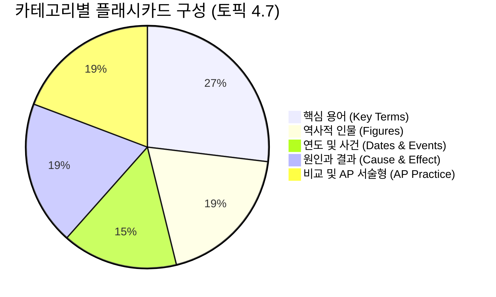

# 토픽 4.7: 사회적 위계질서의 변화 (Changing Social Hierarchies) — 플래시카드

---

### 카테고리 1: 핵심 용어 (Key Terms)

- [ ] **라틴아메리카의 카스타(Casta) 제도란 무엇인가?**
  

▶ 정답

  스페인 식민지에서 인종적 순수성, 혈통, 피부색에 따라 개인의 법적 권리, 조세 부담, 관직 진출 가능성을 엄격하게 규정한 인종 기반 사회 위계 체제입니다.
  

- [ ] **페닌술라르(Peninsulares)란 누구인가?**
  

▶ 정답

  이베리아반도 본국에서 태어나 신대륙으로 건너온 순수 백인으로, 부왕령의 총독, 고위 장군, 대주교 등 식민지 최고위 권력을 독점한 최상위 계급입니다.
  

- [ ] **크리오요(Criollos / Creoles)란 누구인가?**
  

▶ 정답

  아메리카 식민지에서 태어난 스페인계 순수 백인으로, 대농장(하시엔다)과 광산을 소유한 경제적 엘리트였으나 최고위 식민지 관직 진출이 차단되어 본국에 불만을 품었습니다.
  

- [ ] **메스티소, 물라토, 잠보의 혈통적 차이는 무엇인가?**
  

▶ 정답

  - **메스티소(Mestizos)**: 백인과 아메리카 원주민의 혼혈.  
  - **물라토(Mulattoes)**: 백인과 아프리카 흑인의 혼혈.  
  - **잠보(Zambos)**: 아프리카 흑인과 아메리카 원주민의 혼혈.
  

- [ ] **청나라의 변발령(Queue)이란 무엇인가?**
  

▶ 정답

  만주족의 전통 머리 모양(이마를 깎고 뒤통수 머리를 땋아 늘어뜨림)을 모든 한족 남성에게 강제한 정책으로, 만주족 황제에 대한 절대적 복종의 표식이었습니다.
  

- [ ] **오스만 제국의 "하렘 정치(Harem Politics)"란 무엇인가?**
  

▶ 정답

  술탄의 거처인 하렘에 머물던 모후(발리데 술탄)와 정실 후궁들이 궁정 배후에서 재상 임명, 외교 정책, 후계자 계승에 막강한 영향력을 행사한 현상입니다.
  

- [ ] **오스만 제국의 티마르(Timar) 제도란 무엇인가?**
  

▶ 정답

  술탄이 기병 전사(시파히)들에게 군사적 충성을 대가로 정복지 농토의 조세 징수권을 분배하여 군사력과 지방 통치를 유지한 토지 급여 제도입니다.
  

---

### 카테고리 2: 역사적 인물 (Historical Figures)

- [ ] **록셀라나(Roxelana / 휩렘 술탄)의 역사적 의의는 무엇인가?**
  

▶ 정답

  우크라이나 출신 노예로 술탄 쉴레이만 1세의 총애를 받아 정식 황후가 되었으며, 대규모 공공 건축을 후원하고 아들을 차기 술탄으로 즉위시켜 여인들의 술탄 시대를 연 인물입니다.
  

- [ ] **악바르 대제(Akbar the Great)의 종교 정책은 어떠했는가?**
  

▶ 정답

  힌두교도가 다수인 무굴 제국의 안정을 위해 지즈야(비무슬림세)를 폐지하고, 힌두 사원을 지원하며, 종교 간 토론장(이바다트 카나)을 운영하는 등 관용 정책을 폈습니다.
  

- [ ] **메흐메트 2세(Mehmed II)는 유대인에 대해 어떤 정책을 취했는가?**
  

▶ 정답

  1492년 스페인에서 가톨릭 왕정에 의해 추방된 세파르디 유대인들을 이스탄불로 환영하여, 그들의 의학, 금융, 외교, 인쇄술 지식을 제국 발전에 적극 활용했습니다.
  

- [ ] **이반 4세(Ivan the Terrible)는 러시아 귀족을 어떻게 통제했는가?**
  

▶ 정답

  전통 귀족인 보야르의 반발을 무자비하게 숙청하고 노브고로드 등의 영지를 몰수했으며, 친위대(오프리치니키)를 창설해 차르의 절대 전제정을 확립했습니다.
  

- [ ] **이성동(Li Chengdong)과 유양좌(Liu Liangzuo)는 누구인가?**
  

▶ 정답

  청나라에 투항한 한족 출신 장군들로, 변발령에 저항하던 가정(Jiading)과 강음(Jiangyin)의 동족 한족 수만 명을 잔혹하게 학살하여 청 왕조의 지배를 공고히 했습니다.
  

---

### 카테고리 3: 연도 및 사건 (Dates & Events)

- [ ] **1492년 스페인의 유대인 추방령(Edict of Expulsion)의 결과는 무엇인가?**
  

▶ 정답

  레콩키스타 완성 직후 스페인 내 수만 명의 유대인이 재산을 빼앗기고 추방되어 오스만 제국, 북아프리카, 네덜란드 등으로 망명했습니다.
  

- [ ] **1644년 중국의 왕조 교체가 사회 구조에 미친 영향은 무엇인가?**
  

▶ 정답

  만주족이 산해관을 넘어 명나라를 멸망시키고 청나라를 세우며, 소수 만주족이 다수 한족을 지배하는 이중적 사회 위계질서가 확립되었습니다.
  

- [ ] **1649년 러시아 법전(Law of 1649)의 핵심 내용은 무엇인가?**
  

▶ 정답

  농민의 거주 이전 자유를 완전히 박탈하여 토지에 영구 결박하고 영주의 처벌권을 명문화함으로써 가혹한 세습 농노제를 완성했습니다.
  

- [ ] **루이 14세의 베르사유 궁전 입주 정책이 귀족에게 미친 영향은 무엇인가?**
  

▶ 정답

  대귀족들을 자신의 영지에서 떼어내 베르사유에 상주시킴으로써 귀족의 독자적 군사 반란 위험을 없애고 왕실 의전과 연회에 의존하는 궁정 신하로 전락시켰습니다.
  

---

### 카테고리 4: 원인과 결과 (Cause & Effect)

- [ ] **오스만 제국이 세파르디 유대인 난민을 적극 수용한 원인과 결과는 무엇인가?**
  

▶ 정답

  - **원인**: 스페인에서 쫓겨난 유대인들이 뛰어난 상업 네트워크, 금융 지식, 선진 의학 기술을 보유하고 있었음.  
  - **결과**: 오스만 제국은 이들을 이스탄불과 살로니카 등에 정착시켜 제국의 무역을 진흥하고 활판 인쇄술 등 기술 혁신을 흡수함.
  

- [ ] **청 왕조가 한족 남성들에게 변발을 강제한 정치적 원인은 무엇인가?**
  

▶ 정답

  - **원인**: 소수 만주족 지배층이 압도적 다수인 한족의 반청 감정과 잠재적 반란을 억누르고 복종을 확인해야 했음.  
  - **결과**: 변발은 청에 대한 복종을 나타내는 시각적 징표가 되었으며, 거부자는 반역자로 간주하여 즉결 참수함으로써 저항을 분쇄함.
  

- [ ] **화약 무기 발달이 유럽 귀족과 국왕의 역학 관계를 변화시킨 방식은 무엇인가?**
  

▶ 정답

  - **원인**: 대포와 상비군 운용에는 거액의 국가 재정이 소요되어 오직 국왕만이 이를 독점 조달할 수 있었음.  
  - **결과**: 귀족의 두터운 돌 성채가 함포에 쉽게 파괴되면서 귀족의 독자적 군사력이 소멸하고 국왕의 절대왕정이 성립함.
  

- [ ] **라틴아메리카에서 카스타 제도가 성립된 인과관계는 무엇인가?**
  

▶ 정답

  - **원인**: 스페인 백인, 아메리카 원주민, 아프리카 흑인 간의 통혼으로 다양한 혼혈 인구가 급증함.  
  - **결과**: 소수 백인 지배층이 자신들의 기득권을 지키기 위해 혈통 비율에 따라 법적 차별과 특권을 부여하는 세밀한 인종 위계망을 제도화함.
  

- [ ] **러시아 차르가 서유럽과 반대로 농노제를 강화한 원인은 무엇인가?**
  

▶ 정답

  - **원인**: 광대한 영토를 통치하고 군대를 징집하기 위해 보야르 귀족들의 전폭적인 정치적 충성이 필수적이었음.  
  - **결과**: 귀족들에게 농민에 대한 무제한적인 노동 수탈과 매매 권한을 양보하여 농노제가 더욱 가혹하게 굳어짐.
  

---

### 카테고리 5: 비교 및 AP 서술형 (AP Practice)

- [ ] **오스만 제국과 스페인의 종교적 소수자 대우 정책을 비교하시오.**
  

▶ 정답

  - **오스만 제국**: 제도적 관용(밀레트 제도)을 바탕으로 기독교도와 유대인을 '딤미'로 보호하며 자치를 허용하고 지즈야세를 징수함.  
  - **스페인 제국**: 철저한 가톨릭 단일화를 추구하여 1492년 유대인과 무슬림을 전원 추방하고 종교재판소를 통해 개종자들을 가혹하게 감시·처형함.
  

- [ ] **라틴아메리카 카스타 제도에서 페닌술라르와 크리오요의 지위와 갈등을 비교하시오.**
  

▶ 정답

  - **페닌술라르**: 스페인 본국 출신으로 부왕, 대주교 등 최상위 정치·종교 권력을 독점함.  
  - **크리오요**: 식민지 출생 순수 백인으로 광산과 농장을 소유한 부유층이었으나 최고위직 진출이 차단되어 본국 정부에 깊은 반감을 품음(훗날 독립 혁명의 주역).
  

- [ ] **[단답형 서술 / SAQ] 1450~1750년 사이 청나라가 다수 한족을 통제하기 위해 사용한 문화적·정치적 수단 1가지를 설명하시오.**
  

▶ 정답

  - **주장 (Claim)**: 청나라는 모든 한족 남성에게 만주족 고유의 변발(Queue)을 강제하여 정치적 복종을 확인했습니다.  
  - **근거 (Evidence)**: "머리를 남기면 목을 자른다"는 엄격한 법령을 시행하여 변발을 거부하는 자는 즉각 반역죄로 처형했습니다.  
  - **설명 (Reasoning)**: 신체와 머리카락을 부모에게 물려받아 소중히 여기는 유교적 가치관을 억누르고 만주족의 외형적 표식을 강제함으로써, 한족의 반청 저항 의지를 꺾고 소수 만주족 통치의 정당성을 강압적으로 각인시켰습니다.
  

- [ ] **[장문형 서술 / LEQ] 1450~1750년 아메리카 대륙에서 사회적 위계질서가 재편된 정도를 평가하시오.**
  

▶ 정답

  - **주장 (Claim)**: 아메리카 대륙의 사회적 위계질서는 전염병에 의한 원주민 붕괴와 다인종 인구 유입으로 인해, 인종과 혈통에 엄격히 기반한 카스타(Casta) 제도로 완전히 재편되었습니다.  
  - **근거 (Evidence)**: 순수 백인인 페닌술라르와 크리오요가 최상층을 차지하고, 메스티소·물라토·잠보 등 혼혈 계층이 중간층을 형성하며, 원주민과 흑인 노예가 최하위 강제 노동 계층으로 전락했습니다.  
  - **설명 (Reasoning)**: 과거 아스테카나 잉카의 계급이 전사·사제 등 직능적·정치적 신분이었던 것과 달리, 식민 지배 체제에서는 피부색과 혈통의 비율이 개인의 법적 권리와 경제적 계급을 결정하는 항구적인 생물학적 위계질서로 고착화되었기 때문입니다.
  

- [ ] **[자료 기반 서술 / DBQ] 근대 초 제국의 군주들이 소수 종교·민족 집단에 대한 정책을 국가 권력 강화에 활용한 방식을 분석하시오.**
  

▶ 정답

  - **주장 (Claim)**: 군주들은 국가의 지정학적 환경과 인구 구성에 따라, 소수 집단을 포용하여 실용적 역량을 흡수하거나 반대로 철저히 탄압하여 내부 결속을 다지는 양면적 전략을 구사했습니다.  
  - **근거 (Evidence)**: 오스만의 메흐메트 2세는 유대인을 받아들여 재정과 의학을 발전시켰고 무굴의 악바르는 힌두교도를 중용해 제국을 안정시킨 반면, 스페인은 유대인과 무슬림을 추방해 가톨릭 절대주의를 완성했습니다.  
  - **설명 (Reasoning)**: 다민족 거대 제국에서는 소수 집단의 포용이 반란 억제와 경제 번영을 가져왔으나, 강력한 종교적 정당성을 내세운 절대왕정에서는 이교도 배제가 지배층의 사상적 일체감과 왕권 신수설을 강화하는 수단으로 기능했습니다.
  
