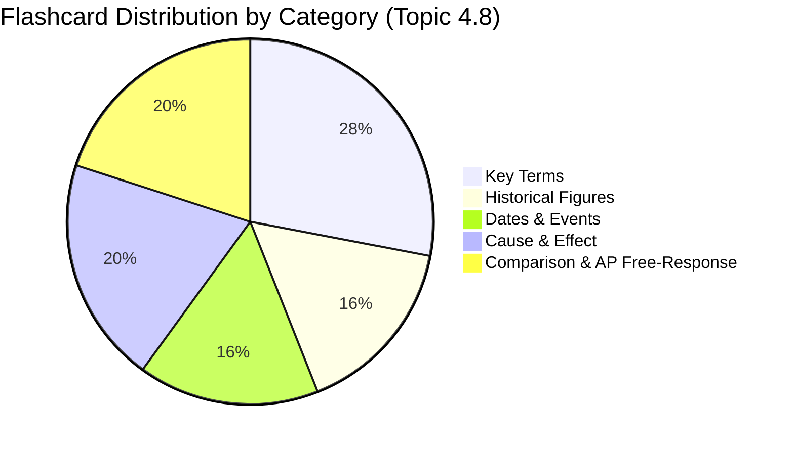

# Topic 4.8: Continuity and Change from c. 1450 to c. 1750 — Flashcards

---

### Category 1: Key Terms

- [ ] **What was the Atlantic System?**
  

▶ Answer

  The comprehensive transoceanic commercial and ecological network linking Western Europe, Western Africa, and the Americas through the movement of goods, capital, coerced human laborers, and crops.
  

- [ ] **What is religious syncretism, and what are two prominent examples in the Americas?**
  

▶ Answer

  The blending of differing religious beliefs and practices into a new synthesized faith. Prominent examples include **Santería** in Cuba (Yoruba animism + Roman Catholicism) and **Vodou** in Haiti (West African spirituality + French Catholicism).
  

- [ ] **Who is the Virgin of Guadalupe, and why is she significant to syncretism?**
  

▶ Answer

  An apparition of the Virgin Mary in 16th-century Mexico who appeared to an indigenous peasant (Juan Diego). She incorporated indigenous Nahua maternal symbolism and dark skin with Catholic Marian theology, becoming a national patroness.
  

- [ ] **What was the Black Legend (*La Leyenda Negra*)?**
  

▶ Answer

  A historiographical term (coined by Julián Juderías) describing the anti-Spanish propaganda cultivated by Protestant rivals (England, Netherlands) that depicted Spanish colonial rule as uniquely cruel and fanatical.
  

- [ ] **What are chartered companies?**
  

▶ Answer

  Private commercial joint-stock corporations (such as the VOC and EIC) that received formal royal monopolies and sovereign privileges (such as waging war, coining money, and building forts) to conduct colonial trade.
  

- [ ] **What was the bourgeoisie?**
  

▶ Answer

  The emerging European urban middle class composed of merchants, shipowners, financiers, and professionals whose wealth stemmed from commercial enterprise rather than inherited feudal landownership.
  

- [ ] **How did art patronage reflect economic change between 1450 and 1750?**
  

▶ Answer

  Rising profits from transoceanic trade enabled wealthy merchants and guild officials (as seen in the Dutch Golden Age paintings of Rembrandt) as well as absolutist monarchs to sponsor art that celebrated mercantile prosperity or legitimized dynastic rule.
  

---

### Category 2: Historical Figures

- [ ] **Who was Bartolomé de Las Casas?**
  

▶ Answer

  A 16th-century Spanish Dominican friar and former encomendero who became the "Protector of the Indians," writing *A Short Account of the Destruction of the Indies* (1552) to denounce the brutal atrocities of Spanish conquistadores.
  

- [ ] **Who was Julián Juderías?**
  

▶ Answer

  A Spanish historian who in 1914 published a seminal work defining the "Black Legend," arguing that foreign Protestant historians systematically magnified Spanish cruelties while ignoring their cultural and administrative achievements.
  

- [ ] **Who was Lewis Hanke?**
  

▶ Answer

  An American 20th-century historian who countered the Black Legend by demonstrating that the Spanish Empire witnessed unprecedented intellectual and Christian humanitarian legal debates regarding the human rights of indigenous peoples.
  

- [ ] **Who was Rembrandt van Rijn in the context of commercial wealth?**
  

▶ Answer

  A master painter of the Dutch Golden Age whose commissions (such as *The Syndics of the Amsterdam Drapers' Guild*, 1662) directly reflected the wealth, civic pride, and patronage of bourgeois merchants enriched by global trade.
  

---

### Category 3: Dates & Events

- [ ] **What was the transformative global shift by 1750?**
  

▶ Answer

  Most of the inhabited globe was integrated into an interdependent maritime network of economic, political, and cultural connections dominated by European oceanic carriers.
  

- [ ] **What occurred in 1552 regarding Spanish colonial debate?**
  

▶ Answer

  Bartolomé de Las Casas published *A Short Account of the Destruction of the Indies*, presenting graphic eyewitness accounts of Spanish brutality that sparked imperial legal reforms (the New Laws).
  

- [ ] **What happened to the volume of global silver during the 16th century?**
  

▶ Answer

  The total quantity of silver circulating in the global economy tripled, driven by massive subterranean extraction at Potosí (Bolivia) and Zacatecas (Mexico).
  

- [ ] **What was the status of European dominance in Afro-Eurasian land empires by 1750?**
  

▶ Answer

  European states dominated maritime trade choke points and colonized the Americas, but major Asian land-based empires (Qing China, Tokugawa Japan, Ottoman Empire) retained formidable territorial sovereignty.
  

---

### Category 4: Cause & Effect

- [ ] **What was the primary economic cause of the expansion of the African slave trade?**
  

▶ Answer

  **Cause**: The relentless European demand for high-profit plantation commodities (sugar, tobacco, coffee) in the Americas, combined with the catastrophic demise of indigenous labor.  
  **Effect**: The forced deportation of over 10 million Africans via the Middle Passage, permanently altering Atlantic demographics.
  

- [ ] **How did the global circulation of silver affect European and Asian social structures?**
  

▶ Answer

  **Cause**: Enormous quantities of silver generated inflation (Price Revolution) while enriching commercial merchants.  
  **Effect**: Fixed-income feudal landowning nobles lost relative social and economic standing, while the rising urban bourgeoisie gained wealth, political clout, and cultural influence.
  

- [ ] **Why did syncretic religions emerge in the Americas?**
  

▶ Answer

  **Cause**: Spanish and French colonial laws mandated Roman Catholic baptism for enslaved Africans and indigenous subjects, suppressing native rituals.  
  **Effect**: Enslaved and colonized communities disguised ancestral African spirits and native deities beneath the identities of Catholic saints, creating faiths like Santería and Vodou.
  

- [ ] **What was a major continuity in Asian regional commerce despite European expansion?**
  

▶ Answer

  **Cause**: Intra-Asian trade volumes for everyday necessities (rice, spices, textiles) far exceeded the transport capacity of European merchant fleets.  
  **Effect**: Traditional merchant networks in the Indian Ocean and South China Sea continued to flourish, with Europeans operating primarily as carrying agents.
  

- [ ] **How did mercantilism inadvertently foster the transition to commercial capitalism?**
  

▶ Answer

  **Cause**: Mercantilist monarchs chartered private joint-stock companies with trade monopolies to expand national wealth.  
  **Effect**: These corporate entities developed stock markets, limited liability, and sophisticated private credit mechanisms, laying the structural groundwork for modern capitalism.
  

---

### Category 5: Comparison & AP Free-Response

- [ ] **Compare continuities and changes in Afro-Eurasian labor systems between 1450 and 1750.**
  

▶ Answer

  - **Continuities**: Traditional peasant subsistence farming and feudal serfdom persisted, with Russia legally entrenching serfdom under the Law of 1649.  
  - **Changes**: Coerced labor became integrated into global export markets, causing transoceanic slave raiding in Africa and the rise of capitalist wage labor in urban Northwestern Europe.
  

- [ ] **Compare the "Black Legend" with the "White Legend" regarding Spanish imperialism.**
  

▶ Answer

  - **Black Legend**: Characterizes Spanish colonization as uniquely sadistic, fanatical, and destructive, heavily propagated by Protestant rivals.  
  - **White Legend**: Apologetic perspective emphasizing Spain’s Christian civilizing mission, humanitarian debates (Las Casas), and the creation of legal protections for native subjects.
  

- [ ] **[AP Short Answer / SAQ Practice] Identify and explain ONE major economic continuity in global trade between 1450 and 1750.**
  

▶ Answer

  - **Claim**: The dominance of Asian manufacturing centers in global luxury production was a major economic continuity.  
  - **Evidence**: Throughout the period 1450–1750, European merchants continuously funneled American silver into China and India to purchase high-quality silk, porcelain, and cotton textiles.  
  - **Reasoning**: Despite discovering new transoceanic routes and establishing naval trading posts, Europeans lacked manufactured goods that Asian consumers desired, forcing Europeans to remain dependent on Asian production until the Industrial Revolution.
  

- [ ] **[AP Long Essay / LEQ Practice] Evaluate the extent to which economic developments between 1450 and 1750 brought about changes in global social structures.**
  

▶ Answer

  - **Claim**: Economic developments profoundly revolutionized global social structures by establishing racial caste hierarchies in the Americas and empowering an urban merchant bourgeoisie in Europe, even as traditional agrarian hierarchies endured.  
  - **Evidence**: The Casta system in Latin America legally ranked populations by race (peninsulares, mestizos, Africans), while in Europe, joint-stock trade profits elevated the commercial bourgeoisie over land-poor aristocrats.  
  - **Reasoning**: Because the emerging global economy relied on transatlantic plantation monoculture and market capitalization rather than localized feudal landholding, social standing shifted from traditional feudal vassalage to racial purity in colonies and liquid financial wealth in maritime metropoles.
  

- [ ] **[AP Document-Based Practice] Analyze how global economic integration between 1450 and 1750 fostered cultural and religious changes.**
  

▶ Answer

  - **Claim**: Transoceanic economic integration compelled the forced migration of diverse populations, directly generating resilient syncretic religions that blended European, African, and indigenous spiritual traditions.  
  - **Evidence**: Enslaved Africans in the Caribbean and Brazil developed Vodou and Santería by harmonizing Yoruba deities (*orishas*) with Catholic saints, while indigenous Mexicans venerated the Virgin of Guadalupe.  
  - **Reasoning**: Because colonial economic exploitation subjected marginalized laborers to compulsory Christian conversion, oppressed communities syncretized their ancestral beliefs with Christian iconography as an adaptive strategy to preserve cultural identity and resist spiritual annihilation.
  
