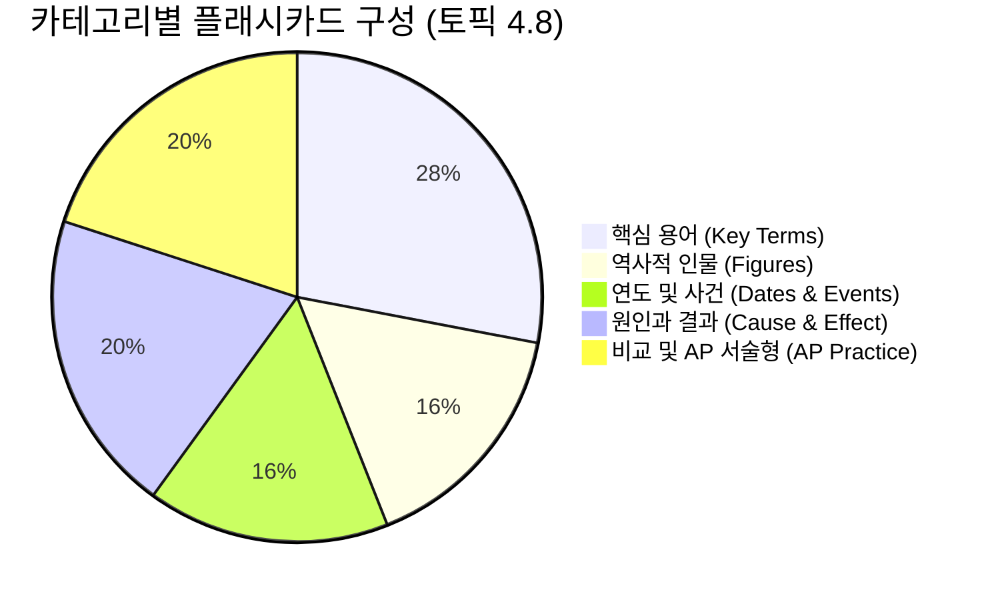

# 토픽 4.8: 1450~1750년의 지속성과 변화 — 플래시카드

---

### 카테고리 1: 핵심 용어 (Key Terms)

- [ ] **대서양 체제(Atlantic System)란 무엇인가?**
  

▶ 정답

  서유럽(자본 및 공산품), 서아프리카(노예 노동력), 아메리카(환금 작물 및 은)가 상호 연결되어 상품, 화폐, 인간, 작물이 순환하던 전 지구적 대양 무역 네트워크입니다.
  

- [ ] **종교적 융합(Religious Syncretism)이란 무엇이며, 아메리카의 대표적 사례 2가지는?**
  

▶ 정답

  서로 다른 종교적 신념과 관행이 결합하여 새로운 형태의 종교로 발전하는 현상입니다. 쿠바의 **산테리아(Santería)**(요루바 신앙 + 가톨릭 성인)와 아이티의 **부두교(Vodou)**(서아프리카 정령 신앙 + 프랑스 가톨릭)가 대표적입니다.
  

- [ ] **과달루페의 성모(Virgin of Guadalupe) 숭배의 종교적 융합적 성격은 무엇인가?**
  

▶ 정답

  16세기 멕시코 원주민 후안 디에고에게 발현한 성모 마리아로, 원주민 나우아족의 모성 여신 상징과 어두운 피부색, 가톨릭 성모 신학이 결합되어 멕시코 민족 정체성의 상징이 되었습니다.
  

- [ ] **검은 전설(The Black Legend / La Leyenda Negra)이란 무엇인가?**
  

▶ 정답

  영국, 네덜란드 등 개신교 경쟁국들이 스페인 제국을 시기하여 스페인의 아메리카 식민 통치를 유례없이 잔혹하고 광신적인 것으로 악의적으로 과장·선전했다는 역사학적 비판 이론입니다.
  

- [ ] **특허 회사(Chartered Companies)의 특징은 무엇인가?**
  

▶ 정답

  국왕으로부터 특허장을 받아 특정 지역 무역 독점권뿐만 아니라 전쟁 선포, 조약 체결, 화폐 주조, 요새 구축 등 준국가적 주권을 행사한 네덜란드 VOC, 영국 EIC 등의 합자회사입니다.
  

- [ ] **부르주아지(Bourgeoisie)란 누구인가?**
  

▶ 정답

  대양 상업, 선박 운항, 금융 투자, 무역 제조업을 통해 부를 축적하며 전통 토지 귀족에 맞서 새로운 경제적 주도권을 쥔 서유럽의 도시 신흥 상인·자본가 계급입니다.
  

- [ ] **1450~1750년 예술 후원(Art Patronage)은 경제적 변화를 어떻게 반영했는가?**
  

▶ 정답

  세계 무역으로 막대한 부를 쌓은 네덜란드 상인 길드(렘브란트의 《직물상 조합의 간부들》 등)와 절대군주들이 예술가들을 적극 후원하여 상업적 번영을 과시하거나 왕권의 정당성을 시각화했습니다.
  

---

### 카테고리 2: 역사적 인물 (Historical Figures)

- [ ] **바르톨로메 데 라스카사스(Bartolomé de Las Casas)의 역사적 역할은 무엇인가?**
  

▶ 정답

  1552년 《서인도 제도의 파괴에 관한 짧은 보고서》를 집필하여 스페인 정복자들의 원주민 학살과 엔코미엔다 수탈을 통렬히 고발하고 원주민 권익 옹호에 앞장선 스페인 도미니코회 사제입니다.
  

- [ ] **훌리안 후데리아스(Julián Juderías)의 학문적 주장은 무엇인가?**
  

▶ 정답

  1914년 '검은 전설'이라는 용어를 학계에 정립하며, 유럽 열강들이 자국의 식민 잔혹 행위는 은폐한 채 스페인의 잔학성만을 편파적으로 과장하여 스페인의 위업을 폄훼했다고 비판했습니다.
  

- [ ] **루이스 행크(Lewis Hanke)의 역사학적 시각은 어떠했는가?**
  

▶ 정답

  스페인 제국이 정복 초기에 라스카사스 신부 등의 주장을 수용하여 신법(New Laws)을 제정하는 등 기독교적 윤리를 법적으로 구현하려 치열한 인도주의적 자기반성을 거쳤음을 강조했습니다.
  

- [ ] **렘브란트 판 레인(Rembrandt van Rijn)의 작품이 상업 혁명과 맺는 관계는 무엇인가?**
  

▶ 정답

  네덜란드 황금기의 거장으로, 교회가 아닌 부유한 상인 길드와 도시 부르주아지의 의뢰를 받아 상업적 성공과 시민적 자부심을 사실적으로 묘사한 대표적 예술가입니다.
  

---

### 카테고리 3: 연도 및 사건 (Dates & Events)

- [ ] **1750년경 전 지구적 질서의 가장 본질적인 변화는 무엇인가?**
  

▶ 정답

  인류 역사상 처음으로 아메리카 신대륙을 포함한 전 세계 대륙이 유럽 해양 세력이 매개하는 단일한 상호의존적 글로벌 경제·생태 네트워크로 통합되었습니다.
  

- [ ] **1552년 라스카사스의 저서 출간이 촉발한 역사적 사건은 무엇인가?**
  

▶ 정답

  《서인도 제도의 파괴에 관한 짧은 보고서》 출간으로 스페인 식민 지배의 잔혹성이 유럽 전역에 폭로되었고, 바야돌리드 논쟁 등 원주민 인권에 관한 최초의 제국주의적 논쟁이 촉발되었습니다.
  

- [ ] **16세기 전 세계 은(Silver) 유통량은 얼마나 증가했는가?**
  

▶ 정답

  볼리비아 포토시와 멕시코 은광 개발로 전 세계 은 유통량이 3배 이상 폭증하며 전 지구적 무역의 기축 화폐로 정착되었습니다.
  

- [ ] **1750년 시점 아시아 대륙 국가들과 유럽 해양 세력의 역학 관계는 어떠했는가?**
  

▶ 정답

  유럽이 해상 무역로를 장악했음에도 불구하고, 청나라, 도쿠가와 일본, 오스만 제국 등 유라시아 대륙의 거대 제국들은 막강한 군사력과 경제적 자급력을 유지하며 주권을 확고히 지켰습니다.
  

---

### 카테고리 4: 원인과 결과 (Cause & Effect)

- [ ] **대서양 노예 무역이 폭발적으로 팽창한 근본적 경제적 원인은 무엇인가?**
  

▶ 정답

  - **원인**: 유럽 시장의 고수익 설탕·담배 수요 폭증과 전염병에 의한 아메리카 원주민 노동력의 궤멸.  
  - **결과**: 1천만 명 이상의 아프리카인을 플랜테이션 노동력으로 강제 이송하는 대규모 노예 무역 체제가 확립됨.
  

- [ ] **글로벌 은 유통이 유럽과 아시아의 사회 구조에 미친 영향은 무엇인가?**
  

▶ 정답

  - **원인**: 은 유입에 따른 물가 폭등(가격 혁명)과 상업 무역 자본의 팽창.  
  - **결과**: 고정 지대를 받던 전통 봉건 토지 귀족이 쇠퇴한 반면, 유동 자본을 굴린 도시 부르주아 상인층이 부와 권력을 장악함.
  

- [ ] **아메리카 대륙에서 혼합 종교(Syncretism)가 발생한 원인과 결과는 무엇인가?**
  

▶ 정답

  - **원인**: 가톨릭 식민 당국이 흑인 노예와 원주민에게 강제 세례를 베풀고 전통 종교 의식을 금지함.  
  - **결과**: 피지배층이 전통 정령과 조상신을 가톨릭 성인의 모습 뒤에 숨겨 비밀리에 숭배하며 산테리아, 부두교 등 혼합 신앙을 발전시킴.
  

- [ ] **유럽의 팽창에도 불구하고 아시아 역내 무역이 번영을 지속한 원인은 무엇인가?**
  

▶ 정답

  - **원인**: 아시아 역내의 식량, 일상 면직물, 소비재 교역 규모가 유럽 상선의 수송 능력을 압도적으로 초과했음.  
  - **결과**: 인도양과 남중국해의 전통 무역망이 계속 유지되었으며, 유럽인은 항구 관세를 내며 물류 중개인으로 참여함.
  

- [ ] **중상주의 정책이 근대 상업 자본주의로 진화하게 된 원인은 무엇인가?**
  

▶ 정답

  - **원인**: 국왕의 통제와 관세만으로는 위험하고 방대한 대양 무역 자본을 효율적으로 운용하기 어려웠음.  
  - **결과**: 주식 발행과 유한책임을 무기로 한 민간 합자회사가 시장 경쟁에서 국가 전매제를 압도하며 근대 자본주의 금융 시장을 확립함.
  

---

### 카테고리 5: 비교 및 AP 서술형 (AP Practice)

- [ ] **1450~1750년 유라시아 전통 노동 체제의 지속성과 아메리카 강제 노동 체제의 변화를 비교하시오.**
  

▶ 정답

  - **유라시아의 지속성**: 농민의 부역 농업과 러시아의 법제화된 농노제 등 전통적인 토지 결속형 신분 노동이 계속됨.  
  - **아메리카의 변화**: 세계 시장의 환금 작물과 은을 생산하기 위해 인간을 매매 가능한 사유재산으로 취급하는 인종 기반 동산 노예제와 포토시 미타제 등 산업적 강제 노동이 새롭게 창출됨.
  

- [ ] **스페인 식민 지배를 둘러싼 '검은 전설'과 '백색 전설'의 주장을 비교하시오.**
  

▶ 정답

  - **검은 전설**: 스페인 정복자들을 잔혹하고 피에 굶주린 광신도로 묘사하며 원주민 학살과 문화 파괴를 극단적으로 강조함 (개신교 진영의 선전).  
  - **백색 전설**: 스페인이 가톨릭 복음을 전파하고 법률(신법)을 통해 원주민을 보호하려 했던 기독교적 교화와 개혁 노력을 강조함 (스페인 호교론).
  

- [ ] **[단답형 서술 / SAQ] 1450~1750년 사이 글로벌 무역망에서 유지된 경제적 지속성(Continuity) 1가지를 제시하고 설명하시오.**
  

▶ 정답

  - **주장 (Claim)**: 고급 소비재 생산에서 아시아 제조업(중국·인도)의 세계적 우위는 확고한 경제적 지속성이었습니다.  
  - **근거 (Evidence)**: 유럽 상인들은 대서양 항로 개척 이후에도 중국산 비단·도자기와 인도산 면직물을 수입하기 위해 아메리카산 은을 지속적으로 지불했습니다.  
  - **설명 (Reasoning)**: 산업혁명 이전까지 유럽은 아시아 시장이 원하는 고품질 공산품을 자체 생산하지 못했기 때문에, 아시아 제조업 중심의 생산 체제와 은 결제 흐름은 300년간 변함없이 유지되었습니다.
  

- [ ] **[장문형 서술 / LEQ] 1450~1750년 경제적 발전이 전 지구적 사회 구조를 변화시킨 정도를 평가하시오.**
  

▶ 정답

  - **주장 (Claim)**: 대양 무역과 플랜테이션 경제의 발달은 아메리카의 인종 기반 신분제 확립과 유럽의 상인 부르주아지 부상을 낳으며 전통적 봉건 사회 구조를 근본적으로 해체했습니다.  
  - **근거 (Evidence)**: 아메리카에서는 카스타 제도가 혈통에 따라 권리를 세분화했고, 유럽에서는 합자회사 주주들이 봉건 토지 귀족의 사회적 영향력을 압도했습니다.  
  - **설명 (Reasoning)**: 토지 소유권이 신분을 규정하던 중세 사회와 달리, 근대 초기는 전 지구적 상품 작물과 화폐 자본의 통제력이 새로운 사회적 권력의 원천으로 대체되었기 때문입니다.
  

- [ ] **[자료 기반 서술 / DBQ] 1450~1750년 전 지구적 경제 통합이 문화 및 종교적 변화를 촉진한 메커니즘을 분석하시오.**
  

▶ 정답

  - **주장 (Claim)**: 강제 이주와 식민 정복을 수반한 글로벌 경제 통합은 지배층의 종교 강요 속에서도 피지배층의 문화적 저항과 타협이 융합된 독창적인 혼합 종교(Syncretism)를 창조했습니다.  
  - **근거 (Evidence)**: 대서양 노예 무역으로 끌려온 흑인들은 서아프리카 정령 신앙을 가톨릭 성인과 결합하여 산테리아와 부두교를 만들었고, 멕시코에서는 과달루페 성모 신앙이 원주민과 스페인 문화를 통합했습니다.  
  - **설명 (Reasoning)**: 생존과 정체성 유지가 절박했던 피지배 집단은 백인 지배층의 기독교 형식을 표면적으로 수용하는 동시에 자신들의 고유한 신앙적 본질을 주입함으로써, 세계화의 충격을 문화적 주체성으로 재해석했습니다.
  
