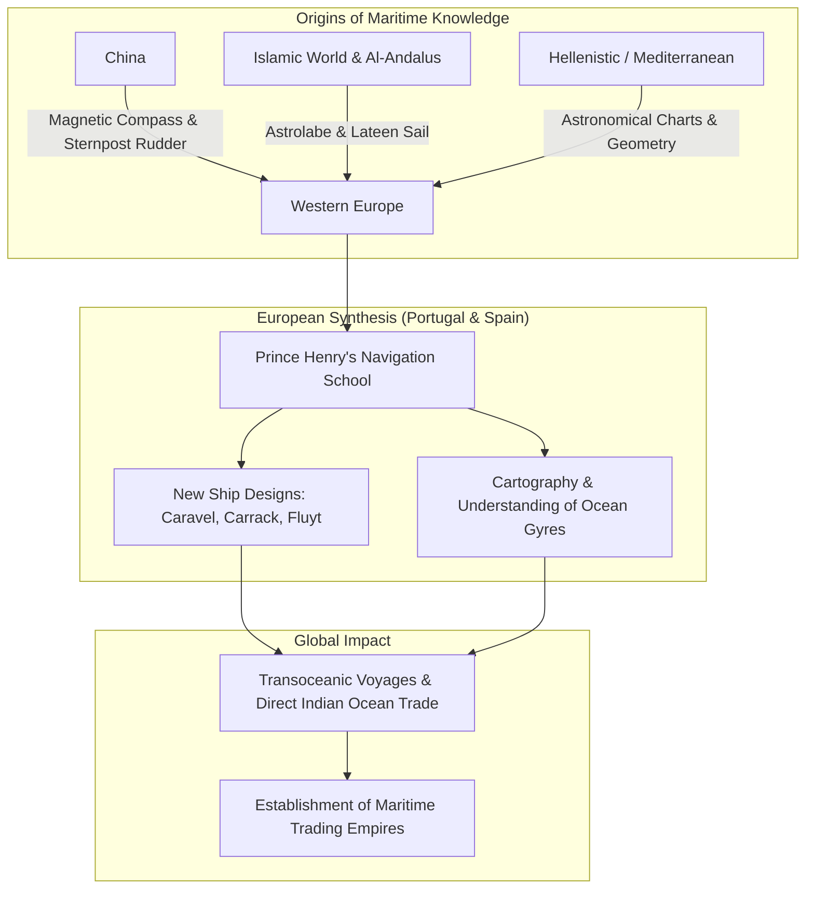
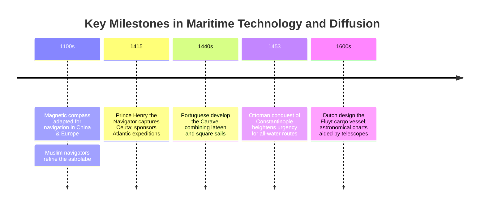

# Topic 4.1: Technological Innovations (c. 1450 to c. 1750)

> **Essential Question**: How did cross-cultural interactions result in the diffusion of technology and facilitate changes in patterns of trade and travel from 1450 to 1750?
> *Source Reference: AMSCO AP World History: Modern (Topic 4.1, pp. 191–198) supplemented with College Board AP World History CED Topic 4.1.*

---

## 1. Big Picture Summary
Between 1450 and 1750, European maritime exploration transformed global connections. This expansion was made possible by the synthesis and diffusion of classical, Islamic, and Asian technologies. Knowledge of astronomical navigation, regional wind and current patterns, cartography, and shipbuilding converged in Western European kingdoms—most notably Portugal and Spain. Spurred by demographic growth, primogeniture laws, religious competition, and a desire to bypass Islamic-Venetian trade monopolies in the Mediterranean, European states utilized these technological breakthroughs to launch transoceanic voyages.

---

## 2. Section-by-Section Breakdown

### A. Context and Motives for Exploration
1. **Demographic Pressures & Economic Factors**:
   - Population growth in post-plague Europe left many workers without land or employment.
   - **Primogeniture laws** mandated that all estate land pass exclusively to the eldest son, leaving younger sons seeking wealth, land, and title overseas.
2. **Religious & Commercial Motives**:
   - European states sought direct maritime access to luxury goods (silk, spices, tea, porcelain) from Asia.
   - The Ottoman conquest of Constantinople (1453) and Italian city-state monopolies (Venice, Genoa) inflated Mediterranean prices, providing strong incentive to find an all-water route to Asia.
   - Rivalries with Middle Eastern trading states (e.g., the **Omani-European rivalry** in the Indian Ocean) encouraged Europeans to pioneer new ocean pathways.
   - Catholic rulers aimed to convert foreign populations to Christianity, especially following the Protestant Reformation.

### B. Cross-Cultural Diffusion of Knowledge and Ideas
1. **Classical Heritage & Islamic Scholarship**:
   - Europeans revitalized navigational traditions tracing back to classical Greeks, including navigation by stars and celestial geometry.
   - Islamic scholars in centers like **Al-Andalus** (Islamic Spain) preserved, refined, and diffused astronomical and geographic knowledge to Christian Europe.
2. **Scientific Advances in Navigation**:
   - **Astronomical Charts**: Star maps developed by ancient Babylonians, Mesopotamians, and Chinese (5th century BCE) were adapted; the introduction of telescopes (c. 1609) enabled grid-based constellation mapping.
   - **Gravitational Theories**: Isaac Newton’s laws of gravitation helped mariners understand tidal patterns, warning sailors when shallow water near coasts threatened ships.
   - **Wind & Current Patterns**: Systematic tracking of oceanic gyres and prevailing winds (such as trade winds and westerlies) permitted reliable round-trip navigation.

### C. Developments in Equipment and Ship Designs
1. **Navigational Instruments**:
   - **Magnetic Compass**: Originally developed in Han/Song China for divination, adapted for maritime orientation in China and Europe by the 12th century.
   - **Astrolabe**: Hellenistic origin, significantly refined by 12th-century Muslim navigators; allowed sailors to measure celestial latitude relative to the equator.
2. **Ship Architecture & Sails**:
   - **Lateen Sail**: Triangular sail developed in the Arab/Indian Ocean world. Unlike traditional square sails that only caught wind from behind, lateen sails could tack against the wind, enabling ocean exploration.
   - **Sternpost Rudder**: Imported from Han China, allowing precision steering and maneuvers through rough Atlantic waters.
   - **Caravel**: Developed by the Portuguese in the 15th century; light, fast, three-masted ship combining lateen and square sails with a shallow draft for coastal and oceanic exploration.
   - **Carrack & Fluyt**: Carracks (Portuguese/Spanish) provided massive cargo space and gun platforms; the Dutch **Fluyt** was designed strictly for commercial efficiency with a small crew and maximum cargo hold.

---

## 3. Visual Diagrams

### Technological Diffusion Flowchart

### Timeline of Key Developments

---

## 4. Comparison Table: Ship Designs of the Age of Exploration

| Feature | Caravel | Carrack | Fluyt |
| :--- | :--- | :--- | :--- |
| **Originating State** | Portugal | Portugal / Spain | Netherlands (Dutch) |
| **Primary Purpose** | Long-distance exploration & coastal scouting | Armed cargo transport & transatlantic voyages | Commercial trade & bulk cargo transport |
| **Sail Configuration** | Lateen sails (or mixed lateen & square) | Mixed square and lateen sails (3-4 masts) | Square sails with specialized rigging |
| **Key Advantage** | High maneuverability; can sail against wind; shallow draft | Enormous cargo capacity; heavy defensive cannons | Inexpensive to build; operated by small crew; maximized cargo space |
| **Trade Region** | West African coast, Atlantic exploration | Transatlantic & Indian Ocean trade routes | Global merchant routes (VOC, Baltic, Atlantic) |

---

## 5. Key Terms

| Term | Category | Historical Significance |
| :--- | :--- | :--- |
| **Magnetic Compass** | Technology | Chinese origin; gave mariners reliable directional awareness independent of sight of land. |
| **Astrolabe** | Technology | Refined by Muslim scholars; allowed sailors to calculate latitude by measuring the angle of the sun and stars. |
| **Lateen Sail** | Technology | Triangular Arab/Indian Ocean sail allowing ships to sail into the wind (tacking). |
| **Caravel** | Ship Design | Portuguese three-masted exploratory vessel combining speed, maneuverability, and shallow draft. |
| **Fluyt** | Ship Design | Dutch commercial vessel engineered for maximum cargo and minimal crew, cutting maritime shipping costs. |
| **Cartography** | Knowledge | Mapmaking advances incorporating astronomical grids, ocean currents, and wind systems. |
| **Primogeniture** | Social/Economic | European legal practice leaving whole estates to eldest sons, driving younger sons abroad. |
| **Omani-European Rivalry** | Conflict | Indian Ocean commercial competition between Oman and Portugal over strategic trade outposts. |
| **Prince Henry the Navigator** | Figure | Portuguese royal who financed navigational research and West African exploratory expeditions. |