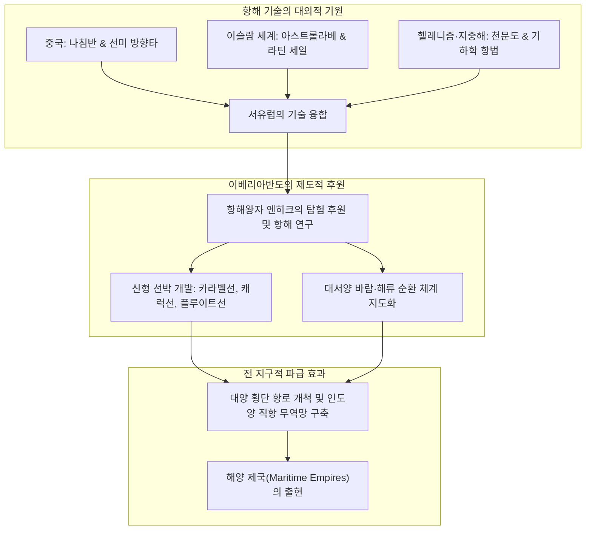
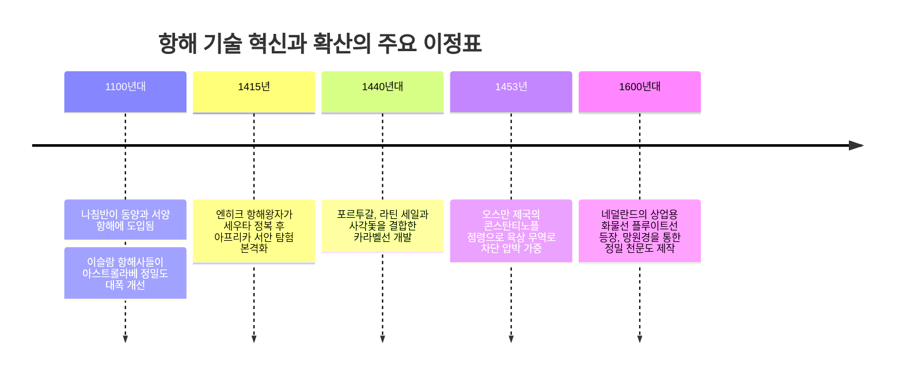

# 토픽 4.1: 기술 혁신 (Technological Innovations, c. 1450–1750)

> **핵심 질문 (Essential Question)**: 1450년부터 1750년까지 문화 간 상호작용은 어떻게 기술을 확산시키고 무역과 항해 패턴의 변화를 촉진했는가?
> *출처 안내: AMSCO AP World History: Modern (Topic 4.1, pp. 191–198) 교재 내용 요약 및 College Board AP World History CED 기준 보완.*

---

## 1. 큰 그림 요약 (Big Picture Summary)
1450년부터 1750년 사이 서유럽 국가들의 해양 팽창은 고대 그리스, 이슬람권, 아시아(중국 등) 문명의 기술적 성취가 융합되고 확산된 결과였습니다. 천문 항법, 해류 및 풍향 지식, 지도 제작술, 조선 기술이 이베리아반도(포르투갈과 스페인)를 중심으로 결합되었습니다. 인구 증가, 장자 상속제(Primogeniture), 오스만 제국과 이탈리아 상인들이 장악한 지중해 무역로의 가격 폭등, 종교적 선교 열망은 유럽 국가들로 하여금 대양 항해 기술을 발전시키고 새로운 해상 무역로를 개척하도록 자극했습니다.

---

## 2. 섹션별 정리 (Section-by-Section Breakdown)

### A. 해양 탐험의 배경과 동기
1. **인구학적·경제적 압박**:
   - 흑사병 이후 유럽 인구가 회복·증가하면서 토지와 일자리가 부족해졌습니다.
   - **장자 상속제(Primogeniture laws)**: 토지와 작위가 장남에게만 상속됨에 따라 차남 이하의 자제들은 부와 영지를 얻기 위해 해외 탐험과 정복으로 눈을 돌렸습니다.
2. **상업적·종교적 동기**:
   - 아시아의 고급 향신료, 비단, 도자기를 직거래하고자 했습니다.
   - 1453년 오스만 제국의 콘스탄티노플 점령과 베네치아 등 이탈리아 도시 국가들의 지중해 독점으로 수입품 가격이 폭등하자, 해상 직항로 개척이 절실해졌습니다.
   - 인도양에서는 오만과 유럽 간의 상업적 패권 경쟁인 **오만-유럽 경쟁(Omani-European rivalry)**이 전개되었습니다.
   - 종교 개혁 이후 가톨릭 군주들은 비기독교 세계에 교세를 확장하려는 강력한 선교 의지를 가졌습니다.

### B. 문화 간 상호작용을 통한 지식과 기술의 확산
1. **고전 유산과 이슬람 학문의 전파**:
   - 고대 그리스의 천문 관측과 기하학 기반 항법 지식이 재조명되었습니다.
   - 이슬람 스페인인 **알안달루스(Al-Andalus)** 등을 통해 아랍 및 동양의 과학 서적이 서유럽으로 번역·유입되었습니다.
2. **항해 지식의 과학화**:
   - **천문도(Astronomical Charts)**: 고대 바빌로니아 및 중국(기원전 5세기)에서 시작된 별자리 지도가 발전하였으며, 1609년 망원경 발명 이후 정밀한 격자 좌표계 항해 지도로 개편되었습니다.
   - **만유인력과 조석 지식**: 아이작 뉴턴의 중력 법칙 발견으로 조수간만의 차를 예측할 수 있게 되어 연안 암초 좌초 위험이 크게 줄었습니다.
   - **바람과 해류 패턴 이해**: 대서양의 무역풍과 편서풍, 해류 환류(Gyres)를 체계적으로 기록하여 대양 왕복 항해가 가능해졌습니다.

### C. 항해 장비 및 선박 기술의 발전
1. **방향 및 위치 측정 장비**:
   - **나침반(Magnetic Compass)**: 중국 한·송대 점술 도구에서 항해용으로 개량되어 12세기경 유럽과 중동에 보급되었습니다. 육지가 보이지 않는 대양에서도 방위를 확인하게 해주었습니다.
   - **아스트롤라베(Astrolabe)**: 헬레니즘 기원으로 12세기 이슬람 항해사들에 의해 위도 측정 기구로 고도화되었으며, 선박의 남북 위치를 정확히 파악하도록 도왔습니다.
2. **선박 구조 및 돛의 혁신**:
   - **삼각돛 / 라틴 세일(Lateen Sail)**: 아랍과 인도양 뱃사람들이 사용하던 삼각형 돛으로, 바람을 등지고만 가는 사각돛과 달리 맞바람을 지그재그(Tacking)로 거슬러 항해할 수 있었습니다.
   - **선미 방향타(Sternpost Rudder)**: 중국에서 유입된 조타 장치로 거친 대양 파도 속에서도 선박의 정밀한 조종을 가능케 했습니다.
   - **카라벨선(Caravel)**: 15세기 포르투갈이 개발한 소형 3마스트 범선으로, 삼각돛과 사각돛을 조합하고 흘수선이 얕아 해안선 탐사와 원양 항해에 최적화되었습니다.
   - **캐럭선(Carrack)과 플루이트선(Fluyt)**: 캐럭선은 대규모 화물과 대포를 탑재할 수 있는 대형 무장 상선이었으며, 네덜란드의 플루이트선은 무장을 줄이고 화물 적재량과 조타 효율을 극대화하여 최소 승무원으로 운용된 상업 혁신 선박이었습니다.

---

## 3. 시각 자료 (Mermaid Diagrams)

### 기술 확산 및 융합 흐름도

### 주요 연표

---

## 4. 선박 유형 비교표 (Comparison Table)

| 특징 | 카라벨선 (Caravel) | 캐럭선 (Carrack) | 플루이트선 (Fluyt) |
| :--- | :--- | :--- | :--- |
| **개발 국가** | 포르투갈 | 포르투갈 / 스페인 | 네덜란드 |
| **주요 용도** | 연안 탐사 및 초기 원양 탐험 | 대규모 화물 수송 및 해상 전투 | 저비용 대량 상업 화물 운송 |
| **돛 배치** | 삼각돛(Lateen) 중심 (필요시 사각돛 혼합) | 3~4개의 마스트에 사각돛과 삼각돛 혼합 | 효율적 조작이 가능한 사각 돛장치 |
| **핵심 장점** | 역풍 항해 가능, 얕은 흘수로 암초 회피 | 높은 적재량, 대포 탑재 가능 | 건조비 저렴, 적은 승무원으로 운용, 화물칸 극대화 |
| **주요 활동 해역** | 서아프리카 연안, 대서양 탐험로 | 대서양 횡단로, 인도양 항로 | 네덜란드 동인도회사(VOC) 무역로, 발트해 |

---

## 5. 핵심 용어 표 (Key Terms)

| 용어 | 분류 | 역사적 의미 및 중요성 |
| :--- | :--- | :--- |
| **나침반 (Magnetic Compass)** | 기술 혁신 | 중국에서 유래하여 12세기 전파됨. 시야가 제한된 대양에서도 방위를 유지해 줌. |
| **아스트롤라베 (Astrolabe)** | 기술 혁신 | 이슬람 학자들이 정밀하게 개량. 태양과 별의 고도를 측정하여 위도를 산출함. |
| **라틴 세일 (Lateen Sail)** | 선박 기술 | 아랍·인도양에서 발달한 삼각돛. 역풍을 안고 지그재그로 전진(Tacking)할 수 있게 함. |
| **카라벨선 (Caravel)** | 선박 기술 | 포르투갈이 개발한 소형 원양 탐험선. 기동성이 뛰어나 초기 대항해 시대를 주도함. |
| **플루이트선 (Fluyt)** | 선박 기술 | 네덜란드가 상업 이윤 극대화를 위해 개발한 화물선. 승무원 수를 대폭 줄여 운송비 절감. |
| **지도 제작술 (Cartography)** | 지식 체계 | 천문 격자, 바람 방향, 해류 정보를 결합하여 안전한 대양 횡단 항로를 제시함. |
| **장자 상속제 (Primogeniture)** | 사회/경제 | 영지와 재산을 장남에게만 물려주어, 차남 이하 귀족 자제들이 해외 식민지 개척으로 진출하게 만듦. |
| **오만-유럽 경쟁 (Omani-European Rivalry)** | 갈등/외교 | 인도양 무역 거점을 둘러싸고 포르투갈과 오만 상인 세력 간에 벌어진 해상 패권 다툼. |
| **항해왕자 엔히크 (Prince Henry the Navigator)** | 역사적 인물 | 사그레스 항해 연구소를 후원하고 아프리카 서안 탐험을 체계적으로 지원한 포르투갈 왕족. |