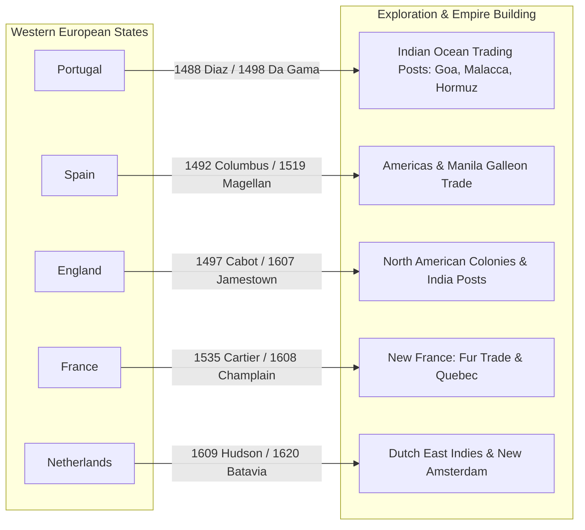
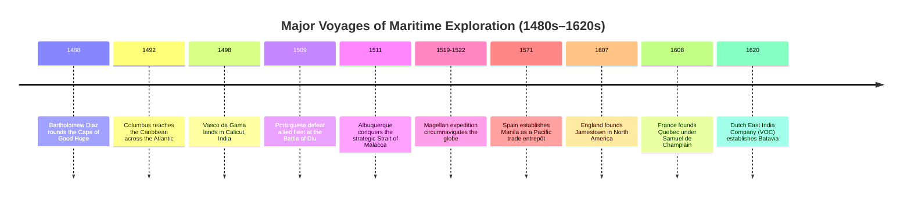

# Topic 4.2: Exploration: Causes and Events (c. 1450 to c. 1750)

> **Essential Question**: What were the causes and effects of the state-sponsored expansion of maritime exploration?
> *Source Reference: AMSCO AP World History: Modern (Topic 4.2, pp. 199–208) supplemented with College Board AP World History CED Topic 4.2.*

---

## 1. Big Picture Summary
During the 15th through 17th centuries, European monarchs centrally sponsored transoceanic voyages driven by a potent mix of economic, political, and religious imperatives—popularly summarized as "God, Gold, and Glory." Italian monopolies over Mediterranean overland trade routes and the commercial theory of mercantilism prompted states like Portugal and Spain, and later England, France, and the Netherlands, to finance perilous oceanic expeditions. These ventures resulted in the construction of the Portuguese "trading post empire" along the African and Asian coasts, the Spanish conquest of the Americas and the Philippines, and the eventual global commercial ascendancy of northern European joint-stock powers.

---

## 2. Section-by-Section Breakdown

### A. The Role of States in Maritime Exploration
1. **Motivations for State Sponsorship**:
   - **Breaking Italian Monopolies**: Italian port cities (Venice, Genoa) controlled trade routes linking the Mediterranean to Silk Roads and Red Sea channels, inflating prices for Asian silks and spices.
   - **Mercantilism**: A 17th-century economic doctrine stating that a nation's wealth and power were measured by its reserves of bullion (gold and silver). States sought to maximize exports and minimize imports via tariffs and state-backed ventures.
   - **Religious Zeal**: European monarchs viewed exploration as a divine mission to convert indigenous populations to Christianity, especially amidst Catholic-Protestant rivalry.
   - **High Capital Costs**: Transoceanic expeditions were far too capital-intensive and risky for private merchants alone; royal treasuries provided essential funding, naval escorts, and charters.

### B. Portuguese Maritime Expansion
1. **Africa and the Indian Ocean Route**:
   - **Prince Henry the Navigator (1394–1460)**: First royal monarch to systematically sponsor expeditions down the West African coast, aiming for gold and direct sea routes.
   - **Bartholomew Diaz (1488)**: Rounded the Cape of Good Hope at Africa’s southern tip, proving an oceanic passage into the Indian Ocean existed.
   - **Vasco da Gama (1498)**: Sailed around Africa and reached Calicut, India, claiming commercial outposts and securing enormous profits in spices.
2. **Southeast and East Asia & The Trading Post Empire**:
   - **Battle of Diu (1509)**: Portuguese navy defeated a combined Mamluk Egyptian, Ottoman, and Venetian fleet, establishing naval dominance in the Arabian Sea.
   - **Afonso de Albuquerque**: Ruthless Portuguese admiral and governor of India (1509–1515); seized Malacca (1511), Goa (1510), and Hormuz (1507).
   - **Trading Post Empire**: Rather than conquering vast inland territories, Portugal established fortified naval bases at strategic straits to monopolize the spice trade and force regional merchants to purchase passes (**cartaz**).
3. **Portuguese Decline & European Rivals**:
   - Portugal lacked sufficient population, merchant ships, and administrative manpower to police its vast trade network. Corruption and merchant evasion weakened state control.
   - By the early 17th century, the Dutch captured Malacca and founded **Batavia** (Java, 1620), while the English pushed Portugal out of mainland India.

### C. Spanish Exploration and Empire Building
1. **Transatlantic Voyages**:
   - **Christopher Columbus (1492)**: Sponsored by Queen Isabella and King Ferdinand of Spain; crossed the Atlantic seeking a western route to Asia, inadvertently initiating sustained European contact with the Americas.
   - **Ferdinand Magellan (1519–1522)**: Spanish-sponsored expedition that achieved the first global circumnavigation, proving the world was interconnected by sea, though Magellan was killed in the Philippines (1521).
2. **Spanish Colonization of the Philippines**:
   - Spain annexed the Philippine archipelago in 1521 and founded **Manila** (1571) as a bustling Pacific commercial hub.
   - Manila became the terminus of the **Manila Galleons**, which traded Mexican silver for Chinese luxury goods (porcelain, silk). Missionaries converted the majority of Filipinos to Roman Catholicism.

### D. Northern European Exploration (England, France, and the Netherlands)
1. **Search for the Northwest Passage**:
   - Northern European powers initially sought a navigable all-water route through North America to East Asia.
   - **French Exploration**: Jacques Cartier (1535) explored the St. Lawrence River; Samuel de Champlain founded **Quebec** (1608). The French prioritized fur trapping, missionary work, and alliances with Native Americans over large-scale settlement.
   - **English Exploration**: John Cabot (1497) claimed Newfoundland; after failed attempts at colonization, the English established **Jamestown** (1607) in Virginia.
   - **Dutch Exploration**: Henry Hudson (1609) sailed into the Hudson River; the Dutch founded **New Amsterdam** (1624), establishing vital transoceanic commercial hubs.

---

## 3. Visual Diagrams

### European Maritime Expansion Routes

### Chronological Timeline of Major Expeditions

---

## 4. Comparison Table: European Maritime Empires

| Feature | Portuguese Empire | Spanish Empire | Northern European (Dutch, English, French) |
| :--- | :--- | :--- | :--- |
| **Primary Region** | African coast, Indian Ocean, Brazil | Americas, Caribbean, Philippines | North America, Caribbean, Southeast Asia, India |
| **Imperial Model** | **Trading Post Empire**: fortified naval choke points | **Territorial Empire**: direct conquest, land grants, silver extraction | Joint-stock commercial outposts & settler colonies |
| **Financing Mechanism** | Direct royal sponsorship and royal monopoly | Direct crown sponsorship, mercantilist bullionism | **Joint-stock chartered companies** (VOC, EIC) & crown charters |
| **Religious Policy** | Aggressive Catholic conversion; Jesuit missions | Catholic conversion; Inquisition; suppression of native cults | Varied: Dutch (strictly commercial), English/French (Protestant/Catholic) |
| **Commodity Focus** | Spices, African gold, slaves, Brazilian sugar | Silver (Potosí, Zacatecas), gold, sugar, tobacco | Furs, tobacco, cotton, textiles, spices, tea |

---

## 5. Key Terms

| Term | Category | Historical Significance |
| :--- | :--- | :--- |
| **Mercantilism** | Economic Policy | Doctrine maximizing state bullion reserves through controlled exports, protective tariffs, and colonial exploitation. |
| **Trading Post Empire** | Imperial Model | Empire based on controlling trade outposts and naval checkpoints rather than governing expansive land territories. |
| **Prince Henry the Navigator** | Figure | Portuguese royal who initiated state-backed maritime exploration along the West African coast. |
| **Bartholomew Diaz** | Explorer | Portuguese mariner who first rounded the southern tip of Africa (Cape of Good Hope) in 1488. |
| **Vasco da Gama** | Explorer | First European to reach India by sea (1498), opening direct maritime trade between Europe and Asia. |
| **Afonso de Albuquerque** | Figure | Portuguese naval commander who seized Goa, Malacca, and Hormuz to establish Portugal's spice monopoly. |
| **Battle of Diu (1509)** | Military Event | Naval victory confirming Portuguese naval dominance in the Indian Ocean over Muslim and Venetian rivals. |
| **Ferdinand Magellan** | Explorer | Commanded the first expedition to circumnavigate the Earth (1519–1522), opening the Pacific route. |
| **Manila Galleons** | Trade Network | Heavily armed Spanish ships transporting American silver to Manila in exchange for Chinese luxury goods. |
| **Northwest Passage** | Exploration Concept | Hypothesized sea route through North America to Asia sought unsuccessfully by English, French, and Dutch navigators. |