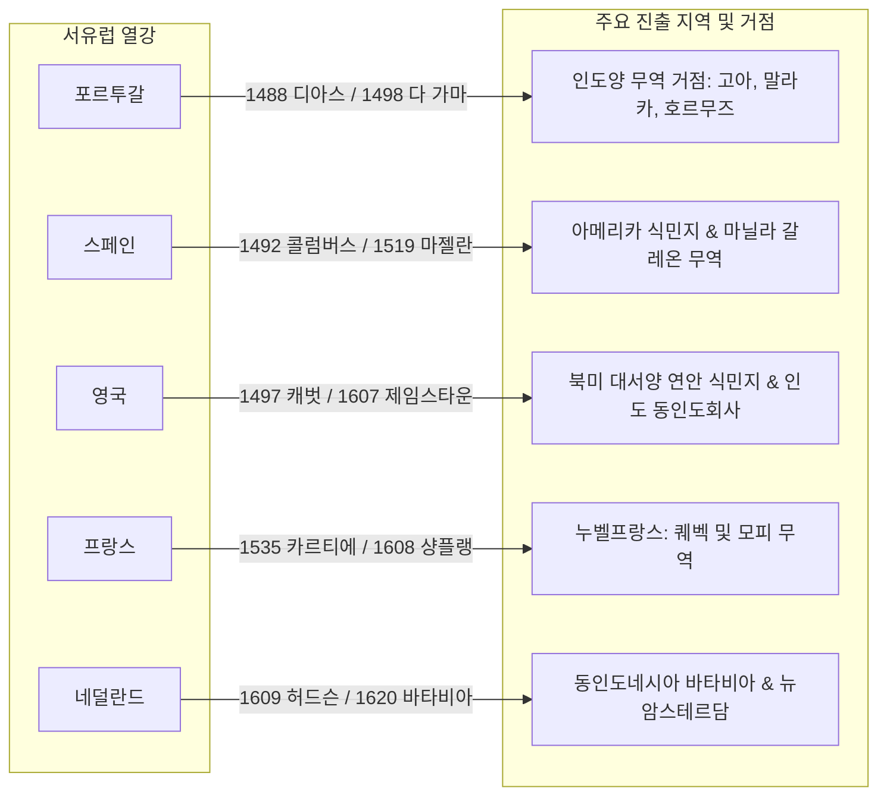
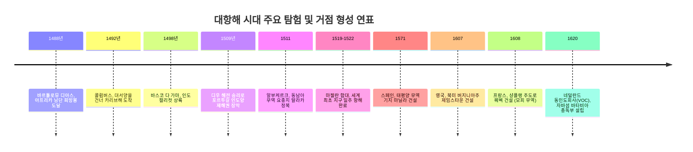

# 토픽 4.2: 해양 탐험: 원인과 전개 (Exploration: Causes and Events, c. 1450–1750)

> **핵심 질문 (Essential Question)**: 국가가 주도하고 후원한 해양 탐험의 원인과 결과는 무엇이었는가?
> *출처 안내: AMSCO AP World History: Modern (Topic 4.2, pp. 199–208) 교재 내용 요약 및 College Board AP World History CED 기준 보완.*

---

## 1. 큰 그림 요약 (Big Picture Summary)
15세기부터 17세기까지 서유럽 군주들은 "신, 금, 영광(God, Gold, and Glory)"이라는 경제적·정치적·종교적 동기가 결합된 국가 주도 해양 탐험을 본격화했습니다. 이탈리아 도시 국가들의 지중해 독점과 중상주의(Mercantilism) 사상은 포르투갈, 스페인을 필두로 영국, 프랑스, 네덜란드가 막대한 국가 재정을 투입해 대양 탐험을 후원하도록 이끌었습니다. 그 결과 포르투갈은 아프리카와 아시아 연안을 잇는 '무역 거점 제국(Trading Post Empire)'을 구축했고, 스페인은 아메리카 대륙 정복과 필리핀 무역망을 개척했으며, 뒤이어 북유럽 국가들이 주식회사 제도를 앞세워 세계 상권을 장악해 나갔습니다.

---

## 2. 섹션별 정리 (Section-by-Section Breakdown)

### A. 국가 주도 해양 탐험의 배경과 동기
1. **국가 후원의 핵심 요인**:
   - **이탈리아의 상권 독점 타파**: 베네치아와 제노바 등 이탈리아 항구 도시들이 실크로드와 홍해를 잇는 지중해 무역을 독점하여 아시아 향신료와 비단 가격을 폭등시켰습니다.
   - **중상주의(Mercantilism)**: 17세기 유럽을 지배한 경제 이론으로, 국력의 척도를 금·은 등 귀금속(Bullion) 보유량으로 보았습니다. 수출을 극대화하고 수입을 최소화하기 위해 식민지 확보와 국가 차원의 통제가 필수적이었습니다.
   - **기독교 전파 열망**: 군주들은 이슬람 세력과의 경쟁 속에서 비유럽인들을 기독교(가톨릭)로 개종시키는 것을 신성한 국가적 사명으로 여겼습니다.
   - **막대한 자본과 위험 부담**: 대양 항해는 막대한 선박 건조비와 인명 손실 위험이 수반되었으므로, 일개 상인이 감당할 수 없어 국왕의 재정 지원과 군사적 보호가 필수적이었습니다.

### B. 포르투갈의 해양 팽창
1. **아프리카 및 인도양 항로 개척**:
   - **항해왕자 엔히크(Prince Henry the Navigator, 1394–1460)**: 금과 동방 직항로를 찾기 위해 서아프리카 연안 탐사를 조직적으로 후원했습니다.
   - **바르톨로뮤 디아스(Bartholomew Diaz, 1488)**: 아프리카 남단 희망봉(Cape of Good Hope)을 돌아 대서양과 인도양이 연결되어 있음을 입증했습니다.
   - **바스코 다 가마(Vasco Da Gama, 1498)**: 아프리카를 우회하여 인도 캘리컷(Calicut)에 도착, 포르투갈의 인도양 직교역 거점을 확보했습니다.
2. **동남아시아·동아시아 진출과 무역 거점 제국**:
   - **디우 해전(Battle of Diu, 1509)**: 맘루크 이집트, 오스만 제국, 베네치아의 연합 함대를 격파하고 아라비아해 제해권을 장악했습니다.
   - **아폰수 드 알부케르크(Afonso de Albuquerque)**: 포르투갈령 인도의 총독(1509–1515)으로, 호르무즈(1507), 고아(1510), 말라카(1511)를 무력 점령했습니다.
   - **무역 거점 제국(Trading Post Empire)**: 내륙 영토를 정복하는 대신 해상 교통로의 요충지에 요새를 짓고 해상 통행증(**카르타스, Cartaz**)을 판매하여 향신료 무역을 독점했습니다.
3. **포르투갈의 쇠퇴와 경쟁국 등장**:
   - 포르투갈은 본국 인구가 적고 상선과 행정 인력이 부족하여 방대한 해상망을 지속적으로 통제하지 못했습니다. 상인들의 밀무역과 관리들의 부패도 심각했습니다.
   - 17세기 초 네덜란드가 말라카를 빼앗고 자바섬에 **바타비아(Batavia, 1620)**를 건설했으며, 영국은 인도 본토에서 포르투갈 세력을 축출했습니다.

### C. 스페인의 아메리카 및 태평양 진출
1. **대서양 횡단과 세계 일주**:
   - **크리스토퍼 콜럼버스(Christopher Columbus, 1492)**: 스페인 이사벨라 여왕과 페르디난트 국왕의 후원을 받아 아시아로 가는 서쪽 항로를 찾던 중 카리브해에 도달하여 아메리카와의 지속적 접촉을 개시했습니다.
   - **페르디난드 마젤란(Ferdinand Magellan, 1519–1522)**: 스페인의 후원을 받아 최초로 지구 일주 항해를 완수(필리핀에서 마젤란 전사 후 선원 귀환)하여 지구가 둥글고 대양으로 연결되어 있음을 확인했습니다.
2. **필리핀 식민 지배와 마닐라 갈레온**:
   - 스페인은 1521년 필리핀 제도를 합병하고 1571년 **마닐라(Manila)**를 건설하여 태평양 무역의 중심지로 삼았습니다.
   - **마닐라 갈레온(Manila Galleons)**: 아메리카(멕시코 아카풀코)의 은을 싣고 태평양을 건너 마닐라에서 중국산 비단·도자기와 교환하는 대규모 태평양 은 무역망이 형성되었습니다. 필리핀 원주민 다수가 가톨릭으로 개종했습니다.

### D. 북유럽 국가들의 진출 (영국, 프랑스, 네덜란드)
1. **북서항로(Northwest Passage) 탐색**:
   - 북유럽 국가들은 북아메리카를 관통해 아시아로 가는 새로운 해상 항로를 집요하게 찾았습니다.
   - **프랑스**: 자크 카르티에(1535)가 세인트로렌스강을 탐험했고, 사뮈엘 드 샹플랭이 **퀘벡(Quebec, 1608)**을 건설했습니다. 대규모 정착 농업보다는 모피 무역과 원주민 동맹, 가톨릭 선교에 집중했습니다.
   - **영국**: 존 캐벗(1497)이 뉴펀들랜드를 탐사한 후, 1607년 북아메리카 최초의 영구 식민지인 **제임스타운(Jamestown)**을 건설하고 대서양 정착촌을 확장했습니다.
   - **네덜란드**: 헨리 허드슨(1609)이 허드슨강을 탐험한 후 **뉴암스테르담(New Amsterdam, 1624)**을 세워 대서양과 카리브해의 무역 중계지로 발전시켰습니다.

---

## 3. 시각 자료 (Mermaid Diagrams)

### 유럽 해양 제국의 진출 경로도

### 주요 탐험 연표

---

## 4. 유럽 해양 제국 유형 비교표 (Comparison Table)

| 항목 | 포르투갈 제국 | 스페인 제국 | 북유럽 열강 (네덜란드·영국·프랑스) |
| :--- | :--- | :--- | :--- |
| **주요 활동 권역** | 아프리카 서안·동안, 인도양, 브라질 | 아메리카 대륙(멕시코·페루), 필리핀 | 북아메리카, 카리브해, 인도, 동남아 |
| **제국 운영 방식** | **무역 거점 제국**: 해상 병목 지점 요새화 | **영토 제국**: 대규모 군사 정복 및 광산 개발 | **합자회사(동인도회사)** 기반 상업망 및 정착촌 |
| **재정 지원 구조** | 왕실 직속 후원 및 왕실 전매제 | 왕실 직접 통제 및 엄격한 중상주의 | 주식회사 주주 자본 조달 (국가 특허장 부여) |
| **종교 정책** | 가톨릭 강제 및 예수회 선교단 파견 | 가톨릭 개종 강요, 종교재판소 설치 | 다양함 (네덜란드는 상업 실용주의, 영국/프랑스 정착) |
| **핵심 교역 품목** | 향신료, 아프리카 금·노예, 브라질 설탕 | 아메리카 은(포토시), 금, 담배, 설탕 | 모피, 담배, 면직물, 차, 향신료 |

---

## 5. 핵심 용어 표 (Key Terms)

| 용어 | 분류 | 역사적 의미 및 중요성 |
| :--- | :--- | :--- |
| **중상주의 (Mercantilism)** | 경제 체제 | 국가의 부를 금·은 축적으로 규정하고, 수출 증대와 수입 억제, 식민지 종속을 추구한 정책. |
| **무역 거점 제국 (Trading Post Empire)** | 제국 형태 | 광대한 영토 지배 대신 전략적 항구와 요새를 장악하여 교역로를 독점 통제하는 제국 모델. |
| **항해왕자 엔히크 (Prince Henry the Navigator)** | 역사적 인물 | 포르투갈 해양 탐험의 개척자로 사그레스 항해 학교를 설립하고 서아프리카 원정을 체계화함. |
| **바르톨로뮤 디아스 (Bartholomew Diaz)** | 탐험가 | 1488년 아프리카 남단 희망봉을 돌아 인도양으로 향하는 항로의 존재를 확인한 항해사. |
| **바스코 다 가마 (Vasco Da Gama)** | 탐험가 | 1498년 아프리카를 돌아 인도 캘리컷에 도달하여 유럽-아시아 간 해상 직교역로를 연 인물. |
| **아폰수 드 알부케르크 (Afonso de Albuquerque)** | 군사/정치 | 디우 해전 승리 후 고아, 말라카, 호르무즈를 점령하여 포르투갈의 인도양 향신료 독점을 확립한 총독. |
| **디우 해전 (Battle of Diu, 1509)** | 해전 | 포르투갈 해군이 이슬람·베네치아 연합 함대를 궤멸시키고 인도양 제해권을 굳힌 결정적 전투. |
| **페르디난드 마젤란 (Ferdinand Magellan)** | 탐험가 | 1519~1522년 최초로 지구 일주 항해를 기획·지휘하여 세계 해양의 연결성을 실증한 탐험가. |
| **마닐라 갈레온 (Manila Galleons)** | 무역 체계 | 아카풀코의 멕시코산 은을 마닐라로 운송해 중국산 비단·도자기와 교환하던 스페인의 무장 무역선. |
| **북서항로 (Northwest Passage)** | 지리 탐색 | 북아메리카 북극해를 거쳐 아시아로 직항하기 위해 영국, 프랑스, 네덜란드가 찾으려 했던 가상의 항로. |