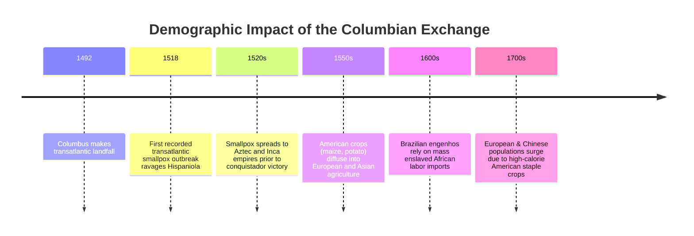

# Topic 4.3: The Columbian Exchange (c. 1450 to c. 1750)

> **Essential Question**: What were the causes of the Columbian Exchange and its effects on the Eastern and Western Hemispheres?
> *Source Reference: AMSCO AP World History: Modern (Topic 4.3, pp. 209–217) supplemented with College Board AP World History CED Topic 4.3.*

---

## 1. Big Picture Summary
The voyage of Christopher Columbus in 1492 permanently linked the Eastern and Western Hemispheres, establishing the **Columbian Exchange**—the unprecedented global transfer of plants, animals, cultures, human populations, and communicable diseases. For the Americas, this biological encounter was catastrophic: Eurasian pathogens eradicated 50% to 90% of indigenous populations. Conversely, the introduction of American caloric crops (potatoes, maize, manioc) to Afro-Eurasia catalyzed demographic booms in Europe, Asia, and Africa. To exploit American lands for cash crop monoculture (particularly sugarcane), European colonizers instituted coercive labor regimes, triggering the horrific forced migration of millions of enslaved Africans via the Transatlantic Slave Trade and giving rise to the African Diaspora and syncretic Atlantic cultures.

---

## 2. Section-by-Section Breakdown

### A. Causes of the Columbian Exchange
1. **Transoceanic Reconnection**:
   - Millennia of geographic isolation ended when European explorers crossed the Atlantic seeking maritime routes to Asian markets.
   - European states established colonies in the Caribbean, Mesoamerica, and South America to extract precious metals and cultivate cash crops.

### B. Diseases and Indigenous Demographic Catastrophe
1. **The Great Dying**:
   - Indigenous American populations had zero immunological resistance to Afro-Eurasian pathogens due to prolonged biological isolation.
   - Diseases introduced: **smallpox** (the primary killer, spread by conquistadores like Cortés and Pizarro), **measles**, **influenza**, **malaria**, and **typhus**.
   - Demographic impact: Population losses exceeded 50% to 90% across the Americas within a century—recognized as one of the greatest demographic disasters in human history.
   - Societal breakdown: Loss of leaders, priests, warriors, and agriculturalists severely weakened indigenous resistance, facilitating Spanish and Portuguese conquest.

### C. Biological and Ecological Exchanges

#### 1. Eastern Hemisphere to Western Hemisphere (Afro-Eurasia to Americas)
- **Crops**: Wheat, barley, sugarcane, grapes, okra, rice, oranges, lettuce, coffee.
  - *Environmental Impact*: Widespread deforestation to clear land for cash crop plantations; severe soil depletion from continuous monoculture.
- **Animals**: Horses, cattle, pigs, sheep, goats, chickens.
  - *Ecological & Cultural Impact*: Domesticated livestock caused overgrazing and soil erosion; pigs reproduced rapidly, destroying native flora. The **horse** radically transformed Native American Plains cultures, boosting buffalo-hunting efficiency, nomadic warfare, and social stratification based on horse ownership.
- **Pests & Vectors**: Mosquitoes (spreading yellow fever and malaria), black rats.

#### 2. Western Hemisphere to Eastern Hemisphere (Americas to Afro-Eurasia)
- **Crops**: Maize (corn), potatoes, sweet potatoes, tomatoes, beans, peppers, cacao, peanuts, manioc (cassava), tobacco.
  - *Demographic Impact in Europe*: High-calorie, nutrient-rich potatoes and maize spurred massive European population growth in the 16th–18th centuries, helping sustain urban labor forces for future industrialization.
  - *Demographic Impact in Africa & Asia*: American crops like manioc, peanuts, and maize grew well in nutrient-poor African soils, leading to overall population increases that offset demographic losses from the slave trade. In China, sweet potatoes and maize sustained rapid population expansion under the Qing Dynasty.

### D. Cash Crops, Plantation Agriculture, and Forced Labor
1. **The Lure of Sugarcane**:
   - Portuguese Brazil possessed ideal tropical conditions and vast acreage for sugarcane cultivation.
   - Because indigenous laborers perished from epidemic disease or escaped into the interior jungle, Portuguese planters turned to the **Transatlantic Slave Trade**, importing enslaved Africans from the Kingdom of Kongo and the Swahili coast.
   - **Engenhos**: Complex sugar plantations/mills ("engines") that combined intensive agricultural cutting with industrial boiling and refining. Working conditions were lethal, resulting in an annual labor mortality rate of 5% to 10%.
2. **Expansion to Spanish and Northern European Colonies**:
   - Spanish colonies returned to plantation agriculture in the Caribbean, prioritizing sugar and tobacco over silver.
   - Over 90% of all enslaved Africans were transported to the Caribbean and South America (especially Brazil); only approximately 6% went to British North America.

### E. The African Diaspora and Cultural Synthesis in the Americas
1. **African Diaspora**: The forced dispersion of millions of Africans across the Atlantic.
2. **Linguistic Continuity & Syncretism**:
   - Because slavers intentionally mixed captives of diverse linguistic backgrounds, enslaved people created **creole languages** (blending West African grammatical structures and vocabulary with English, French, Spanish, or Portuguese).
   - Examples: Haitian Creole, and the **Gullah/Geechee** dialect of coastal South Carolina and Georgia.
3. **Musical Traditions & Folklore**:
   - West African syncopated rhythms, call-and-response structures, and percussion became vital mechanisms of psychological survival, community cohesion, and resistance.
   - Formed the bedrock for gospel, blues, jazz, rock and roll, reggae, samba, and **Negro spirituals**; enslaved Africans invented the **banjo**.
4. **Culinary Influences**:
   - Enslaved Africans introduced African cooking techniques and ingredients, such as okra and rice, leading directly to southern American cuisines like **gumbo**.

---

## 3. Visual Diagrams

### Biological & Cultural Flows of the Columbian Exchange
```mermaid
flowchart LR
    subgraph Americas["The Americas (Western Hemisphere)"]
        AmCrops["Crops: Maize, Potatoes, Tomatoes, Cacao, Tobacco, Manioc"]
        AmMetals["Minerals: Silver, Gold"]
    end

    subgraph AfroEurasia["Europe, Africa & Asia (Eastern Hemisphere)"]
        EuCrops["Crops: Sugar, Wheat, Rice, Okra, Coffee"]
        EuAnimals["Animals: Horses, Cattle, Pigs, Sheep"]
        EuDiseases["Pathogens: Smallpox, Measles, Malaria, Flu"]
        AfPeople["Human Labor: Enslaved Africans (Diaspora)"]
    end

    AmCrops -->|Population explosion & dietary diversification| AfroEurasia
    AmMetals -->|Global monetization & inflation (Price Rev)| AfroEurasia
    EuDiseases -->|Demographic collapse: 50-90% mortality| Americas
    EuAnimals -->|Overgrazing & Plains horse culture| Americas
    EuCrops -->|Deforestation & plantation cash crops| Americas
    AfPeople -->|Coerced plantation labor & cultural syncretism| Americas
```

### Demographic Divergence Timeline


---

## 4. Comparison Table: Hemispheric Transfers and Consequences

| Category | Eastern Hemisphere to Americas (Old to New) | Western Hemisphere to Afro-Eurasia (New to Old) |
| :--- | :--- | :--- |
| **Major Crops** | Sugarcane, wheat, barley, rice, okra, coffee, grapes | Maize, potatoes, tomatoes, sweet potatoes, cacao, tobacco, manioc |
| **Major Animals** | Horses, cows, pigs, sheep, goats, chickens | Turkeys, llamas, alpacas, guinea pigs |
| **Pathogens** | Smallpox, measles, influenza, typhus, malaria, yellow fever | Syphilis (disputed/debated) |
| **Demographic Effect** | Catastrophic collapse of indigenous populations (50–90% death rate) | Sustained long-term population growth; urban expansion |
| **Labor & Social Effect** | Institution of chattel slavery; rise of racial casta hierarchies | Enhanced peasant nutrition; commercialization of agriculture |
| **Environmental Impact** | Deforestation for plantations; soil erosion from hoofed grazing | Introduction of hardy crops in marginal soils; increased crop rotation |

---

## 5. Key Terms

| Term | Category | Historical Significance |
| :--- | :--- | :--- |
| **Columbian Exchange** | Concept | Global biological and cultural transfer of plants, animals, diseases, and peoples following 1492. |
| **Smallpox** | Disease | Highly lethal Eurasian viral pathogen that decimated unexposed indigenous American populations. |
| **The Great Dying** | Event/Demography | The catastrophic demographic collapse of indigenous Americans caused by Old World epidemic diseases. |
| **African Diaspora** | Migration/Society | The forced dispersion of enslaved African peoples across the Americas and the Atlantic world. |
| **Engenhos** | Labor/Economy | Brazilian sugar plantation and processing complexes dependent on intensive enslaved labor. |
| **Transatlantic Slave Trade** | Economic Network | The coerced maritime transport of 10–12 million enslaved Africans across the Middle Passage. |
| **Creole Languages** | Culture/Linguistics | New languages created by blending European colonial tongues with West African grammar and vocabulary. |
| **Gullah / Geechee** | Culture/Linguistics | Distinct African-American creole culture and language developed along coastal South Carolina and Georgia. |
| **Plains Horse Culture** | Cultural Change | The transformation of North American indigenous societies into nomadic buffalo hunters following European horse introduction. |
| **Gumbo** | Cultural Food | Southern North American dish exemplifying the integration of African ingredients (okra) and cooking traditions. |