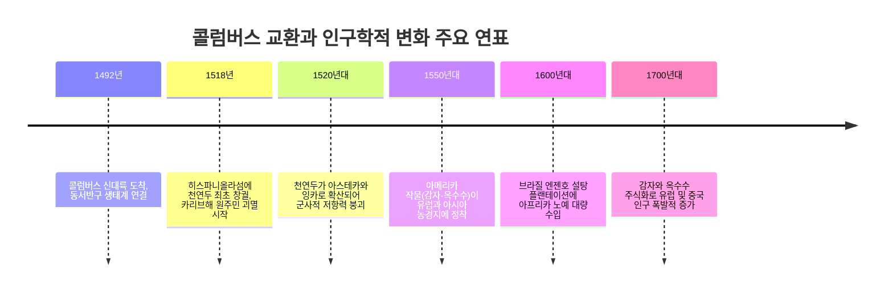

# 토픽 4.3: 콜럼버스 교환 (The Columbian Exchange, c. 1450–1750)

> **핵심 질문 (Essential Question)**: 콜럼버스 교환의 원인은 무엇이었으며, 동반구와 서반구에 각각 어떤 영향을 미쳤는가?
> *출처 안내: AMSCO AP World History: Modern (Topic 4.3, pp. 209–217) 교재 내용 요약 및 College Board AP World History CED 기준 보완.*

---

## 1. 큰 그림 요약 (Big Picture Summary)
1492년 크리스토퍼 콜럼버스의 대서양 횡단은 동반구(아프로-유라시아)와 서반구(아메리카)를 영구적으로 연결하여 **콜럼버스 교환(Columbian Exchange)**이라는 전 지구적 생물학적·문화적 대교환을 촉발했습니다. 아메리카 원주민에게 이 접촉은 천연두 등 구대륙 병원균에 의한 50~90%의 인구 괴멸(The Great Dying)이라는 대참사를 초래했습니다. 반면 옥수수, 감자 등 아메리카 원산 고열량 작물의 도입은 유럽, 아시아, 아프리카의 폭발적인 인구 성장을 이끌었습니다. 신대륙의 사탕수수 등 환금 작물(Cash Crops) 플랜테이션을 운영하기 위해 유럽인들은 대서양 노예 무역(Transatlantic Slave Trade)을 통해 수백만 명의 아프리카인을 강제 이주시켰으며, 이는 **아프리카 디아스포라(African Diaspora)**와 독특한 대서양 혼합 문화를 탄생시켰습니다.

---

## 2. 섹션별 정리 (Section-by-Section Breakdown)

### A. 콜럼버스 교환의 배경과 원인
1. **대양 횡단 재연결**:
   - 수천 년간 지리적·생태학적으로 완전히 고립되어 있던 두 대륙이 유럽 국가들의 해양 탐험과 식민지 건설로 인해 접촉하게 되었습니다.
   - 유럽 국가들은 금·은 등 귀금속 채굴과 설탕 등 고수익 환금 작물 재배를 목적으로 식민지를 개척했습니다.

### B. 전염병 전파와 원주민 인구 대참사 (The Great Dying)
1. **면역력 부재와 인구 격감**:
   - 아메리카 원주민들은 수천 년간 아프로-유라시아의 가축 및 병원균과 격리되어 면역체계(항체)가 전혀 없었습니다.
   - 유입된 주요 질병: **천연두(Smallpox)**(가장 치명적, 코르테스와 피사로의 정복 과정에서 창궐), **홍역(Measles)**, **인플루엔자(Influenza)**, **말라리아(Malaria)**, **발진티푸스(Typhus)**.
   - 인구 손실: 접촉 후 100년도 채 되지 않아 아메리카 대륙 인구의 50%에서 최대 90%가 사망했습니다. 이는 인류 역사상 가장 극심한 인구 참사 중 하나입니다.
   - 사회 붕괴: 지배층, 전사, 사제, 농민이 급격히 사망하면서 원주민 제국(아스테카, 잉카)의 조직적 저항이 무너지고 스페인과 포르투갈의 식민 지배가 용이해졌습니다.

### C. 동·서반구 간 생물학적·생태학적 교환

#### 1. 동반구에서 서반구로 (구대륙 → 신대륙)
- **작물**: 사탕수수(Sugarcane), 밀(Wheat), 보리, 쌀, 오크라(Okra), 오렌지, 포도, 커피.
  - *환경적 영향*: 환금 작물 플랜테이션 농장 조성을 위한 대규모 삼림 벌채(Deforestation)와 동일 작물 연작으로 인한 토양 영양분 고갈(Soil depletion) 발생.
- **가축**: 말(Horse), 소, 돼지, 양, 염소, 닭.
  - *생태 및 문화적 영향*: 가축들의 과도한 방목(Overgrazing)으로 토양 침식 초래. **말(Horse)**의 유입은 북미 대평원 원주민(Plains Indians)의 삶을 극적으로 변화시켜 버팔로 사냥 효율성을 극대화하고, 말 보유 수에 따른 유목 전사 문화와 사회적 위계질서를 형성함.
- **해충 및 매개체**: 모기(황열병·말라리아 전파), 쥐(흑사병 매개).

#### 2. 서반구에서 동반구로 (신대륙 → 구대륙)
- **작물**: 옥수수(Maize), 감자(Potato), 고구마, 토마토, 콩, 고추, 카카오, 땅콩, 마니옥(카사바/Manioc), 담배(Tobacco).
  - *유럽 인구 증가*: 영양가가 높고 척박한 토양에서도 잘 자라는 감자와 옥수수의 보급으로 16~18세기 유럽 인구가 급증하였으며, 이는 훗날 산업혁명의 노동력 기반이 됨.
  - *아프리카 및 아시아 영향*: 브라질에서 아프리카로 전래된 마니옥과 땅콩은 영양 상태를 개선하여 노예 무역으로 인한 인구 유출에도 불구하고 아프리카 전반의 인구성장을 뒷받침함. 중국(청나라)에서도 옥수수와 고구마가 보급되어 폭발적인 인구 증가를 견인함.

### D. 환금 작물, 플랜테이션 농업, 강제 노동
1. **설탕의 매혹과 플랜테이션**:
   - 포르투갈령 브라질은 열대 기후와 광활한 토지로 사탕수수 재배에 최적이었습니다.
   - 원주민들이 전염병으로 사망하거나 내륙 밀림으로 탈출하자, 포르투갈은 콩고 왕국 및 스와힐리 연안 등에서 **대서양 노예 무역(Transatlantic Slave Trade)**을 통해 아프리카 흑인 노예들을 대거 수입했습니다.
   - **엔젠호(Engenhos)**: 포르투갈어로 '엔진'을 뜻하며, 사탕수수 재배와 분쇄, 설탕 정제를 병행한 복합 플랜테이션 시설이었습니다. 노동 환경이 극도로 가혹하여 매년 노예 인구의 5~10%가 사망했습니다.
2. **카리브해 및 북미로의 확산**:
   - 스페인도 카리브해에서 설탕과 담배 플랜테이션을 대대적으로 전개했습니다.
   - 대서양 노예 무역으로 운송된 노예의 90% 이상이 카리브해와 남아메리카(특히 브라질)로 팔려갔으며, 영국의 북미 식민지로 유입된 비율은 약 6%에 불과했습니다.

### E. 아프리카 디아스포라와 아메리카의 문화적 융합
1. **아프리카 디아스포라 (African Diaspora)**: 아프리카 본토에서 수백만 명이 아메리카 전역으로 강제 분산·이주된 역사적 현상.
2. **언어적 혼합 (Creole Languages)**:
   - 노예 상인들은 반란을 막기 위해 언어가 다른 부족들을 섞어 배치했습니다.
   - 이에 노예들은 서아프리카 문법 구조와 유럽 식민 지배자들의 어휘(영어, 프랑스어, 스페인어, 포르투갈어)를 결합하여 **크리올어(Creole)**를 창조했습니다. (예: 아이티 크리올어, 미국 사우스캐롤라이나 연안의 **굴라/기치(Gullah/Geechee)어**).
3. **음악 및 종교적 저항**:
   - 아프리카 특유의 싱코페이션(당김음) 리듬과 타악기 전통은 가혹한 노예 노동을 견디고 탈출을 모의하는 생존 수단이었습니다.
   - 이는 흑인 영가(Negro spirituals), 가스펠, 블루스, 재즈, 삼바, 레게의 기원이 되었으며, 노예들은 서아프리카 현악기를 개량하여 **밴조(Banjo)**를 발명했습니다.
4. **식문화의 융합**:
   - 오크라, 쌀 조리법이 유입되어 미국 남부의 대표 전통 요리인 **검보(Gumbo)**와 같은 독특한 혼합 요리가 탄생했습니다.

---

## 3. 시각 자료 (Mermaid Diagrams)

### 콜럼버스 교환의 쌍방향 교환 체계도
```mermaid
flowchart LR
    subgraph 서반구["서반구 (아메리카 신대륙)"]
        AmCrops["원산지 작물: 옥수수, 감자, 고구마, 카카오, 담배, 마니옥"]
        AmMetals["귀금속: 포토시 은(Silver), 금"]
    end

    subgraph 동반구["동반구 (아프로-유라시아 구대륙)"]
        EuCrops["작물: 사탕수수, 밀, 쌀, 오크라, 커피"]
        EuAnimals["가축: 말, 소, 돼지, 양, 염소"]
        EuDiseases["병원균: 천연두, 홍역, 말라리아, 인플루엔자"]
        AfPeople["인구 이동: 아프리카 흑인 노예 (디아스포라)"]
    end

    AmCrops -->|칼로리 공급 및 구대륙 인구 폭발| 동반구
    AmMetals -->|전 세계 은 유통 및 가격 혁명 유발| 동반구
    EuDiseases -->|원주민 인구 50-90% 괴멸 (The Great Dying)| 서반구
    EuAnimals -->|대평원 인디언 말 문화 형성 및 토양 침식| 서반구
    EuCrops -->|삼림 벌채 및 환금 작물 플랜테이션 확산| 서반구
    AfPeople -->|강제 노동 체제 및 언어·음악 크리올 융합| 서반구
```

### 인구학적 파급 효과 연표


---

## 4. 구대륙과 신대륙 교환 비교표 (Comparison Table)

| 구분 | 동반구 → 아메리카 (구대륙 → 신대륙) | 아메리카 → 동반구 (신대륙 → 구대륙) |
| :--- | :--- | :--- |
| **주요 작물** | 사탕수수, 밀, 보리, 쌀, 오크라, 커피, 포도, 오렌지 | 옥수수, 감자, 고구마, 토마토, 고추, 카카오, 마니옥, 담배 |
| **도입 가축** | 말, 소, 돼지, 양, 염소, 닭 | 칠면조, 라마, 알파카, 기니피그 |
| **유입 질병** | 천연두, 홍역, 발진티푸스, 독감, 말라리아, 황열병 | 매독 (기원 논쟁 존재) |
| **인구학적 결과** | 원주민 인구 50~90% 감소 (역사상 최악의 인구 재앙) | 유럽·중국·아프리카의 지속적 인구 증가 및 도시화 촉진 |
| **노동 및 사회 체제** | 동산 노예제(Chattel slavery) 정착 및 인종 기반 카스타 계급 형성 | 영양 상태 개선으로 농민 노동 생산성 및 도시 상공업 노동력 증대 |
| **환경적 영향** | 대규모 벌채(플랜테이션), 가축 방목으로 인한 토양 침식 | 척박한 토양의 개간 및 생산성 극대화, 윤작 방식 다양화 |

---

## 5. 핵심 용어 표 (Key Terms)

| 용어 | 분류 | 역사적 의미 및 중요성 |
| :--- | :--- | :--- |
| **콜럼버스 교환 (Columbian Exchange)** | 생태/역사 | 1492년 이후 동반구와 서반구 간에 발생한 식물, 동물, 질병, 인구의 전 지구적 교환. |
| **천연두 (Smallpox)** | 전염병 | 구대륙 바이러스로 면역력이 없던 아메리카 원주민 사회를 괴멸시킨 가장 치명적인 질병. |
| **인구 대참사 (The Great Dying)** | 인구학 | 구대륙 전염병으로 인해 아메리카 원주민 인구의 50~90%가 사망한 미증유의 인구 격감 사건. |
| **아프리카 디아스포라 (African Diaspora)** | 강제 이주 | 대서양 노예 무역으로 인해 아프리카 흑인들이 아메리카 대륙 전역으로 강제 분산된 현상. |
| **엔젠호 (Engenhos)** | 경제/노예제 | 포르투갈어로 '엔진'을 뜻하며, 가혹한 노동으로 악명 높았던 브라질의 사탕수수 정제 플랜테이션. |
| **대서양 노예 무역 (Transatlantic Slave Trade)** | 무역망 | 아메리카 플랜테이션 노동력 공급을 위해 1천만 명 이상의 흑인을 강제 운송한 삼각무역 축. |
| **크리올어 (Creole Languages)** | 문화/언어 | 서아프리카 문법 구조에 유럽 식민 지배자의 어휘를 결합하여 형성된 신대륙 혼합 언어. |
| **굴라 / 기치 (Gullah / Geechee)** | 문화/공동체 | 미국 남부 사우스캐롤라이나와 조지아 해안가에서 보존된 독특한 아프리카계 미국인 크리올 문화. |
| **대평원 말 문화 (Plains Horse Culture)** | 사회/생태 | 유럽에서 도입된 말을 수용하여 기동성 높은 버팔로 사냥 유목 전사 집단으로 변모한 북미 원주민 문화. |
| **검보 (Gumbo)** | 식문화 | 아프리카 오크라와 조리법이 유럽·원주민 재료와 융합되어 발전한 미국 남부 루이지애나 전통 스튜. |