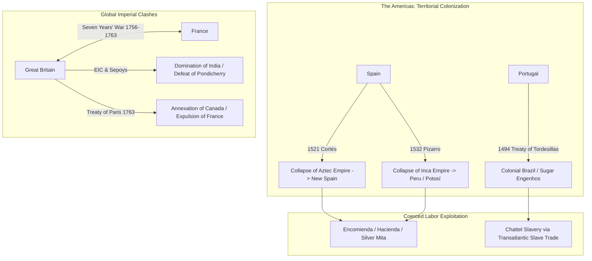
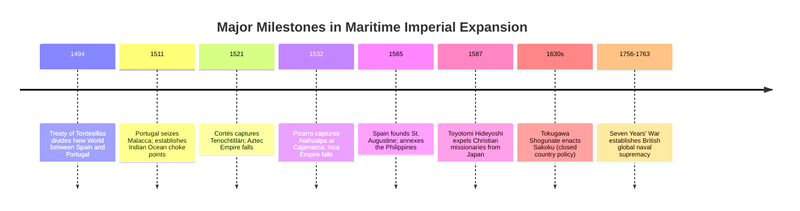

# Topic 4.4: Maritime Empires Link Regions (c. 1450 to c. 1750)

> **Essential Question**: How were the empires of European states established between 1450 and 1750, and what economic and labor systems fueled them?
> *Source Reference: AMSCO AP World History: Modern (Topic 4.4, pp. 218–231) supplemented with College Board AP World History CED Topic 4.4.*

---

## 1. Big Picture Summary
Between 1450 and 1750, European maritime powers established interconnected global trading empires. While Asian and African interactions were initially characterized by coastal trading posts and negotiations with powerful regional states (such as the Ming, Mughals, Asante, and Dahomey), the Americas experienced direct military conquest and territorial colonization (the fall of the Aztec and Inca empires). To extract wealth from these colonies, Europeans adapted and intensified coercive labor regimes, including **chattel slavery**, **indentured servitude**, the **encomienda**, and the adapted Incan **mita** system. Meanwhile, geopolitical competition among European rivals (culminating in the Seven Years' War) reorganized global territorial control.

---

## 2. Section-by-Section Breakdown

### A. Trading Posts and State Interactions in Africa and Asia
1. **African Coastal Kingdoms**:
   - European powers established coastal trading posts (*feitorias*) with the consent of local rulers rather than conquering interior Africa.
   - Coastal states traded captive laborers to Europeans in exchange for manufactured goods, especially gunpowder and firearms.
   - **Militarization & State Growth**: Kingdoms like **Dahomey** and **Asante** expanded aggressively by raiding neighboring inland communities for captives to sell, creating a cycle of gun-slave diplomacy.
   - **Central Africa**: The Kingdom of **Kongo** and the Kingdom of **Benin** engaged with Portuguese traders and Catholic missionaries; Benin artisans incorporated depictions of European soldiers into their famous bronze sculptures.
2. **Indian Ocean Choke Points & Swahili Decline**:
   - In 1498, Vasco da Gama invaded the thriving commercial city-states of East Africa (Kilwa, Mombasa), bombarding ports and building forts to seize trade, pitching the Swahili coast into prolonged economic decline.
3. **Asian Responses: Isolationism and Controlled Trade**:
   - **Tokugawa Japan**: Initially tolerated Portuguese and Dutch merchants and Jesuit missionaries (St. Francis Xavier, 1549). As Christian converts destroyed Buddhist shrines, the Tokugawa Shogunate perceived Christianity as a subversive threat. By 1587, Christian worship was banned; by the 1630s, the **Sakoku** (closed country) policy expelled foreigners, barred travel abroad, and restricted European trade exclusively to the Dutch at **Deshima Island** in Nagasaki harbor.
   - **Ming & Qing China**: After Zheng He's voyages, the Ming dynasty restricted private maritime commerce, destroyed dockyards, and rebuilt the Great Wall. Although foreign trade was formally restricted, China’s desperate need for American silver to collect taxes eventually compelled the resumption of carefully regulated coastal commerce (the Canton system).

### B. European Imperial Rivalries on Five Continents
1. **South Asia and the British Ascendancy**:
   - The British East India Company (EIC), Portuguese (at Goa), and French (at Pondicherry) competed for commercial dominance in India.
   - Exploiting internal fractures between the Muslim Mughal ruling elite and Hindu majorities, the British EIC forged treaties with local princely rulers and recruited native Indian private soldiers (**sepoys**).
   - In the **Seven Years' War (1756–1763)**, British victory drove French military influence out of India and North America (Treaty of Paris, 1763).
2. **The Americas: Spanish Conquest and Territorial Division**:
   - **Conquest of the Aztec Empire (1521)**: Hernán Cortés, aided by smallpox epidemics and indigenous allies subjugated by the Aztecs (such as the Tlaxcalans), overthrew Tenochtitlán and established the capital of **New Spain** (Mexico City).
   - **Conquest of the Inca Empire (1532–1572)**: Francisco Pizarro captured Incan Emperor Atahualpa at Cajamarca; despite receiving a massive ransom room of gold, the Spanish executed Atahualpa in 1533, completing the conquest of Peru by 1572.
   - **Treaty of Tordesillas (1494)**: Negotiated by the Papacy, dividing non-Christian lands along a meridian 370 leagues west of the Cape Verde islands: Spain claimed lands west of the line (most of the Americas), while Portugal secured Brazil and lands eastward.
   - **North American Imperial Contests**: Pedro Menéndez de Avilés founded St. Augustine, Florida (1565); British settlers encroached on Dutch New Amsterdam (seized in 1664) and allied with the Iroquois against New France until the **Great Peace of Montreal (1701)** and the French and Indian War expelled French authority from Canada.

### C. Coerced Labor Systems
1. **Chattel Slavery**: An absolute ownership system where human beings are legally classified as private, inheritable property with no legal rights, dominant in Caribbean and Brazilian plantations.
2. **Indentured Servitude**: A contractual labor arrangement where individuals traded 4 to 7 years of agricultural labor in the Americas in exchange for transatlantic passage, shelter, and eventual freedom (common in British North America).
3. **The Encomienda & Hacienda Systems**:
   - *Encomienda*: Spanish crown granted conquistadores the right to compel indigenous tribute and labor in exchange for food, shelter, and Christian instruction (notoriously brutal and criticized by Bartolomé de Las Casas).
   - *Hacienda*: Large agrarian land estates developed as the encomienda declined, binding indigenous tenant farmers to the land through debt peonage.
4. **The Adapted Mita System**:
   - Spanish colonial administrators in the Andes adapted the traditional Incan communal labor draft (*mita*) into a mandatory, brutal forced labor system compelling native villages to send a quota of adult males into the lethal silver mines of **Potosí**.

---

## 3. Visual Diagrams

### Global Networks and Imperial Conflicts

### Timeline of State Expansion and Clashes

---

## 4. Comparison Table: Labor Systems in the Early Modern Era

| Labor System | Location | Legal Status of Worker | Primary Economic Output |
| :--- | :--- | :--- | :--- |
| **Chattel Slavery** | Americas (Caribbean, Brazil, North America) | Complete property; hereditary; no rights | Sugar, tobacco, cotton, mining |
| **Indentured Servitude** | British North America | Contractual bondage for fixed term (4–7 yrs); eventual freedom | Tobacco, domestic service, wheat |
| **Encomienda** | Spanish America | Indigenous subjects required to labor in exchange for Christianization | Gold panning, agriculture |
| **Hacienda System** | Spanish America (Mexico, Peru) | Legally free but bound by debt peonage to landowners | Livestock, wheat, corn, sugar |
| **Colonial Mita** | Andean Highlands (Potosí, Bolivia) | Mandatory seasonal forced labor draft of native males | Silver extraction |
| **Russian Serfdom** | Tsarist Russia | Peasants tied legally to land; sold with estates (Law of 1649) | Grain export for European markets |

---

## 5. Key Terms

| Term | Category | Historical Significance |
| :--- | :--- | :--- |
| **Chattel Slavery** | Labor System | Absolute ownership of human beings as saleable personal property. |
| **Indentured Servitude** | Labor System | Temporary labor bondage under contract in exchange for ocean passage and maintenance. |
| **Encomienda** | Labor System | Spanish royal grant assigning native labor to settlers with an obligation to Christianize them. |
| **Hacienda** | Economic Unit | Large rural agricultural estate in Spanish America worked by debt-bound indigenous peasants. |
| **Mita System (Colonial)** | Labor System | Incan communal rotational labor draft coerced by Spain into mandatory silver mine labor. |
| **Treaty of Tordesillas (1494)** | Treaty | Papal-brokered agreement dividing the non-European world between Spain and Portugal. |
| **Sepoys** | Military Unit | Indian troops trained and armed in European military tactics employed by the British East India Company. |
| **Seven Years' War (1756–1763)** | Global Conflict | Worldwide war between Britain and France, ending French dominance in India and Canada. |
| **Sakoku** | Political Policy | Japanese Tokugawa policy of strict national seclusion, banning foreigners and foreign travel. |
| **Kingdom of Dahomey** | West African State | Militaristic coastal African kingdom that expanded through firearm acquisitions and slave raiding. |