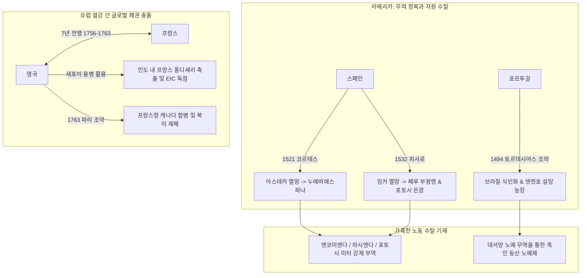
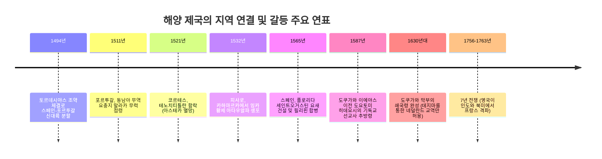

# 토픽 4.4: 해양 제국의 지역 간 연결 (Maritime Empires Link Regions, c. 1450–1750)

> **핵심 질문 (Essential Question)**: 1450년부터 1750년까지 유럽 해양 제국은 어떻게 수립되었으며, 어떠한 경제 및 노동 체제가 제국의 성장을 뒷받침했는가?
> *출처 안내: AMSCO AP World History: Modern (Topic 4.4, pp. 218–231) 교재 내용 요약 및 College Board AP World History CED 기준 보완.*

---

## 1. 큰 그림 요약 (Big Picture Summary)
1450년부터 1750년 사이 서유럽 해양 제국들은 전 지구적 규모의 무역망을 구축했습니다. 아시아와 아프리카에서는 강력한 현지 군주들(명·청, 무굴 제국, 아샨티, 다호메이 등)의 존재로 인해 연안 무역 거점을 통한 협상과 총포류-노예 교환이 주를 이루었습니다. 반면 아메리카 대륙에서는 아스테카와 잉카 제국이 무력으로 정복되어 광대한 영토 식민지로 편입되었습니다. 이러한 식민지에서 막대한 부를 착취하기 위해 유럽인들은 **동산 노예제(Chattel slavery)**, **계약 하인제(Indentured servitude)**, **엔코미엔다(Encomienda)**, 개조된 **미타제(Mita system)** 등 가혹한 강제 노동 체제를 가동했습니다. 또한 유럽 열강 간의 패권 경쟁은 **7년 전쟁(Seven Years' War)**으로 폭발하며 전 세계 식민지 판도를 재편했습니다.

---

## 2. 섹션별 정리 (Section-by-Section Breakdown)

### A. 아프리카 및 아시아에서의 교역 거점과 현지 국가 간 상호작용
1. **아프리카 연안 왕국들과의 관계**:
   - 유럽 국가들은 아프리카 내륙을 정복하지 못하고, 현지 지배자의 허가를 받아 연안에 무역 거점(상관 및 요새)을 설치했습니다.
   - 현지 연안 지배자들은 전쟁 포로들을 유럽인들에게 노예로 넘겨주는 대가로 유럽산 화약과 총포를 구매했습니다.
   - **군사화와 국가 성장**: **다호메이(Dahomey)**와 **아샨티(Asante)** 왕국 등은 총기를 바탕으로 내륙 부족들을 약탈하여 노예를 공급하며 강력한 군사 국가로 성장했습니다.
   - **중부 아프리카**: **콩고 왕국(Kongo)**과 **베냉 왕국(Benin)**은 포르투갈과 초기 교역 및 가톨릭을 수용했으며, 베냉의 장인들은 유명한 청동 조각에 포르투갈 침입자의 모습을 묘사했습니다.
2. **인도양 요충지 장악과 스와힐리 도시들의 몰락**:
   - 1498년 바스코 다 가마는 킬와(Kilwa), 몸바사(Mombasa) 등 번영하던 동아프리카 스와힐리 무역 도시들을 무력 공격하고 요새를 구축하여 상권을 탈취했고, 이로 인해 이 지역은 장기적인 쇠퇴기에 접어들었습니다.
3. **동아시아 국가들의 쇄국 및 무역 통제 정책**:
   - **도쿠가와 일본**: 16세기 중반 포르투갈·네덜란드 상인과 예수회 선교사(프란치스코 하비에르, 1549년)를 수용했으나, 기독교 개종자들이 불교 사원을 파괴하는 등 사회적 불안이 발생하자 막부는 기독교를 체제 위협으로 규정했습니다. 1587년 기독교 선교를 금지했고, 1630년대에는 **쇄국령(Sakoku)**을 내려 외국인 추방, 해외 도항 금지 조치를 취했으며, 네덜란드 상인에게만 나가사키 앞바다의 인공섬 **데지마(Deshima)**에서 엄격히 통제된 무역을 허용했습니다.
   - **명·청대 중국**: 정화의 원정 이후 명나라는 민간 해외 무역을 금지하고 선박을 파괴하며 만리장성을 재건하는 보수주의 정책을 폈습니다. 그러나 조세 납부용 은이 절대적으로 필요해지자 무역 규제를 완화하고 광둥(Canton) 등을 통해 철저히 통제된 형태로 대외 교역을 재개했습니다.

### B. 5개 대륙에서의 유럽 열강 간 식민지 패권 경쟁
1. **남아시아(인도)에서의 영국 패권 확립**:
   - 영국 동인도회사(EIC), 포르투갈(고아), 프랑스(퐁디셰리)가 인도 무역의 주도권을 다투었습니다.
   - 무굴 제국의 중앙 권력이 약화되자, 영국 EIC는 힌두교도와 무슬림 간의 종교적 갈등을 이용하고 현지 인도인 용병인 **세포이(Sepoys)**를 고용하여 내륙 영토를 잠식해 나갔습니다.
   - **7년 전쟁 (Seven Years' War, 1756–1763)**: 영국이 프랑스를 격파하고 1763년 파리 조약으로 프랑스 세력을 인도와 캐나다에서 몰아내어 세계 제국으로서의 독점적 위상을 굳혔습니다.
2. **아메리카 대륙의 정복과 식민 분할**:
   - **아스테카 제국 정복 (1521)**: 에르난 코르테스는 천연두 유행과 아스테카의 압제에 반발하던 틀락스칼라 등 원주민 동맹군을 규합하여 테노치티틀란을 함락하고 **누에바에스파냐(New Spain)** 총독부를 세웠습니다.
   - **잉카 제국 정복 (1532–1572)**: 프란시스코 피사로는 카하마르카에서 잉카 황제 아타우알파를 사로잡은 뒤, 방을 채운 황금 몸값을 받고도 1533년 처형했으며, 1572년 마지막 저항을 진압하고 페루 부왕령을 확립했습니다.
   - **토르데시야스 조약 (Treaty of Tordesillas, 1494)**: 교황의 중재로 스페인과 포르투갈이 카보베르데 서쪽 370리그 자오선을 기준으로 신대륙을 양분하여, 브라질은 포르투갈이, 나머지 아메리카 전역은 스페인이 영유권을 차지했습니다.
   - **북미에서의 영·프 갈등**: 1565년 스페인이 미국 내 최고(最古) 식민 도시인 세인트오거스틴을 세웠고, 영국 정착민들은 이로쿼이 연맹과 동맹을 맺고 프랑스와 대립하다가 **1701년 몬트리올 대평화 조약** 및 7년 전쟁(프렌치-인디언 전쟁)을 통해 프랑스령 캐나다를 완전히 병합했습니다.

### C. 식민지 착취를 위한 강제 노동 체제 (Coerced Labor Systems)
1. **동산 노예제 (Chattel Slavery)**: 인간을 법적으로 매매·양도가 가능한 동산(재산)으로 취급하고 자녀에게 노예 신분이 세습되는 제도로, 카리브해와 브라질 설탕 플랜테이션에서 전면화되었습니다.
2. **계약 하인제 (Indentured Servitude)**: 신대륙으로 가는 배편과 숙식을 제공받는 대가로 통상 4~7년 동안 무보수 농업 노동을 제공하기로 계약한 노동 체제로, 북미 영국의 담배 식민지에서 널리 활용되었습니다.
3. **엔코미엔다 (Encomienda)와 하시엔다 (Hacienda) 제도**:
   - *엔코미엔다*: 스페인 국왕이 정복자들에게 일정 구역 원주민의 노동력과 공물을 징발할 권리를 부여하는 대신 원주민을 기독교로 개종시키도록 한 제도 (혹독한 착취로 라스카사스 신부 등의 거센 비판을 받음).
   - *하시엔다*: 엔코미엔다가 쇠퇴하자 등장한 대토지 농장 체제로, 부채 노예제(Debt peonage)를 통해 자유 원주민 농민을 토지에 영구적으로 묶어두고 식량과 축산물을 생산함.
4. **식민지 미타 제도 (Colonial Mita System)**:
   - 잉카 전통의 공공 윤번 부역제였던 미타를 스페인이 변질시켜, 성인 남성 원주민들을 가혹한 죽음의 광산인 **포토시(Potosí)** 은광에 의무적으로 강제 징용하여 대량 사망을 유발함.

---

## 3. 시각 자료 (Mermaid Diagrams)

### 전 지구적 해양 제국 연결 및 갈등 구조도

### 주요 사건 연표

---

## 4. 근대 초기 주요 노동 체제 비교표 (Comparison Table)

| 노동 체제 | 주요 시행 지역 | 노동자의 법적 지위 | 주 생산 품목 |
| :--- | :--- | :--- | :--- |
| **동산 노예제 (Chattel Slavery)** | 아메리카 (카리브해, 브라질, 북미) | 완전한 매매 가능 사유재산, 신분 세습 | 설탕, 담배, 면화, 광산 노동 |
| **계약 하인제 (Indentured Servitude)** | 북미 영국 식민지 | 4~7년 기한부 계약 속박, 계약 만료 후 자유 | 담배, 식량 농업, 가사 노동 |
| **엔코미엔다 (Encomienda)** | 스페인령 아메리카 | 국왕의 신민이나 정복자에게 강제 노동·공물 제공 | 사금 채취, 농업 생산 |
| **하시엔다 (Hacienda)** | 스페인령 아메리카 (멕시코, 페루) | 법적 자유인이나 채무 속박(부채 노예)으로 구속 | 밀, 옥수수, 가축 사육 |
| **식민지 미타 (Colonial Mita)** | 안데스 고원 (볼리비아 포토시) | 의무적 강제 징용 원주민 (극심한 치사율) | 은(Silver) 채굴 및 제련 |
| **농노제 (Serfdom)** | 제정 러시아 | 토지에 영구 결박된 농민, 영주가 매매 가능 (1649 법전) | 유럽 수출용 곡물(밀 등) |

---

## 5. 핵심 용어 표 (Key Terms)

| 용어 | 분류 | 역사적 의미 및 중요성 |
| :--- | :--- | :--- |
| **동산 노예제 (Chattel Slavery)** | 노동 제도 | 인간을 사고파는 물건(재산)으로 규정하여 자유와 권리를 완전히 박탈한 세습 노예제. |
| **계약 하인제 (Indentured Servitude)** | 노동 제도 | 항해 운임과 체류 비용을 대가로 정해진 연한(4~7년) 동안 무보수로 일한 계약 노동. |
| **엔코미엔다 (Encomienda)** | 노동 제도 | 스페인 국왕이 정복자에게 원주민 노동력 징발권을 위임하고 기독교 개종을 의무화한 제도. |
| **하시엔다 (Hacienda)** | 경제 체제 | 엔코미엔다 쇠퇴 후 형성된 대농장으로, 부채로 묶인 원주민 농민을 통해 환금 농축산물을 생산. |
| **미타 제도 (Colonial Mita)** | 노동 제도 | 잉카의 윤번 부역제를 스페인이 악용하여 포토시 은광에 원주민 남성을 강제 동원한 죽음의 부역제. |
| **토르데시야스 조약 (Treaty of Tordesillas, 1494)** | 조약/외교 | 교황의 중재로 스페인(아메리카 대부분)과 포르투갈(브라질 및 동반구)이 세력권을 분할한 조약. |
| **세포이 (Sepoys)** | 군사 조직 | 영국 동인도회사(EIC)가 고용하고 유럽식 전술로 무장시킨 인도인 현지 용병 군대. |
| **7년 전쟁 (Seven Years' War, 1756–1763)** | 국제 전쟁 | 유럽, 북미, 인도 등 전 세계에서 벌어진 영·프 간의 대전쟁으로 영국의 세계적 패권을 확립함. |
| **쇄국령 (Sakoku)** | 국가 정책 | 도쿠가와 막부가 외세와 기독교의 영향력을 차단하기 위해 시행한 엄격한 대외 고립 정책. |
| **다호메이 왕국 (Kingdom of Dahomey)** | 아프리카 국가 | 유럽인들에게 총기를 수입하여 내륙 이웃 부족들을 약탈하고 노예를 공급하며 팽창한 군사 국가. |