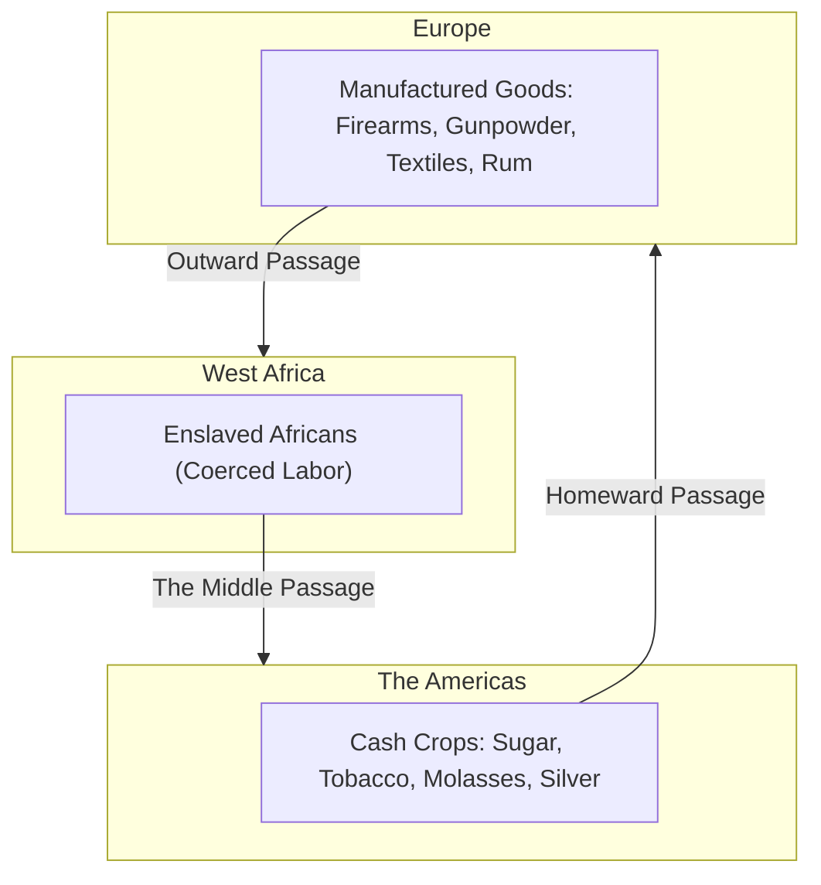
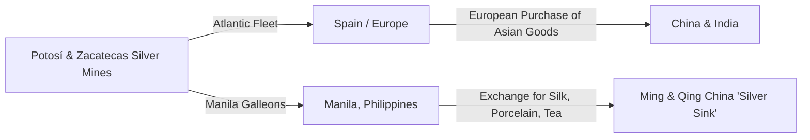

# Topic 4.5: Maritime Empires Develop (c. 1450 to c. 1750)

> **Essential Question**: What economic strategies did maritime empires use to increase their power, and how did the developing empires affect political, economic, religious, and cultural dynamics?
> *Source Reference: AMSCO AP World History: Modern (Topic 4.5, pp. 232–242) supplemented with College Board AP World History CED Topic 4.5.*

---

## 1. Big Picture Summary
The development of European maritime empires catalyzed the **Commercial Revolution**, transforming Europe's domestic barter and feudal economy into a sophisticated, trade-based global financial system lubricated by American silver. Western European nations, particularly England and the Netherlands, pioneered modern financial institutions such as **joint-stock companies**, public stock exchanges, and national banks, while Spain and Portugal maintained centralized royal monopolies. At the center of this oceanic integration was the **Triangular Trade** network, which linked Europe, Africa, and the Americas through the exchange of manufactured firearms, coerced African laborers, and plantation cash crops. This trade wrought profound demographic distortions in West Africa, decimated indigenous American cultural records, and fueled widespread European inflation known as the **Price Revolution**.

---

## 2. Section-by-Section Breakdown

### A. The Commercial Revolution and Financial Innovations
1. **Four Drivers of the Commercial Revolution**:
   - The development of expansive European overseas colonies.
   - The opening of transoceanic trade routes linking the Atlantic, Indian, and Pacific basins.
   - Demographic population growth in Europe following agricultural improvements.
   - Inflation fueled by population pressure and the massive influx of American silver, termed the **Price Revolution** (16th–early 17th century).
2. **Joint-Stock Companies and Modern Finance**:
   - **Joint-Stock Companies**: Precursors to modern corporations; investors pooled capital by purchasing shares, sharing both commercial profits and the risks of overseas voyages.
   - **Limited Liability**: Crucial legal principle stating that an investor was only liable for the amount of money they personally invested, shielding personal estates from corporate debt and encouraging middle-class investment.
   - Notable Companies: The **British East India Company (EIC, 1600)** and the **Dutch East India Company (Vereenigde Oostindische Compagnie - VOC, 1602)**. In contrast, Iberian monarchies (Spain and Portugal) maintained royal state-financed investments.
3. **Dutch Commercial and Financial Hegemony**:
   - Dutch merchants served as the "middlemen of Europe," operating vast fleets of lightweight **fluyts**.
   - Established the world’s first modern stock exchange in **Amsterdam (1602)** and the **Bank of Amsterdam (1609)**, which pioneered international currency exchange and commercial deposit banking.
4. **Financial Speculation & Bubbles**:
   - Emerging stock markets experienced speculative frenzies; early 18th-century "financial bubbles" (the **South Sea Bubble** in Britain and the **Mississippi Bubble** in France) burst, wiping out fortunes and prompting state regulatory oversight.

### B. The Atlantic Trading System (Triangular Trade)
1. **The Three Triangular Legs**:
   - **First Leg (Europe to Africa)**: European merchant ships transported manufactured goods—particularly **firearms**, gunpowder, metalware, and textiles—to West African coastal ports.
   - **Second Leg (Africa to Americas - The Middle Passage)**: Enslaved Africans were crammed onto slave ships and transported across the Atlantic under horrific, lethal conditions.
   - **Third Leg (Americas to Europe)**: Ships loaded raw plantation commodities produced by enslaved labor—primarily **sugar**, tobacco, rum, and molasses—for European consumer markets.
2. **Economic Significance of Sugar and Silver**:
   - Sugar eclipsed silver as the most profitable commodity in the Atlantic world by the 18th century, financing burgeoning commercial fortunes in Britain, France, and the Netherlands.

### C. Global Trade Rivalries and Silver Circuits
1. **The Global Flow of American Silver**:
   - Silver mined at Potosí and Zacatecas was minted into **pieces of eight** and shipped across the Atlantic to Europe and across the Pacific via Manila Galleons to Asia.
   - China's shift to a silver-based tax system (**Single Whip Law**) made the Middle Kingdom the ultimate "sink" for world silver, where American bullion was exchanged for Chinese silk, tea, and porcelain.
2. **Trade Monopolies**:
   - European crowns granted exclusive royal monopolies to state entities or chartered companies (e.g., the Spanish crown established a strict monopoly over tobacco produced in its American colonies, generating one-third of total state revenue).
3. **Armed Commercial Conflicts**:
   - **Battle of Diu (1509)**: Portuguese naval victory over allied Muslim/Venetian fleets for Indian Ocean supremacy.
   - **Moroccan-Songhai Conflict (1590–1591)**: In need of revenue after defeating the Portuguese, the Sultan of Morocco sent an army armed with firearms and cannons across the Sahara. At the **Battle of Tondibi (1591)**, Moroccan forces crushed the numerically superior Songhai Empire, shattering West Africa's greatest land empire.

### D. Effects of the Atlantic Slave Trade on Africa
1. **Demographic and Gender Imbalance**:
   - Slave traders heavily targeted young men for hard plantation field labor; more than two-thirds of captured Africans were males.
   - This caused severe gender imbalances in West Africa (modern Ghana, Benin, Nigeria), leading to a rise in **polygyny** (men taking multiple wives) and forcing women to assume traditionally male agrarian and economic roles.
2. **Militarization and the Gun-Slave Cycle**:
   - Kingdoms like **Dahomey** and **Oyo** exchanged war captives for European muskets, giving them a devastating military advantage over neighbors. To maintain their gun supplies and security, they were forced into continuous raiding wars.
   - Weakened states: Kingdoms like Kongo suffered decentralization, civil war, and population flight.
3. **Biological Offset**:
   - American food crops introduced via the Columbian Exchange—especially **manioc (cassava)**, maize, and peanuts—expanded African food supply, spurring population recovery that partially offset demographic losses.

### E. Colonial Administration and Cultural Erasure in the Americas
1. **Spanish Imperial Administration**:
   - The Spanish crown appointed royal **Viceroys** to administer the Viceroyalties of New Spain and Peru as direct crown representatives.
   - **Audiencias**: Royal appellate courts staffed by Spanish magistrates established to check the independent power of viceroys and provide a legal venue for colonists.
2. **Destruction of Indigenous Knowledge**:
   - Spanish conquistadores and Catholic friars (e.g., Diego de Landa in Yucatán) systematically burned indigenous Mesoamerican codices (books) and eradicated native religious shrines, viewing them as demonic, causing an irreplaceable loss of pre-Columbian historical and scientific records.

---

## 3. Visual Diagrams

### Triangular Trade Flowchart

### Global Silver Circuit

---

## 4. Comparison Table: Financial Systems of Early Modern Empires

| Feature | Dutch Republic & Great Britain | Spain & Portugal |
| :--- | :--- | :--- |
| **Primary Financial Entity** | Private **Joint-Stock Companies** (VOC, EIC) | Direct Royal Crown Monopolies (Casa de Contratación) |
| **Capital Mobilization** | Public stock issuance to middle-class investors | Royal treasury borrowing and loans from Genoese/German bankers |
| **Investor Liability** | **Limited liability** (loss capped at investment) | Direct royal liability; crown repeatedly declared state bankruptcies |
| **Banking & Markets** | Centralized commercial banks (Bank of Amsterdam) & stock bourses | Unregulated bullion spending; lack of modern banking infrastructure |
| **Long-Term Economic Impact** | Capital accumulation led directly to commercial dominance and Industrial Revolution | American silver triggered rampant domestic inflation (**Price Revolution**); economic stagnation |

---

## 5. Key Terms

| Term | Category | Historical Significance |
| :--- | :--- | :--- |
| **Commercial Revolution** | Economic Era | The transition to an interconnected, cash- and bullion-based global commercial economy. |
| **Price Revolution** | Economic Event | The prolonged period of high inflation in 16th-century Europe caused by population pressure and American silver. |
| **Joint-Stock Company** | Business Model | Corporate enterprise where investors buy shares, pool capital, and assume limited financial liability. |
| **Limited Liability** | Legal Principle | Rule protecting investors by ensuring they cannot lose more capital than they invested. |
| **Triangular Trade** | Trade Network | Three-legged Atlantic commercial circuit exchanging European manufactured goods, African enslaved persons, and American cash crops. |
| **Middle Passage** | Maritime Route | The harrowing, brutal transatlantic voyage that transported millions of chained Africans into New World bondage. |
| **Polygyny** | Social/Gender | The practice of taking multiple wives, which surged in West Africa due to extreme gender imbalances caused by slave raiding. |
| **Battle of Tondibi (1591)** | Military Battle | Moroccan forces using gunpowder defeated the Songhai Empire, collapsing West Africa's largest state. |
| **Viceroys** | Political Office | High-ranking royal governors appointed by the Spanish monarch to rule the Viceroyalties of New Spain and Peru. |
| **Audiencias** | Legal Body | Royal courts of appeal in Spanish America established to review viceregal decisions and administer imperial law. |