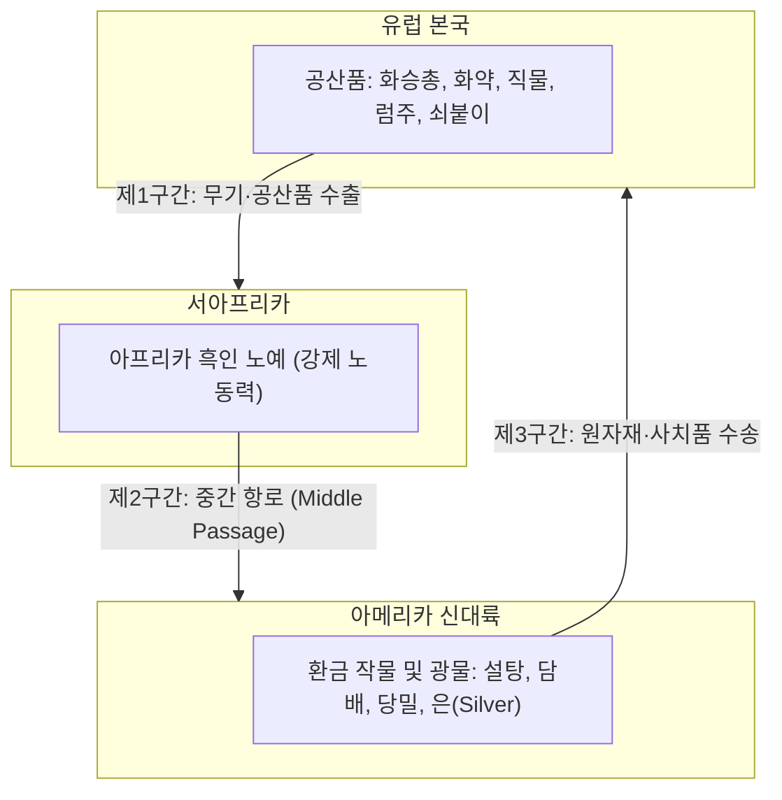
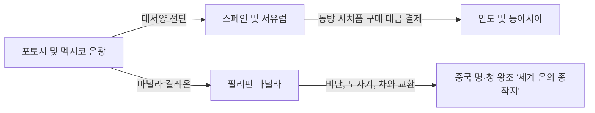

# 토픽 4.5: 해양 제국의 발전 (Maritime Empires Develop, c. 1450–1750)

> **핵심 질문 (Essential Question)**: 해양 제국들은 국력을 신장하기 위해 어떤 경제 전략을 사용했으며, 이들 제국의 성장은 정치·경제·종교·문화적 역학에 어떤 영향을 미쳤는가?
> *출처 안내: AMSCO AP World History: Modern (Topic 4.5, pp. 232–242) 교재 내용 요약 및 College Board AP World History CED 기준 보완.*

---

## 1. 큰 그림 요약 (Big Picture Summary)
유럽 해양 제국의 형성은 **상업 혁명(Commercial Revolution)**을 촉발하여 유럽의 중세적 장원·물물교환 경제를 전 세계 은(Silver)으로 결제되는 정교한 화폐·상업 자본주의 체제로 탈바꿈시켰습니다. 영국과 네덜란드는 **합자회사(Joint-stock companies)**, 증권거래소, 중앙은행 등 근대적 금융 제도를 개척하며 상업적 패권을 장악한 반면, 스페인과 포르투갈은 왕실 직속의 폐쇄적 전매제를 고수했습니다. 대서양에서는 유럽의 화승총, 아프리카의 흑인 노예, 아메리카의 설탕·은을 잇는 **대서양 삼각무역(Triangular Trade)**이 가동되었습니다. 이 과정에서 서아프리카는 심각한 성비 불균형과 내전을 겪었고, 아메리카 원주민의 고유 문화 기록물은 파괴되었으며, 유럽은 은 유입으로 인한 심각한 인플레이션인 **가격 혁명(Price Revolution)**에 직면했습니다.

---

## 2. 섹션별 정리 (Section-by-Section Breakdown)

### A. 상업 혁명과 금융 혁신
1. **상업 혁명의 4대 동인**:
   - 유럽의 광대한 해외 식민지 개발.
   - 대서양, 인도양, 태평양을 잇는 새로운 대양 해상 무역로 개척.
   - 농업 생산력 개선 및 흑사병 극복에 따른 유럽 내 인구 증가.
   - 인구 압박과 아메리카 대륙산 은의 대량 유입으로 인한 급격한 물가 상승 현상인 **가격 혁명(Price Revolution, 16~17세기 초)**.
2. **합자회사(Joint-Stock Company)와 유한책임 원칙**:
   - **합자회사**: 근대 주식회사의 원형으로, 다수의 투자자가 주식을 매수하여 거액의 자본을 형성하고 원양 무역의 막대한 이익과 위험을 분담함.
   - **유한책임(Limited Liability)**: 투자자는 자신이 투자한 출자금 한도 내에서만 회사 채무에 책임을 지는 법적 원칙으로, 개인 재산을 보호하여 중산층의 투자를 대대적으로 활성화함.
   - 대표 회사: **영국 동인도회사(EIC, 1600)**, **네덜란드 동인도회사(VOC, 1602)**. 반면 스페인과 포르투갈은 왕실이 직접 탐험을 재정 지원하고 이익을 독점하는 구조를 유지함.
3. **네덜란드의 상업 및 금융 패권**:
   - 네덜란드 상인들은 경량 화물선인 **플루이트선(Fluyt)**을 활용하여 '유럽의 중개자' 역할을 독점함.
   - 1602년 **암스테르담 증권거래소**를 설립하고, 1609년 **암스테르담 은행(Bank of Amsterdam)**을 세워 국제 통화 환전 및 상업 예금 결제 체제를 세계 최초로 표준화함.
4. **금융 투기와 버블**:
   - 주식 시장 발달과 함께 투기 열풍이 불어, 18세기 초 영국의 **남해 거품 사건(South Sea Bubble)**과 프랑스의 **미시시피 거품 사건(Mississippi Bubble)**이 터지며 수많은 투자자가 파산하고 국가 금융 위기가 발생함.

### B. 대서양 무역 체제 (삼각무역, Triangular Trade)
1. **삼각무역의 3단계 순환 구조**:
   - **제1구간 (유럽 → 서아프리카)**: 유럽 상선이 **화승총**, 화약, 금속 공산품, 직물, 럼주를 싣고 서아프리카 연안으로 이동하여 현지 지배자들에게 공급함.
   - **제2구간 (서아프리카 → 아메리카, 중간 항로 / Middle Passage)**: 전쟁 포로와 납치된 아프리카 흑인 노예들을 쇠사슬로 묶어 비인도적 환경의 노예선에 싣고 대서양을 횡단함.
   - **제3구간 (아메리카 → 유럽)**: 흑인 노예 강제 노동으로 생산된 **설탕**, 담배, 당밀, 럼주, 은을 선적하여 유럽 시장으로 운송함.
2. **설탕의 경제적 지위**:
   - 18세기 카리브해와 브라질의 설탕 생산은 은을 능가하는 대서양 최고 수익 상품이 되었으며, 영국·프랑스 자본가들의 거대한 부를 형성함.

### C. 전 지구적 교역 갈등과 은(Silver)의 순환
1. **아메리카 은의 세계적 유통**:
   - 볼리비아 포토시와 멕시코 사카테카스에서 채굴된 은은 대서양을 건너 스페인으로, 태평양을 건너 마닐라 갈레온을 통해 아시아로 유입됨.
   - 명나라가 세금을 은으로만 내도록 한 **일조편법(Single Whip Law)**을 시행하면서 중국은 전 세계 은을 흡수하는 거대한 '은의 종착지(Silver Sink)'가 되었고, 유럽은 이 은으로 중국산 비단, 도자기, 차를 구매함.
2. **왕실 전매권(Monopolies)**:
   - 스페인 국왕은 식민지 담배 생산 및 무역에 대한 독점권을 설정하여 국고 수입의 약 3분의 1을 담배 전매 수익으로 충당함.
3. **무역 패권을 둘러싼 무력 충돌**:
   - **디우 해전 (1509)**: 포르투갈 해군이 이슬람·베네치아 연합 함대를 격파하고 인도양 무역 통제권 확보.
   - **모로코-송가이 전쟁 (1590–1591)**: 포르투갈과의 전쟁으로 재정이 고갈된 모로코 술탄국이 사하라 사막을 건너 총포와 대포로 무장한 군대를 파병함. **톤디비 전투(Battle of Tondibi, 1591)**에서 화승총 부대가 수적으로 우세했던 서아프리카 송가이 제국 군대를 궤멸시키고 제국을 멸망시킴.

### D. 대서양 노예 무역이 아프리카 사회에 미친 영향
1. **인구 감소 및 성비 불균형**:
   - 플랜테이션 중노동을 위해 남성 노예를 집중적으로 매입하여 전체 노예의 3분의 2 이상이 남성이었음.
   - 서아프리카(가나, 베냉, 나이지리아 연안)에 극심한 성비 불균형이 초래되어 **일부다처제(Polygyny)**가 확산되었고, 여성이 전통적으로 남성의 몫이었던 농경과 경제 활동을 떠맡게 됨.
2. **총-노예 순환과 지역 사회의 군사화**:
   - **다호메이(Dahomey)**와 **오요(Oyo)** 등 노예 약탈 국가들은 유럽 총기를 독점하여 군사력을 키우고, 화약 무기가 없는 이웃 부족들을 지속적으로 침략하여 노예를 확보하는 유혈 내전의 악순환에 빠짐.
3. **아메리카 작물 도입의 역설적 효과**:
   - 브라질에서 건너온 **마니옥(카사바)**, 옥수수, 땅콩이 아프리카 주식으로 정착하여 농업 생산량을 늘렸고, 이는 노예 유출에도 불구하고 아프리카 전반의 인구 회복을 가능케 함.

### E. 아메리카 식민지 행정과 문화 파괴
1. **스페인의 식민 지배 기구**:
   - 국왕을 대리하여 식민지를 통치하는 **부왕(Viceroys)**을 누에바에스파냐와 페루에 파견함.
   - **아우디엔시아(Audiencias)**: 부왕의 권력 남용과 독주를 견제하고 국왕의 법령을 집행하기 위해 설치된 식민지 왕립 사법 재판소.
2. **원주민 문화의 파괴**:
   - 에르난 코르테스와 디에고 데 란다 주교 등 스페인 정복자들과 성직자들은 원주민 종교를 우상 숭배로 규정하고 마야·아스테카의 그림 문자 서적(코덱스, Codices)을 대량 소각하여 소중한 역사적 기록을 인멸함.

---

## 3. 시각 자료 (Mermaid Diagrams)

### 대서양 삼각무역 구조도

### 전 지구적 은(Silver) 순환 흐름도

---

## 4. 근대 초기 제국들의 금융 경제 체제 비교표 (Comparison Table)

| 비교 항목 | 네덜란드 및 영국 | 스페인 및 포르투갈 |
| :--- | :--- | :--- |
| **핵심 상업 주체** | 민간 주주 기반 **합자회사 (VOC, EIC)** | 국왕 직속 식민지 무역원 (카사 데 콘트라타시온) |
| **자본 조달 방식** | 주식 공모를 통해 상인 및 시민 자본 유치 | 국왕의 국채 발행 및 제노바·독일계 금융업자 차관 |
| **투자자 책임 범위** | **유한책임 제도** (투자 금액 한도 내에서만 손실) | 국왕 및 귀족의 무한 책임 (스페인 왕실 반복적 파산) |
| **금융 인프라** | 암스테르담 증권거래소, 암스테르담 은행 | 근대적 상업 은행 부재, 은 유출 방치 |
| **장기적 결과** | 자본 축적 및 금융 제도 확립으로 산업혁명의 토대 마련 | 은 유입에 따른 극심한 인플레이션(**가격 혁명**) 및 제조업 쇠퇴 |

---

## 5. 핵심 용어 표 (Key Terms)

| 용어 | 분류 | 역사적 의미 및 중요성 |
| :--- | :--- | :--- |
| **상업 혁명 (Commercial Revolution)** | 경제사 | 지리상의 발견 이후 유럽 경제가 은과 상품 중심의 글로벌 상업 자본주의로 전환된 사건. |
| **가격 혁명 (Price Revolution)** | 경제 현상 | 16세기 아메리카산 은의 대량 유입과 인구 증가로 서유럽 물가가 수 세기 동안 급등한 현상. |
| **합자회사 (Joint-Stock Company)** | 기업 형태 | 다수의 주주가 자본을 모아 위험과 이익을 나누는 근대 주식회사의 효시 (VOC, EIC). |
| **유한책임 (Limited Liability)** | 법률/경제 | 투자자가 자신이 투자한 지분 이상의 회사 빚에 대해 법적 책임을 지지 않는 혁신적 제도. |
| **삼각무역 (Triangular Trade)** | 무역 체제 | 유럽 공산품 → 아프리카 노예 → 아메리카 환금 작물로 이어지는 대서양 3자 교역망. |
| **중간 항로 (Middle Passage)** | 무역 항로 | 아프리카 노예들을 싣고 대서양을 건너던 잔혹한 항로로, 질병과 영양실조로 수많은 노예가 사망함. |
| **일부다처제 (Polygyny)** | 사회/가족 | 남성 노예 집중 유출로 인한 심각한 성비 불균형으로 서아프리카 사회에서 급격히 확산된 혼인 형태. |
| **톤디비 전투 (Battle of Tondibi, 1591)** | 군사 전투 | 화승총으로 무장한 모로코 군대가 전통 창검 중심의 서아프리카 송가이 제국을 격파하고 멸망시킨 전투. |
| **부왕 (Viceroys)** | 식민 관직 | 스페인 국왕을 대리하여 누에바에스파냐와 페루 등 광대한 식민지를 총괄 통치한 최고 행정관. |
| **아우디엔시아 (Audiencias)** | 사법 기구 | 부왕의 독단적 권력 행사를 견제하고 왕실 법령 집행을 감독하던 스페인령 아메리카의 최고 법원. |