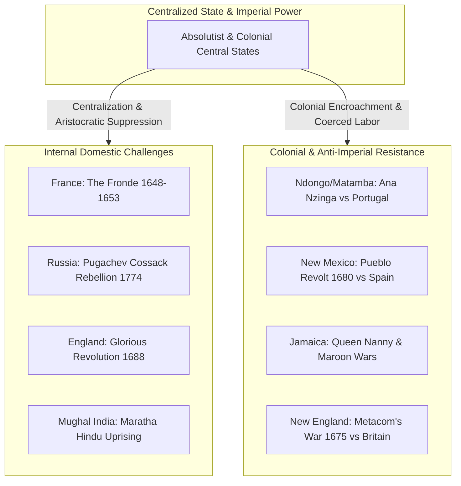
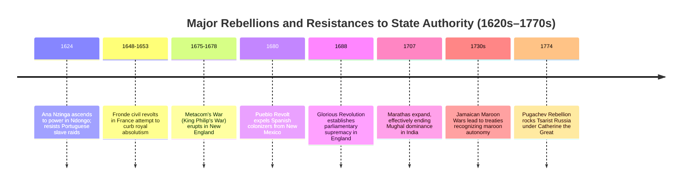

# Topic 4.6: Internal and External Challenges to State Power (c. 1450 to c. 1750)

> **Essential Question**: How did the development of state power result in external and internal challenges in the period between 1450 and 1750?
> *Source Reference: AMSCO AP World History: Modern (Topic 4.6, pp. 243–250) supplemented with College Board AP World History CED Topic 4.6.*

---

## 1. Big Picture Summary
As early modern states consolidated centralized royal authority, imposed heavy taxation, and expanded colonial empires across oceans, they provoked widespread resistance from diverse social and political groups. Challenges took two principal forms: **internal resistance** from domestic elites, oppressed peasants, and subjugated religious groups struggling against absolutist central power (e.g., the Fronde in France, Pugachev’s Rebellion in Russia, the Glorious Revolution in England, and the Maratha uprising against the Mughals), and **external/colonial resistance** from indigenous populations, maroon communities, and rival states contesting European imperial encroachment (e.g., Ana Nzinga in Ndongo/Matamba, Metacom’s War in New England, and the Pueblo Revolt in Spanish New Mexico).

---

## 2. Section-by-Section Breakdown

### A. Resistance in Africa: Queen Ana Nzinga of Ndongo and Matamba
1. **Context of Portuguese Encroachment**:
   - By the early 17th century, the Portuguese intensified slave raiding in south-central Africa (modern Angola) to supply Brazilian sugar plantations.
   - Neighboring African states attacked Ndongo, exacerbating instability.
2. **Nzinga’s Statecraft and Resistance**:
   - In 1624, **Ana Nzinga** became ruler of **Ndongo**. She initially negotiated an alliance with Portugal, agreeing to baptism as a Christian with the Portuguese governor as her godfather to halt slave raids.
   - When the Portuguese betrayed the treaty, Nzinga withdrew her people inland, conquered the neighboring kingdom of **Matamba**, and transformed it into a powerhouse of anti-Portuguese resistance.
   - She incited rebellions in Ndongo, forged a military alliance with the **Dutch**, and offered sanctuary and freedom to runaway enslaved Africans, successfully safeguarding Matamba’s sovereignty for decades.

### B. Internal Challenges and Peasant Revolts in Tsarist Russia
1. **The Expansion of Serfdom and Mirs**:
   - To secure the political loyalty of the noble **boyars**, Russian tsars continually degraded the legal status of peasants.
   - Under the **Law of 1649**, Russian serfs were permanently bound to the land, could be bought and sold independently of estates, and were subjected to corporal punishment by landlords.
   - Village communes (**mirs**) collectively controlled peasant land distribution and tax obligations.
2. **Cossack Rebellions**:
   - **Cossacks**: Runaway serfs and fierce, autonomous democratic horsemen living on the southern treeless steppes near the Black Sea. While tsars hired them as elite mercenary cavalry to conquer Siberia and fight Ottomans, Cossacks fiercely resisted central autocratic control.
   - **Pugachev Rebellion (1774)**: Cossack Yemelyan Pugachev launched a massive peasant uprising against Catherine the Great, falsely claiming to be her assassinated husband, Peter III.
   - Pugachev mobilized disgruntled serfs, ethnic minorities (Bashkirs), and Cossacks, controlling the territory between the Volga River and the Urals.
   - *Outcome*: Imperial armies crushed the rebellion and executed Pugachev. Rather than reforming serfdom, Catherine increased noble control over serfs to cement aristocratic loyalty against future revolts.

### C. Religious and Regional Resistance in South Asia (Mughal Empire)
1. **The Maratha Uprising**:
   - Although the Mughal Empire consolidated northern and central India under a Persianate Muslim elite, the vast majority of the population remained Hindu.
   - Emperor Aurangzeb (reigned 1658–1707) reversed Akbar’s religious tolerance, reimposing the *jizya* tax and destroying Hindu temples.
   - In response, the **Marathas**—a fiercely militarized Hindu warrior group founded by Shivaji—waged prolonged guerrilla warfare against Mughal armies (1680–1707).
   - The Marathas successfully established the independent **Maratha Empire (1674–1818)**, effectively dismantling Mughal hegemony across central India.

### D. Anti-Colonial and Indigenous Resistance in the Spanish Empire
1. **The Pueblo Revolt (1680)**:
   - In Spanish New Mexico, Franciscan friars aggressively suppressed traditional indigenous religious ceremonies, while colonial authorities coerced Pueblo and Apache labor under the encomienda.
   - Led by the religious leader **Popé**, the Pueblo and Apache united in a coordinated surprise uprising, killing over 400 Spanish colonizers, razing Catholic churches, and driving the surviving Spaniards south to El Paso.
   - The Pueblo retained complete independence for twelve years until the Spanish reconquest in 1692. Upon return, the Spanish accommodated indigenous cultural practices and eased labor demands.

### E. Struggles for Power in England and Its Colonies
1. **Maroon Communities and Jamaican Maroon Wars**:
   - **Maroons**: Communities of Africans in the Caribbean who escaped chattel slavery and formed heavily defended independent settlements in mountainous interiors.
   - In Jamaica, **Queen Nanny** united the Windward Maroons and waged guerrilla warfare against British forces (**Maroon Wars**, 1728–1740), forcing the British crown to sign treaties recognizing maroon autonomy.
2. **The Gloucester County Rebellion (1663)**:
   - In Virginia, enslaved Africans and white European indentured servants conspired together to demand freedom from the colonial governor, representing an early multiracial cross-class coalition that terrified the planter elite. The conspiracy was betrayed and crushed before enactment.
3. **Metacom’s War (King Philip’s War, 1675–1678)**:
   - The final armed effort by indigenous New England tribes (Wampanoag, Narragansett), led by Metacom (King Philip), to halt English colonial land encroachment.
   - Resulted in the destruction of 12 English towns and heavy casualties; ended with Metacom's death and the near-total subjugation of southern New England tribes.
4. **The Glorious Revolution (1688–1689)**:
   - An internal English conflict over absolutism and religion. Catholic King James II was deposed by Parliament in favor of his Protestant daughter **Mary II** and her Dutch husband **William of Orange**.
   - Resulted in the passage of the **English Bill of Rights (1689)**, establishing a constitutional monarchy and formalizing parliamentary supremacy over the crown.

---

## 3. Visual Diagrams

### Taxonomy of Resistance to Early Modern State Power

### Chronological Timeline of Major Rebellions

---

## 4. Comparison Table: Major Challenges to State Authority

| Revolt / Conflict | Target State | Leaders / Groups | Grievance / Motivation | Outcome |
| :--- | :--- | :--- | :--- | :--- |
| **Ana Nzinga’s War** | Portuguese Empire | Queen Ana Nzinga (Ndongo/Matamba) | Portuguese slave raids and broken treaties | Sustained Matamba's independence; allied with Dutch |
| **Pugachev Rebellion** | Russian Empire | Yemelyan Pugachev (Cossacks & Serfs) | Noble oppression of serfs; autocratic taxation | Rebellion crushed; Catherine II increased noble power over serfs |
| **Maratha Resistance** | Mughal Empire | Shivaji / Hindu Maratha warriors | Religious intolerance and centralizing Islamic rule | Marathas dismantled Mughal rule; established Maratha Empire |
| **Pueblo Revolt** | Spanish Empire | Popé (Pueblo & Apache) | Religious suppression and forced labor under encomienda | Expelled Spanish for 12 years; Spanish later eased cultural demands |
| **Metacom’s War** | British North America | Metacom / Wampanoag | Colonial land expansion and legal subjugation | Metacom killed; remaining indigenous New England land seized |
| **Glorious Revolution** | English Crown | English Parliament, William & Mary | James II's absolutist Catholic policies | Constitutional monarchy established with English Bill of Rights |

---

## 5. Key Terms

| Term | Category | Historical Significance |
| :--- | :--- | :--- |
| **Ana Nzinga** | Figure/Leader | Sovereign ruler of Ndongo and Matamba who led decades of armed resistance against Portuguese colonization. |
| **Matamba** | African State | Inland African kingdom captured by Nzinga that became a sanctuary for escaped slaves and an anti-Portuguese bastion. |
| **Yemelyan Pugachev** | Rebel Leader | Cossack chieftain who led the largest Russian peasant rebellion (1774) against Catherine the Great. |
| **Pugachev Rebellion** | Uprising | Mass rebellion of serfs and Cossacks that prompted Catherine II to reinforce aristocratic serfdom. |
| **Maratha Empire** | South Asian State | Hindu warrior empire (1674–1818) that broke Mughal hegemony across the Indian subcontinent. |
| **Pueblo Revolt (1680)** | Indigenous Revolt | Successful coordinated uprising in New Mexico that temporarily drove Spanish colonizers out of the region. |
| **Queen Nanny** | Maroon Leader | Legendary leader of the Jamaican Windward Maroons who fought British forces to a standstill. |
| **Maroons** | Social Group | Communities of escaped enslaved Africans who maintained autonomous, armed settlements in the Americas. |
| **Metacom’s War** | Conflict | Armed resistance (1675–1678) led by Wampanoag leader Metacom against Puritan territorial expansion in New England. |
| **Glorious Revolution (1688)** | Political Event | Deposition of Catholic King James II and ascension of William and Mary, establishing English parliamentary supremacy. |