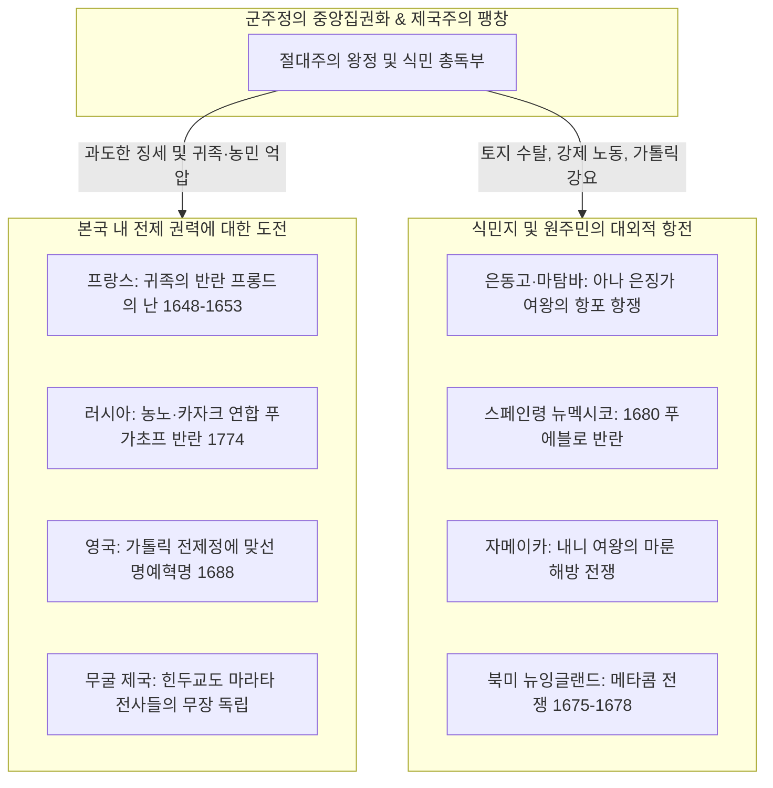
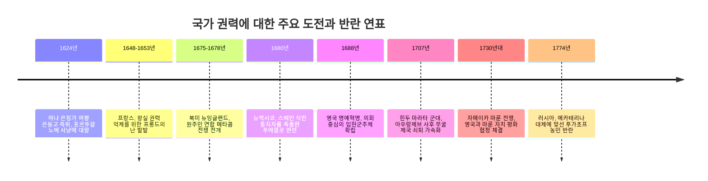

# 토픽 4.6: 국가 권력에 대한 내외의 도전 (Internal and External Challenges to State Power, c. 1450–1750)

> **핵심 질문 (Essential Question)**: 1450년부터 1750년까지 국가 권력의 팽창과 강화는 어떻게 대내외적 저항과 도전을 촉발했는가?
> *출처 안내: AMSCO AP World History: Modern (Topic 4.6, pp. 243–250) 교재 내용 요약 및 College Board AP World History CED 기준 보완.*

---

## 1. 큰 그림 요약 (Big Picture Summary)
근대 초 군주들이 중앙집권적 절대왕정을 확립하고, 과중한 세금을 부과하며, 대양 너머 식민지를 확장하자 이에 맞서 다양한 계층의 격렬한 저항이 일어났습니다. 이러한 도전은 크게 두 가지 형태로 나타났습니다. 첫째는 군주의 절대권력 강화와 농노 착취에 맞선 **국내적 저항(Internal Challenges)**으로, 프랑스의 프롱드의 난, 러시아의 푸가초프 반란, 영국의 명예혁명, 무굴 제국에 맞선 마라타 반란이 이에 해당합니다. 둘째는 유럽 제국주의 침탈과 강제 개종, 노예 사냥에 맞선 **대외적·식민지적 저항(External / Colonial Challenges)**으로, 은동고·마탐바의 아나 은징가 여왕의 항전, 북미의 메타콤 전쟁, 스페인령 뉴멕시코의 푸에블로 반란 등이 전개되었습니다.

---

## 2. 섹션별 정리 (Section-by-Section Breakdown)

### A. 아프리카의 식민 저항: 은동고와 마탐바의 아나 은징가 여왕
1. **포르투갈의 침탈 배경**:
   - 17세기 초 포르투갈은 브라질 설탕 농장에 공급할 노예를 확보하기 위해 남중부 아프리카(현재의 앙골라)에서 무자비한 노예 사냥을 자행했습니다.
   - 주변 부족들의 침략까지 겹쳐 은동고(Ndongo) 왕국은 심각한 위기에 처했습니다.
2. **아나 은징가(Ana Nzinga)의 항쟁과 외교 전략**:
   - 1624년 은동고의 통치자가 된 은징가는 포르투갈과 초기 평화 협정을 맺고 기독교로 개종(포르투갈 총독이 대부)하여 노예 약탈을 중단시키려 했습니다.
   - 포르투갈이 협약을 어기자, 은징가는 백성들을 이끌고 서쪽 내륙으로 이동하여 **마탐바(Matamba)** 왕국을 점령하고 강력한 반포르투갈 항쟁 기지로 재편했습니다.
   - 은징가는 은동고 내 반란을 선동하고, **네덜란드**와 군사 동맹을 맺었으며, 도망친 아프리카 노예들에게 피난처와 자유를 제공하며 수십 년 동안 마탐바의 독립을 지켜냈습니다.

### B. 러시아 제정의 전제 권력 강화와 농민 반란
1. **농노제(Serfdom) 확대와 미르(Mirs)**:
   - 러시아 차르는 귀족(**보야르, Boyars**)의 정치적 충성을 얻기 위해 농민의 법적 권리를 철저히 박탈했습니다.
   - **1649년 법전(Law of 1649)**을 통해 농노는 토지에 영구히 결박되었고, 영주가 농노를 토지와 함께 혹은 단독으로 매매하고 체벌할 수 있게 되었습니다.
   - 촌락 공동체인 **미르(Mirs)**는 농노들의 토지 분배와 공동 납세 의무를 차르 정부 대신 통제했습니다.
2. **카자크(Cossacks)와 푸가초프 반란**:
   - **카자크**: 흑해 인근 남부 초원 지대에서 자유롭게 생활하던 도망 농노 출신의 용맹한 기마 전사 집단입니다. 차르는 시베리아 정복과 오스만 격퇴를 위해 이들을 용병으로 고용했으나, 카자크는 중앙정부의 간섭에 거세게 반발했습니다.
   - **푸가초프 반란 (1774)**: 카자크 출신 예멜리얀 푸가초프(Yemelyan Pugachev)가 예카테리나 대제에 맞서 농민 반란을 일으켰습니다. 그는 자신이 암살당한 황제 표트르 3세라고 사칭했습니다.
   - 푸가초프는 억압받던 농노, 바시키르인 등 소수 민족, 카자크를 규합하여 볼가강과 우랄산맥 사이의 광대한 영토를 일시 장악했습니다.
   - *결과*: 정부군에 의해 진압되어 푸가초프는 처형되었습니다. 예카테리나 2세는 추가 반란을 막기 위해 귀족 계급의 지지가 필수적이라 판단하고, 귀족의 농노 지배권을 오히려 더욱 강화했습니다.

### C. 남아시아의 종교적·민족적 저항: 마라타 제국과 무굴의 쇠퇴
1. **마라타의 무장 봉기**:
   - 무굴 제국은 무슬림 엘리트가 지배했으나 인구의 대다수는 힌두교도였습니다.
   - 아우랑제브 황제(재위 1658–1707)가 악바르 대제의 종교적 관용 정책을 뒤엎고 힌두교도에게 지즈야(이교도세)를 재부과하고 힌두 사원을 파괴하자 강력한 반발이 일어났습니다.
   - 시바지가 창시한 힌두 전사 집단인 **마라타(Marathas)**는 무굴 제국 군대를 상대로 장기간 게릴라 전쟁(1680–1707)을 벌였습니다.
   - 마라타는 무굴 제국을 붕괴 직전으로 몰아넣고 독립적인 **마라타 제국(Maratha Empire, 1674–1818)**을 세워 인도 중부의 패권을 장악했습니다.

### D. 스페인 제국에 맞선 아메리카 원주민의 저항
1. **푸에블로 반란 (Pueblo Revolt, 1680)**:
   - 스페인령 뉴멕시코에서 프란치스코회 수도사들이 원주민 전통 종교 의식을 가혹하게 탄압하고 강제 노동을 강요했습니다.
   - 종교 지도자 **포페(Popé)**의 지휘 아래 푸에블로족과 아파치족이 연합하여 일제히 봉기, 스페인 식민 정착민 400여 명을 사살하고 성당을 불태우며 스페인인들을 엘파소로 축출했습니다.
   - 원주민들은 12년 동안 완전한 자치를 유지했습니다. 1692년 스페인이 이 지역을 재정복했으나, 이후에는 종교적 강요를 완화하고 노동 수탈을 줄이는 등 유화 정책을 취했습니다.

### E. 영국 및 식민지에서의 권력 투쟁
1. **자메이카 마룬 전쟁 (Maroon Wars)**:
   - **마룬(Maroons)**: 카리브해에서 사탕수수 농장을 탈출하여 험준한 산악 지대에 요새화된 독립 공동체를 세운 흑인 노예 탈출 집단.
   - 자메이카의 흑인 여성 지도자 **내니 여왕(Queen Nanny)**은 마룬들을 통합하여 영국군을 상대로 게릴라전을 전개(1728–1740)하였고, 영국 왕실로부터 자치권을 인정받는 조약을 이끌어냈습니다.
2. **글로스터 카운티 반란 모의 (Gloucester County Rebellion, 1663)**:
   - 미국 버지니아에서 흑인 노예들과 백인 유럽인 계약 하인들이 합심하여 자유를 쟁취하기 위해 총독에 맞서 무장 봉기를 모의했습니다. 사전에 발각되어 진압되었으나, 계급 연대 저항의 위험성을 백인 지배층에 각인시켰습니다.
3. **메타콤 전쟁 (Metacom’s War / King Philip’s War, 1675–1678)**:
   - 왐파노아그족 추장 메타콤(영어명 필립 왕)이 영국의 끝없는 토지 침탈에 맞서 뉴잉글랜드 원주민들을 규합하여 벌인 최후의 대규모 무장 저항. 12개 정착촌이 파괴되는 격전 끝에 패배하여 남부 뉴잉글랜드 원주민 사회가 완전히 와해되었습니다.
4. **명예혁명 (Glorious Revolution, 1688–1689)**:
   - 가톨릭 절대주의를 부활시키려던 제임스 2세를 영국 의회가 무혈 축출하고, 개신교도인 **메리 2세**와 네덜란드 총독 **빌럼(윌리엄 3세)**을 공동 군주로 추대한 사건.
   - **권리장전(English Bill of Rights, 1689)**이 통과되어 국왕의 자의적 과세권이 박탈되고 의회 우위의 입헌군주제가 확립되었습니다.

---

## 3. 시각 자료 (Mermaid Diagrams)

### 근대 초기 국가 권력에 대한 저항 분류도

### 주요 반란 및 저항 사건 연표

---

## 4. 국가 권력에 대한 주요 도전 사례 비교표 (Comparison Table)

| 사건명 | 대항 대상 국가 | 주도 지도자 및 집단 | 핵심 저항 원인 | 최종 결과 및 역사적 영향 |
| :--- | :--- | :--- | :--- | :--- |
| **아나 은징가의 항쟁** | 포르투갈 제국 | 아나 은징가 여왕 (은동고/마탐바) | 포르투갈의 불법 노예 약탈 및 영토 침범 | 마탐바 독립 유지, 네덜란드와 동맹 체결 |
| **푸가초프 반란** | 러시아 제국 | 예멜리얀 푸가초프 (카자크·농노) | 영주의 가혹한 농노 수탈 및 전제정 과세 | 진압 및 푸가초프 처형; 귀족의 농노 지배권 강화 |
| **마라타의 저항** | 무굴 제국 | 시바지 / 힌두 마라타 전사들 | 아우랑제브 황제의 힌두교 탄압 및 전제 통치 | 마라타 제국 수립; 무굴 제국의 실질적 몰락 |
| **푸에블로 반란** | 스페인 제국 | 포페 (푸에블로족 및 아파치족) | 가톨릭 강제 개종 및 엔코미엔다 강제 노동 | 12년간 자치 유지; 스페인의 원주민 유화 정책 유도 |
| **메타콤 전쟁** | 영국 북미 식민지 | 메타콤 (왐파노아그족 등) | 영국 정착민들의 끝없는 토지 잠식과 법적 억압 | 메타콤 전사; 남부 뉴잉글랜드 원주민 토지 완전 상실 |
| **명예혁명** | 영국 왕실 (스튜어트가) | 영국 의회, 윌리엄 3세 & 메리 2세 | 제임스 2세의 친가톨릭 정책 및 전제군주정 기도 | 의회 권리장전 제정 및 입헌군주제 완성 |

---

## 5. 핵심 용어 표 (Key Terms)

| 용어 | 분류 | 역사적 의미 및 중요성 |
| :--- | :--- | :--- |
| **아나 은징가 (Ana Nzinga)** | 역사적 인물 | 은동고와 마탐바의 통치자로 외교와 군사 전략을 통해 포르투갈 침략에 맞선 여왕. |
| **마탐바 (Matamba)** | 아프리카 국가 | 은징가가 장악하여 도망 노예들에게 자유를 보장하고 반포르투갈 항전을 이끈 내륙 왕국. |
| **예멜리얀 푸가초프 (Yemelyan Pugachev)** | 반란 지도자 | 표트르 3세를 사칭하여 예카테리나 2세의 농노제 강화에 맞서 대규모 농민 반란을 일으킨 카자크. |
| **푸가초프 반란 (Pugachev Rebellion, 1774)** | 민중 봉기 | 러시아 농노와 소수 민족이 전제정에 대항한 최대 규모 반란으로, 역설적으로 농노제 강화를 초래함. |
| **마라타 제국 (Maratha Empire)** | 남아시아 국가 | 무굴 제국의 이슬람 지배와 탄압에 맞서 힌두 전사들이 수립한 제국 (1674–1818). |
| **푸에블로 반란 (Pueblo Revolt, 1680)** | 원주민 봉기 | 뉴멕시코 원주민들이 스페인 정복자들을 몰아내고 12년간 독립을 유지한 북미 최대 원주민 반란. |
| **내니 여왕 (Queen Nanny)** | 저항 지도자 | 자메이카 마룬 공동체를 이끌고 영국군에 맞서 게릴라전을 벌여 자치권을 획득한 여성 영웅. |
| **마룬 (Maroons)** | 사회 집단 | 카리브해와 아메리카 대륙에서 사탕수수 플랜테이션을 탈출해 자치 공동체를 형성한 탈주 흑인 노예. |
| **메타콤 전쟁 (Metacom’s War)** | 원주민 전쟁 | 1675~1678년 뉴잉글랜드 청교도 정착민의 토지 확장에 맞서 메타콤 추장이 벌인 최후의 혈전. |
| **명예혁명 (Glorious Revolution, 1688)** | 정치 혁명 | 전제군주 제임스 2세를 피 흘림 없이 축출하고 의회 권리장전을 제정해 입헌군주제를 확립한 혁명. |