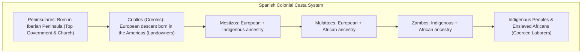
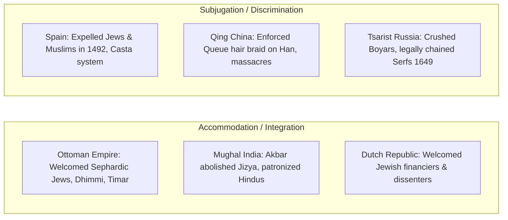

# Topic 4.7: Changing Social Hierarchies (c. 1450 to c. 1750)

> **Essential Question**: How were social categories, roles, and practices maintained or changed from 1450 to 1750?
> *Source Reference: AMSCO AP World History: Modern (Topic 4.7, pp. 251–260) supplemented with College Board AP World History CED Topic 4.7.*

---

## 1. Big Picture Summary
Between 1450 and 1750, the consolidation of gunpowder states, maritime empires, and transoceanic demographic movements profoundly reshaped social hierarchies across the globe. Some states accommodated ethnic and religious diversity to utilize specialized economic talents (e.g., Ottoman welcoming of Sephardic Jews and Mughal religious syncretism under Akbar), while others enforced aggressive religious or ethnic subjugation (e.g., the expulsion of Jews and Muslims from Spain, Manchu enforcement of the queue in Qing China, and Russian subjection of boyars and serfs). In the Americas, the convergence of European settlers, enslaved Africans, and surviving indigenous populations gave rise to a rigid, race- and ancestry-based social hierarchy known as the **Casta system**.

---

## 2. Section-by-Section Breakdown

### A. Gunpowder Empires: Social Stratification and Religious Minorities
1. **The Ottoman Empire**:
   - **Internal Power Dynamics**: Tension between the warrior aristocracy, Islamic legal scholars (**ulama**), and the elite military slave corps (**Janissaries**), who frequently staged coups against weak sultans.
   - **Imperial Administration**: Capable grand **viziers** often held operational power; sultans granted land and tax revenues through the **timar system** to maintain elite military loyalty.
   - **Religious Minorities**: In contrast to Western Europe (which expelled Jews from England in 1290, France in 1394, and Spain in 1492), Sultan **Mehmed II** welcomed exiled Sephardic Jews to Istanbul. Jewish scholars and physicians served as court advisors and introduced the printing press. While protected under the *dhimmi* status, minorities faced inequalities: they paid the **jizya** tax, were confined to specific urban quarters, and could not hold top imperial offices.
   - **Women and "Harem Politics"**: Elite concubines and wives wielded substantial behind-the-scenes political power. **Roxelana** (Hurrem Sultan), an enslaved Ukrainian captive who entered Sultan Suleiman the Magnificent's harem, married the sultan, sponsored major civic public works, and maneuvered her son onto the throne, ushering in the era known as the "Sultanate of Women."
   - **Slaves & Barbary Pirates**: Ottoman galley fleets and Mediterranean markets relied on impressed captives seized by Barbary pirates along the North African coast.
2. **The Mughal Empire**:
   - Ruled by a Muslim minority over a Hindu majority.
   - **Akbar the Great (1556–1605)**: Practiced radical religious toleration to unify the empire; abolished the *jizya* tax, granted land and funds to Hindu temples and Catholic churches, sponsored interfaith debates at the *Ibadat Khana*, and supported Sikhism.

### B. Manchu Dominance and Ethnic Tensions in Qing China
1. **Ethnic Rule over the Han Majority**:
   - The Manchu minority from Manchuria conquered China, establishing the Qing Dynasty (1644–1912).
   - Although maintaining continuities—such as the Confucian civil service examinations and recruiting Han Chinese into the civil bureaucracy alongside Manchus—the Qing strictly preserved Manchu ethnic superiority.
2. **Enforcement of the Queue**:
   - The Qing mandated that all Han Chinese men shave their foreheads and braid their hair into the traditional Manchu **queue**.
   - Wearing the queue served as an enforced test of political loyalty; refusal was treason punishable by immediate execution ("Keep your hair and lose your head, or lose your hair and keep your head").
   - Resistance was ruthlessly crushed, as in the brutal massacres of Han populations in Jaiding and Jiangyin carried out by Han defector generals (Li Chengdong and Liu Liangzuo).

### C. European Social Hierarchies: Nobility vs. Monarchy
1. **Nobility vs. Absolutist Monarchs**:
   - European nobility maintained inherited lands and legal tax exemptions.
   - Monarchy centralization eroded noble military power: gunpowder and siege artillery allowed monarchs to destroy noble stone castles.
   - In France, **Louis XIV** epitomized royal absolutism ("L'état, c'est moi" - "I am the state"), forcing the nobility to reside at Versailles to keep them under constant surveillance. In contrast, **Frederick II of Prussia** branded himself the "first servant of the state."
   - In England and the Netherlands, wealthy landowning aristocrats retained direct legislative power through Parliament and provincial assemblies.
2. **Jewish Minorities in Europe**:
   - After the 1492 expulsion from Spain, **Sephardic Jews** dispersed across North Africa, the Ottoman Empire, and the Netherlands. Central and Eastern European Jews became known as **Ashkenazi Jews**.
   - The Enlightenment and Scientific Revolution gradually reduced anti-Semitic prejudices; Jewish merchants became vital to Dutch and English commerce and banking.

### D. Tsarist Russia: Boyars and Serfdom
1. **The Boyar Class**:
   - Traditional landowning noble elite of Moscow.
   - **Ivan IV ("Ivan the Terrible")**: Crushed boyar resistance, confiscated lands from Novgorod boyars after their defeat, and forced noble families to move to Moscow under state surveillance.
2. **Entrenchment of Serfdom**:
   - While serfdom faded in Western Europe (Elizabeth I freed the last English serfs in 1574), Russia institutionalized serfdom through the Law of 1649 to appease the boyars.

### E. Social Hierarchies in the Americas: The Casta System
1. **Origins of Racial Stratification**:
   - The convergence of European colonizers, enslaved Africans, and indigenous Americans produced a rigid social hierarchy based strictly on racial ancestry and skin color.
2. **The Casta Pyramid (from top to bottom)**:
   - **Peninsulares**: European-born Spaniards or Portuguese living in the Americas; held top government and church administrative posts.
   - **Criollos (Creoles)**: Individuals of pure European descent born in the Americas; wealthy landowners and mine operators, but barred from the highest viceregal offices.
   - **Castas (Mixed-Race Groups)**:
     - **Mestizos**: Mixed European and indigenous ancestry.
     - **Mulattoes**: Mixed European and African ancestry.
     - **Zambos**: Mixed indigenous and African ancestry.
   - **Bottom Tiers**: Subjugated Indigenous peoples and Enslaved Africans, subject to coerced labor, tribute, and systemic legal discrimination.

---

## 3. Visual Diagrams

### Latin American Casta Pyramid

### Contrast in Early Modern State Policy Toward Minorities

---

## 4. Comparison Table: Treatment of Religious & Ethnic Groups

| State / Empire | Group | Policy / Social Position | Motivation / Political Logic |
| :--- | :--- | :--- | :--- |
| **Ottoman Empire** | Sephardic Jews | Welcomed by Mehmed II; paid jizya; lived in designated quarters | Utilized medical, financial, and diplomatic expertise |
| **Mughal Empire** | Hindu Majority | Akbar repealed jizya, intermarried, built temples | Preserved stability in a fractured, Hindu-majority empire |
| **Qing China** | Han Majority | Maintained civil service exams; enforced Manchu queue under penalty of death | Demonstrated political submission to Manchu ruling minority |
| **Spanish Empire** | Jews & Muslims | Expelled in 1492 (*Reconquista*); pursued by Inquisition | Enforced Catholic religious uniformity under royal absolutism |
| **Spanish Americas** | Mestizos / Mulattoes | Classified under legal Casta system; restricted from high office | Preserved socio-economic dominance of pure European blood (*limpieza de sangre*) |
| **Tsarist Russia** | Serfs | Bound to land (1649); bought/sold; lacked legal protection | Secured political loyalty of boyar nobility to tsarist autocracy |

---

## 5. Key Terms

| Term | Category | Historical Significance |
| :--- | :--- | :--- |
| **Casta System** | Social Structure | Racial hierarchy in colonial Latin America determining legal rights based on bloodline. |
| **Peninsulares** | Social Class | Iberian-born Spaniards holding supreme administrative and judicial offices in the Americas. |
| **Criollos (Creoles)** | Social Class | People of pure Spanish blood born in the Americas who controlled land and commerce. |
| **Mestizos** | Social Class | Persons of mixed European and indigenous ancestry occupying intermediate social tiers. |
| **Mulattoes** | Social Class | Persons of mixed European and African heritage in colonial Atlantic societies. |
| **Queue** | Cultural Policy | Mandatory braided pigtail hairstyle imposed by the Qing on Han men as a symbol of submission. |
| **Harem Politics** | Political/Gender | The exercise of imperial power by wives and mothers of Ottoman sultans within royal residences. |
| **Roxelana** | Historical Figure | Enslaved captive who married Suleiman the Magnificent, illustrating rare social mobility. |
| **Timar** | Economic Grant | Ottoman system granting land revenue to favored military cavalrymen to maintain elite loyalty. |
| **Boyars** | Social Class | Traditional Russian noble landowning aristocracy subordinated by Ivan IV and Peter I. |