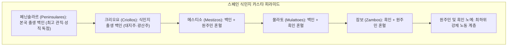
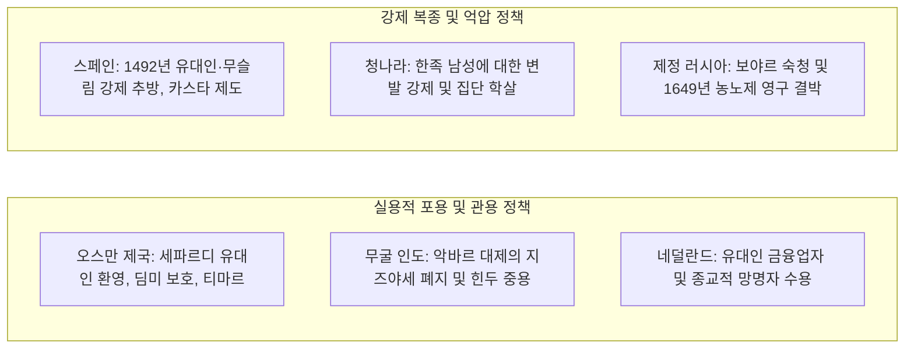

# 토픽 4.7: 사회적 위계질서의 변화 (Changing Social Hierarchies, c. 1450–1750)

> **핵심 질문 (Essential Question)**: 1450년부터 1750년까지 사회 계층, 역할, 관행은 어떻게 유지되거나 변화했는가?
> *출처 안내: AMSCO AP World History: Modern (Topic 4.7, pp. 251–260) 교재 내용 요약 및 College Board AP World History CED 기준 보완.*

---

## 1. 큰 그림 요약 (Big Picture Summary)
1450년부터 1750년 사이 화약 제국의 팽창, 해양 식민지 개척, 전 지구적 인구 이동은 세계 각국의 사회적 위계질서를 근본적으로 뒤흔들었습니다. 오스만 제국(스페인에서 추방된 유대인 수용)과 무굴 제국(악바르 대제의 종교적 관용)처럼 제국 통치를 위해 소수 집단의 전문 지식과 경제력을 포용하는 국가가 있었던 반면, 스페인(1492년 유대인·무슬림 추방), 청나라(한족에게 변발 강요), 러시아(농노제 법제화)처럼 엄격한 민족·종교적 복종을 강요하는 국가도 있었습니다. 특히 아메리카 대륙에서는 유럽 백인, 아프리카 흑인, 원주민 간의 접촉으로 인종과 혈통에 따라 법적 권리와 특권이 엄격히 나뉘는 **카스타 제도(Casta system)**라는 미증유의 인종 피라미드가 확립되었습니다.

---

## 2. 섹션별 정리 (Section-by-Section Breakdown)

### A. 화약 제국의 사회 계층과 소수 집단
1. **오스만 제국의 권력 구도와 사회 구조**:
   - **엘리트 간 권력 경쟁**: 전통 기마 전사 귀족, 이슬람 법학자 집단인 **울라마(Ulama)**, 그리고 술탄의 정예 노예 군대인 **예니체리(Janissaries)** 사이에 권력 투쟁이 상존했으며, 예니체리는 종종 쿠데타를 일으켜 술탄을 폐위시켰습니다.
   - **관료제와 티마르 제도**: 실무 최고 책임자인 대재상(**비지르, Viziers**)이 막강한 영향력을 행사했으며, 술탄은 군사적 충성을 유지하기 위해 **티마르(Timar)**라는 토지 조세 징수권을 기병들에게 분배했습니다.
   - **종교적 소수자 대우**: 1492년 스페인 가톨릭 왕정이 유대인을 추방하자, 오스만의 술탄 **메흐메트 2세**는 스페인계 유대인(**세파르디 유대인, Sephardic Jews**)을 이스탄불로 대거 초빙했습니다. 유대인들은 궁정 의사, 외교관으로 활약하고 인쇄술을 도입했습니다. 소수 종교인은 *딤미(Dhimmi)*로서 신앙의 자유를 누렸으나, **지즈야(Jizya)**세를 납부해야 했고, 지정된 구역에 거주해야 했으며, 최고위 군사 관직 진출은 제한되었습니다.
   - **여성과 "하렘 정치(Harem Politics)"**: 술탄의 모후와 부인들은 궁정 배후에서 막강한 정치적 실권을 행사했습니다. 우크라이나 출신 노예로 술탄 쉴레이만 1세의 하렘에 들어간 **록셀라나(Roxelana / 휩렘 술탄)**는 정식 황후가 되어 대규모 공공사업을 후원하고 아들을 차기 술탄으로 즉위시켜 '여인들의 술탄 시대'를 열었습니다.
   - **바르바리 해적(Barbary Pirates)**: 북아프리카 해안의 해적들이 지중해와 대서양에서 유럽인 100만 명 이상을 납치하여 갈레온선 노예나 술탄의 노예로 매각했습니다.
2. **무굴 제국의 종교적 융합과 사회 정책**:
   - 무슬림 소수가 힌두교 다수를 통치하는 구조였습니다.
   - **악바르 대제(Akbar the Great, 1556–1605)**: 분열을 막기 위해 파격적인 종교 관용을 시행하여 지즈야세를 폐지하고, 힌두 사원과 가톨릭 성당 건축을 재정 지원했으며, 힌두 공주와 정략결혼을 맺고 시크교를 공인했습니다.

### B. 청나라의 만주족 지배와 한족 탄압
1. **소수 만주족의 한족 지배**:
   - 만주에서 발흥한 만주족이 명나라를 멸망시키고 청나라(1644–1912)를 건국했습니다.
   - 유교 과거제와 관료제를 유지하고 한족 관리를 등용하는 등 제도적 연속성을 유지했으나, 최고 권력은 철저히 만주족이 독점했습니다.
2. **변발령(Queue)의 강제와 저항 탄압**:
   - 청 왕조는 모든 한족 남성에게 이마를 깎고 머리를 땋아 늘어뜨리는 만주족 고유의 **변발(Queue)**을 강제했습니다.
   - 변발은 만주족 황제에 대한 절대적 복종의 상징이었으며, 이를 거부하는 자는 "머리를 남기려면 목을 내놓고, 목을 남기려면 머리를 깎아라(留頭不留髮, 留髮不留頭)"라며 즉각 사형에 처했습니다.
   - 강남의 가정(Jiading), 강음(Jiangyin) 등지에서 변발에 저항한 한족 수만 명이 만주족에게 투항한 한족 출신 장군(이성동, 유양좌)들에 의해 잔혹하게 학살당했습니다.

### C. 유럽의 사회 위계: 군주와 귀족의 갈등
1. **절대군주와 귀족 계급의 대립**:
   - 화포 기술과 상비군의 발달로 귀족의 봉건 성채가 무력화되면서 군주의 중앙집권 권력이 비약적으로 성장했습니다.
   - 프랑스의 **루이 14세**는 "짐이 곧 국가다(L'état, c'est moi)"라고 선언하고, 베르사유 궁전을 지어 귀족들을 입주시켜 사치 경쟁에 빠뜨림으로써 정치적 반란을 무력화했습니다. 반면 프로이센의 **프리드리히 2세**는 스스로를 "국가 제1의 공복"이라 칭했습니다.
   - 영국과 네덜란드에서는 부유한 대지주와 상인 계급이 의회를 통해 국왕의 권력을 견제하며 기득권을 수호했습니다.
2. **유럽 내 유대인의 지위 변화**:
   - 이베리아반도에서 추방된 **세파르디 유대인**과 중·동부 유럽의 **아슈케나지 유대인(Ashkenazi Jews)**으로 분화되었습니다. 계몽주의 확산과 상업 자본주의 발달로 네덜란드와 영국 등에서 유대인 금융업자들의 활동 공간이 확대되었습니다.

### D. 제정 러시아의 사회 계층: 보야르와 농노제
1. **보야르(Boyars) 귀족 계급**:
   - 전통 대토지 귀족인 보야르는 차르의 중앙집권화 정책과 끊임없이 충돌했습니다. **이반 4세(뇌제)**는 노브고로드 보야르들을 무력 진압하고 영지를 몰수하여 모스크바로 강제 이주시킨 뒤 감시했습니다.
2. **농노제의 법제화**:
   - 서유럽에서 농노제가 소멸하던 것과 정반대로, 러시아는 귀족들의 충성을 대가로 **1649년 법전**을 제정하여 농노를 토지에 영구히 결속시켰습니다.

### E. 아메리카 식민지의 인종 기반 카스타(Casta) 제도
1. **인종 위계질서의 형성**:
   - 스페인·포르투갈 정복자, 아프리카 흑인 노예, 생존 원주민 간의 혼혈이 광범위하게 발생하자, 인종적 순수성(피의 순결)과 출생지에 따라 법적 권리를 차등화한 **카스타(Casta) 제도**를 제도화했습니다.
2. **카스타 계급 피라미드 (위에서 아래로)**:
   - **페닌술라르 (Peninsulares)**: 이베리아반도 본국에서 태어난 순수 백인으로, 부왕령의 총독, 대주교 등 최고위 관직 독점.
   - **크리오요 (Criollos / Creoles)**: 아메리카 대륙에서 태어난 순수 스페인계 백인으로, 대농장(하시엔다)과 광산을 소유한 부유층이나 최고위 관직에서는 배제됨.
   - **카스타 (Castas - 혼혈 계층)**:
     - **메스티소 (Mestizos)**: 백인과 아메리카 원주민 사이의 혼혈.
     - **물라토 (Mulattoes)**: 백인과 아프리카 흑인 사이의 혼혈.
     - **잠보 (Zambos)**: 아프리카 흑인과 원주민 사이의 혼혈.
   - **최하위 계층**: 지배와 수탈의 대상이었던 **순수 아메리카 원주민**과 **아프리카 흑인 노예**.

---

## 3. 시각 자료 (Mermaid Diagrams)

### 라틴아메리카 카스타(Casta) 신분 피라미드

### 소수 집단에 대한 국가 정책 비교도

---

## 4. 근대 초기 주요 제국의 소수자·사회 계층 정책 비교표 (Comparison Table)

| 제국 / 국가 | 대상 집단 | 시행 정책 및 사회적 지위 | 국가의 정책적 의도 및 배경 |
| :--- | :--- | :--- | :--- |
| **오스만 제국** | 세파르디 유대인 | 메흐메트 2세의 정착 장려; 지즈야세 납부; 신앙 인정 | 의학, 금융, 외교, 인쇄 등 전문 역량 국가 활용 |
| **무굴 제국** | 힌두교도 대다수 | 악바르 대제의 지즈야세 폐지, 사원 건축 지원 | 힌두교 인구가 대다수인 제국의 정치적 안정과 통합 |
| **청나라** | 피지배 한족 | 과거제 유지로 한족 관료 등용; **변발령** 강제 집행 | 소수 만주족에 대한 정치적 복종 확인 및 체제 안정 |
| **스페인 제국** | 유대인 및 무슬림 | 1492년 강제 추방; 개종자(콘베르소) 종교재판소 감시 | 절대왕정의 가톨릭 신앙 단일화 및 영토 통일 완성 |
| **스페인령 아메리카** | 혼혈 계층 (카스타) | 인종 비율에 따른 법적 차별; 고위 공직 취임 금지 | 소수 순수 백인 지배층의 토지와 정치 권력 영구 독점 |
| **제정 러시아** | 농민 (농노) | 1649년 법전으로 토지 결박 및 영주의 매매권 허용 | 전제군주정에 대한 보야르 귀족 계급의 충성 확보 |

---

## 5. 핵심 용어 표 (Key Terms)

| 용어 | 분류 | 역사적 의미 및 중요성 |
| :--- | :--- | :--- |
| **카스타 제도 (Casta System)** | 사회 체제 | 혈통과 피부색에 따라 법적 권리와 사회적 위계를 구분한 라틴아메리카의 인종 위계제. |
| **페닌술라르 (Peninsulares)** | 사회 계급 | 이베리아반도 본국 출신 백인으로, 식민지 최고위 행정관과 고위 성직을 독점함. |
| **크리오요 (Criollos / Creoles)** | 사회 계급 | 아메리카 대륙에서 태어난 스페인계 백인으로 대지주 계층을 형성했으나 최고위직 진출은 제한됨. |
| **메스티소 (Mestizos)** | 혼혈 계층 | 유럽인 백인과 아메리카 원주민 사이에서 태어난 자손으로 중간 계층 형성. |
| **물라토 (Mulattoes)** | 혼혈 계층 | 유럽인 백인과 아프리카 흑인 사이에서 태어난 자손. |
| **변발 (Queue)** | 문화/정치 | 청나라가 한족 남성들에게 강제한 만주족 고유의 땋은 머리로, 불복종 시 사형에 처함. |
| **하렘 정치 (Harem Politics)** | 정치/여성 | 오스만 제국 황실 후궁과 모후들이 궁정 배후에서 술탄 계승과 국정에 막대한 영향력을 행사한 현상. |
| **록셀라나 (Roxelana)** | 역사적 인물 | 우크라이나 노예 출신으로 쉴레이만 1세와 정식 결혼하여 국정을 좌우한 오스만의 전설적 황후. |
| **티마르 (Timar)** | 토지 제도 | 오스만 술탄이 군사적 충성을 대가로 기병 전사들에게 분배한 토지 조세 징수권. |
| **보야르 (Boyars)** | 귀족 계급 | 중세 이래 러시아의 대토지를 소유하던 전통 귀족 계급으로 이반 4세와 표트르 대제에 의해 굴복됨. |