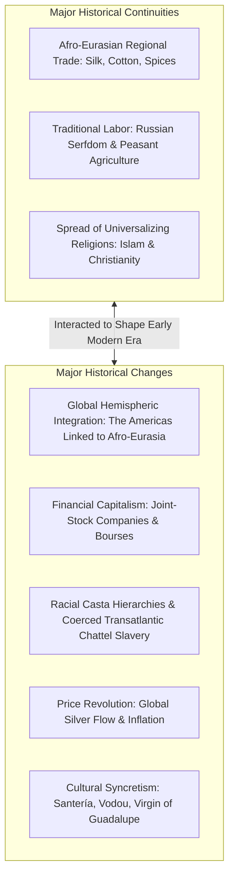
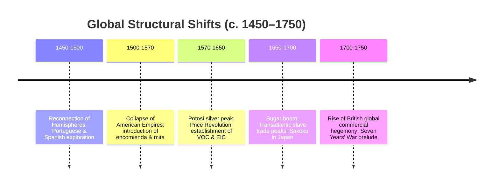

# Topic 4.8: Continuity and Change from c. 1450 to c. 1750

> **Essential Question**: How did economic developments from 1450 to 1750 affect social structures over time?
> *Source Reference: AMSCO AP World History: Modern (Topic 4.8, pp. 261–264; Unit 4 Review, p. 265) supplemented with College Board AP World History CED Topic 4.8.*

---

## 1. Big Picture Summary
The period from 1450 to 1750 marked the definitive transition to a connected global economy. The defining transformation was the integration of the Western Hemisphere into Afro-Eurasian maritime networks through the Columbian Exchange and the Atlantic System. While traditional land-based regional commerce, religious practices, and localized peasant agriculture exhibited profound **continuities**, revolutionary **changes** occurred in global finance, labor organization, and social hierarchies. European mercantilism laid the institutional groundwork for commercial capitalism via joint-stock chartered companies. Simultaneously, the immense demand for cash crops (sugar, tobacco) and silver extraction intensified coercive labor regimes, producing racially stratified colonial caste systems in the Americas and demographic shocks in West Africa.

---

## 2. Section-by-Section Breakdown

### A. Transoceanic Travel, Trade, and Economic Syntheses
1. **Technological Synthesis & Oceanic Integration**:
   - Navigation relied on borrowed and refined cross-cultural tools: **astronomical charts**, **astrolabes**, **magnetic compasses**, and **lateen sails**.
   - Specialized ship designs enabled specialized oceanic roles: Portuguese **caravels** and **carracks** for exploration and armed defense; Dutch **fluyts** for maximized, low-cost commercial shipping.
2. **Shift from Mercantilism toward Commercial Capitalism**:
   - Monarchy-directed mercantilist policies (aimed at hoarding bullion through protectionist tariffs and royal monopolies) gradually yielded to private **commercial capitalism**.
   - **Joint-stock chartered companies** (EIC, VOC) mobilized private investment through public equity and limited liability, eclipsing state-run treasuries in efficiency.
3. **The Global Silver Engine**:
   - The tripling of physical silver in the 16th-century global economy fueled transoceanic trade.
   - Silver flowed from Potosí and Zacatecas across the Atlantic to Europe and across the Pacific via the Manila Galleons to Qing China, functioning as the premier international monetary standard.
   - *Negative Economic Effects*: Hyperinflation hit both Spain (eroding domestic manufacturing) and Ming/Qing China.

### B. Continuities and Changes in Trade Networks
1. **Changes**:
   - European merchants established themselves as dominant oceanic carriers, extracting profits by moving commodities between continents and disrupting Arab, Indian, and Swahili maritime monopolies.
   - Formation of the **Atlantic System**: A triangular web coordinating European capital/firearms, African forced labor, and American raw commodities.
2. **Continuities**:
   - Despite European armed merchant presence, **intra-Asian and regional overland trade flourished**: Indian cotton, Chinese silk/porcelain, and Middle Eastern rugs continued to dominate domestic consumption across Afro-Eurasia.
   - European merchants often operated as regional middlemen (*peddlers/carriers*) within established Asian trade routes, subject to the customs laws of powerful land-based empires.

### C. Continuities and Changes in Labor Systems and Social Hierarchies
1. **Continuities in Coerced Labor**:
   - Traditional unfree labor systems persisted in Afro-Eurasia: **serfdom** was legally expanded and entrenched in Tsarist Russia (Law of 1649); Mediterranean galley fleets continued using impressed convict/slave labor.
2. **Radical Changes in Labor**:
   - Scale and brutality of labor intensified to service global capitalist markets.
   - Proliferation of American coerced labor systems: **chattel slavery** (hereditary property), European **indentured servitude**, Spanish **encomienda**, private debt peonage in **haciendas**, and the adapted Incan **mita** in silver mines.
3. **New Social Hierarchies**:
   - In the Americas, social status was reorganized around racial purity and skin color, institutionalized in the **Casta system** (Peninsulares -> Criollos -> Mestizos -> Mulattoes -> Indigenous & Enslaved Africans).
   - In Europe, mercantile wealth empowered a rising **bourgeois middle class**, funding public arts (e.g., Rembrandt and Dutch Golden Age masters) and setting the stage for political revolutions after 1750.
   - In West Africa, slave raiding created severe gender imbalances, expanding **polygyny** and altering women’s economic responsibilities.

### D. Cultural and Religious Syncretism
1. **Continuities**: Monotheistic world religions (Christianity, Islam) continued aggressive geographic spread.
2. **Changes (Syncretic Belief Systems)**:
   - African diaspora traditions fused with Roman Catholicism in the Americas, giving rise to syncretic spiritual practices: **Santería** (Cuba), **Vodou** (Haiti), and **Candomblé** (Brazil).
   - In Mexico, indigenous Marian devotion merged with native Nahua symbolism to form the veneration of the **Virgin of Guadalupe**.

### E. Historiographical Debate: The Spanish Empire and the "Black Legend"
1. **Bartolomé de Las Casas (1552)**: Dominican friar whose *A Short Account of the Destruction of the Indies* detailed horrific Spanish cruelties against native populations.
2. **The Black Legend (*La Leyenda Negra*)**: Coined by Julián Juderías (1914); argued that Protestant rivals (England, Netherlands) exaggerated Spanish atrocities out of geopolitical jealousy and religious anti-Catholic bias.
3. **The "White Legend" vs. Modern Consensus**: Pro-Spanish apologists minimized abuses by highlighting Spanish legal protections and missionary efforts (Lewis Hanke); contemporary global historians note that systemic colonial cruelty, forced labor, and ecological devastation were pervasive across *all* European maritime empires.

---

## 3. Visual Diagrams

### Continuity and Change Matrix (1450–1750)

### Synthesis of Global Macro-Developments

---

## 4. Comprehensive Comparison Table: Continuity vs. Change (1450–1750)

| Historical Domain | Major Continuities | Major Changes |
| :--- | :--- | :--- |
| **Global Trade Networks** | Intra-Asian maritime trade (Indian Ocean) and overland Silk Roads remained active. | Permanent biological and commercial integration of the Americas (Atlantic System). |
| **Monetary & Financial Systems** | Regional barter and local coinage continued in rural agrarian markets. | Global silver currency standard; emergence of joint-stock companies and stock exchanges. |
| **Labor Systems** | Peasant agricultural labor and Russian serfdom persisted in Afro-Eurasia. | Mass transatlantic chattel slavery; industrial plantation engenhos; colonial silver mita. |
| **Social Hierarchies** | Landed aristocrats and monarchies maintained political dominance in Eurasia. | Rise of racial Casta hierarchy in Americas; empowerment of European urban bourgeoisie. |
| **Cultural & Religious Practices** | Traditional Confucianism, Hinduism, and Islamic legal systems (*sharia*) endured. | Religious syncretism in the Americas (Santería, Vodou, Virgin of Guadalupe). |

---

## 5. Key Terms

| Term | Category | Historical Significance |
| :--- | :--- | :--- |
| **Atlantic System** | Economic Network | The integrated transoceanic trade network linking Europe, Africa, and the Americas. |
| **Commercial Capitalism** | Economic System | Economic order centered on capital accumulation, private market investment, and joint-stock trade. |
| **Santería** | Syncretic Religion | Afro-Cuban religion blending West African Yoruba spiritual traditions with Roman Catholic saints. |
| **Vodou (Voodoo)** | Syncretic Religion | Afro-Haitian spiritual system fusing Dahomey/Central African animism with French Catholicism. |
| **Virgin of Guadalupe** | Cultural Syncretism | Apparition of the Virgin Mary in Mexico blending Catholic theology with indigenous Nahua imagery. |
| **The Black Legend** | Historiography | The historiographical argument that Protestant rivals exaggerated Spanish colonial brutality. |
| **Bartolomé de Las Casas** | Figure/Reformer | Spanish Dominican friar who documented and passionately condemned the abuse of indigenous peoples. |
| **Lewis Hanke** | Historiography | Historian who emphasized Spanish humanitarian reform attempts and Christian legal debates. |
| **Chartered Monopolies** | Economic Policy | Exclusive commercial trading privileges granted by royal governments to private joint-stock companies. |
| **Bourgeoisie** | Social Class | The emerging European middle class of merchants, investors, and financiers enriched by global trade. |