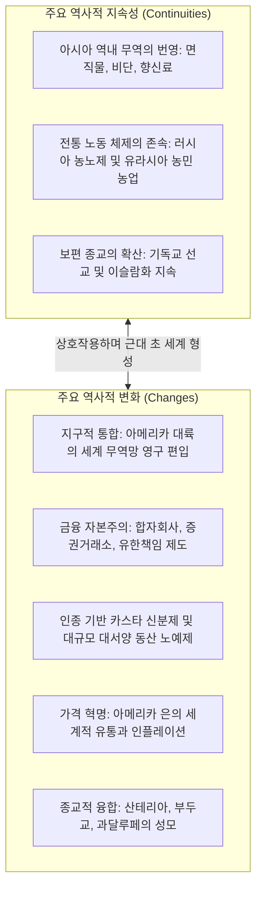
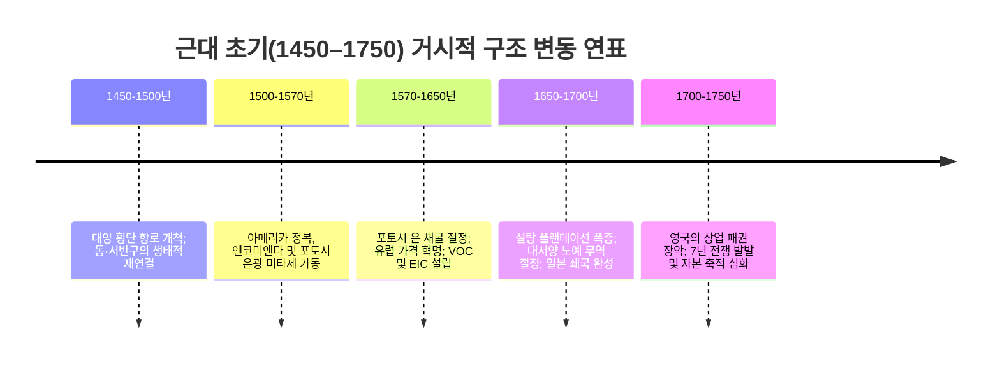

# 토픽 4.8: 1450~1750년의 지속성과 변화 (Continuity and Change from c. 1450 to c. 1750)

> **핵심 질문 (Essential Question)**: 1450년부터 1750년까지 전개된 경제적 발전은 사회 구조에 어떤 지속성과 변화를 가져왔는가?
> *출처 안내: AMSCO AP World History: Modern (Topic 4.8, pp. 261–264; Unit 4 Review, p. 265) 교재 내용 요약 및 College Board AP World History CED 기준 보완.*

---

## 1. 큰 그림 요약 (Big Picture Summary)
1450년부터 1750년까지의 시기는 인류 역사상 최초로 전 지구가 하나의 단일한 교역망으로 통합된 시대였습니다. 가장 결정적인 변화는 콜럼버스 교환과 대서양 무역 체제를 통해 **아메리카 대륙이 아프로-유라시아 네트워크에 영구히 통합**된 것입니다. 아시아 내륙 상업, 전통 농노제, 기존 종교의 확산 등 중요한 **지속성(Continuity)**이 유지된 한편, 금융 자본주의의 태동, **합자회사(Joint-Stock Companies)**의 발전, 전 세계적 은(Silver) 유통, 그리고 아메리카 대륙의 인종 기반 **카스타 제도(Casta system)**의 정착이라는 혁명적인 **변화(Change)**가 일어났습니다. 대서양 환금 작물 플랜테이션의 노동력 수요는 아프리카 흑인을 대상으로 한 가혹한 동산 노예제를 폭발적으로 팽창시켰으며, 이는 종교적 융합(Syncretism)과 함께 대서양 세계의 사회 구조를 완전히 재편했습니다.

---

## 2. 섹션별 정리 (Section-by-Section Breakdown)

### A. 대양 횡단 항해와 글로벌 경제의 융합
1. **항법 기술의 융합과 해양 진출**:
   - 천문도, 아스트롤라베, 나침반, 라틴 세일 등 여러 문명의 기술을 융합하여 원양 항해가 일상화되었습니다.
   - 포르투갈의 **카라벨선**과 **캐럭선**, 네덜란드의 상업용 **플루이트선** 등 용도에 특화된 신형 선박들이 해양 무역을 주도했습니다.
2. **중상주의에서 초기 상업 자본주의로의 이행**:
   - 국가가 금은 축적을 위해 무역을 직접 통제하던 전통 중상주의는 점차 민간 주도의 **상업 자본주의(Commercial Capitalism)**로 진화했습니다.
   - **합자회사(EIC, VOC)**는 유한책임 제도를 통해 일반 대중의 자본을 흡수하여 군주들의 국고를 능가하는 막대한 자금력으로 세계 무역을 지배했습니다.
3. **글로벌 은(Silver) 경제와 가격 혁명**:
   - 16세기 동안 전 세계 은 유통량이 3배 이상 폭증했습니다.
   - 볼리비아 포토시와 멕시코의 은은 대서양을 통해 유럽으로, 마닐라 갈레온을 통해 명·청대 중국으로 유입되어 세계 무역 결제의 핵심 축이 되었습니다.
   - *부정적 영향*: 과도한 화폐 유통으로 인해 유럽에서는 **가격 혁명(Price Revolution)**이라 불리는 극심한 인플레이션이 일어났고, 스페인과 명나라의 거시 경제가 교란되었습니다.

### B. 무역망의 지속성과 변화 (Continuities and Changes)
1. **변화 (Changes)**:
   - 유럽 상인들이 전 세계 해상 물류를 장악하며 아랍, 인도, 중국 상인들이 주도하던 해상 패권을 잠식했습니다.
   - **대서양 체제(Atlantic System)**의 완성: 유럽의 자본 및 화기, 아프리카의 강제 노동력, 아메리카의 토지와 환금 작물이 결합된 삼각무역이 세계 경제의 새로운 중심축으로 부상했습니다.
2. **지속성 (Continuities)**:
   - 유럽인들의 진출에도 불구하고 **아시아 역내 전통 무역망은 강력하게 지속**되었습니다. 인도산 면직물, 중국산 비단·도자기, 중동의 향료는 여전히 아프로-유라시아 전역의 주요 소비 품목이었습니다.
   - 유럽 세력은 아시아 내륙 국가들을 정복하지 못했으며, 기존 인도양 항구의 관세와 법률을 준수하며 중계 운송업자(Peddlers)로 활동하는 경우가 많았습니다.

### C. 노동 체제와 사회 계층의 지속과 변동
1. **강제 노동 체제의 지속성**:
   - 유라시아 대륙에서는 전통적인 부역과 농노제가 계속 유지되었습니다. 특히 러시아에서는 **1649년 법전**을 통해 농노제가 더욱 가혹하게 법제화되어 유지되었습니다.
2. **강제 노동의 파괴적 팽창 (변화)**:
   - 세계 시장의 상품 수요(설탕, 담배, 은)를 맞추기 위해 강제 노동의 규모와 가혹성이 산업적 수준으로 극대화되었습니다.
   - 아메리카 대륙에서는 인간을 사고파는 **동산 노예제(Chattel Slavery)**, **계약 하인제(Indentured Servitude)**, **엔코미엔다**, **하시엔다**, 그리고 포토시 은광의 잔혹한 **식민지 미타(Mita) 제도**가 광범위하게 강요되었습니다.
3. **사회 계층의 격변**:
   - **카스타 제도 (Casta System)**: 아메리카 식민지에서 인종과 피부색에 따라 법적 권리와 지위가 규정되는 엄격한 인종 피라미드가 형성되었습니다 (페닌술라르 $
ightarrow$ 크리오요 $
ightarrow$ 메스티소 $
ightarrow$ 물라토 $
ightarrow$ 원주민 및 흑인 노예).
   - **부르주아지의 부상**: 유럽에서는 상업과 금융으로 부를 축적한 신흥 시민 계급(부르주아지)이 성장하여 렘브란트 등 예술가를 후원하고 문화적 번영을 이끌었습니다.
   - **아프리카 성비 왜곡**: 남성 노예 집중 차출로 서아프리카에 심각한 성비 불균형이 초래되어 **일부다처제(Polygyny)**가 증가하고 여성의 경제적 역할이 증대되었습니다.

### D. 종교적·문화적 지속과 혼합 (Syncretism)
1. **지속성**: 기독교와 이슬람교 등 세계 종교의 지리적 확산이 가속화되었습니다.
2. **문화적 융합 (변화)**:
   - 아프리카 전통 신앙이 가톨릭 성인 숭배와 융합되어 쿠바의 **산테리아(Santería)**, 아이티의 **부두(Vodou)**, 브라질의 **칸돔블레(Candomblé)** 등 독창적인 혼합 종교가 탄생했습니다.
   - 멕시코에서는 원주민 신앙의 모성 상징과 가톨릭 성모 신앙이 결합된 **과달루페의 성모(Virgin of Guadalupe)** 숭배가 형성되었습니다.

### E. 역사학적 논쟁: 스페인의 지배와 '검은 전설' (The Black Legend)
1. **바르톨로메 데 라스카사스 (1552)**: 《서인도 제도의 파괴에 관한 짧은 보고서》를 통해 스페인 정복자들의 잔혹한 원주민 학살과 수탈을 고발한 도미니코회 신부.
2. **검은 전설 (La Leyenda Negra)**: 1914년 스페인 역사학자 훌리안 후데리아스가 명명. 영국, 네덜란드 등 개신교 경쟁국들이 스페인의 부와 권력을 시기하여 스페인 식민 통치의 잔혹성을 악의적으로 과장했다는 주장.
3. **백색 전설(White Legend)과 현대적 평가**: 루이스 행크(Lewis Hanke) 등은 스페인이 기독교적 인도주의에 입각해 법적 개혁을 시도했다고 옹호했으나, 현대 역사학계는 잔혹성과 착취가 특정 국가의 문제가 아니라 모든 유럽 해양 식민 제국 전반에 걸쳐 구조적으로 자행된 보편적 현상이었다고 평가합니다.

---

## 3. 시각 자료 (Mermaid Diagrams)

### 1450~1750년 지속성과 변화 매트릭스

### 전 지구적 거시 변화 종합 연표

---

## 4. 지속성과 변화 종합 비교표 (Comparison Table)

| 역사적 영역 | 주요 지속성 (Continuities) | 주요 변화 (Changes) |
| :--- | :--- | :--- |
| **전 지구적 무역망** | 인도양 연안 및 실크로드의 전통적 아시아 역내 교역망 번영 유지. | 아메리카 대륙이 영구 통합된 대서양 삼각무역 체제 확립. |
| **화폐 및 금융 체제** | 농촌 지역의 물물교환 및 전통적 지방 주화 유통 지속. | 아메리카 은이 글로벌 기축통화로 작동; 합자회사 및 증권거래소 출현. |
| **강제 노동 체제** | 농민의 부역 의무 존속; 제정 러시아의 법제화된 농노제 심화. | 대규모 대서양 흑인 동산 노예제; 엔젠호 설탕 플랜테이션; 포토시 미타제. |
| **사회적 계층 구조** | 유라시아 대륙에서 전통 토지 귀족과 군주정의 지배적 위상 유지. | 아메리카의 인종 기반 카스타 제도; 서유럽 도시 부르주아 상인 계층의 부상. |
| **문화 및 종교 현상** | 유교, 힌두교, 이슬람교, 가톨릭 등 기존 정통 신앙의 지속적 확산. | 아프리카-가톨릭 혼합 종교(산테리아, 부두교) 및 과달루페 성모 숭배 탄생. |

---

## 5. 핵심 용어 표 (Key Terms)

| 용어 | 분류 | 역사적 의미 및 중요성 |
| :--- | :--- | :--- |
| **대서양 체제 (Atlantic System)** | 경제망 | 유럽의 공산품, 아프리카의 노예 노동, 아메리카의 환금 작물이 결합된 대서양 무역망. |
| **상업 자본주의 (Commercial Capitalism)** | 경제 체제 | 이윤 추구, 시장 경쟁, 민간 합자회사 투자를 핵심으로 하는 근대 초기 경제 질서. |
| **산테리아 (Santería)** | 혼합 종교 | 서아프리카 요루바족 전통 정령 신앙과 가톨릭 성인 숭배가 결합된 쿠바의 혼합 종교. |
| **부두교 (Vodou)** | 혼합 종교 | 서아프리카 다호메이 전통 종교와 프랑스 가톨릭이 융합된 아이티의 혼합 영성 체계. |
| **과달루페의 성모 (Virgin of Guadalupe)** | 종교 융합 | 멕시코 원주민 신앙의 모성 이미지와 가톨릭 성모 마리아 신앙이 결합된 상징. |
| **검은 전설 (The Black Legend)** | 역사학 | 개신교 경쟁국들이 스페인의 잔혹성을 과장 왜곡했다고 주장하는 역사학적 개념. |
| **바르톨로메 데 라스카사스** | 인물/개혁가 | 스페인 정복자들의 가혹한 원주민 학살과 노예화를 고발하고 권익을 옹호한 도미니코회 신부. |
| **루이스 행크 (Lewis Hanke)** | 역사학 | 스페인 제국이 기독교적 윤리를 법적으로 구현하려 했던 개혁적 노력을 강조한 역사학자. |
| **특허 전매권 (Chartered Monopolies)** | 경제 정책 | 국왕이 특정 합자회사(VOC, EIC 등)에 배타적 무역 독점권을 부여한 특허장. |
| **부르주아지 (Bourgeoisie)** | 사회 계급 | 대양 무역과 금융업을 통해 막대한 부를 축적하며 신흥 세력으로 부상한 서유럽 도시 상인층. |