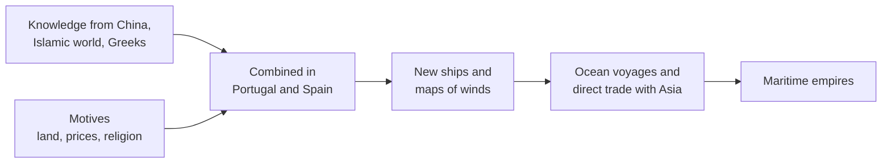

# AP World History: Modern — Topic 4.1 Summary: Technological Innovations (c. 1450–1750)

> Source: Summary of AP_WH_4.1_Notes_EN.md

**Unit 4: Transoceanic Interconnections (c. 1450–1750)**

---

## In One Sentence
Europeans borrowed tools and knowledge from China, the Islamic world, and the ancient Greeks, combined them into new ships and better maps of winds and currents, and so could sail across oceans and trade directly with Asia.

## The Big Picture
Between 1450 and 1750, European ships began to cross the world's oceans. This was possible because of **diffusion**: technology spreading from one culture to another. Knowledge of stars, winds, currents, maps, and shipbuilding came together in **Portugal and Spain**. Europeans also had strong reasons to sail: not enough land at home, high prices for Asian goods, and the wish to spread Christianity.

## Key Points
### 1. Why Europeans Went to Sea (context for LO-A)
- After the plague, Europe's **population grew**, and many workers had no land or jobs. Under **primogeniture**, only the eldest son got the family land, so younger sons looked for wealth overseas.
- After the Ottomans took **Constantinople (1453)**, and with **Venice and Genoa** controlling Mediterranean trade, Asian goods such as spices and silk cost more. Europeans wanted an **all-water route** to Asia.
- **Catholic rulers** wanted to convert people abroad to Christianity, especially after the Protestant Reformation.
### 2. Knowledge from Other Cultures (LO-A)
- Europeans used old **Greek** ways of finding direction by the stars. **Islamic scholars** in **Al-Andalus** (Muslim Spain) kept, improved, and passed on astronomy and geography to Christian Europe.
- **Astronomical charts** (star maps) began with the Babylonians and Chinese. After telescopes (c. 1609), the maps became more exact.
- Sailors learned the patterns of **winds and currents**, such as the trade winds and westerlies. This made safe **round trips** across oceans possible.
### 3. Tools Borrowed and Improved (LO-A)
- **From China:** the **magnetic compass**, which showed direction even out of sight of land, and the **sternpost rudder**, which made steering in rough seas easier.
- **From the Greek and Islamic worlds:** the **astrolabe**, refined by Muslim navigators, which let sailors find their **latitude** (how far north or south they were).
- **From the Arab and Indian Ocean world:** the **lateen sail**, a triangular sail that could sail **against the wind**. Square sails could only use wind from behind.
### 4. New Ship Designs (LO-A)
- **Caravel (Portugal, 1400s):** light and fast, mixed lateen and square sails, and a **shallow** bottom for exploring coasts and oceans.
- **Carrack (Portugal and Spain):** large, with **huge cargo space** and heavy cannons, for Atlantic and Indian Ocean routes.
- **Fluyt (Dutch, 1600s):** built only for **trade**. It was cheap, needed a **small crew**, and carried as much cargo as possible.

## Must-Know Terms & People
| Term | What it is | Why it matters |
|---|---|---|
| Magnetic compass | Chinese tool that shows direction | Sailors could steer far from land |
| Astrolabe | Tool to measure the sun and stars and find latitude | Islamic refinement of a Greek tool |
| Lateen sail | Triangular Arab and Indian Ocean sail | Let ships sail against the wind |
| Caravel | Light, fast Portuguese exploring ship | Explored the West African coast and the Atlantic |
| Carrack | Large Portuguese and Spanish armed cargo ship | Carried goods and guns on long routes |
| Fluyt | Dutch cargo ship with a small crew | Made shipping goods cheaper |
| Primogeniture | Rule that the eldest son gets all the land | Pushed younger sons to seek wealth abroad |
| Prince Henry the Navigator | Portuguese prince | Paid for navigation research and West African voyages |

## Key Dates
| Year | Event |
|---|---|
| 1100s | Compass adapted for sailing; Muslim navigators refine the astrolabe |
| 1415 | Portugal captures Ceuta; Prince Henry sponsors Atlantic voyages |
| 1440s | Portuguese develop the caravel |
| 1453 | Ottomans take Constantinople; Europeans want an all-water route to Asia |
| 1600s | Dutch design the fluyt; telescopes (c. 1609) improve star charts |

## How the Exam Asks About It
- **Legitimacy & consolidation:** This topic is about technology, not rulers. The closest link: royals such as **Prince Henry** paid for research and voyages, and Catholic rulers wanted to spread their faith.
- **Continuity, innovation, diversity:** Continuity: Europeans still used old Greek star navigation. Innovation: the caravel mixed lateen and square sails. Diversity: the tools came from China, the Islamic world, and the Greeks.
- **Likely comparison:** Caravel vs. fluyt. Both were European ships that served sea trade. But the caravel was built to **explore**, while the fluyt was built to carry **cheap bulk cargo**.
- **Common trap:** Students say Europeans invented these tools themselves. The fix: the compass and rudder came from **China**, and the astrolabe and lateen sail from the **Greek and Islamic worlds**. Europeans **combined and improved** them.

## Check Yourself
1. Name two tools Europeans borrowed and where each came from.

▶ Answer
The magnetic compass came from China. The lateen sail came from the Arab and Indian Ocean world. (The astrolabe, from the Greek and Islamic worlds, and the sternpost rudder, from China, are also correct.)

2. Why did knowing wind and current patterns matter?

▶ Answer
Sailors could plan routes with the trade winds and westerlies. This made safe round trips across the oceans possible.

3. How was the fluyt different from the caravel?

▶ Answer
The caravel was a light, fast Portuguese ship for exploring coasts and oceans. The Dutch fluyt was built only for trade: cheap, with a small crew and a large cargo hold.

