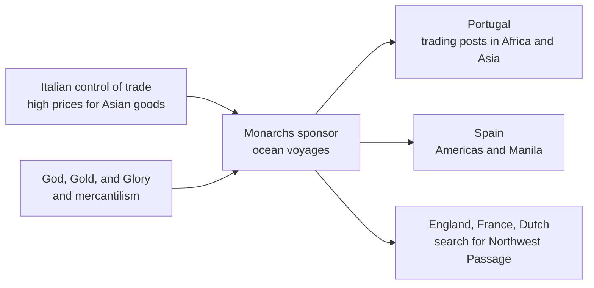

# AP World History: Modern — Topic 4.2 Summary: Exploration: Causes and Events (c. 1450–1750)

> Source: Summary of AP_WH_4.2_Notes_EN.md

**Unit 4: Transoceanic Interconnections (c. 1450–1750)**

---

## In One Sentence
European kings and queens paid for ocean voyages to get around Italian control of trade, to gain gold, glory, and converts, and the results were Portugal's trading post empire in Africa and Asia, Spain's empire in the Americas and the Philippines, and English, French, and Dutch searches for new routes to Asia.

## The Big Picture
From the 1400s to the 1600s, European rulers sponsored (paid for and supported) voyages across the oceans. Their reasons are often summed up as **"God, Gold, and Glory"**: religion, wealth, and power. **Portugal** sailed around Africa into the Indian Ocean. **Spain** crossed the Atlantic and the Pacific. Later, **England, France, and the Netherlands** sailed to North America, looking for another way to Asia.

## Key Points
### 1. Why States Paid for Exploration (LO-B, LO-C)
- **Venice and Genoa** controlled the trade routes from the Mediterranean to Asia, so Asian silk and spices were very expensive. States wanted to **go around** these Italian middlemen.
- **Mercantilism** was the idea that a country's wealth and power depend on how much **gold and silver** it holds. A state should sell more to others (exports) than it buys (imports).
- Rulers saw exploration as a duty to spread **Christianity**, especially during the Catholic-Protestant rivalry.
- Ocean voyages were **too costly and risky** for merchants alone. Royal treasuries gave the **money**, **naval escorts**, and **charters** (official permission to trade or settle).
### 2. Portugal: Around Africa to Asia (LO-C)
- **Prince Henry the Navigator** (1394–1460) sponsored voyages down the **West African coast**, looking for gold and a sea route east.
- **Bartholomew Diaz** rounded the **Cape of Good Hope** (1488). **Vasco da Gama** reached **Calicut, India** (1498) and made huge profits from spices.
- Portugal won the **Battle of Diu** (1509) and took control of the Arabian Sea. **Afonso de Albuquerque** seized **Goa** (1510) and **Malacca** (1511).
- This was a **trading post empire**: forts at key sea passages, not large lands inland. Local merchants had to buy a pass (**cartaz**) to trade.
### 3. Spain: Across the Atlantic and Pacific (LO-C)
- **Christopher Columbus** (1492), sponsored by **Queen Isabella and King Ferdinand**, sailed west looking for Asia. He began lasting European contact with the **Americas**.
- **Ferdinand Magellan's** expedition (1519–1522) was the first to sail **around the world**. Magellan himself was killed in the Philippines (1521).
- Spain founded **Manila** (1571). The **Manila Galleons** carried **Mexican silver** across the Pacific to trade for Chinese silk and porcelain. Missionaries converted most Filipinos to Catholicism.
### 4. England, France, and the Dutch: Northern Routes (LO-C)
- These states looked for a **Northwest Passage**, a sea route through North America to Asia.
- **France:** Jacques Cartier explored the St. Lawrence River (1535). Samuel de Champlain founded **Quebec** (1608). The French cared more about **furs**, missions, and alliances with Native Americans than big settlements.
- **England:** John Cabot claimed Newfoundland (1497), and England founded **Jamestown** (1607). **Dutch:** Henry Hudson sailed the Hudson River (1609), and the Dutch founded **New Amsterdam** (1624).

## Must-Know Terms & People
| Term | What it is | Why it matters |
|---|---|---|
| Mercantilism | Idea that wealth means holding gold and silver | Pushed states to seek colonies and trade |
| Trading post empire | Empire of forts and ports, not large lands | Portugal's way of controlling the spice trade |
| Vasco da Gama | Portuguese explorer | First European to reach India by sea (1498) |
| Afonso de Albuquerque | Portuguese commander in India | Seized Goa and Malacca for Portugal |
| Christopher Columbus | Explorer sponsored by Spain | Began lasting contact with the Americas (1492) |
| Ferdinand Magellan | Leader of a Spanish-sponsored voyage | First trip around the world (1519–1522) |
| Manila Galleons | Spanish ships between Mexico and Manila | Traded American silver for Chinese goods |
| Northwest Passage | Hoped-for sea route through North America | Main goal of English, French, Dutch voyages |

## Key Dates
| Year | Event |
|---|---|
| 1488 | Diaz rounds the Cape of Good Hope |
| 1492 | Columbus crosses the Atlantic to the Caribbean |
| 1498 | Vasco da Gama reaches Calicut, India |
| 1519–1522 | Magellan's expedition sails around the world |
| 1571 | Spain founds Manila |
| 1607 | England founds Jamestown |

## How the Exam Asks About It
- **Legitimacy & consolidation:** Monarchs justified voyages as a **religious mission** and a way to make the state rich. Portugal kept control with **forts** and the **cartaz** pass system.
- **Continuity, innovation, diversity:** Continuity: Europeans still wanted the same **Asian spices and silk**. Innovation: an **all-water route** around Africa to India. Diversity: Portugal built trading posts, Spain conquered land, and France traded for furs.
- **Likely comparison:** Portugal vs. Spain. Both were sponsored by the **crown** and spread Catholicism. But Portugal built **coastal trading posts** in Africa and Asia, while Spain **conquered territory** in the Americas.
- **Common trap:** Students say Portugal conquered large lands in Asia. The fix: it was a **trading post empire** of forts at key sea passages.

## Check Yourself
1. Why did states, and not just merchants, pay for ocean voyages?

▶ Answer
The voyages were too costly and risky for merchants alone. Royal treasuries gave money, naval escorts, and charters.

2. What was Portugal's trading post empire?

▶ Answer
Portugal built forts at key sea passages, such as Goa and Malacca, instead of conquering large lands. Local merchants had to buy a pass (cartaz) to trade.

3. What were England, France, and the Dutch looking for in North America?

▶ Answer
They were looking for a Northwest Passage, a sea route through North America to Asia.

