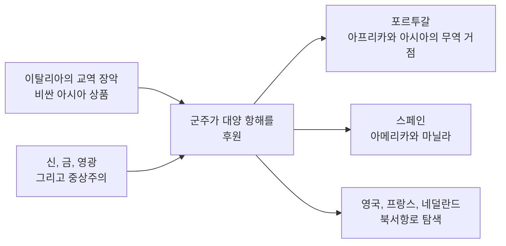

# AP 세계사: 모던 — 토픽 4.2 요약: 해양 탐험: 원인과 전개 (Exploration: Causes and Events)

> 출처: AP_WH_4.2_Notes_KR.md 요약

**Unit 4: 대양 간 상호 연결 (Transoceanic Interconnections, c. 1450–1750)**

---

## 한 문장 요약
유럽의 왕과 여왕은 이탈리아의 교역 장악을 피해 가고 금, 영광, 개종자를 얻으려고 대양 항해에 돈을 댔으며, 그 결과 아프리카와 아시아에는 포르투갈의 무역 거점 제국이, 아메리카와 필리핀에는 스페인의 제국이 생겼고, 영국, 프랑스, 네덜란드는 아시아로 가는 새 항로를 찾아 나섰다.

## 큰 그림
1400년대부터 1600년대까지 유럽의 통치자들은 대양을 건너는 항해를 후원했다 (돈을 대고 지원했다). 그 이유는 흔히 **"신, 금, 영광 (God, Gold, and Glory)"**, 곧 종교, 부, 권력으로 요약된다. **포르투갈**은 아프리카를 돌아 인도양으로 들어갔다. **스페인**은 대서양과 태평양을 건넜다. 뒤이어 **영국, 프랑스, 네덜란드**가 아시아로 가는 다른 길을 찾아 북아메리카로 항해했다.

## 핵심 정리
### 1. 국가는 왜 탐험에 돈을 댔는가 (LO-B, LO-C)
- **베네치아와 제노바** (Venice, Genoa)가 지중해에서 아시아로 이어지는 교역로를 장악해 아시아의 비단과 향신료가 매우 비쌌다. 국가들은 이 이탈리아 중개상들을 **피해 가려** 했다.
- **중상주의** (Mercantilism)는 나라의 부와 힘이 **금과 은**을 얼마나 가졌느냐에 달려 있다는 생각이다. 국가는 남에게 사는 것(수입)보다 더 많이 팔아야(수출) 한다고 보았다.
- 통치자들은 특히 가톨릭과 개신교가 경쟁하던 시기에 탐험을 **기독교**를 퍼뜨리는 의무로 여겼다.
- 대양 항해는 상인 혼자 감당하기에 **비용과 위험이 너무 컸다**. 왕실 재정이 **자금**, **해군 호위**, **특허장** (Charter, 교역이나 정착을 허락하는 공식 문서)을 제공했다.
### 2. 포르투갈: 아프리카를 돌아 아시아로 (LO-C)
- **항해왕자 엔히크** (Prince Henry the Navigator, 1394–1460)는 금과 동쪽으로 가는 바닷길을 찾아 **서아프리카 연안** 항해를 후원했다.
- **바르톨로뮤 디아스** (Bartholomew Diaz)는 **희망봉** (Cape of Good Hope)을 돌았다 (1488). **바스코 다 가마** (Vasco Da Gama)는 **인도 캘리컷** (Calicut)에 도착해 (1498) 향신료로 막대한 이익을 얻었다.
- 포르투갈은 **디우 해전** (Battle of Diu, 1509)에서 이겨 아라비아해를 장악했다. **아폰수 드 알부케르크** (Afonso de Albuquerque)는 **고아** (Goa, 1510)와 **말라카** (Malacca, 1511)를 점령했다.
- 이것이 **무역 거점 제국** (Trading Post Empire)이다. 내륙의 넓은 땅이 아니라 바닷길의 요충지에 요새를 두었다. 현지 상인은 교역하려면 통행증 (**카르타스, Cartaz**)을 사야 했다.
### 3. 스페인: 대서양과 태평양을 건너다 (LO-C)
- **크리스토퍼 콜럼버스** (Christopher Columbus, 1492)는 **이사벨라 여왕과 페르디난트 국왕** (Queen Isabella, King Ferdinand)의 후원을 받아 아시아를 찾아 서쪽으로 항해했다. 그는 **아메리카**와 유럽의 지속적인 접촉을 시작했다.
- **페르디난드 마젤란** (Ferdinand Magellan)의 원정대 (1519–1522)는 처음으로 **세계 일주**를 했다. 마젤란 자신은 필리핀에서 죽었다 (1521).
- 스페인은 **마닐라** (Manila, 1571)를 세웠다. **마닐라 갈레온** (Manila Galleons)은 **멕시코의 은**을 싣고 태평양을 건너 중국의 비단, 도자기와 바꾸었다. 선교사들은 필리핀 사람 대다수를 가톨릭으로 개종시켰다.
### 4. 영국, 프랑스, 네덜란드: 북쪽 항로 (LO-C)
- 이 나라들은 북아메리카를 지나 아시아로 가는 바닷길인 **북서항로** (Northwest Passage)를 찾았다.
- **프랑스:** 자크 카르티에 (Jacques Cartier)가 세인트로렌스강을 탐험했다 (1535). 사뮈엘 드 샹플랭 (Samuel de Champlain)이 **퀘벡** (Quebec, 1608)을 세웠다. 프랑스는 큰 정착지보다 **모피**, 선교, 원주민과의 동맹에 더 관심을 두었다.
- **영국:** 존 캐벗 (John Cabot)이 뉴펀들랜드의 영유권을 주장했고 (1497), 영국은 **제임스타운** (Jamestown, 1607)을 세웠다. **네덜란드:** 헨리 허드슨 (Henry Hudson)이 허드슨강을 항해했고 (1609), 네덜란드는 **뉴암스테르담** (New Amsterdam, 1624)을 세웠다.

## 꼭 알아야 할 용어·인물
| 용어 | 무엇인가 | 왜 중요한가 |
|---|---|---|
| 중상주의 (Mercantilism) | 부는 금과 은을 가지는 것이라는 생각 | 국가가 식민지와 교역을 찾게 했다 |
| 무역 거점 제국 (Trading Post Empire) | 넓은 땅이 아니라 요새와 항구로 이루어진 제국 | 포르투갈이 향신료 무역을 통제한 방식이다 |
| 바스코 다 가마 (Vasco Da Gama) | 포르투갈의 탐험가 | 바닷길로 인도에 간 첫 유럽인이다 (1498) |
| 아폰수 드 알부케르크 (Afonso de Albuquerque) | 인도의 포르투갈 사령관 | 포르투갈을 위해 고아와 말라카를 점령했다 |
| 크리스토퍼 콜럼버스 (Christopher Columbus) | 스페인이 후원한 탐험가 | 아메리카와의 지속적인 접촉을 시작했다 (1492) |
| 페르디난드 마젤란 (Ferdinand Magellan) | 스페인이 후원한 항해의 지휘자 | 최초의 세계 일주 항해 (1519–1522) |
| 마닐라 갈레온 (Manila Galleons) | 멕시코와 마닐라를 오간 스페인 배 | 아메리카의 은을 중국 상품과 바꾸었다 |
| 북서항로 (Northwest Passage) | 북아메리카를 지나는 것으로 기대된 바닷길 | 영국, 프랑스, 네덜란드 항해의 주된 목표였다 |

## 주요 연도
| 연도 | 사건 |
|---|---|
| 1488 | 디아스가 희망봉을 돎 |
| 1492 | 콜럼버스가 대서양을 건너 카리브해에 도착함 |
| 1498 | 바스코 다 가마가 인도 캘리컷에 도착함 |
| 1519–1522 | 마젤란 원정대가 세계를 일주함 |
| 1571 | 스페인이 마닐라를 세움 |
| 1607 | 영국이 제임스타운을 세움 |

## 시험에서는 이렇게 묻는다
- **정당화와 공고화:** 군주들은 항해를 **종교적 사명**이자 나라를 부유하게 하는 길로 정당화했다. 포르투갈은 **요새**와 **카르타스** 통행증 제도로 지배를 유지했다.
- **연속성·혁신·다양성:** 연속성은 유럽인이 여전히 같은 **아시아의 향신료와 비단**을 원했다는 점이다. 혁신은 아프리카를 돌아 인도로 가는 **해상 직항로**이다. 다양성은 포르투갈은 무역 거점을 세우고, 스페인은 땅을 정복하고, 프랑스는 모피를 교역했다는 점이다.
- **자주 나오는 비교:** 포르투갈과 스페인. 둘 다 **왕실**의 후원을 받았고 가톨릭을 퍼뜨렸다. 그러나 포르투갈은 아프리카와 아시아에 **해안 무역 거점**을 세웠고, 스페인은 아메리카에서 **영토를 정복했다**.
- **자주 하는 실수:** 포르투갈이 아시아에서 넓은 땅을 정복했다고 쓰는 것이다. 바로잡기: 포르투갈은 바닷길 요충지의 요새로 이루어진 **무역 거점 제국**이었다.

## 스스로 확인하기
1. 상인만이 아니라 국가가 대양 항해에 돈을 댄 이유는 무엇인가?

▶ 정답
항해는 상인 혼자 감당하기에 비용과 위험이 너무 컸다. 왕실 재정이 자금, 해군 호위, 특허장을 제공했다.

2. 포르투갈의 무역 거점 제국이란 무엇인가?

▶ 정답
포르투갈은 넓은 땅을 정복하는 대신 고아와 말라카 같은 바닷길 요충지에 요새를 세웠다. 현지 상인은 교역하려면 통행증 (카르타스)을 사야 했다.

3. 영국, 프랑스, 네덜란드는 북아메리카에서 무엇을 찾았는가?

▶ 정답
북아메리카를 지나 아시아로 가는 바닷길인 북서항로를 찾았다.

