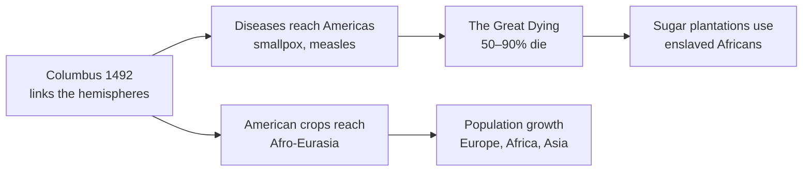

# AP World History: Modern — Topic 4.3 Summary: The Columbian Exchange (c. 1450–1750)

> Source: Summary of AP_WH_4.3_Notes_EN.md

**Unit 4: Transoceanic Interconnections (c. 1450–1750)**

---

## In One Sentence
European voyages after 1492 linked the two hemispheres, so diseases from Afro-Eurasia killed most indigenous Americans, American crops helped populations grow in Europe, Africa, and Asia, and sugar plantations brought millions of enslaved Africans to the Americas.

## The Big Picture
Columbus's voyage in **1492** ended thousands of years of separation between the **Eastern Hemisphere** (Afro-Eurasia) and the **Western Hemisphere** (the Americas). The result was the **Columbian Exchange**: the movement of plants, animals, diseases, and people between them. For indigenous Americans it was a disaster, because Afro-Eurasian diseases killed **50% to 90%** of them. For Afro-Eurasia, new American crops meant more food and **population growth**. To grow **cash crops** (crops grown to sell) such as sugar, Europeans forced millions of enslaved Africans across the Atlantic.

## Key Points
### 1. Causes: Two Worlds Connected (LO-D)
- For thousands of years the two hemispheres were **isolated** from each other.
- European explorers crossed the Atlantic looking for sea routes to Asia. Then they set up **colonies** in the Caribbean, Mesoamerica, and South America to get **precious metals** (gold and silver) and grow **cash crops**.
- Ships now went back and forth across the ocean, carrying plants, animals, germs, and people.
### 2. Disease and the Great Dying (LO-D)
- Indigenous Americans had **no immunity** (natural protection) to Afro-Eurasian diseases, because they had been isolated so long.
- **Smallpox** was the biggest killer. **Measles**, influenza, **malaria**, and typhus also spread. **Mosquitoes** and black rats came too, and mosquitoes spread malaria and yellow fever.
- Within a century, **50% to 90%** of indigenous Americans died. This is called the **Great Dying**.
- So many leaders, priests, warriors, and farmers died that resistance grew weak. This helped the **Spanish and Portuguese conquest**.
### 3. From Afro-Eurasia to the Americas (LO-D)
- **Crops:** wheat, barley, **sugarcane**, grapes, oranges, and coffee. Enslaved Africans brought **okra and rice**.
- **Animals:** **horses**, cattle, pigs, sheep, goats, and chickens.
- **Environment:** forests were cut down for plantations, growing one crop over and over wore out the soil, and grazing animals caused erosion.
- The **horse** changed Plains Native American life. It made buffalo hunting and warfare easier, and owning horses created new social ranks.
### 4. From the Americas to Afro-Eurasia (LO-D)
- **Crops:** **maize** (corn), **potatoes**, sweet potatoes, tomatoes, beans, peppers, cacao, peanuts, **manioc** (cassava), and tobacco.
- **Europe:** high-calorie potatoes and maize helped Europe's **population grow** in the 1500s–1700s.
- **Africa:** manioc, peanuts, and maize grew well in poor soils and helped African populations grow.
- **China:** sweet potatoes and maize supported fast **population growth under the Qing**.
### 5. Sugar, Slavery, and the African Diaspora (LO-D)
- Brazil was ideal for **sugarcane**. Indigenous workers died of disease or escaped, so Portuguese planters turned to the **Transatlantic Slave Trade**.
- **Engenhos** were Brazilian sugar plantations with mills. The work was deadly.
- Over **90%** of enslaved Africans were taken to the Caribbean and South America, especially Brazil. Only about 6% went to British North America.
- The **African Diaspora** (the forced scattering of Africans) shaped American cultures: **creole languages** such as Gullah, music such as spirituals and blues, and foods such as **gumbo**.

## Must-Know Terms & People
| Term | What it is | Why it matters |
|---|---|---|
| Columbian Exchange | Transfer of plants, animals, diseases, and people after 1492 | Changed diets and populations on both sides of the Atlantic |
| The Great Dying | Collapse of indigenous American populations from disease | 50–90% died; conquest became easier |
| Smallpox | Deadly Afro-Eurasian disease | The main killer of indigenous Americans |
| Cash crop | A crop grown to sell, such as sugar or tobacco | Led to plantations and forced labor |
| Engenhos | Brazilian sugar plantations and mills | Depended on enslaved labor in harsh conditions |
| Transatlantic Slave Trade | Forced shipping of 10–12 million Africans across the Atlantic | Supplied plantation labor |
| African Diaspora | Forced scattering of Africans across the Americas | Created new mixed cultures |
| Creole languages | New languages mixing European words and West African grammar | Example of cultural blending, such as Gullah |
| Manioc | American root crop, also called cassava | Grew in poor soils and fed Africans |

## Key Dates
| Year | Event |
|---|---|
| 1492 | Columbus reaches the Americas |
| 1518 | First recorded smallpox outbreak in the Americas, on Hispaniola |
| 1520s | Smallpox spreads to the Aztec and Inca empires |
| 1550s | American crops such as maize and potatoes spread in Europe and Asia |
| 1600s | Brazilian engenhos rely on large numbers of enslaved Africans |
| 1700s | European and Chinese populations rise with American crops |

## How the Exam Asks About It
- **Legitimacy & consolidation:** This topic is about the environment more than rulers. The closest link: disease killed indigenous **leaders and warriors**, which helped the Spanish and Portuguese **conquer** the Americas.
- **Continuity, innovation, diversity:** Continuity: enslaved Africans kept African **rhythms and cooking**, such as okra and rice. Innovation: new **creole languages**. Diversity: different American crops fed different regions, such as potatoes in Europe, manioc in Africa, and sweet potatoes in China.
- **Likely comparison:** The Americas vs. Afro-Eurasia. Both saw large **population changes** from the exchange. But the Americas lost 50–90% of their people to disease, while Afro-Eurasia **grew** thanks to new crops.
- **Common trap:** Students mix up the directions, for example saying horses are native to the Americas or potatoes came from Europe. The fix: **horses and sugar** went **to** the Americas; **maize, potatoes, and manioc** came **from** the Americas.

## Check Yourself
1. Why did so many indigenous Americans die after 1492?

▶ Answer
They had been isolated for thousands of years, so they had no immunity to Afro-Eurasian diseases such as smallpox and measles. Within a century, 50% to 90% died.

2. Name two American crops and one effect they had in Afro-Eurasia.

▶ Answer
Potatoes and maize were high in calories, so they helped Europe's population grow. (Manioc in Africa and sweet potatoes in China are also correct.)

3. Why did Portuguese planters in Brazil turn to enslaved Africans?

▶ Answer
They needed many workers for sugar plantations, but indigenous workers died of disease or escaped. So they brought enslaved Africans through the Transatlantic Slave Trade.

