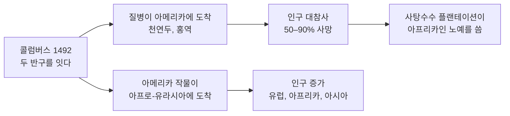

# AP 세계사: 모던 — 토픽 4.3 요약: 콜럼버스 교환 (The Columbian Exchange)

> 출처: AP_WH_4.3_Notes_KR.md 요약

**Unit 4: 대양 간 상호 연결 (Transoceanic Interconnections, c. 1450–1750)**

---

## 한 문장 요약
1492년 이후 유럽의 항해가 두 반구를 이어 놓자, 아프로-유라시아의 질병은 아메리카 원주민 대다수를 죽였고, 아메리카 작물은 유럽, 아프리카, 아시아의 인구 증가를 도왔으며, 사탕수수 플랜테이션은 수백만 명의 아프리카인을 노예로 아메리카에 끌고 왔다.

## 큰 그림
**1492년** 콜럼버스 (Christopher Columbus)의 항해는 **동반구** (Eastern Hemisphere, 아프로-유라시아)와 **서반구 (Western Hemisphere, 아메리카)** 사이의 수천 년에 걸친 단절을 끝냈다. 그 결과가 **콜럼버스 교환 (Columbian Exchange)**, 곧 두 반구 사이에서 식물, 동물, 질병, 사람이 오간 일이다. 아메리카 원주민에게 이것은 재앙이었다. 아프로-유라시아의 질병으로 원주민의 **50%에서 90%가** 죽었기 때문이다. 아프로-유라시아에는 새로운 아메리카 작물이 더 많은 식량과 **인구 증가**를 가져왔다. 설탕 같은 **환금 작물** (Cash crop, 팔기 위해 기르는 작물)을 기르려고 유럽인은 수백만 명의 아프리카인을 노예로 삼아 대서양 너머로 강제로 끌고 갔다.

## 핵심 정리
### 1. 원인: 두 세계가 연결되다 (LO-D)
- 수천 년 동안 두 반구는 서로 **고립**되어 있었다.
- 유럽의 탐험가들은 아시아로 가는 바닷길을 찾아 대서양을 건넜다. 그 뒤 **귀금속** (금과 은)을 얻고 **환금 작물**을 기르려고 카리브해, 메소아메리카, 남아메리카에 **식민지**를 세웠다.
- 이제 배가 대양을 오가며 식물, 동물, 병균, 사람을 실어 날랐다.
### 2. 질병과 인구 대참사 (LO-D)
- 아메리카 원주민은 오랫동안 고립되어 있었기 때문에 아프로-유라시아의 질병에 대한 **면역력** (타고난 방어력)이 없었다.
- **천연두** (Smallpox)가 가장 많은 사람을 죽였다. **홍역 (Measles)**, 인플루엔자 (Influenza), **말라리아 (Malaria)**, 발진티푸스 (Typhus)도 퍼졌다. **모기**와 곰쥐 (Black rat)도 함께 건너왔고, 모기는 말라리아와 황열병 (Yellow fever)을 옮겼다.
- 한 세기 안에 아메리카 원주민의 **50%에서 90%가** 죽었다. 이를 **인구 대참사** (The Great Dying)라고 한다.
- 지배층, 사제, 전사, 농민이 너무 많이 죽어 저항이 약해졌다. 이것이 **스페인과 포르투갈의 정복**을 도왔다.
### 3. 아프로-유라시아에서 아메리카로 (LO-D)
- **작물:** 밀, 보리, **사탕수수 (Sugarcane)**, 포도, 오렌지, 커피. 아프리카인 노예들은 **오크라 (Okra)와 쌀**을 가져왔다.
- **동물:** **말 (Horse)**, 소, 돼지, 양, 염소, 닭.
- **환경:** 플랜테이션을 만들려고 숲을 베어 냈고, 한 작물만 계속 길러 땅이 메말랐으며, 풀을 뜯는 가축 때문에 토양이 깎여 나갔다.
- **말**은 북미 대평원 원주민 (Plains Indians)의 삶을 바꾸었다. 버팔로 사냥과 전쟁이 쉬워졌고, 말을 얼마나 가졌는지에 따라 새로운 사회적 서열이 생겼다.
### 4. 아메리카에서 아프로-유라시아로 (LO-D)
- **작물:** **옥수수 (Maize)**, **감자 (Potato)**, 고구마, 토마토, 콩, 고추, 카카오, 땅콩, **마니옥 (Manioc, 카사바)**, 담배.
- **유럽:** 열량이 높은 감자와 옥수수가 1500년대–1700년대 유럽의 **인구 증가**를 도왔다.
- **아프리카:** 마니옥, 땅콩, 옥수수는 척박한 땅에서도 잘 자라 아프리카의 인구 증가를 도왔다.
- **중국:** 고구마와 옥수수가 **청나라 (Qing) 시기의 빠른 인구 증가**를 뒷받침했다.
### 5. 설탕, 노예제, 아프리카 디아스포라 (LO-D)
- 브라질은 **사탕수수** 재배에 알맞았다. 원주민 노동자가 병으로 죽거나 달아나자 포르투갈 농장주들은 **대서양 노예 무역** (Transatlantic Slave Trade)에 눈을 돌렸다.
- **엔젠호** (Engenhos)는 제당 시설을 갖춘 브라질의 사탕수수 플랜테이션이었다. 일은 목숨을 앗아 갈 만큼 가혹했다.
- 아프리카인 노예의 **90% 이상**이 카리브해와 남아메리카, 특히 브라질로 끌려갔다. 영국의 북미 식민지로 간 비율은 약 6%에 불과했다.
- **아프리카 디아스포라** (African Diaspora, 아프리카인의 강제 분산)는 아메리카의 문화를 만들었다. 굴라 (Gullah) 같은 **크리올어 (Creole languages)**, 흑인 영가와 블루스 같은 음악, **검보 (Gumbo)** 같은 음식이 그 예이다.

## 꼭 알아야 할 용어·인물
| 용어 | 무엇인가 | 왜 중요한가 |
|---|---|---|
| 콜럼버스 교환 (Columbian Exchange) | 1492년 이후 식물, 동물, 질병, 사람이 오간 일 | 대서양 양쪽의 식생활과 인구를 바꾸었다 |
| 인구 대참사 (The Great Dying) | 질병으로 인한 아메리카 원주민 인구의 붕괴 | 50–90%가 죽었고, 정복이 쉬워졌다 |
| 천연두 (Smallpox) | 아프로-유라시아의 치명적인 질병 | 아메리카 원주민을 가장 많이 죽였다 |
| 환금 작물 (Cash crop) | 설탕이나 담배처럼 팔기 위해 기르는 작물 | 플랜테이션과 강제 노동으로 이어졌다 |
| 엔젠호 (Engenhos) | 브라질의 사탕수수 플랜테이션과 제당 시설 | 가혹한 환경의 노예 노동에 기댔다 |
| 대서양 노예 무역 (Transatlantic Slave Trade) | 1천만–1천2백만 명의 아프리카인을 대서양 너머로 강제 운송한 일 | 플랜테이션에 노동력을 공급했다 |
| 아프리카 디아스포라 (African Diaspora) | 아프리카인이 아메리카 전역으로 강제로 흩어진 일 | 새로운 혼합 문화를 낳았다 |
| 크리올어 (Creole languages) | 유럽어 어휘와 서아프리카 문법을 섞은 새 언어 | 굴라 (Gullah) 같은 문화 혼합의 예이다 |
| 마니옥 (Manioc) | 카사바라고도 하는 아메리카의 뿌리 작물 | 척박한 땅에서 자라 아프리카인을 먹여 살렸다 |

## 주요 연도
| 연도 | 사건 |
|---|---|
| 1492 | 콜럼버스가 아메리카에 도착함 |
| 1518 | 히스파니올라 (Hispaniola)에서 아메리카 최초의 천연두 유행이 기록됨 |
| 1520년대 | 천연두가 아스테카 (Aztec)와 잉카 (Inca) 제국으로 퍼짐 |
| 1550년대 | 옥수수와 감자 같은 아메리카 작물이 유럽과 아시아로 퍼짐 |
| 1600년대 | 브라질의 엔젠호가 많은 아프리카인 노예에 기댐 |
| 1700년대 | 아메리카 작물 덕분에 유럽과 중국의 인구가 늘어남 |

## 시험에서는 이렇게 묻는다
- **정당화와 공고화:** 이 토픽은 통치자보다 환경을 다룬다. 가장 가까운 연결은 이것이다. 질병이 원주민의 **지배층과 전사**를 죽여 스페인과 포르투갈이 아메리카를 **정복**하기 쉬워졌다.
- **연속성·혁신·다양성:** 연속성은 아프리카인 노예들이 아프리카의 **리듬과 요리** (오크라와 쌀 등)를 이어 간 점이다. 혁신은 새로운 **크리올어**이다. 다양성은 유럽의 감자, 아프리카의 마니옥, 중국의 고구마처럼 서로 다른 아메리카 작물이 서로 다른 지역을 먹여 살린 점이다.
- **자주 나오는 비교:** 아메리카와 아프로-유라시아. 두 지역 모두 교환으로 큰 **인구 변화**를 겪었다. 그러나 아메리카는 질병으로 인구의 50–90%를 잃었고, 아프로-유라시아는 새 작물 덕분에 **인구가 늘었다**.
- **자주 하는 실수:** 방향을 헷갈려 말이 아메리카 토종이라거나 감자가 유럽에서 왔다고 쓰는 것이다. 바로잡기: **말과 사탕수수**는 아메리카**로** 갔고, **옥수수, 감자, 마니옥**은 아메리카**에서** 왔다.

## 스스로 확인하기
1. 1492년 이후 아메리카 원주민이 그렇게 많이 죽은 이유는 무엇인가?

▶ 정답
수천 년 동안 고립되어 있었기 때문에 천연두와 홍역 같은 아프로-유라시아의 질병에 대한 면역력이 없었다. 한 세기 안에 50%에서 90%가 죽었다.

2. 아메리카 작물 두 가지와 그것이 아프로-유라시아에 미친 영향 하나를 쓰시오.

▶ 정답
감자와 옥수수는 열량이 높아 유럽의 인구 증가를 도왔다. (아프리카의 마니옥, 중국의 고구마도 정답이다.)

3. 브라질의 포르투갈 농장주들은 왜 아프리카인 노예에게 눈을 돌렸는가?

▶ 정답
사탕수수 플랜테이션에 많은 노동자가 필요했지만, 원주민 노동자는 병으로 죽거나 달아났다. 그래서 대서양 노예 무역으로 아프리카인 노예를 들여왔다.

