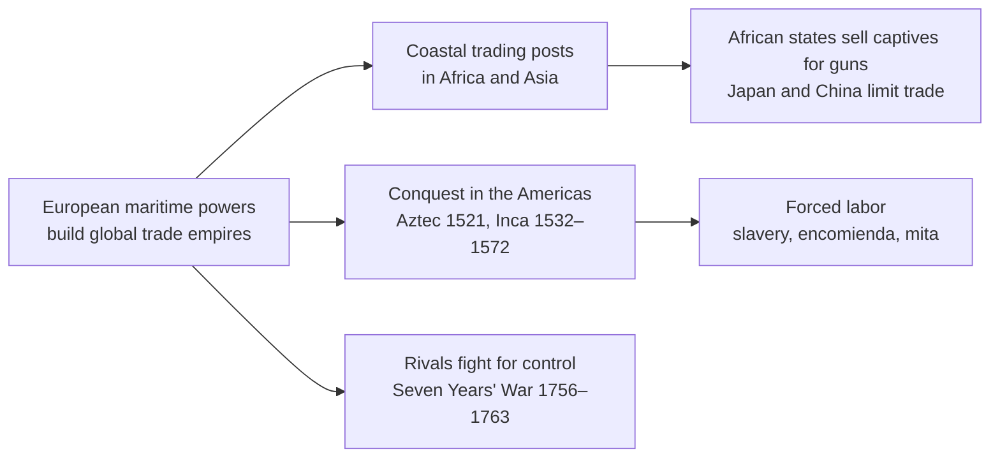

# AP World History: Modern — Topic 4.4 Summary: Maritime Empires Established (c. 1450–1750)

> Source: Summary of AP_WH_4.4_Notes_EN.md

**Unit 4: Transoceanic Interconnections (c. 1450–1750)**

---

## In One Sentence

European states built their empires with coastal **trading posts** in Africa and Asia and with **conquest** in the Americas, and forced labor such as **chattel slavery**, the **encomienda**, and the **mita** made those empires rich.

## The Big Picture

From 1450 to 1750, European states built **maritime empires** (empires linked by the sea). In Africa and Asia, strong local states stayed in charge, so Europeans mostly traded from posts on the coast. Some African kingdoms grew stronger by selling captives for guns, while Japan and China limited trade with Europeans. In the Americas, Spain **conquered** the Aztec and Inca empires and took their land. Europeans used **coerced labor** (forced work) to get wealth from the colonies, and rival European states fought each other for control.

## Key Points

### 1. Africa: Trading Posts and Stronger States (LO-E, LO-G)

- Europeans set up **trading posts** on the coast with the permission of local rulers. They did **not conquer** inland Africa.
- Coastal states sold **captives** to Europeans for guns and gunpowder. **Dahomey** and **Asante** grew strong by raiding inland neighbors for more captives to sell.
- The Kingdom of **Kongo** and the Kingdom of **Benin** traded with the Portuguese and met Catholic missionaries. Benin artists showed European soldiers in their famous **bronze** sculptures.

### 2. Japan and China Limit Trade (LO-E)

- Japan at first let European merchants and **Jesuit** missionaries (Catholic priests) come in. Some converts destroyed Buddhist shrines, so Japan's rulers saw **Christianity as a threat**.
- In 1587, Toyotomi Hideyoshi expelled the Christian missionaries. In the 1630s, the **Tokugawa shogunate** passed **Sakoku** (the "closed country" policy): it expelled foreigners, banned travel abroad, and let only the **Dutch** trade, on **Deshima** island in Nagasaki harbor.
- After Zheng He's voyages, the **Ming** limited private sea trade and rebuilt the Great Wall. But China needed **American silver** to collect taxes, so it later reopened trade under tight control, through ports such as **Canton**.

### 3. European Rivals Divide the World (LO-E)

- In the **Treaty of Tordesillas** (1494), Spain and Portugal split the non-Christian lands. Spain got most of the Americas; Portugal got **Brazil** and lands to the east.
- Spain **conquered** the Americas. **Hernán Cortés** took the Aztec capital Tenochtitlán in 1521, helped by smallpox and native allies. **Francisco Pizarro** captured the Inca emperor **Atahualpa** and executed him in 1533.
- In India, the **British East India Company**, the Portuguese, and the French competed for trade, and the British hired Indian soldiers called **sepoys**. Britain won the **Seven Years' War** (1756–1763) and pushed French power out of India and North America.

### 4. Forced Labor in the Americas (LO-F, LO-G)

- **Chattel slavery:** people were owned as **property** for life, and their children were enslaved too. It was the main system on **plantations** (big farms for crops like sugar) in the Caribbean and Brazil.
- **Indentured servitude:** a worker agreed to work **4–7 years** in return for the trip to the Americas, then went free. It was common in British North America.
- **Encomienda:** the Spanish crown let conquistadors force native people to **work and pay tribute**, if they taught them Christianity. Later, **haciendas** (large estates) held native farmers through **debt**.
- **Mita:** Spain turned an old **Inca labor draft** into forced work in the deadly **Potosí** silver mines.

## Must-Know Terms & People

| Term | What it is | Why it matters |
|---|---|---|
| Asante and Dahomey | West African kingdoms | Grew strong by trading captives for European guns |
| Sakoku | Tokugawa Japan's "closed country" policy of the 1630s | Example of an Asian state limiting European trade |
| Treaty of Tordesillas | 1494 deal that split new lands between Spain and Portugal | Why Brazil became Portuguese and most of the Americas Spanish |
| Sepoys | Indian soldiers hired by the British East India Company | Helped Britain win power in India |
| Chattel slavery | Owning people as property, passed to their children | Main labor system on Caribbean and Brazilian plantations |
| Indentured servitude | Work for a fixed 4–7 years in return for passage | Common labor system in British North America |
| Encomienda | Spanish grant of native labor and tribute to conquistadors | New forced labor system in Spanish America |
| Mita | Inca labor draft that Spain made forced mine work | Supplied workers for the Potosí silver mines |

## Key Dates

| Year | Event |
|---|---|
| 1494 | Treaty of Tordesillas splits new lands between Spain and Portugal |
| 1521 | Cortés takes Tenochtitlán; the Aztec Empire falls |
| 1533 | Pizarro executes the Inca emperor Atahualpa |
| 1587 | Toyotomi Hideyoshi expels Christian missionaries from Japan |
| 1630s | Tokugawa Japan passes the Sakoku policy |
| 1756–1763 | Seven Years' War; Britain defeats France |

## How the Exam Asks About It

- **Legitimacy & consolidation:** European states claimed land by treaty and by conquest, and held it with local allies and hired troops such as the sepoys. Tokugawa Japan kept its own power by shutting out Christianity and most foreigners.
- **Continuity, innovation, diversity:** Continuity: Spain reused the Inca mita. Innovation: new labor systems such as chattel slavery on plantations and indentured servitude. Diversity: Europeans conquered land in the Americas but mostly built coastal posts in Africa and Asia.
- **Likely comparison:** Chattel slavery vs. indentured servitude. Both were bound labor for colonial farms. But slavery lasted for life and passed to children, while an indentured servant worked a fixed 4–7 years and then went free.
- **Common trap:** Students say Europeans conquered Africa and Asia in this period. The fix: outside the Americas they mostly traded from **coastal posts**, and strong states such as Asante, the Ming, and Tokugawa Japan stayed in control.

## Check Yourself

1. Why did African kingdoms such as Dahomey and Asante grow stronger in this period?

▶ Answer
They sold captives to European traders for guns and gunpowder. With the guns they raided inland neighbors for more captives, so their power grew.

2. How did Tokugawa Japan respond to Europeans and Christianity?

▶ Answer
It saw Christianity as a threat. In the 1630s its Sakoku policy expelled foreigners, banned travel abroad, and let only the Dutch trade, at Deshima in Nagasaki.

3. How did Spain change the Inca mita?

▶ Answer
The mita had been an Inca labor draft. Spain turned it into forced labor that sent native men to the deadly Potosí silver mines.

