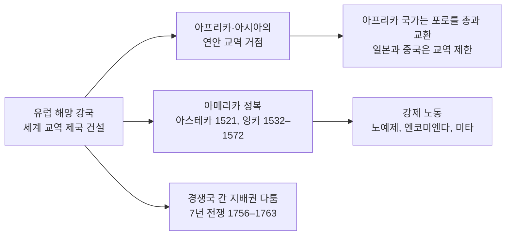

# AP 세계사: 모던 — 토픽 4.4 요약: 해양 제국의 수립 (Maritime Empires Established)

> 출처: AP_WH_4.4_Notes_KR.md 요약

**Unit 4: 대양 간 상호 연결 (Transoceanic Interconnections, c. 1450–1750)**

---

## 한 문장 요약

유럽 국가들은 아프리카와 아시아에서는 연안의 **교역 거점** (Trading posts)으로, 아메리카에서는 **정복** (Conquest)으로 제국을 세웠고, **동산 노예제 (Chattel slavery)**, **엔코미엔다 (Encomienda)**, **미타 (Mita)** 같은 강제 노동이 그 제국을 부유하게 만들었다.

## 큰 그림

1450년부터 1750년까지 유럽 국가들은 **해양 제국 (Maritime empires)**, 곧 바다로 이어진 제국을 세웠다. 아프리카와 아시아에서는 강한 현지 국가들이 여전히 주도권을 쥐고 있어서, 유럽인은 주로 해안의 거점에서 교역했다. 일부 아프리카 왕국은 포로를 총과 바꾸어 팔며 더 강해졌고, 일본과 중국은 유럽인과의 교역을 제한했다. 아메리카에서는 스페인이 아스테카와 잉카 제국을 **정복**하고 그 땅을 차지했다. 유럽인은 **강제 노동** (Coerced labor)으로 식민지에서 부를 얻었고, 경쟁하는 유럽 국가들은 지배권을 놓고 서로 싸웠다.

## 핵심 정리

### 1. 아프리카: 교역 거점과 강해진 국가들 (LO-E, LO-G)

- 유럽인은 현지 지배자의 허가를 받아 해안에 **교역 거점**을 세웠다. 아프리카 내륙은 **정복하지 못했다**.
- 연안 국가들은 **포로**를 유럽인에게 넘기고 총과 화약을 얻었다. **다호메이** (Dahomey)와 **아샨티** (Asante)는 내륙의 이웃을 습격해 팔 포로를 더 잡으며 강해졌다.
- **콩고 왕국** (Kingdom of Kongo)과 **베냉 왕국** (Kingdom of Benin)은 포르투갈과 교역하고 가톨릭 선교사를 맞았다. 베냉의 장인들은 유명한 **청동** 조각에 유럽 군인의 모습을 새겼다.

### 2. 교역을 제한한 일본과 중국 (LO-E)

- 일본은 처음에 유럽 상인과 **예수회 (Jesuit)** 선교사(가톨릭 신부)를 받아들였다. 일부 개종자가 불교 사원을 파괴하자, 일본의 지배자들은 **기독교를 위협**으로 보았다.
- 1587년 도요토미 히데요시 (Toyotomi Hideyoshi)가 기독교 선교사를 추방했다. 1630년대에 **도쿠가와 막부** (Tokugawa shogunate)는 **쇄국령 (Sakoku)**, 곧 "나라를 닫는" 정책을 펴서 외국인을 추방하고 해외 도항을 금지했으며, **네덜란드**인에게만 나가사키 항의 **데지마 (Deshima)** 섬에서 교역을 허용했다.
- 정화 (Zheng He)의 원정 이후 **명나라** (Ming)는 민간 해상 무역을 제한하고 만리장성을 다시 쌓았다. 그러나 중국은 세금을 걷는 데 **아메리카의 은**이 필요했기 때문에, 뒤에 **광둥 (Canton)** 같은 항구를 통해 엄격히 통제된 교역을 다시 열었다.

### 3. 세계를 나눈 유럽의 경쟁국들 (LO-E)

- **토르데시야스 조약** (Treaty of Tordesillas, 1494)으로 스페인과 포르투갈은 비기독교 세계의 땅을 나누었다. 스페인은 아메리카의 대부분을, 포르투갈은 **브라질**과 동쪽의 땅을 차지했다.
- 스페인은 아메리카를 **정복**했다. **에르난 코르테스** (Hernán Cortés)는 천연두와 원주민 동맹군의 도움으로 1521년 아스테카의 수도 테노치티틀란 (Tenochtitlán)을 함락했다. **프란시스코 피사로** (Francisco Pizarro)는 잉카 황제 **아타우알파** (Atahualpa)를 사로잡아 1533년 처형했다.
- 인도에서는 **영국 동인도회사 (British East India Company)**, 포르투갈, 프랑스가 교역을 놓고 경쟁했고, 영국은 **세포이** (Sepoys)라는 인도인 병사를 고용했다. 영국은 **7년 전쟁** (Seven Years' War, 1756–1763)에서 이겨 프랑스 세력을 인도와 북아메리카에서 몰아냈다.

### 4. 아메리카의 강제 노동 (LO-F, LO-G)

- **동산 노예제 (Chattel slavery):** 사람을 평생 **재산**으로 소유했고, 그 자녀도 노예가 되었다. 카리브해와 브라질의 **플랜테이션 (Plantation)**, 곧 설탕 같은 작물을 기르는 큰 농장에서 중심이 된 체제였다.
- **계약 하인제 (Indentured servitude):** 노동자가 아메리카로 가는 뱃삯을 받는 대신 **4~7년** 동안 일하기로 약속하고, 그 뒤 자유를 얻었다. 북아메리카의 영국 식민지에서 흔했다.
- **엔코미엔다 (Encomienda):** 스페인 국왕은 정복자 (Conquistador)에게 원주민을 **일하게 하고 공물을 받을** 권리를 주었고, 그 대신 원주민에게 기독교를 가르치게 했다. 뒤에 **하시엔다 (Hacienda)**, 곧 대토지 농장이 **빚**으로 원주민 농민을 묶어 두었다.
- **미타 (Mita):** 스페인은 잉카의 오래된 **노동 징발 제도**를 죽음의 **포토시 (Potosí)** 은광에서 일하는 강제 노동으로 바꾸었다.

## 꼭 알아야 할 용어·인물

| 용어 | 무엇인가 | 왜 중요한가 |
|---|---|---|
| 아샨티 (Asante)와 다호메이 (Dahomey) | 서아프리카의 왕국들 | 포로를 유럽의 총과 바꾸며 강해졌다 |
| 쇄국령 (Sakoku) | 1630년대 도쿠가와 일본의 "나라를 닫는" 정책 | 유럽과의 교역을 제한한 아시아 국가의 사례 |
| 토르데시야스 조약 (Treaty of Tordesillas) | 1494년 스페인과 포르투갈이 새 땅을 나눈 약속 | 브라질은 포르투갈령, 아메리카 대부분은 스페인령이 된 이유 |
| 세포이 (Sepoys) | 영국 동인도회사가 고용한 인도인 병사 | 영국이 인도에서 힘을 얻도록 도왔다 |
| 동산 노예제 (Chattel slavery) | 사람을 재산으로 소유하고 자녀에게 대물림한 제도 | 카리브해와 브라질 플랜테이션의 중심 노동 체제 |
| 계약 하인제 (Indentured servitude) | 뱃삯의 대가로 정해진 4~7년 동안 일하는 제도 | 북아메리카 영국 식민지에서 흔한 노동 체제 |
| 엔코미엔다 (Encomienda) | 스페인이 정복자에게 원주민의 노동과 공물을 맡긴 제도 | 스페인령 아메리카의 새로운 강제 노동 체제 |
| 미타 (Mita) | 스페인이 강제 광산 노동으로 바꾼 잉카의 노동 징발 제도 | 포토시 은광에 노동자를 공급했다 |

## 주요 연도

| 연도 | 사건 |
|---|---|
| 1494 | 토르데시야스 조약 (Treaty of Tordesillas)으로 스페인과 포르투갈이 새 땅을 나눔 |
| 1521 | 코르테스 (Cortés)가 테노치티틀란을 함락, 아스테카 제국 멸망 |
| 1533 | 피사로 (Pizarro)가 잉카 황제 아타우알파 (Atahualpa)를 처형 |
| 1587 | 도요토미 히데요시 (Toyotomi Hideyoshi)가 일본에서 기독교 선교사를 추방 |
| 1630년대 | 도쿠가와 일본이 쇄국령 (Sakoku)을 시행 |
| 1756–1763 | 7년 전쟁 (Seven Years' War), 영국이 프랑스를 물리침 |

## 시험에서는 이렇게 묻는다

- **정당화와 공고화:** 유럽 국가들은 조약과 정복으로 땅을 차지했고, 현지 동맹과 세포이 같은 고용 병력으로 그 땅을 지켰다. 도쿠가와 일본은 기독교와 대부분의 외국인을 막아 자기 권력을 지켰다.
- **연속성·혁신·다양성:** 연속성은 스페인이 잉카의 미타를 다시 쓴 것이다. 혁신은 플랜테이션의 동산 노예제와 계약 하인제 같은 새 노동 체제이다. 다양성은 유럽인이 아메리카에서는 땅을 정복했지만 아프리카와 아시아에서는 주로 연안 거점을 세운 것이다.
- **자주 나오는 비교:** 동산 노예제와 계약 하인제. 둘 다 식민지 농장을 위한 속박된 노동이었다. 그러나 노예제는 평생 이어지고 자녀에게 대물림되었지만, 계약 하인은 정해진 4~7년을 일한 뒤 자유를 얻었다.
- **자주 하는 실수:** 이 시기에 유럽인이 아프리카와 아시아를 정복했다고 쓰는 것이다. 바로잡기: 아메리카 밖에서는 주로 **연안 거점**에서 교역했고, 아샨티, 명나라, 도쿠가와 일본 같은 강한 국가들이 여전히 주도권을 쥐었다.

## 스스로 확인하기

1. 다호메이와 아샨티 같은 아프리카 왕국은 이 시기에 왜 강해졌는가?

▶ 정답
유럽 상인에게 포로를 넘기고 총과 화약을 얻었다. 그 총으로 내륙의 이웃을 습격해 포로를 더 잡았고, 그래서 힘이 커졌다.

2. 도쿠가와 일본은 유럽인과 기독교에 어떻게 대응했는가?

▶ 정답
기독교를 위협으로 보았다. 1630년대의 쇄국령으로 외국인을 추방하고 해외 도항을 금지했으며, 나가사키의 데지마에서 네덜란드인만 교역하게 했다.

3. 스페인은 잉카의 미타를 어떻게 바꾸었는가?

▶ 정답
미타는 원래 잉카의 노동 징발 제도였다. 스페인은 이를 원주민 남성을 죽음의 포토시 은광으로 보내는 강제 노동으로 바꾸었다.

